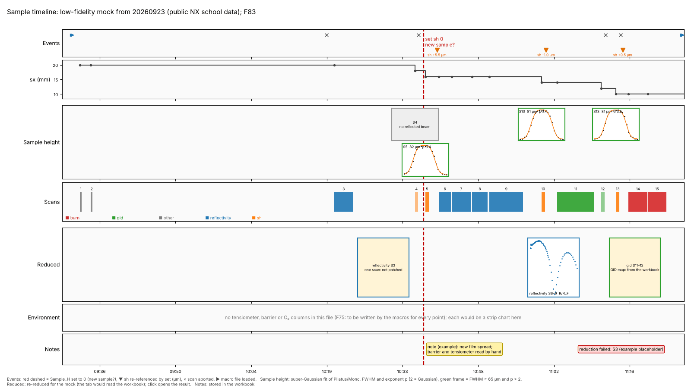

# Sample timeline tab: research (F83)

Owner, 2026-11-23: "it would be nice to have a sample timeline tab, with
sample height scan thumbnails, the 'sx' motions, new sample changes ('set sh
0' is almost always a new sample, occasionally used on the same sample but
after some conditions have changed), tensiometer, barrier, reduced data
thumbnails with colored text-box placeholders in the rare case where needed.
This sample timeline tab is a bit of a doozy, meaning a large subproject, so
put a subagent on it to do some research first."

This is research only: no application code was changed. Each finding is
marked **measured** (a run in this session, with the tool named) or
**read** (from code, documents or SPEC's conventions, not tested).

**Limits of this session.** The private sets (`sample_data/bu/`,
`sample_data/private/`) are **not present in this container**, so every
finding below comes from the public NX school file
(`sample_data/NX_school/2026sep/20260923`, 15 scans over 1.8 h) or from a
synthetic multi-day file made by repeating its scans. To run the same
measurements on the private files, `tests/tools/timeline_mock.py survey`
prints counts only: no comment text, values or names. It can be run on
them and its output quoted here (owner's rule; see "Tools" below).

Tools written for this research:

- `tests/tools/timeline_mock.py survey <files or folders>` prints, per
  file, the counts behind questions 1–3.
- `tests/tools/timeline_mock.py mock` draws `mock_nx.png` (this folder)
  from the public file.

---

## 1. What the SPEC files hold for a timeline

| Item | What is there (NX file) | How known |
|---|---|---|
| `#S` | number and command (`a2scan sh -2.2785 -2.1185 oh … 20 1`) | measured |
| `#D` | local date of the scan's start, 1 s; the file header's `#E`/`#D` pair gives the time zone (`lss_core.timing`) | measured, read |
| `#O0–9` | motor **names** only (`Sample_H`, `Sample_X`, …). No offsets and no mnemonics: the file has no `#o` lines | measured |
| `#P0–9` | the **user** position of every motor at the scan's start, names cut to 8 characters (`Sample_T`, `X_Pinhol`); the reader keeps them as `Par[scan][name]` | measured, read (`spec_routines.py`) |
| `#L` | columns. Old format: `Epoch` (steps within a scan reliable, base not; `timing.py`). New format: `Tstart`/`Tend`. The scanned motor's name comes first (`Sample_H`, `Det_Th`, `In_Ht`) | measured |
| `#C`, dated | `#C Wed Sep 23 10:37:39 2026.  <text>.`: 4 aborts, 29 macro files loaded (`do …`), **4 motor redefinitions** | measured (survey) |
| undated text | 57 slit-macro echo lines between scans (`s1v 0.01 0.01`, `s4h 8.5 8.5`): slit settings with no time, placed only by their order in the file | measured |
| scan footer | `Sum = … Ave.Mon./Time = … Ave.Temp. = 0C` after 13 scans: a temperature slot, 0 in every scan (no sensor) | measured |
| `#U` | none in the NX file. `#U Series` and `#U SeriesT0` are proposed (hand-off 05) and read by the reader when present | measured, read |
| `#A`, `#M`, `#Q`, `#W` | absorber, monitor gain, HKL, wavelength per scan | measured |

**Mnemonic to name.** Commands use mnemonics (`sh`) and the `#L` columns
use names (`Sample_H`). The mapping can be learnt per file from the scans
themselves: the first word after the command is the mnemonic, the first
`#L` column the name. NX: sh → Sample_H, oh → Out_Ht, dth → Det_Th,
ih → In_Ht (measured). sx → Sample_X is inferred from `#O`; sx is never
scanned in the NX file, so the file cannot confirm it.

### Is `set sh 0` visible?

**Yes, as a dated `#C` line.** SPEC's standard `set` macro writes
`<motor name> reset from <old> to <new>` through `comment`. The NX file
has four (measured; the text below is the file's):

| Time | Comment | Context |
|---|---|---|
| 10:37:39 | `Sample_H reset from -0.61 to 0.` | after sh scan 4 (aborted, no reflected beam) and slit changes; the **`set sh 0`** |
| 10:40:09 | `Sample_H reset from -2.204 to -2.1985.` | 2 min after sh scan 5, whose fitted centre is −2.2038 |
| 11:00:54 | `Sample_H reset from -2.1975 to -2.1985.` | 1 min after sh scan 10, centre −2.1973 |
| 11:15:28 | `Sample_H reset from -2.199 to -2.1985.` | 1 min after sh scan 13, centre −2.1992 |

So two kinds of `set` appear in the file, and they are easy to tell apart:

- **`set sh 0`** (new value exactly 0; old value −0.61, a 610 µm change):
  the zero of the half-cut, the owner's step 1;
- **re-referencing after an sh scan**: the surface centre found by the sh
  scan is made to read the nominal sh for the scan's Qz (−2.1985 at
  Qz = 0.018 Å⁻¹). These changes are 1–5.5 µm, and each follows an sh scan
  by 1–2 min.

**Not visible in `#P` or `#O` (measured).** `set` changes the user offset,
so the user position in `#P` stays nominal. In the NX file, Sample_H in
`#P`, divided by the `#Q` L value, is −122.0 to −122.3 mm·Å in all 12
scans with Qz > 0.01 Å⁻¹, before and after every reset. Sample height
follows Qz because the incident beam is tilted down; scans 1–2 at L ≈ 0
read Sample_H = 0. `#O` holds no offsets and dial positions are not
written, so the comment is the only trace of a `set`.

**How reliable (read, partly unverified).**

- The comment is written only when the `set` macro is used, and only into
  the data file that is open at the time.
- A macro that calls `chg_offset()` directly, or a site macro such as
  `cleanup_sh` (called at the end of `dppc_xr.do`), leaves no trace unless
  it calls `comment` itself. Whether the beamline's macros do this is not
  known (Q-TL-1).
- The comment carries the motor **name**, so the rule is
  `Sample_H reset from X to 0`, with the name taken from the file (see
  "Mnemonic to name" above).

**Is a `set sh 0` a new sample?** Not in the NX file, read in context. All
its macros are `dppc_*`, and the set falls between two sh scans 2 min
apart, after an sh scan that found no beam. That fits the owner's
"occasionally used on the same sample but after some conditions have
changed" (here, re-finding the surface after slit changes). The timeline
should therefore draw it as "set sh 0: new sample?", a guess the user
confirms or rejects with one click. The answer is stored as a note (§5).

**Other evidence of a sample change** that the file could give (proposed
heuristics, not tested on real sample changes; the public file has none):

1. a gap with no scans longer than N minutes (the chamber opened, the
   hutch entered);
2. the next sh scan, or a scan at L ≈ 0 (a half-cut), soon after it;
3. sx back at its starting value after a series of steps;
4. in future files, the oxygen column rising and the barrier or
   tensiometer columns jumping (F75).

None is decisive alone. An explicit line written by a macro would be (see
Q-TL-2).

### Environment columns

None today (measured, NX). The columns are `Epoch`, `Monb`, `Monp`,
`Pil300K`, `Vortex`, `Apex2`, `YAP`, `Pilatus`, `Pilatus1M`, `Mond`, `PSD`,
`Seconds`, `Monc`, plus H, K, L and the scanned motors. No motor named
like a tensiometer, barrier, oxygen or pressure reading appears in `#O`.
The footer's `Ave.Temp.` is always 0 °C. The owner's F75 says these
readings will be written as columns for every point. The survey looks for
names containing tens, barr, oxy, o2, temp, press or wilh, so it will
report them when they appear.

---

## 2. The sample-height scans

**Recognition (measured, NX: 4 of 15 scans).** The command is
`a2scan sh <a> <b> oh <c> <d> <n> <t>`: sample and output height rise
together, which matches the owner's description. The rule used is
`ascan`, `a2scan`, `dscan`, `d2scan` or `lup` with first motor `sh` and
a ≠ b. The `#L` columns are `Sample_H`, `Out_Ht`, H, K, L, `Epoch`,
counters, `Seconds`, `Monc`, `Pilatus`. `lss_core.series.infer` already
calls such scans 'align' when they fall inside a series.

**Signal.** The SPEC `Pilatus` column is the detector's ROI counter. In
sh scan 10 it is 0.87–0.90 of the whole frame at the peak points (frame
total / column = 1.11–1.15), and the background takes a larger share in
the wings (measured). So it is an ROI around the reflected beam, set in
the detector's software. The reader's own ROI on the images would need
the frames: 64 ms to read the 21 frames of one scan, uncached (measured).
The thumbnail can use the column for free (Q-TL-4).

**Fit (measured, `timeline_mock.fit_sh`).** I = A exp(−|(h−h₀)/w|^p) + b,
fitted to Pilatus/Monc with Poisson errors, started at p = 2 and p = 4,
keeping the better fit:

| Scan | sx (mm) | FWHM | p | χ²/dof | χ²/dof of a Gaussian | Fit time |
|---|---|---|---|---|---|---|
| 4 (aborted, 15 points) | 18 | — no reflected beam (peak < 10σ) | | | | <1 ms |
| 5 | 16 | 82.1 µm | 3.36 ± 0.08 | 2.6 | 28.2 | 6 ms |
| 10 | 14 | 81.1 µm | 3.38 ± 0.08 | 3.1 | 28.0 | 5 ms |
| 13 | 10 | 81.4 µm | 3.53 ± 0.09 | 5.2 | 33.8 | 5 ms |

- The FWHM lies inside the owner's 65–110 µm. The profiles are clearly
  flatter than a Gaussian: p ≈ 3.4, and a Gaussian's χ² is ten times
  worse.
- χ²/dof of 2.6–5.2 means the super-Gaussian is not the exact shape (the
  shoulders differ). It is good enough for a width and a flatness number,
  not for a precise form.
- **A guard is needed.** Without the "no reflected beam" test, aborted
  scan 4 (no beam) "fitted" with p = 20 ± 760.
- The fit belongs in `lss_core.peaks` beside `fit_scan`, as the F78 item.
  Its tests would use synthetic super-Gaussians of known w and p.

**Cost of one thumbnail (measured).**

- Reading the whole SPEC file: 9 ms for the NX file, 1.4 s for a
  synthetic 3,000-scan file of 10.6 MB.
- The fit: about 5 ms.
- Drawing a 120 × 80 px curve: 0.04 ms with QPainter into a QPixmap,
  6.4 ms with a matplotlib Agg figure.
- 800 sh scans in a multi-day file: about 4 s of fitting, done in the
  background and cached per (scan, point count).

---

## 3. sx motions

- **Source (measured).** `Sample_X` in each scan's `#P2`, the position at
  the scan's start. It is never a column in the NX file.
- **Moves not written.** Moves between scans (`umv sx …`) leave no trace
  except the next scan's `#P`, so a move is dated only to "between the end
  of scan n and the start of scan n+1".
- **NX file (measured).** sx changes 5 times in 1.8 h (20 → 18 → 16 → 14
  → 12 → 10 mm, 2 mm steps); 4 of the 5 changes come just before an sh
  scan. That fits "a new sh scan after a large sx move" (owner).
- **Within a scan (read).** The NX file loads macros named
  `lscan_sx.mac` and `dthscan_sx.mac`, which suggest scans that move sx
  between points. Their files are not in the repository, so this is not
  known. If they move sx between points, sx is a column, or changes within
  a scan, and the lane must draw it as a ramp (Q-TL-7).

---

## 4. Reduced-data thumbnails from the workbook

**What the workbook holds (read, `lss_core/workbook.py`).**

- *Saved*: one row per result, with id, `saved` (the wall-clock time of
  saving, **not** of the data), kind, scans, label, version, note, the
  columns, settings, series, recipe, stale and origin.
- *Data*: the vectors, one row per point.
- *Fits*, *Trends* and *Maps*: fitted peaks, trends over time, and grids.

So a reduction is placed on the time axis by its **scans** (their SPEC
times), not by `saved`.

**Speed (measured, synthetic workbook of 300 reflectivity results × 100
points, 1.9 MB).**

- Opening with `Workbook()`: 3.0 s.
- `results()`: 5 ms.
- `data(rid)` for one result: **0.48 s**, because it scans every Data row.
  300 thumbnails done that way would take about 145 s.
- One pass over all Data rows, grouped by id: 0.37 s. With openpyxl in
  read-only mode the same pass took 2.0 s, which was slower.

So thumbnails can be drawn without re-reducing, if the timeline reads the
Data sheet once (or uses the window's open `Workbook`). The pixmaps can be
cached by the result's `content` digest, which already exists. GID maps:
the Maps grid, drawn as a small image. Burn tests: the Trends rows (a
verdict colour) rather than a curve.

**Placeholders.** These are coloured text boxes where a thumbnail cannot
be drawn:

- a series with no saved result yet ("not reduced");
- a reduction that failed;
- a stale result ("series grew since saved"; the Saved `stale` field);
- a single scan that is not patched.

The mock shows two of these. Whether "placeholders" in the owner's
request means these, user notes, or both is Q-TL-5.

---

## 5. Design proposal

**Layout.** A tab in ngui, "Timeline", placed before Scans
(`docs/gui/prototype.md`; that file is left to the ngui agent). It holds
lanes on one horizontal time axis (local clock; days shown when the range
spans midnight), each with a fixed label at the left:

1. **Events**:
   - `set sh 0` as a red line through all lanes, labelled "new sample?";
     a click confirms or rejects it;
   - sh re-referencing (µm), aborts, macro files loaded, SPEC session
     restarts (a new `#E`), gaps longer than N min;
   - slit and absorber changes, optional.
2. **sx** (and other chosen motors from `#P`): step lines.
3. **Sample height**: thumbnails with FWHM and p.
   - A frame colour gives the verdict once Q-TL-6 is answered: green when
     FWHM ≥ 65 µm and p > 2, red otherwise, grey for no beam.
   - Zoomed out, each scan becomes a coloured dot.
   - Time since the last sh scan, and sx moved since then, can be shaded:
     the owner's 30 min and "large sx move" rules.
4. **Scans**: bars from start to end, coloured by series kind (reflectivity,
   GID, XFNTR, burn, sh, other). Aborted scans are paler. The tooltip
   gives the command, the number of points and the series.
5. **Reduced**: thumbnails of the saved results (R/R_F, GID map, burn
   verdict), placed at their scans' time; the version and note go in the
   tooltip (rule 9). Placeholders as in §4.
6. **Environment** (F75): one strip chart per chosen column (tensiometer,
   barrier, O₂). The lane is empty, and says why, until the columns exist.
7. **Notes**: coloured text boxes the user adds at a time or over a span.
   A confirmed or rejected "new sample?" becomes one of them.

**Interaction.**

- Wheel to zoom on the time axis only; drag to pan; double-click to fit
  everything; a "today / this sample / all" menu.
- Level of detail: thumbnails when the visible range is under about 3 h,
  dots and bars above that.
- Clicking an sh thumbnail opens the scan in the Scans tab with the fit.
- Clicking a reduction opens the saved result (Reflectivity or GID tab)
  with its provenance strip.
- Clicking a bar selects the scan or its series in the selection panel.
- Hover tooltips everywhere. The notes lane offers "Add note…" from its
  context menu.

**Live updates.** The window already re-reads the growing file
incrementally (`MainWindow.liveRead` returns the new scans and the scans
that grew). The timeline model appends events and items for those, and
refits the sh scan that grew. Nothing is rebuilt, and the view keeps its
zoom unless it was following the end ("follow" toggle, like a log view).

Reset comments sit after the previous scan's data, so they are seen when
that block is re-read. `spec_routines` already collects aborts and series
lines from the same place (the `extras` loop); resets would join them, as
`Par[n]['Resets']`. One caveat: comments in the file header, before the
first `#S`, belong to no scan block and need their own list.

**Thousands of scans (measured, synthetic 3,000-scan file).**

- `specread`: 1.44 s; series inference: 0.05 s; finding the `#C` resets:
  15 ms.
- A QGraphicsScene with 3,000 bars and 1,100 thumbnail pixmaps: 0.05 s to
  build; rendering everything takes 9 ms, a 2 h window 2 ms (offscreen).
- The cost is the sh fits (about 5 ms each) and workbook reads (one pass:
  0.4 s per 300 results). Both are cached and done off the GUI thread.

**Rendering choice.**

- **QGraphicsScene / QGraphicsView**: no new dependency; designed for many
  items, with zoom and pan, item tooltips and clicks, and level of detail
  through each item's `paint`. Measured as fast as above. Thumbnails are
  drawn by QPainter (0.04 ms each).
- **matplotlib** (installed): 200 inset thumbnails took 1.0 s to build,
  0.25 s to draw, and 0.16 s to redraw after each zoom step (measured).
  That is sluggish at 1,000 items, and its click and tooltip handling is
  poor.
- **pyqtgraph**: not installed. It would mean a new runtime dependency to
  pin in `requirements.txt` and `packaging/requirements-build.txt` and to
  check in the PyInstaller build. It buys little here, because the lanes
  are mostly items, not dense curves.

**Recommendation**: QGraphicsScene, with a small custom time axis. A
dependency-free route; nothing to note for packaging.

**Storage of notes.** The workbook has seven sheets, and the owner asked
for fewer than eight (2026-11-21), so no new sheet. Proposal: a note is a
**Saved row of kind `note`**:

- `scans`: the scans it is attached to, if any;
- `label`: a short title;
- `note`: the text;
- `settings` JSON: `{"t0": …, "t1": …, "lane": …, "colour": …,
  "event": "set-sh-0 confirmed new sample"}`.

It then gets ids, versions, the filter and Excel sorting for free. The
alternative, a `timeline` section of the Settings sheet, loses versions
and the scan link.

**Where the logic lives.**

- `lss_core/timeline.py` (no Qt): events from the file (resets, aborts,
  macro loads, gaps, session restarts), the mnemonic table, sh scans and
  their fits, sx steps, scan spans, and the placement of workbook results.
  It is testable on the NX file and on synthetic files.
- The tab itself is only a view of that model.

---

## 6. Phases and effort

The sizes are rough, in working sessions of the main agent (one session
is about one tranche of code, tests and docs).

| Phase | Content | Depends on | Size |
|---|---|---|---|
| 0 (done) | This research, mock, survey tool | — | — |
| 1a | F78 super-Gaussian fit in `lss_core.peaks` with the no-beam guard; synthetic known-truth tests; shown in the Scans tab — **built 2026-11-24** (`peaks.fit_super_gaussian`, SpecPlot; `tests/test_super_gaussian.py`) | — | 1 |
| 1b | `lss_core/timeline.py`: events (`reset`, abort, `do`, session restart, gaps), mnemonic map, sh scans, sx steps, scan spans; reset comments collected in `spec_routines` (`Par['Resets']`, with a test); incremental update — **built 2026-11-24** (`lss_core/timeline.py`, `tests/test_timeline.py`). Changed from the plan: it reads the dated `#C` lines itself instead of through `spec_routines`, because the macro loads sit in the file header, which belongs to no scan block; and it is rebuilt rather than updated in place (36 ms for the NX file) | — | 1–2 |
| 1c | ~~ngui~~ **main-window** Timeline tab (owner, 2026-11-24; **first version built 2026-11-24**: `timelineview.py`, lanes, zoom, pan, tooltips, click, sh thumbnails; notes to come): QGraphicsView lanes (events, sx, sh thumbnails, scans), zoom and pan, level of detail, tooltips, click to open the scan; live append | ngui shell, 1a, 1b | 2–3 |
| 1d | Reduced lane from the workbook (one-pass read, pixmap cache by `content`), placeholders, click to open the result; notes as Saved rows of kind `note` with Add/Edit; "new sample?" confirm/reject | 1c | 1–2 |
| 2 | Environment lanes: any column chosen as a strip chart, sharing F75's burn panels; synthetic environment columns (`tests/synthetic/`) so it can be built before the macros write them | F75 columns' names; can be started with synthetic data | 1 |
| 3 | Sample change from evidence: the O₂ rise and barrier or tensiometer jumps, gaps, half-cuts; or an explicit macro line (Q-TL-2); several SPEC files of one beamtime on one axis (Q-TL-3) | owner's answers | 1–2 |

The first usable version on today's files is phases 1a–1c, about 4–6
sessions. With the reductions and notes (1d) it is about 6–8 sessions.

Rule 11 applies as each phase lands:

- the tooltips;
- `MANUAL_NOTES.md`;
- inventory entries in `docs/gui/inventory/` with their ids in a
  `workflows.yaml` step (`day-ref` steps day.sh and day.change gain the
  timeline);
- an `OUTPUT_DECISIONS.md` row for the verdict thresholds, and for the
  no-beam guard (10σ);
- a `COMPARISONS.md` row for the super-Gaussian against `fit_scan`.

---

## 7. Questions for the owner

Only the questions whose answers change the design.

- **Q-TL-1.** Is the sample height always redefined with SPEC's `set`,
  which writes `#C … Sample_H reset from X to 0.`? Or do some macros
  (`cleanup_sh` at the end of `dppc_xr.do`, alignment macros) change the
  offset silently with `chg_offset`? Silent changes cannot be detected,
  and the timeline would then depend on heuristics.
- **Q-TL-2.** Would you accept a macro-written line that marks a new
  sample explicitly? For example,
  `#U Sample id=<n> name=<…>` (or a `#C NewSample …` comment) written by a
  `newsample` macro, alongside the `#U Series` proposal (hand-off 05).
  With it the "new sample?" guess becomes a fact. Without it, every
  `set sh 0` is a question for the user to confirm.
- **Q-TL-3.** Does one beamtime span several SPEC files (one per day, as
  the NX name `20260923` suggests)? Should the timeline join them on one
  axis? Each SPEC file has its own workbook, so a beamtime view must read
  several.
- **Q-TL-4.** For the sh-scan thumbnail and its FWHM and flatness, is
  SPEC's `Pilatus` ROI counter good enough? In NX scan 10 it holds
  87–90 % of the frame at the peak. Or must it be the reader's own
  reflected-beam ROI from the frames, which costs about 64 ms per scan to
  read?
- **Q-TL-5.** The "coloured text-box placeholders": are they
  (a) your own notes, (b) stand-ins where a reduced-data thumbnail cannot
  be drawn (not reduced, failed, stale), or (c) both? Should the program
  add automatic flags too ("sh scan narrower than 65 µm", "40 min since the
  last sh scan")?
- **Q-TL-6.** Thresholds for the sh-scan verdict colour: FWHM ≥ 65 µm, and
  which exponent? The NX scans give p = 3.4–3.5 (a Gaussian is 2). Is
  p > 2.5, or 3, "flat-ish"? Or should only the numbers be shown, with no
  colour?
- **Q-TL-7.** Do `lscan_sx` / `dthscan_sx` move sx during a scan? What
  sx change counts as "large" (the NX steps are 2 mm)? Should other
  motors (sy, the trough or barrier motor, if it is a SPEC motor) get
  lanes too?
- **Q-TL-8.** The future environment columns: their names and units
  (surface pressure in mN/m or the raw balance reading; barrier position
  or area; O₂ in % or ppm). Are they written in every scan or only in some
  macros? Is the O₂ rise on opening the chamber sharp enough to mark a
  sample change by itself?

---

## Doubtful points

- That SPEC's `set` always writes the reset comment, and that site macros
  do not change offsets silently, was read from SPEC's convention, not
  checked on the beamline's macros (Q-TL-1).
- Whether the one `set sh 0` in the NX file is a new sample is a reading of
  context. It is probably not: it is the "same sample, conditions changed"
  case.
- The 3,000-scan timings come from the NX scans repeated 200 times, so
  they hold the same mix of scans. Real multi-day files may differ in
  the size of their scans. The owner's files hold about 8,000 scans in
  total (`timing.py`, read).
- That the `Pilatus` column is an ROI was inferred from its ratio to the
  frame totals, not from the detector's configuration.
- Nothing was measured on private data in this session; the survey tool
  is ready for it.
