# The workflow map

Generated by `python tests/tools/gui_map.py` from `docs/gui/workflows.yaml` and `docs/gui/inventory/*.yaml`; do not edit by hand. Schema and plan: `docs/gui/README.md`. Questions for the owner: `docs/gui/questions/workflows.md`.

In the flowcharts, rounded green boxes are steps that are automatic today; diamonds are the user's decisions. In the tables, a control marked `?` is not (yet) in the inventory.

| Workflow | Priority | Steps | Automatic today (yes / partly / no) | Issues |
|---|---|---|---|---|
| [day-ref](#day-ref) | 0 | 12 | 0 / 3 / 9 | 7 |
| [burn-ref](#burn-ref) | 1 | 11 | 4 / 4 / 3 | 17 |
| [burn-gid](#burn-gid) | 1 | 11 | 4 / 5 / 2 | 12 |
| [burn-fluo](#burn-fluo) | 1 | 7 | 0 / 3 / 4 | 9 |
| [reflectivity](#reflectivity) | 2 | 15 | 4 / 5 / 6 | 19 |
| [gid](#gid) | 3 | 14 | 1 / 8 / 5 | 17 |
| [xfntr](#xfntr) | 4 | 13 | 2 / 4 / 7 | 12 |
| [exafs](#exafs) | 5 | 7 | 1 / 2 / 4 | 9 |
| [gisaxs](#gisaxs) | 6 | 3 | 0 / 0 / 3 | 3 |
| [cuts](#cuts) | 6 | 4 | 0 / 2 / 2 | 4 |
| [alignment](#alignment) | 6 | 5 | 0 / 2 / 3 | 4 |
| [mca-look](#mca-look) | 6 | 3 | 0 / 0 / 3 | 2 |
| [flex-plot](#flex-plot) | 6 | 2 | 0 / 0 / 2 | 0 |
| [session](#session) | 6 | 9 | 4 / 3 / 2 | 10 |

## day-ref — A day of reflectivity at the beamline (the order of the workflows)

**Priority** 0. **Known from:** owner 2026-11-23 (physics_notes, 'A typical reflectivity day'; F75-F80).

**Experiment.** The owner's answer to Q-GEN-2 (2026-11-23), for a day of reflectivity only: align the sample, check that its surface is flat, burn-test unless a safe absorber is already known, measure, reduce, tune the macro, recheck the surface every 30 min or after a large sx move, compare the reduced curves for stability, and start again with the next sample. Days with GID or fluorescence are still to be described. Each step names the workflow of this map that carries it out.

**Recognised by.** not a series: the order of series in a SPEC file (half-cut or sh scans, burn scans, reflectivity series, sh scans again) and the time between them. Phase 3 (contextual GUIs, F73) would use it to offer the next reduction.

**Outputs:** the workbook: burn tests, reflectivities and sh scans of the day, in time order. **Script:** `none (an order of workflows)`. **Questions:** Q-GEN-2.

```mermaid
flowchart TD
    day_open["open: Open the SPEC file (File &gt; Open Spec File); the scans, the…"]
    day_rough["rough: Rough alignment with a half-cut (workflow 'alignment'); to…"]
    day_sh["sh: Sample height scan at a fixed incident angle, sample and de…"]
    day_sh_d{"Surface flat enough?"}
    day_burn_known["burn-known: Is a safe absorber already established (effectively no chan…"]
    day_burn_known_d{"Burn test needed?"}
    day_burn["burn: Burn test (workflow 'burn-ref'): click the burn scan, Selec…"]
    day_burn_d{"No change over about 400 s?"}
    day_macro["macro: Run the macro of the main experiment (reflectivity here; GI…"]
    day_reduce["reduce: Reduce (workflow 'reflectivity'): select the scans, Select…"]
    day_reduce_d{"R/R_F continuous?"}
    day_stats["stats: Decide whether the statistics are good enough; if not, repe…"]
    day_stats_d{"Statistics good enough?"}
    day_tune["tune: Tune the macro from the result: counting times for reflecti…"]
    day_recheck["recheck: After 30 min or more, or a large sx change: another sample…"]
    day_recheck_d{"Surface checked recently enough?"}
    day_compare["compare: Keep measuring; compare reduced curves from different place…"]
    day_change["change: Sample change: the chamber is opened (the oxygen in the tro…"]
    day_change_d{"Next sample?"}
    day_open --> day_rough
    day_rough --> day_sh
    day_sh --> day_sh_d
    day_sh_d -- "no: another place or a new preparation" --> day_rough
    day_sh_d -- "yes" --> day_burn_known
    day_burn_known --> day_burn_known_d
    day_burn_known_d -- "no: a safe absorber is known" --> day_macro
    day_burn_known_d -- "yes" --> day_burn
    day_burn --> day_burn_d
    day_burn_d -- "no: change the absorber, repeat" --> day_burn
    day_burn_d -- "yes" --> day_macro
    day_macro --> day_reduce
    day_reduce --> day_reduce_d
    day_reduce_d -- "no: change Qoff or Qc" --> day_reduce
    day_reduce_d -- "yes" --> day_stats
    day_stats --> day_stats_d
    day_stats_d -- "no: repeat the macro" --> day_macro
    day_stats_d -- "yes" --> day_tune
    day_tune --> day_recheck
    day_recheck --> day_recheck_d
    day_recheck_d -- "no: 30 min or more, or a large sx move" --> day_sh
    day_recheck_d -- "yes" --> day_compare
    day_compare --> day_change
    day_change --> day_change_d
    day_change_d -- "yes: start again" --> day_rough
    classDef auto fill:#e6f4ea,stroke:#4a8;
```

| Step | Do | Where | Controls | User decides | Automatic | Could be automatic | Known from | Issues |
|---|---|---|---|---|---|---|---|---|
| day.open (shared.open) | Open the SPEC file (File > Open Spec File); the scans, the series and the detector folders are read | File menu | `actionOpen_Spec_File` | which SPEC file | partly | reopen the last file and its workbook settings (F66 to-do); offer the series' reductions at once (F60) | code; run 2026-11-22 | Opening a file with Pilatus images presets the reflectivity ROI (21,11), the background offset (0.5), Qc (0.0217) and the absorber factor (code, openSpecFile ~l.744); nothing on screen says so A missing detector folder opens a directory chooser (F27) |
| day.rough | Rough alignment with a half-cut (workflow 'alignment'); to become a sample height scan with a horizontal beam, which also measures the beam profile. The sample-height offset is set to read zero on that scale | SPEC (the scan); SpecPlot (looking at it) | `scanListWidget`, `spXComboBox`, `spYComboBox` | the height offset (set in SPEC) | no | the half-cut's edge and beam size fitted and shown (F43; lss_core half-cut fit built, no data yet) | owner 2026-11-23 |  |
| day.sh | Sample height scan at a fixed incident angle, sample and detector rising together (workflow 'alignment'); scans from a few places or conditions reviewed together by selecting them together | SpecPlot (several scans selected) | `scanListWidget`, `spYComboBox`, `spNCheckBox` | whether the surface is flat enough: FWHM about 65 µm or more (up to about 110 µm in the 89 mm trough), flatter than a Gaussian ('more squashed than a gaussian') | no | a super-Gaussian fit with FWHM and exponent, flagged against 65 µm, beside the sample's earlier sh scans (F78) | owner 2026-11-23 | Only the shape is judged today, by eye; no number is given for width or flatness |
| day.burn-known | Is a safe absorber already established (effectively no change over about 400 s, proven, not predicted)? Then no burn test | the user's knowledge (no record in the reader) |  | whether to burn-test | no | the safe absorbers established earlier in the beamtime, kept per sample, subphase and energy (owner 2026-11-23: they 'depend heavily on the sample and the subphase and energy but per beamtime there is no change'), offered when a new sample starts | owner 2026-11-23 |  |
| day.burn | Burn test (workflow 'burn-ref'): click the burn scan, Select All, Burn Test; change the absorber and repeat until there is effectively no change over about 400 s; tell a changing sample from beam damage | left panel; Pilatus tab > Burn Test; Burn test dialog | `scanListWidget`, `imageSelectAllCheckBox`, `pilBurnPushButton`, `burnResultLabel` | the next absorber; whether the sample is changing by itself | partly | burns at several absorbers compared on dose and time axes (F76); barrier, tensiometer and oxygen beside the trend (F75); a safe absorber predicted from a short high-flux test (F77, research) | owner 2026-11-23 | Three actions in three places (scan list, Select All, a Pilatus-tab button) before any result |
| day.macro | Run the macro of the main experiment (reflectivity here; GID or XFNTR on other days) for a first data set | SPEC |  | the macro and its parameters | no |  | owner 2026-11-23 |  |
| day.reduce | Reduce (workflow 'reflectivity'): select the scans, Select All, Ref Patch, review the joins; Qc of water unless the subphase is lighter or denser; Qoff tweaked until R/R_F is continuous apart from one or two outliers | left panel; Pilatus tab > Ref Patch; Ref Patch window; Reflectivity tab | `scanListWidget`, `seriesComboBox`, `imageSelectAllCheckBox`, `pilRefPatchPushButton`, `refpatch.nextPushButton`, `refQcLineEdit`, `refQoffLineEdit`, `refRRFCheckBox` | Qc, Qoff, the joins | partly | the whole series and its frames taken in one action (D55 Series list exists); Qoff proposed from continuity, Qc from the subphase (F79) | owner 2026-11-23 | The owner selects the scans by hand, then Select All: the Series list (D55) selects a whole series in one action but is new and not yet tried by people (owner 2026-11-23); frames still need Select All Qc is the subphase's ('pure water is not very interesting and does not pay the bills'), close to water's ('rarely very wrong, depending on which decimal place'); the third digit still moves the level of R/R_F by about four times its relative size (physics_notes 2026-11-23) |
| day.stats | Decide whether the statistics are good enough; if not, repeat the macro (several scans) and have the reader sum the repeats' ROIs | SPEC (the repeat); Ref Patch identical-scans step (the merge) | `refpatchsamescan.mergePushButton` | whether to repeat, and whether to sum the repeats | no | repeats recognised and summed by counts and monitors by default, the choice shown (F81) | owner 2026-11-23 | The merge of identical scans averages the per-monitor curves with equal weights (code, pilRefSSMerge), rather than summing counts and monitors |
| day.tune | Tune the macro from the result: counting times for reflectivity, which angles to search for GID | SPEC |  | counting times, angles | no | counting time per segment proposed from the counts and errors of the first data set (guess) | owner 2026-11-23 |  |
| day.recheck | After 30 min or more, or a large sx change: another sample height scan, judged as before | SPEC; SpecPlot | `scanListWidget`, `spYComboBox` | whether to continue on this place | no | a reminder from the time since the last sh scan or a large sx change (live mode) | owner 2026-11-23 |  |
| day.compare | Keep measuring; compare reduced curves from different places and over time to check that the sample is stable | Reflectivity tab (Add Files) or the workbook | `refAddFilePushButton`, `refRefFileListWidget` | whether the sample is stable | no | the workbook's saved reflectivities overlaid by series, time or sx in one action, with ratios (F80) | owner 2026-11-23 |  |
| day.change | Sample change: the chamber is opened (the oxygen in the trough enclosure rises; some chambers have no sensor), the shutter closed and the hutch opened, tensiometer readings taken, the barrier moved | the hutch |  | when to change | no | oxygen, tensiometer and barrier read from the SPEC file once written per point (F75) | owner 2026-11-23 |  |

## burn-ref — Burn test on a reflectivity frame series

**Priority** 1. **Known from:** owner 2026-11-21 (D54, physics_notes "Burn tests"); code; tests/test_gui_burn_trends.py; docs/handoff_out/07-burn-trends.md.

**Experiment.** The sample is held at one reflectivity condition (Det_Th 0, one Qz, one absorber setting) and exposed repeatedly; the standard burn scan is `ascan ih a a n t`, a motor scan that does not move (owner, 2026-11-21), with one Pilatus frame per point (e.g. 21 frames). Purpose: whether the specular ROI intensity changes with time under the beam, i.e. whether the exposure planned for the reflectivity run damages the film (owner, D54). No real reflectivity burn is in the repository; a synthetic one (tau = 400 s) is. Owner 2026-11-23: after the first burn, the absorber is changed and the test repeated until there is effectively no change over about 400 s (proven, not predicted); once an absorber level is established, burn tests are not repeated, so they do not always precede the real data. Sometimes the sample changes by itself and is not being burnt.

**Recognised by.** series kind 'burn' (`series.is_burn`: ascan ih, start = end, >= 3 points, owner 2026-11-21) with Pilatus frames; reflectivity geometry when Det_Th is about 0 (`burn.is_gid` false). With macros writing `#U Series kind=burn`, the kind is given, not guessed. Detector Pilatus; all frames at one Qz and one Qxy (the window checks this).

**Outputs:** workbook: Saved (kind 'burn test'), Data (time, quantity +- error), Trends (one row per quantity x model); Messages/Script pane: exp.burn(...). **Script:** `Experiment.burn(scan, time='clock', threshold=0.05, slit=(21, 11), bg_offset=0.5, direction='H')`. **Questions:** Q-BURN-1; Q-BURN-2; Q-BURN-4; Q-BURN-5; Q-GEN-1.

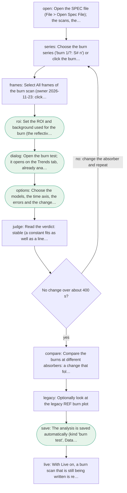

| Step | Do | Where | Controls | User decides | Automatic | Could be automatic | Known from | Issues |
|---|---|---|---|---|---|---|---|---|
| burn-ref.open (shared.open) | Open the SPEC file (File > Open Spec File); the scans, the series and the detector folders are read | File menu | `actionOpen_Spec_File` | which SPEC file | partly | reopen the last file and its workbook settings (F66 to-do); offer the series' reductions at once (F60) | code; run 2026-11-22 | Opening a file with Pilatus images presets the reflectivity ROI (21,11), the background offset (0.5), Qc (0.0217) and the absorber factor (code, openSpecFile ~l.744); nothing on screen says so A missing detector folder opens a directory chooser (F27) |
| burn-ref.series (shared.series) | Choose the burn series ('burn 1/?: S# n') or click the burn scan | left panel | `seriesComboBox`, `seriesWholeCheckBox`, `scanListWidget`, `scansLineEdit` | which burn scan; whether it is a reflectivity or a GID burn is not shown in the list | partly | select the newest series of the kind the user works on; in live mode follow it (built for whole-series selections, L3) | run 2026-11-22 (NX file lists 'burn 1/?: S# 14' and 'burn 1/?: S# 15'); code | Nothing offers the burn test when a burn series is chosen (TODO: offer it automatically, F60) The list does not say whether the burn is at reflectivity or GID geometry |
| burn-ref.frames (shared.frames) | Select All frames of the burn scan (owner 2026-11-23: click the burn scan, Select All, then Burn Test) | left panel (image list, labelled 'Pilatus:' or 'Vortex:') | `imageListWidget`, `imageSelectAllCheckBox` | all frames (usual); leaving frames out is possible | no | select all frames of a whole-series selection by default; show a movie instead of tiles (F69) | owner 2026-11-23; code | Selecting all frames draws every frame as a tile on the Pilatus tab (owner 2026-11-22: more than 6 tiles is too many, F69) Selecting frames switches to the Pilatus tab (2) or the MCA tab (5) (code) |
| burn-ref.roi | Set the ROI and background used for the burn (the reflectivity ROI) and the direct-beam position | Reflectivity tab (ROI fields) and Pilatus tab (DB Pos, bad pixels) | `refSlitLineEdit`, `refBGOffLineEdit`, `refBGDirComboBox`, `pilSpecCheckBox`, `pilDBPosLineEdit`, `pilBPCiteSpinBox`, `pilBPCfacSpinBox` | ROI size (default 21,11 px), background offset (0.5 deg) and direction (H); DB position from SPEC (default) or typed | yes | ROI close-up of the frames with the box drawn (F71), in the burn dialog itself | code (burnArguments reads the Reflectivity tab's fields) | The burn ROI is set on the Reflectivity tab, which the burn dialog neither shows nor mentions: a hidden dependency across tabs No view of the ROI on the frames before the analysis (F71) |
| burn-ref.dialog | Open the burn test; it opens on the Trends tab, already analysed | Pilatus tab > Burn Test; Burn test dialog | `pilBurnPushButton`, `burnTabWidget`, `burnTrendPlotWidget`, `burnResultLabel` |  | yes | open (or offer) it when a burn series is selected (F60) | test tests/test_gui_burn_trends.py; code (pilBurnTest) | Refused with a message when frames of several scans or several Qz are selected; comparing two burns needs two dialogs one after the other Burn Test sits on the Pilatus tab among GID/GISAXS/cut actions |
| burn-ref.options | Choose the models, the time axis, the errors and the change threshold; Analyse re-runs | Burn test dialog > Trends | `burnConstantCheckBox`, `burnLinearCheckBox`, `burnExponentialCheckBox`, `burnDoubleExponentialCheckBox`, `burnTimeComboBox`, `burnErrorsComboBox`, `burnThresholdSpinBox`, `burnAnalysePushButton` | models (all four by default), time clock (default, owner 2026-11-21) or exposure, errors auto (counting for reflectivity), threshold 5 % | yes |  | owner 2026-11-21 (D54: four models by AICc, 5 %, wall time); test tests/test_gui_burn_trends.py | Options are kept as a preference, so a changed threshold silently carries over to the next burn (code, burnOptions) |
| burn-ref.judge | Read the verdict: stable (a constant fits as well as a line) or changing, the best model, the 95 % confident time to a 5 % change | Burn test dialog > Trends (summary beside the panel; details in the label's tooltip) | `burnResultLabel`, `burnTrendPlotWidget` | which absorber to change to and repeat, until no change over about 400 s (owner 2026-11-23); whether the sample is changing by itself rather than being damaged | partly | state the verdict against the planned reflectivity exposure (needs the plan; F39 macro lines) | owner 2026-11-21 ("flat line as good as a line means a good regime"; "a confident time for < 5 % change") | No dose axis: burns at different absorbers cannot be put on one curve (TODO, hand-off 07; F76) The barrier position, tensiometer and oxygen readings are not shown beside the trend (F75) |
| burn-ref.compare | Compare the burns at different absorbers: a change that follows the dose is beam damage, one that follows time is the sample itself | not in the reader (one burn dialog at a time) |  | damage or a changing sample; which absorber is safe | no | the burns of a sample on dose and time axes in one view (F76); a safe absorber predicted from a short high-flux test (F77, research) | owner 2026-11-23 (the need); physics_notes 2026-11-23 (dose versus time, a derivation) | Needs several burn scans in one analysis; the dialog refuses frames of several scans |
| burn-ref.legacy | Optionally look at the legacy REF burn plot | Burn test dialog > Legacy | `pdburn.refPushButton` |  | no |  | code (pilRefBurn); test tests/test_gui_burn_trends.py | The legacy tab's REF button and GID list are actions on the Legacy tab only; their use today is unknown (Q-BURN-4) |
| burn-ref.save (shared.workbook) | The analysis is saved automatically (kind 'burn test', Data and Trends sheets); Save adds a version with a note | Save button beside each Export; GID menu 'Save to workbook' | `burnSavePushButton` | whether to add a 'user' version with a note | yes |  | owner 2026-11-22 (D56); test tests/test_gui_workbook.py (burn saved when done) | Automatic saves report in the status bar only; there is no view of the workbook inside the reader |
| burn-ref.live (shared.live) | With Live on, a burn scan that is still being written is re-analysed as frames arrive (the open dialog follows) | left panel, beside Update Specfile | `liveCheckBox`, `speUpSpeFilePushButton` | live on or off | partly | turn Live on when the file is still growing (a series 'in progress') | test tests/test_gui_live.py (a growing burn scan is remade live) | Live stops by itself only for series with #U Series lines (L4); guessed series need a manual untick |

## burn-gid — Burn test on repeated GID frames

**Priority** 1. **Known from:** owner 2026-11-21 (D54, F22a 4); code; tests/test_gui_burn_trends.py; docs/handoff_out/07-burn-trends.md; run 2026-11-22.

**Experiment.** The sample is held at one GID condition (one Det_Th, one Qz level) and exposed repeatedly by an `ascan ih a a n t` that does not move (owner, 2026-11-21); one Pilatus frame per point. Public example: NX school scans 14 and 15, 21 frames of 10 s each, same spot and geometry, absorber 12 then 8 (about 4.1 x the flux). Wanted: the strongest Bragg peak's integrated intensity, position and width against time, each on its own panel with a right axis in percent (owner, 2026-11-21); a relative change matters, so absolute sigmas weigh less (owner, same day).

**Recognised by.** series kind 'burn' (`series.is_burn`) with Pilatus frames at Det_Th > 1 deg (`burn.is_gid`); `#U Series kind=burn` once the macros write it. The private GID file lists further burn scans (23, 35, 51, ...; frames not on disk).

**Outputs:** workbook: Saved (burn test), Data (time; intensity, centre, FWHM +- error), Trends. **Script:** `Experiment.burn(scan, estimator='template', time='clock', qxy_range=None, limit=None)`. **Questions:** Q-BURN-1; Q-BURN-2; Q-BURN-4; Q-BURN-6.

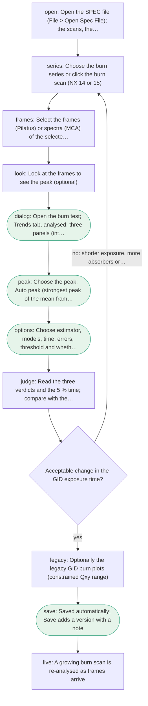

| Step | Do | Where | Controls | User decides | Automatic | Could be automatic | Known from | Issues |
|---|---|---|---|---|---|---|---|---|
| burn-gid.open (shared.open) | Open the SPEC file (File > Open Spec File); the scans, the series and the detector folders are read | File menu | `actionOpen_Spec_File` | which SPEC file | partly | reopen the last file and its workbook settings (F66 to-do); offer the series' reductions at once (F60) | code; run 2026-11-22 | Opening a file with Pilatus images presets the reflectivity ROI (21,11), the background offset (0.5), Qc (0.0217) and the absorber factor (code, openSpecFile ~l.744); nothing on screen says so A missing detector folder opens a directory chooser (F27) |
| burn-gid.series (shared.series) | Choose the burn series or click the burn scan (NX 14 or 15) | left panel | `seriesComboBox`, `seriesWholeCheckBox`, `scanListWidget`, `scansLineEdit` | which series (or scans by number); Whole series on (default) or off | partly | select the newest series of the kind the user works on; in live mode follow it (built for whole-series selections, L3) | run 2026-11-22; test tests/test_gui_burn_trends.py | Nothing offers the burn test for a burn series (F60, TODO) |
| burn-gid.frames (shared.frames) | Select the frames (Pilatus) or spectra (MCA) of the selected scans; Select All for all of them | left panel (image list, labelled 'Pilatus:' or 'Vortex:') | `imageListWidget`, `imageSelectAllCheckBox` | all frames (usual) or a subset (left out of the reduction, kept in remakes) | no | select all frames of a whole-series selection by default; show a movie instead of tiles (F69) | code; test tests/test_gui_workflows.py | Selecting all frames draws every frame as a tile on the Pilatus tab (owner 2026-11-22: more than 6 tiles is too many, F69) Selecting frames switches to the Pilatus tab (2) or the MCA tab (5) (code) |
| burn-gid.look (shared.frames-look) | Look at the frames to see the peak (optional) | Pilatus tab | `pilLogIntCheckBox`, `pilMinLineEdit`, `pilMaxLineEdit`, `pilMinHorizontalSlider`, `pilMaxHorizontalSlider`, `pilCMapComboBox`, `pilAxesComboBox`, `pilAspectComboBox`, `pilMoviePushButton` | whether the frames look sane (Movie, colour scale) | partly | sticky preferences and intelligent colour scales (F70); movie with sticky zoom (F69) | guess | Colour limits are reset on every selection (code, imageSelectedScanChanged); see docs/gui/image_display.md |
| burn-gid.dialog | Open the burn test; Trends tab, analysed; three panels (intensity, position, FWHM) | Pilatus tab > Burn Test; Burn test dialog | `pilBurnPushButton`, `burnTabWidget`, `burnTrendPlotWidget`, `burnResultLabel` |  | yes | offer it for a burn series (F60) | owner 2026-11-21 (panels, % axes, summary beside); test tests/test_gui_burn_trends.py (slow, NX 15) |  |
| burn-gid.peak | Choose the peak: Auto peak (strongest peak of the mean frame, 3 FWHM either side, inside the lit columns) or a typed Qxy range | Burn test dialog > Trends; range field at the top of the dialog | `burnAutoPeakCheckBox`, `pdburn.rangeLineEdit` | auto (default) or another Qxy section (owner F22a 4 - override to another section) | yes | list the peaks found and let the user pick one by clicking | owner 2026-11-19 (F22a 4); test tests/test_gui_burn_trends.py | The typed range field ('1.4:1.5') belongs to the legacy layout at the top of the dialog; it is used only when Auto peak is off Detector rows are all summed; the row range is not exposed (TODO, hand-off 07) |
| burn-gid.options | Choose estimator, models, time, errors, threshold and whether the position counts in the limit | Burn test dialog > Trends | `burnEstimatorComboBox`, `burnConstantCheckBox`, `burnLinearCheckBox`, `burnExponentialCheckBox`, `burnDoubleExponentialCheckBox`, `burnTimeComboBox`, `burnErrorsComboBox`, `burnThresholdSpinBox`, `burnPositionLimitCheckBox`, `burnAnalysePushButton` | estimator template (default), moments (legacy) or fit; errors auto = scatter for GID; position in limit off (owner - the position judgment is the user's) | yes |  | owner 2026-11-21; code; test tests/test_gui_burn_trends.py | The template estimator reads a broadening at constant area on a shoulder as an intensity gain (P44, measured on synthetic data); the user is not warned |
| burn-gid.judge | Read the three verdicts and the 5 % time; compare with the other burn of the same spot | Burn test dialog > Trends | `burnResultLabel`, `burnTrendPlotWidget` | whether the GID exposure is acceptable; whether a position drift matters (owner - the user's judgment) | partly | overlay two burns of one spot against dose (TODO 'Dose axis') | owner 2026-11-21; physics_notes 2026-11-21 (NX 14 vs 15 measured) | Two burns (e.g. NX 14 and 15, different absorbers) cannot be shown together; the user opens the dialog twice |
| burn-gid.legacy | Optionally the legacy GID burn plots (constrained Qxy range) | Burn test dialog > Legacy | `pdburn.gidComboBox`, `pdburn.rangeLineEdit` |  | no |  | code (pilGidBurn); owner 2026-11-21 ("the legacy GID burn test did well once the fit range was constrained") |  |
| burn-gid.save (shared.workbook) | Saved automatically; Save adds a version with a note | Save button beside each Export; GID menu 'Save to workbook' | `burnSavePushButton` | whether to add a 'user' version with a note | yes |  | owner 2026-11-21/22 (D53, D56); test tests/test_gui_workbook.py | Automatic saves report in the status bar only; there is no view of the workbook inside the reader |
| burn-gid.live (shared.live) | A growing burn scan is re-analysed as frames arrive | left panel, beside Update Specfile | `liveCheckBox`, `speUpSpeFilePushButton` | live on or off | partly | turn Live on when the file is still growing (a series 'in progress') | test tests/test_gui_live.py | Live stops by itself only for series with #U Series lines (L4); guessed series need a manual untick |

## burn-fluo — Burn test on repeated fluorescence spectra

**Priority** 1. **Known from:** docs/handoff_out/07-burn-trends.md; docs/TODO.md (Fluorescence burns); code; guess.

**Experiment.** A fluorescence spectrum is taken repeatedly at one condition by an `ascan ih` that does not move, with one MCA spectrum per point; examples are scans 19 and 20 of the owner's private XFNTR file (docs/handoff_out/07, TODO area C). Wanted (by analogy with the other burns, not stated in these words by the owner): the element line's intensity per monitor against time, compared over the four models.

**Recognised by.** series kind 'burn' (`series.is_burn`), detector Vortex (a `#V` line) or per-point MCA files (`mca_save_point`). Read in the code: a scan is offered as MCA data only for `getandsave_mca` or a `#V` line; per-point files of scans without `#V` are not reachable (TODO area C).

**Outputs:** <name>_flu.txt (frame, I, sigma); workbook: fluorescence sum / line fit (not a burn test). **Script:** `exp.fluorescence([scan], window=...) then lss_core.trends.compare(t, I, sigma) by hand (no Experiment.burn for MCA)`. **Questions:** Q-BURN-3; Q-XFNTR-1.

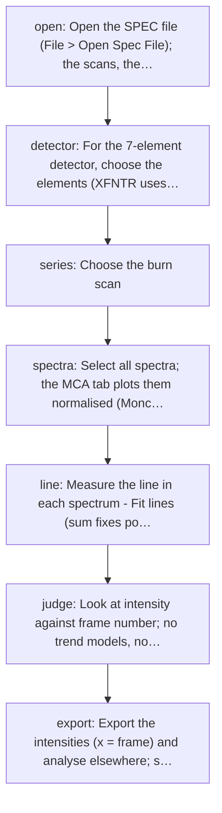

| Step | Do | Where | Controls | User decides | Automatic | Could be automatic | Known from | Issues |
|---|---|---|---|---|---|---|---|---|
| burn-fluo.open (shared.open) | Open the SPEC file (File > Open Spec File); the scans, the series and the detector folders are read | File menu | `actionOpen_Spec_File` | which SPEC file | partly | reopen the last file and its workbook settings (F66 to-do); offer the series' reductions at once (F60) | code; run 2026-11-22 | Opening a file with Pilatus images presets the reflectivity ROI (21,11), the background offset (0.5), Qc (0.0217) and the absorber factor (code, openSpecFile ~l.744); nothing on screen says so A missing detector folder opens a directory chooser (F27) |
| burn-fluo.detector | For the 7-element detector, choose the elements (XFNTR uses the central one, element 1) | File > Preferences > Fluorescence detector | `actionPreferences`, `prefMcaCentrePushButton`, `prefMcaAllPushButton`, `prefMcaChannel1CheckBox` | elements summed (default all) | no | choose by series kind (xfntr/burn of an XFNTR sample - centre; energy - all) (D49) | owner 2026-11-19 (D49); code | A global preference in a dialog; what a burn of fluorescence should use is not stated (Q-BURN-3) |
| burn-fluo.series (shared.series) | Choose the burn scan | left panel | `seriesComboBox`, `seriesWholeCheckBox`, `scanListWidget`, `scansLineEdit` | which series (or scans by number); Whole series on (default) or off | partly | select the newest series of the kind the user works on; in live mode follow it (built for whole-series selections, L3) | code (is_burn does not look at the detector); guess | If the scan has no #V line its spectra are not listed at all (physics_notes 2026-11-19, checked on the October file) |
| burn-fluo.spectra (shared.frames) | Select all spectra; the MCA tab plots them normalised (Monc, absorber from the last #A) | left panel (image list, labelled 'Pilatus:' or 'Vortex:') | `imageListWidget`, `imageSelectAllCheckBox`, `mcaNormComboBox`, `mcaCalibCheckBox` | all frames (usual) or a subset (left out of the reduction, kept in remakes) | no | select all frames of a whole-series selection by default; show a movie instead of tiles (F69) | code (mcaSelectedScanChanged) | Selecting all frames draws every frame as a tile on the Pilatus tab (owner 2026-11-22: more than 6 tiles is too many, F69) Selecting frames switches to the Pilatus tab (2) or the MCA tab (5) (code) |
| burn-fluo.line | Measure the line in each spectrum - Fit lines (sum fixes position and width, each spectrum amplitude and background) or a window Sum All | MCA tab | `mcaRanLineEdit`, `mcaFitLinesPushButton`, `mcaFitOptionsPushButton`, `mcaFitDetectorWidthCheckBox`, `mcaFitNoiseSpinBox`, `mcaFitEscapeCheckBox`, `mcaSumAllPushButton`, `mcaXAxisComboBox` | the line window; fitted lines (owner D47 - lines count, not the Vortex counter) or window sum; x axis Frame | no | a burn dialog for MCA series (TODO - feed fit_series through trends.compare) | code; owner 2026-11-19 (D47); guess (that users do this for burns) | The Burn Test button refuses MCA scans (it needs Pilatus frames; code, pilBurnTest) The MCA x axis offers Frame, Qz, Energy; no time axis (TODO area E: time axis in MCA) |
| burn-fluo.judge | Look at intensity against frame number; no trend models, no 5 % time in the window | MCA tab (integral plot, list) | `mcaDataListWidget` | whether the line intensity changes | no | the same Trends panel as the Pilatus burns | code; guess | This workflow is not supported as a burn test today; the user judges by eye or exports |
| burn-fluo.export | Export the intensities (x = frame) and analyse elsewhere; saved to the workbook as a fluorescence sum or line fit | MCA tab | `mcaExportIntPushButton`, `mcaSaveWorkbookPushButton` | file name | partly |  | code; guess |  |

## reflectivity — Specular reflectivity

**Priority** 2. **Known from:** owner 2026-11-14/15 (PROJECT_CONTEXT, F24); owner 2026-11-22 (absorbers and patching); code; tests/test_gui_workflows.py; tests/test_real_nx_school.py; run 2026-11-22.

**Experiment.** A macro runs a series of `hklscan 0 0 0 0 qz1 qz2 n t` segments in Qz, each at an absorber setting chosen so the ROI does not saturate, with alignment scans (sh/oh a2scan) before and between segments; one Pilatus frame per point (NX school: scans 6-9, 96 frames, alignment 4, 5, 10). Absorbers change only when counting statistics have dropped by more than 100 x; overlaps are not placed across the critical edge (owner, 2026-11-22). The first data set follows the burn test (or a known safe absorber); the macro is then tuned (counting times), and reduced curves from different places and over time are compared for stability (owner, 2026-11-23). The reader sums the specular ROI minus background per frame per Monc, patches the segments by fitting a factor at each overlap (joint fit default since 2026-11-22), normalises below Qc, and writes R and R/R_F for xmodfit.

**Recognised by.** series kind 'reflectivity': consecutive hklscans (no `#V`) whose Qz ranges move up and overlap or touch (`series.infer`), alignment scans attached as 'align'; or `#U Series kind=reflectivity`. Detector Pilatus at Det_Th about 0 (beam on the recorded DBPos).

**Outputs:** <name>_ref.txt; <name>_rrf.txt; workbook: Saved (reflectivity), Data; Script pane: exp.reflectivity(...). **Script:** `Experiment.reflectivity([6, 7, 8, 9], slit=(21, 11), bg_offset=0.5, direction='H', qc=0.0217, drops=..., factors=...).save(name)`. **Questions:** Q-REF-1; Q-REF-2; Q-REF-3; Q-REF-4; Q-REF-5; Q-REF-6; Q-GEN-2.

```mermaid
flowchart TD
    ref_open["open: Open the SPEC file; with Pilatus images the ROI 21x11, back…"]
    ref_series["series: Choose the reflectivity series ('reflectivity 4/?: S# 6-9')…"]
    ref_frames["frames: Select all frames of the series (NX 6-9 - 96 frames) with S…"]
    ref_check["check: Optionally check the ROI frame by frame - Reflectivity open…"]
    ref_options(["options: Set the options that change the per-frame signal (low-Qz sl…"])
    ref_errors(["errors: Choose the error model (Legacy default, or Budget with a mo…"])
    ref_patch(["patch: Ref Patch - one point per frame (ROI minus background per M…"])
    ref_same["same: When identical scans (same Qz range and points) are found -…"]
    ref_same_d{"Identical scans found?"}
    ref_join["join: For each join: the overlap plotted with the factor that Nex…"]
    ref_join_d{"Factor acceptable at this join?"}
    ref_view["view: The patched curve on the Reflectivity tab - R or R/R_F, Qc,…"]
    ref_view_d{"R/R_F continuous?"}
    ref_export["export: Export - &lt;name&gt;_ref.txt and &lt;name&gt;_rrf.txt (Q, R, sigma); t…"]
    ref_save(["save: The finished reduction is saved into &lt;SPEC file&gt;_reader.xls…"])
    ref_compare["compare: Compare reduced curves from different places on the sample…"]
    ref_live["live: With Live on, the open Reflectivity curve follows its serie…"]
    ref_downstream["downstream: Fit the exported curve in xmodfit"]
    ref_open --> ref_series
    ref_series --> ref_frames
    ref_frames --> ref_check
    ref_check --> ref_options
    ref_options --> ref_errors
    ref_errors --> ref_patch
    ref_patch --> ref_same
    ref_same --> ref_same_d
    ref_same_d -- "no" --> ref_join
    ref_same_d -- "yes" --> ref_join
    ref_join --> ref_join_d
    ref_join_d -- "drop points" --> ref_join
    ref_join_d -- "use known ratio" --> ref_join
    ref_join_d -- "yes" --> ref_view
    ref_view --> ref_view_d
    ref_view_d -- "no: change Qoff or Qc" --> ref_view
    ref_view_d -- "yes" --> ref_export
    ref_export --> ref_save
    ref_save --> ref_compare
    ref_compare --> ref_live
    ref_live --> ref_downstream
    classDef auto fill:#e6f4ea,stroke:#4a8;
    class ref_options,ref_errors,ref_patch,ref_save auto;
```

| Step | Do | Where | Controls | User decides | Automatic | Could be automatic | Known from | Issues |
|---|---|---|---|---|---|---|---|---|
| ref.open (shared.open) | Open the SPEC file; with Pilatus images the ROI 21x11, background offset 0.5, Qc 0.0217 and the absorber factor are preset | File menu | `actionOpen_Spec_File` | which SPEC file | partly | reopen the last file and its workbook settings (F66 to-do); offer the series' reductions at once (F60) | code; run 2026-11-22 (21,11 and 0.0217 after opening the NX file) | Opening a file with Pilatus images presets the reflectivity ROI (21,11), the background offset (0.5), Qc (0.0217) and the absorber factor (code, openSpecFile ~l.744); nothing on screen says so A missing detector folder opens a directory chooser (F27) |
| ref.series (shared.series) | Choose the reflectivity series ('reflectivity 4/?: S# 6-9') or click one of its scans | left panel | `seriesComboBox`, `seriesWholeCheckBox`, `scanListWidget`, `scansLineEdit` | which series (or scans by number); Whole series on (default) or off | partly | select the newest series of the kind the user works on; in live mode follow it (built for whole-series selections, L3) | run 2026-11-22; test tests/test_gui_series.py; owner 2026-11-23 (selects the scans by hand today) | The owner selects the scans one by one: the Series list (D55) does it in one action but is new and not yet tried by people (owner 2026-11-23) |
| ref.frames (shared.frames) | Select all frames of the series (NX 6-9 - 96 frames) with Select All | left panel (image list, labelled 'Pilatus:' or 'Vortex:') | `imageListWidget`, `imageSelectAllCheckBox` | all frames (usual) or a subset (left out of the reduction, kept in remakes) | no | Ref Patch takes every frame of the selected scans itself (one action fewer) | test tests/test_real_nx_school.py; owner 2026-11-23 | Selecting all frames draws every frame as a tile on the Pilatus tab (owner 2026-11-22: more than 6 tiles is too many, F69) Selecting frames switches to the Pilatus tab (2) or the MCA tab (5) (code) |
| ref.check | Optionally check the ROI frame by frame - Reflectivity opens the Ref tab with the frames by Qz, the ROI image, Analyze / Accept / Analyze All | Pilatus tab > Reflectivity; Reflectivity tab | `pilRefPushButton`, `refQzListWidget`, `refSlitLineEdit`, `refBGOffLineEdit`, `refBGDirComboBox`, `refCenCheckBox`, `refCenLineEdit`, `refSeaWinLineEdit`, `refBPCFacLineEdit`, `refAnalyzePushButton`, `refAcceptPushButton`, `refAnalyzeAllPushButton` | ROI size, background offset and direction, centre (from SPEC or typed), search window | no | a movie of the frames zoomed to the region around the ROI, on a log or other nonlinear scale, keeping zoom and colour mode while it plays (owner 2026-11-23: 'If there was a slick way to show a movie of it ... we might do it more often'); ROI close-up with the box and background boxes drawn, flags on frames whose beam is off by > 2 px (F71) | code (refPlotWin, refAnalyze); owner 2026-11-23 (done, but mostly when something is weird and the data must be verified; the routine path is Ref Patch) | Two entry points with similar names: 'Reflectivity' (frame-by-frame analysis) and 'Ref Patch' (the reduction); the ROI fields used by both live on the Reflectivity tab The ROI default in the .ui is 61,31 and is overwritten to 21,11 when a Pilatus file opens (code); the script default is 21,11 |
| ref.options | Set the options that change the per-frame signal (low-Qz slit correction, merge same Qz, bad-pixel correction, DB position) | Pilatus tab | `pilLowQzCorCheckBox`, `pilMergeSameQzCheckBox`, `pilBPCiteSpinBox`, `pilBPCfacSpinBox`, `pilSpecCheckBox`, `pilDBPosLineEdit` | usually the defaults (guess) | yes |  | code | Low Qz Corr. is applied to the first frame of each scan regardless of the box (P18, as coded) |
| ref.errors (shared.errors) | Choose the error model (Legacy default, or Budget with a monitor model) | Errors pane (dock) | `errorModeComboBox`, `monitorKindComboBox`, `errorModel_sigma` | Legacy (default, byte-identical files) or Budget | yes |  | owner 2026-11-17 (D20, D22, D26); code | A global setting in a dock, far from the reductions it changes; which default the export should use is open (TODO B) |
| ref.patch | Ref Patch - one point per frame (ROI minus background per Monc), scans sorted by Qz; pop-ups for beams > 2 px off and bad pixels in the ROI | Pilatus tab > Ref Patch | `pilRefPatchPushButton` |  | yes | offer Ref Patch when a reflectivity series is selected (F60) | code (pilRefPatchData); test tests/test_real_nx_school.py | The beam-offset and bad-pixel tables are modal dialogs (pilPeakCenDialog, pilBadPixDialog) that interrupt the patch |
| ref.same | When identical scans (same Qz range and points) are found - merge them, drop some, or patch them regularly | identical-scans dialog | `refpatchsamescan.mergePushButton`, `refpatchsamescan.dropPushButton`, `refpatchsamescan.dropLineEdit`, `refpatchsamescan.nextPushButton` | merge (repeats), drop, or patch (default) | no | merge repeats by default when they agree within errors | code (pilRefPatchData, pilRefSameScan) | Announced by a message, then a dialog; the default ('regular patch') is stated only in the message |
| ref.join | For each join: the overlap plotted with the factor that Next will use (joint fit), the known foil ratio offered; drop points; Next / Finish! | Ref Patch dialog (one per join) | `refpatch.nextPushButton`, `refpatch.dropPushButton`, `refpatch.dropLineEdit`, `refpatch.knownRatioCheckBox`, `refpatch.knownRatioLabel`, `prefPatchMethodComboBox`, `prefPatchAutoCheckBox`, `prefPatchThresholdSpinBox` | accept the fitted factor or use the known ratio; which points to drop (typed indices) | partly | accept every join whose fit passes its guard and agrees with the foils, and show only the doubtful ones (owner 2026-11-18 F58 - known ratio automatic where plainly better) | owner 2026-11-18 (F58), owner 2026-11-22 (joint fit default); test tests/test_gui_workflows.py, tests/test_known_ratio_patch.py | One dialog per join (3 for NX 6-9); the method preference is in File > Preferences, not in the dialog Dropped points are typed as indices, deleted from the arrays, not drawn, no undo (F16, D2) |
| ref.view | The patched curve on the Reflectivity tab - R or R/R_F, Qc, Qoff, log, Qz^2, normalisation factor; compare with reference files | Reflectivity tab (Ref / Norm Ref lists, plot) | `refDataListWidget`, `refNormRefListWidget`, `refRRFCheckBox`, `refQcLineEdit`, `refQoffLineEdit`, `refLogYCheckBox`, `refQzSqrCheckBox`, `refNormFacCheckBox`, `refNormLineEdit`, `refDelPushButton`, `refRefFileListWidget`, `refAddFilePushButton`, `refRemoveFilePushButton`, `refLegendCheckBox` | Qc (0.0217 preset: water, the same Qc at every energy, physics_notes 2026-11-23; changed for lighter or denser subphases); Qoff tweaked until R/R_F is continuous apart from one or two outliers (owner 2026-11-23); reference curves to compare | partly | Qoff proposed from the continuity of R/R_F across the joins, Qc from the subphase (F79); Qoff from the sh-scan images (F42) | code (updateRefPlotData); test tests/test_gui_workflows.py (tab 3 after Finish); owner 2026-11-23 | Qc and Qoff change the R/R_F file but are typed fields among display options Qoff is found by trial: type, press Enter, look, repeat |
| ref.export | Export - <name>_ref.txt and <name>_rrf.txt (Q, R, sigma); the Script pane records exp.reflectivity(...) | Reflectivity tab > Export | `refExportPushButton`, `refCovarianceCheckBox` | file name; whether to write the covariance sidecars (+ covariance, off by default) | no | name from the sample and series (guess) | code (saveRefData, saveRefCovariance); tests/test_ref_export_golden.py, tests/test_gui_covariance_export.py; docs docs/SCRIPTING.md | The covariance sidecars (F24) exist since 2026-11-22 behind '+ covariance', which sits after the workbook Save although it modifies Export; the contract's corrected/legacy pair is for scripts only (TODO B2) |
| ref.save (shared.workbook) | The finished reduction is saved into <SPEC file>_reader.xlsx automatically; Save stores a version with a note | Save button beside each Export; GID menu 'Save to workbook' | `refSaveWorkbookPushButton` | whether to add a 'user' version with a note | yes |  | test tests/test_real_nx_school.py (reflectivity saved to the workbook) | Automatic saves report in the status bar only; there is no view of the workbook inside the reader |
| ref.compare | Compare reduced curves from different places on the sample and over time, to check that it is stable | Reflectivity tab (Add Files: the exported _ref.txt files) | `refAddFilePushButton`, `refRefFileListWidget`, `refRemoveFilePushButton` | whether the sample is stable | no | the workbook's saved reflectivities overlaid by series, time or sx in one action, with ratios to the first (F80) | owner 2026-11-23 (the need; which tab is used is a guess) | Comparing means exporting, then adding the files back |
| ref.live (shared.live) | With Live on, the open Reflectivity curve follows its series as segments arrive (remade from the recipe) | left panel, beside Update Specfile | `liveCheckBox`, `speUpSpeFilePushButton` | live on or off | partly | turn Live on when the file is still growing (a series 'in progress') | test tests/test_gui_live.py (the open reflectivity follows its series) | Live stops by itself only for series with #U Series lines (L4); guessed series need a manual untick |
| ref.downstream | Fit the exported curve in xmodfit | outside the reader |  |  | no |  | owner 2026-11-14 (PROJECT_CONTEXT - fitting in xmodfit) |  |

## gid — Grazing-incidence diffraction map (pinhole default, or legacy patch)

**Priority** 3. **Known from:** owner 2026-11-18 (D36, D40, F45, F61, F62); owner 2026-11-19 (D51); code; tests/test_gid_worksheet.py; tests/test_real_nx_school.py; docs/manual/gid_patching.md; run 2026-11-22.

**Experiment.** `ascan dth a b n t` scans of the detector angle at a fixed incidence angle below the critical angle, one scan per Qz level (low, middle, high), one Pilatus frame per point; the pinhole (S4) in front of the detector defines 2theta per column (NX school: scans 11 and 12, 41 and 4 frames, the second aborted; the owner's private pairs have complete levels). One absorber setting per GID scan (worksheet: the absorber factor is not applied; joins absorb differences). The reader bins each column at its own 2theta (exact IMG_COO_CONV geometry, default since 2026-11-18), joins levels and scans, and saves the map and its Qxy/Qz projections.

**Recognised by.** series kind 'gid': consecutive `ascan dth` scans with Pilatus frames (`series.infer`), or `#U Series kind=gid level=k`. Det_Th > 1 deg; `#B1` gives the S4-detector distance (pinhole).

**Outputs:** <name>_qxy_gid.txt, <name>_qz_gid.txt, <name>_q2d_gid.txt (PROJECT_CONTEXT); workbook: Saved (GID map), Maps; Script pane: exp.gid(...). **Script:** `Experiment.gid([11, 12], params=GIDParams(...), axes='Q').save(name)`. **Questions:** Q-GID-1; Q-GID-2; Q-GID-3; Q-GID-4; Q-GID-5.

```mermaid
flowchart TD
    gid_open["open: Open the SPEC file (File &gt; Open Spec File); the scans, the…"]
    gid_series["series: Choose the GID series ('gid 2/? (partial): S# 11-12')"]
    gid_frames["frames: Select all frames of the levels"]
    gid_look["look: Watch the raw frames as a movie (often, owner 2026-11-23):…"]
    gid_background["background: Optionally subtract background frames (add selected frames…"]
    gid_settings["settings: Open the worksheet (GID menu &gt; Worksheet) and check the set…"]
    gid_patch["patch: GID Patch (or GID Patch Relax for the larger Q grid) - the…"]
    gid_inspect["inspect: Inspect the joins and levels - join table (overlap, points,…"]
    gid_inspect_d{"Joins and levels acceptable?"}
    gid_colour["colour: Adjust the colour scale and log of the map; optionally over…"]
    gid_cuts["cuts: Cuts of the map - Q H or Q V with a range, Line/Area Cuts;…"]
    gid_save["save: Save GID (axes Angles or Q) - the map and its projections;…"]
    gid_workbook(["workbook: The map is saved automatically (Maps sheet, as a grid); GID…"])
    gid_live["live: The open GID map follows its series as levels arrive"]
    gid_downstream["downstream: Fit the Qxy and Qz profiles downstream"]
    gid_open --> gid_series
    gid_series --> gid_frames
    gid_frames --> gid_look
    gid_look --> gid_background
    gid_background --> gid_settings
    gid_settings --> gid_patch
    gid_patch --> gid_inspect
    gid_inspect --> gid_inspect_d
    gid_inspect_d -- "no: change settings" --> gid_settings
    gid_inspect_d -- "yes" --> gid_colour
    gid_colour --> gid_cuts
    gid_cuts --> gid_save
    gid_save --> gid_workbook
    gid_workbook --> gid_live
    gid_live --> gid_downstream
    classDef auto fill:#e6f4ea,stroke:#4a8;
    class gid_workbook auto;
```

| Step | Do | Where | Controls | User decides | Automatic | Could be automatic | Known from | Issues |
|---|---|---|---|---|---|---|---|---|
| gid.open (shared.open) | Open the SPEC file (File > Open Spec File); the scans, the series and the detector folders are read | File menu | `actionOpen_Spec_File` | which SPEC file | partly | reopen the last file and its workbook settings (F66 to-do); offer the series' reductions at once (F60) | code; run 2026-11-22 | Opening a file with Pilatus images presets the reflectivity ROI (21,11), the background offset (0.5), Qc (0.0217) and the absorber factor (code, openSpecFile ~l.744); nothing on screen says so A missing detector folder opens a directory chooser (F27) |
| gid.series (shared.series) | Choose the GID series ('gid 2/? (partial): S# 11-12') | left panel | `seriesComboBox`, `seriesWholeCheckBox`, `scanListWidget`, `scansLineEdit` | which series (or scans by number); Whole series on (default) or off | partly | select the newest series of the kind the user works on; in live mode follow it (built for whole-series selections, L3) | run 2026-11-22 | The Series list is a combo box with a placeholder first item ('Series: choose to select its scans'); the list of series is not visible at a glance (run 2026-11-22) Guessed series have n unknown ('4/?'); the kind is only a guess until the macros write #U Series (handoff_out/05) Selecting a scan always switches to the SpecPlot tab (code, scanListChanged), whatever the workflow |
| gid.frames (shared.frames) | Select all frames of the levels | left panel (image list, labelled 'Pilatus:' or 'Vortex:') | `imageListWidget`, `imageSelectAllCheckBox` | all frames (usual) or a subset (left out of the reduction, kept in remakes) | no | select all frames of a whole-series selection by default; show a movie instead of tiles (F69) | code; test tests/test_gui_workflows.py | Selecting all frames draws every frame as a tile on the Pilatus tab (owner 2026-11-22: more than 6 tiles is too many, F69) Selecting frames switches to the Pilatus tab (2) or the MCA tab (5) (code) |
| gid.look (shared.frames-look) | Watch the raw frames as a movie (often, owner 2026-11-23): real GID peaks stay at the same 2θ as the detector angle changes, other junk does not; zoomed, with zoom and colour mode kept while the frames play. The Pinhole box gives display and cuts the pinhole geometry | Pilatus tab | `pilAxesComboBox`, `pilLogIntCheckBox`, `pilMinLineEdit`, `pilMaxLineEdit`, `pilCMapComboBox`, `pilPinholeCheckBox`, `pilMoviePushButton` | which features are real peaks (fixed in 2θ) and which are junk | partly | a movie drawn on a common 2θ axis with the zoom fixed in angle, so real peaks stand still and detector-fixed junk moves (image_display M7); sticky zoom and scale (M2, F69, F70) | code; owner 2026-11-18 (D40); owner 2026-11-23 (the movie and why) | Movie today blocks the window (0.5 s per frame), cannot be paused, resets the zoom and leaves the Axes box at Q (image_display.md) Two pinhole switches: the Pilatus tab's 'Pinhole' (display and cuts) and the worksheet's 'Pinhole: angle per column' (the patch) |
| gid.background | Optionally subtract background frames (add selected frames to the background list, factor, ignore negatives) | left panel (background list) | `backgroundPushButton`, `backgroundListWidget`, `bgFacLineEdit`, `bgIgnoreNegCheckBox`, `bgSelectAllCheckBox`, `removePushButton` | which frames are background, the factor | no |  | code; guess (whether it is used for GID) | Background-subtracted maps are not scriptable (gidScript says so) |
| gid.settings | Open the worksheet (GID menu > Worksheet) and check the settings - pinhole on, response, footprint window, S4-detector distance (Fit), rows, columns | Pilatus tab > GID menu > Worksheet (separate window) | `gidComboBox`, `gidPinholeCheckBox`, `gidPinholeDistSpinBox`, `gidFitDistancePushButton`, `gidResponseComboBox`, `gidFootprintComboBox`, `gidTransverseComboBox`, `gidRowMinSpinBox`, `gidRowMaxSpinBox`, `gidColumnsSpinBox`, `pilHSlitLineEdit`, `gidAreaCheckBox`, `gidPolCheckBox`, `gidApplyJoinsCheckBox`, `gidMinFramesSpinBox`, `gidArmCheckBox`, `gidDefaultsPushButton` | usually the defaults (pinhole, exact footprint, response fit); the distance from Fit when reliable | partly | calibrate the distance automatically on the first patch and say so (P43 built as a button) | owner 2026-11-18/19 (D40, D51); test tests/test_gid_worksheet.py; docs docs/manual/gid_patching.md | Actions are items of a combo box whose first item 'GID' is a title; choosing the same item again needs a re-selection (code, activated) 'Columns per frame' (worksheet) and the H slit field on the Pilatus tab are one setting in two places |
| gid.patch | GID Patch (or GID Patch Relax for the larger Q grid) - the map is drawn on the Pilatus tab in Q | Pilatus tab > GID menu | `gidComboBox`, `gidPatchPushButton` | Patch or Patch Relax | partly | patch when a complete GID series is selected (F60) | code (pilGID, pilGIDpatchData); test tests/test_gid_worksheet.py, tests/test_real_nx_school.py | Axes switch from Pixels to Q by themselves on the first patch (code) |
| gid.inspect | Inspect the joins and levels - join table (overlap, points, factor +- error, chi2/dof), levels line with 'frames agree' chi2/dof; change a setting and the map updates | GID worksheet | `gidJoinTable`, `gidLevelsLabel`, `gidLiveCheckBox`, `gidFitLabel` | whether the patch is honest; which method to keep | partly | flag joins whose chi2 or factor is out of line | owner 2026-11-18 (F61); owner 2026-11-20 (honest presentation); test tests/test_gid_worksheet.py |  |
| gid.colour | Adjust the colour scale and log of the map; optionally overlay form-factor minima (Form Factor) | Pilatus tab; GID menu > Form Factor | `pilMinLineEdit`, `pilMaxLineEdit`, `pilLogIntCheckBox`, `pilCMapComboBox`, `pdformfac.sphCheckBox`, `pdformfac.updatePushButton` | colour limits | partly | intelligent colour scale for maps (F70) | code |  |
| gid.cuts | Cuts of the map - Q H or Q V with a range, Line/Area Cuts; fit the peaks; export | Pilatus tab (cut direction and range) > Line/Area Cuts tab | `pilCutDirComboBox`, `pilIntRangeLineEdit`, `pilLineAreaPushButton`, `cutFitPushButton`, `cutFitOptionsPushButton`, `cutExportPushButton`, `cutSaveWorkbookPushButton` | direction and range (Qz range for a Bragg rod profile, Qxy range for a rod) | no | Qxy profile and Bragg-rod cut of the strongest peak by default (F68 - defaults by scan kind) | test tests/test_real_nx_school.py (GID line cuts; pixel cuts refused with a message) | Pixel cuts are offered but refused on a map; the cut range has no sensible default for the map (F59) |
| gid.save | Save GID (axes Angles or Q) - the map and its projections; Script pane records exp.gid(...) | Pilatus tab > GID menu > Save GID | `gidComboBox`, `pilAxesComboBox` | file name; axes Angles or Q (set on the display combo box) | no |  | code (saveGIDData); test tests/test_gid_script.py | Save GID refuses Pixels axes; the axes for the file are chosen on the display combo box |
| gid.workbook (shared.workbook) | The map is saved automatically (Maps sheet, as a grid); GID menu > Save to workbook adds a version with a note | Save button beside each Export; GID menu 'Save to workbook' | `gidComboBox` | whether to add a 'user' version with a note | yes |  | test tests/test_real_nx_school.py (GID map saved to the workbook) | Automatic saves report in the status bar only; there is no view of the workbook inside the reader |
| gid.live (shared.live) | The open GID map follows its series as levels arrive | left panel, beside Update Specfile | `liveCheckBox`, `speUpSpeFilePushButton` | live on or off | partly | turn Live on when the file is still growing (a series 'in progress') | test tests/test_gui_live.py (the open GID map follows its series) | Live stops by itself only for series with #U Series lines (L4); guessed series need a manual untick |
| gid.downstream | Fit the Qxy and Qz profiles downstream | outside the reader |  |  | no |  | owner 2026-11-14 (PROJECT_CONTEXT); guess (which program) |  |

## xfntr — X-ray fluorescence near total reflection

**Priority** 4. **Known from:** owner 2026-11-19 (F65, D45, D47, D49, fluo.mac received); code; tests/test_xfntr.py; tests/test_mca_merge.py; docs/SCRIPTING.md.

**Experiment.** The usual XFNTR scan is the macro `fluo_p time abs`: S1 set, the detector arm moved out of the way, then `MCAscanpt lscan 0.015 0.03 15 time`, an hklscan in Qz across the critical angle with one MCA spectrum per point (single-element Dante, or the 7-element Xspress3 of which XFNTR uses the central element 1). Repeats of one scan are merged on target Qz (owner's rule F65). The spectra are dominated by the elastic line; the element lines are weaker; what counts is the fitted line normalised by Monc, not the SPEC Vortex counter (owner D47). No absorber setting is written by `getandsave_mca` scans (the last #A above is taken, D24).

**Recognised by.** series kind 'xfntr': consecutive L scans with a `#V` line (detector Vortex), alignment scans attached (`series.infer`); or `#U Series kind=xfntr`. MCA files in `vortex/`, per-point (`mca_save_point`).

**Outputs:** <name>_flu.txt; workbook: Saved (fluorescence sum / line fit / merge); Script pane: exp.fluorescence(...). **Script:** `flu = Experiment.fluorescence(scans, window=(lo, hi), channels=[1]); flu.merge(); flu.save(name, x='qz')`. **Questions:** Q-XFNTR-1; Q-XFNTR-2; Q-XFNTR-3; Q-XFNTR-4; Q-XFNTR-5.

```mermaid
flowchart TD
    xfntr_open["open: Open the SPEC file (File &gt; Open Spec File); the scans, the…"]
    xfntr_detector["detector: For the 7-element detector choose the central element (Cent…"]
    xfntr_series["series: Choose the XFNTR series - the repeats of one run, which the…"]
    xfntr_spectra["spectra: Select all spectra; the MCA tab overlays them, normalised b…"]
    xfntr_calib(["calib: Check the energy calibration (from the file, or typed)"])
    xfntr_window["window: Choose the line window (range field; Enter draws it on the…"]
    xfntr_measure["measure: Sum All (window sum) or Fit lines (Gaussian on a background…"]
    xfntr_axis["axis: Put the intensities on the Qz axis"]
    xfntr_merge["merge: Merge repeated points (default window 0.1 x the Qz grid ste…"]
    xfntr_merge_d{"Repeats to merge?"}
    xfntr_export["export: Export Integral - &lt;name&gt;_flu.txt (x, I, sigma); the Script…"]
    xfntr_save(["save: The finished reduction is saved into &lt;SPEC file&gt;_reader.xls…"])
    xfntr_live["live: With Live on, spectra appended to the latest MCA file are p…"]
    xfntr_downstream["downstream: Fit the fluorescence curve downstream"]
    xfntr_open --> xfntr_detector
    xfntr_detector --> xfntr_series
    xfntr_series --> xfntr_spectra
    xfntr_spectra --> xfntr_calib
    xfntr_calib --> xfntr_window
    xfntr_window --> xfntr_measure
    xfntr_measure --> xfntr_axis
    xfntr_axis --> xfntr_merge
    xfntr_merge --> xfntr_merge_d
    xfntr_merge_d -- "no" --> xfntr_export
    xfntr_merge_d -- "yes" --> xfntr_export
    xfntr_export --> xfntr_save
    xfntr_save --> xfntr_live
    xfntr_live --> xfntr_downstream
    classDef auto fill:#e6f4ea,stroke:#4a8;
    class xfntr_calib,xfntr_save auto;
```

| Step | Do | Where | Controls | User decides | Automatic | Could be automatic | Known from | Issues |
|---|---|---|---|---|---|---|---|---|
| xfntr.open (shared.open) | Open the SPEC file (File > Open Spec File); the scans, the series and the detector folders are read | File menu | `actionOpen_Spec_File` | which SPEC file | partly | reopen the last file and its workbook settings (F66 to-do); offer the series' reductions at once (F60) | code; run 2026-11-22 | Opening a file with Pilatus images presets the reflectivity ROI (21,11), the background offset (0.5), Qc (0.0217) and the absorber factor (code, openSpecFile ~l.744); nothing on screen says so A missing detector folder opens a directory chooser (F27) |
| xfntr.detector | For the 7-element detector choose the central element (Centre = element 1) | File > Preferences > Fluorescence detector | `actionPreferences`, `prefMcaCentrePushButton`, `prefMcaAllPushButton`, `prefMcaChannel1CheckBox` | element(s); default all | no | centre element by default for xfntr series, all for energy series (D49) | owner 2026-11-19 (D49, "the central element is 1"); code | The default (all elements) suits EXAFS, not XFNTR; switching kinds means visiting Preferences each time |
| xfntr.series (shared.series) | Choose the XFNTR series - the repeats of one run, which the user decides to merge | left panel | `seriesComboBox`, `seriesWholeCheckBox`, `scanListWidget`, `scansLineEdit` | which repeats (one run, wavelength, sample, signal shape - the user's choice, owner 2026-11-19) | partly | select the newest series of the kind the user works on; in live mode follow it (built for whole-series selections, L3) | owner 2026-11-19 (F65 steps 1, 7 left to the user); code | Repeats whose line amplitude changes from repeat to repeat are merged without warning (physics_notes 2026-11-19, private data) |
| xfntr.spectra (shared.frames) | Select all spectra; the MCA tab overlays them, normalised by Monc x real/live time x absfac^n | left panel (image list, labelled 'Pilatus:' or 'Vortex:') | `imageListWidget`, `imageSelectAllCheckBox`, `mcaNormComboBox`, `mcaGainCheckBox`, `mcaPhotonCheckBox`, `mcaLogYCheckBox`, `mcaOffsetCheckBox`, `mcaOffsetLineEdit` | all frames (usual) or a subset (left out of the reduction, kept in remakes) | no | select all frames of a whole-series selection by default; show a movie instead of tiles (F69) | code; test tests/test_xfntr.py | Dozens of spectra are overlaid in one plot; Offset Factor is the only separation |
| xfntr.calib | Check the energy calibration (from the file, or typed) | MCA tab | `mcaCalibCheckBox`, `mcaCalibConLineEdit`, `mcaCalibLinLineEdit`, `mcaCalibQuaLineEdit` | file calibration (usual) or typed | yes |  | code |  |
| xfntr.window | Choose the line window (range field; Enter draws it on the spectra) | MCA tab | `mcaRanLineEdit` | the window around the element line (default 1:1000, the whole spectrum) | no | line markers and a proposed window from the element (F47, xraydb); remember the window per sample | code; guess (how users place it) | The default window is the whole spectrum, dominated by the elastic line |
| xfntr.measure | Sum All (window sum) or Fit lines (Gaussian on a background; the sum fixes position and width) | MCA tab | `mcaSumAllPushButton`, `mcaFitLinesPushButton`, `mcaFitOptionsPushButton`, `mcaFitPushButton`, `mcaFitAllPushButton`, `mcaAcceptPushButton` | window sum or fitted lines (owner D47 - fitted lines are what count); fit options (background order) | no | Fit lines as the default for xfntr (D47) | owner 2026-11-19 (D47, F22a 6); code; test tests/test_xfntr.py, tests/test_gui_workbook.py (Fit lines) | Three fitting paths side by side: Fit / Fit All / Accept (legacy dialog), Fit lines (new) and Sum All |
| xfntr.axis | Put the intensities on the Qz axis | MCA tab | `mcaXAxisComboBox`, `mcaDataListWidget` | Qz (Frame is the default) | no | Qz by default for xfntr series, Energy for energy series | code; test tests/test_xfntr.py (export against Qz) | The x axis also decides the exported column and the merge axis; the default is Frame |
| xfntr.merge | Merge repeated points (default window 0.1 x the Qz grid step; Qz jitter added to the errors); delete bad points | MCA tab > Merge (dialog); Delete | `mcaMergePushButton`, `mcamerge.resLineEdit`, `mcamerge.okPushButton`, `mcaDelPushButton` | accept the default window or type one; which points to delete | partly | merge on Sum All when the selection holds repeats (the edge check, F65 steps 3-4, is backlog) | owner 2026-11-19 (F65 steps 2, 5); test tests/test_mca_merge.py | Deleted points are gone (no mask, no undo; F16) |
| xfntr.export | Export Integral - <name>_flu.txt (x, I, sigma); the Script pane records exp.fluorescence(...) | MCA tab > Export Integral | `mcaExportIntPushButton` | file name | no |  | code (mcaSaveIntData); test tests/test_xfntr.py | Written with full float precision, unlike the reflectivity files (physics_notes 2026-11-15) |
| xfntr.save (shared.workbook) | The finished reduction is saved into <SPEC file>_reader.xlsx automatically; Save stores a version with a note | Save button beside each Export; GID menu 'Save to workbook' | `mcaSaveWorkbookPushButton` | whether to add a 'user' version with a note | yes |  | test tests/test_gui_workbook.py (MCA sum and Fit lines saved) | Automatic saves report in the status bar only; there is no view of the workbook inside the reader |
| xfntr.live (shared.live) | With Live on, spectra appended to the latest MCA file are picked up and the MCA integrals remade | left panel, beside Update Specfile | `liveCheckBox`, `speUpSpeFilePushButton` | live on or off | partly | turn Live on when the file is still growing (a series 'in progress') | test tests/test_gui_live.py (spectra appended are picked up); docs TODO (the MCA redraw on a fluorescence series is untested) | Live stops by itself only for series with #U Series lines (L4); guessed series need a manual untick |
| xfntr.downstream | Fit the fluorescence curve downstream | outside the reader |  |  | no |  | guess (xmodfit or another program; Q-XFNTR-5) |  |

## exafs — Energy scans of fluorescence (EXAFS / XANES)

**Priority** 5. **Known from:** owner 2026-11-19 (EXAFS macros, D48, D49); code; guess.

**Experiment.** `<element>_exafs` macros call `MCAscanpt escan_14 edge e_before e_after ...` around an absorption edge with a k-space part; `*_edge` macros scan +- dE around the edge; one spectrum per energy point, all seven elements summed (owner, 2026-11-19, D49; macros read). Optional deliberate dose with `eb_expose time abs`. The bu September file has 24 escan scans. What the reader should output for EXAFS is not scoped (F36).

**Recognised by.** series kind 'energy': consecutive `escan` scans (`series.infer`), or `#U Series kind=energy`. Spectra per point in `vortex/`; whether these scans carry a `#V` line (needed for the window to list the spectra) is not confirmed here (private data not on this machine).

**Outputs:** <name>_flu.txt against energy; workbook: fluorescence sum / line fit. **Script:** `exp.fluorescence(scans, window=(lo, hi)) (all elements), x='energy' in save`. **Questions:** Q-EXAFS-1; Q-EXAFS-2; Q-EXAFS-3; Q-EXAFS-4.

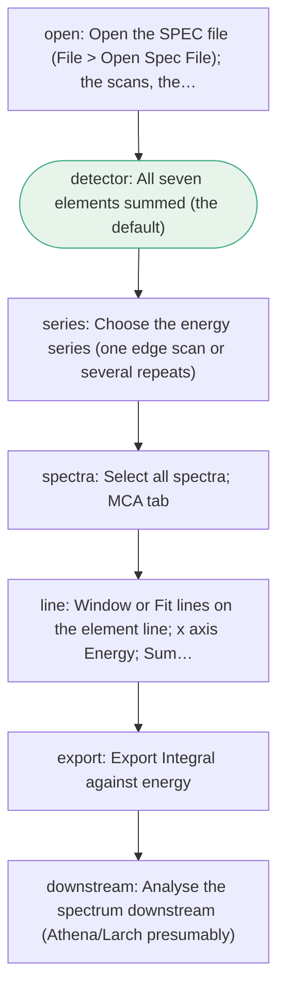

| Step | Do | Where | Controls | User decides | Automatic | Could be automatic | Known from | Issues |
|---|---|---|---|---|---|---|---|---|
| exafs.open (shared.open) | Open the SPEC file (File > Open Spec File); the scans, the series and the detector folders are read | File menu | `actionOpen_Spec_File` | which SPEC file | partly | reopen the last file and its workbook settings (F66 to-do); offer the series' reductions at once (F60) | code; run 2026-11-22 | Opening a file with Pilatus images presets the reflectivity ROI (21,11), the background offset (0.5), Qc (0.0217) and the absorber factor (code, openSpecFile ~l.744); nothing on screen says so A missing detector folder opens a directory chooser (F27) |
| exafs.detector | All seven elements summed (the default) | File > Preferences > Fluorescence detector | `actionPreferences`, `prefMcaAllPushButton` | all elements (default) or a subset | yes |  | owner 2026-11-19 (D49) |  |
| exafs.series (shared.series) | Choose the energy series (one edge scan or several repeats) | left panel | `seriesComboBox`, `seriesWholeCheckBox`, `scanListWidget`, `scansLineEdit` | which series (or scans by number); Whole series on (default) or off | partly | select the newest series of the kind the user works on; in live mode follow it (built for whole-series selections, L3) | code (series kind 'energy'); guess | The Series list is a combo box with a placeholder first item ('Series: choose to select its scans'); the list of series is not visible at a glance (run 2026-11-22) Guessed series have n unknown ('4/?'); the kind is only a guess until the macros write #U Series (handoff_out/05) Selecting a scan always switches to the SpecPlot tab (code, scanListChanged), whatever the workflow |
| exafs.spectra (shared.frames) | Select all spectra; MCA tab | left panel (image list, labelled 'Pilatus:' or 'Vortex:') | `imageListWidget`, `imageSelectAllCheckBox` | all frames (usual) or a subset (left out of the reduction, kept in remakes) | no | select all frames of a whole-series selection by default; show a movie instead of tiles (F69) | guess (not run on an escan here) | Selecting all frames draws every frame as a tile on the Pilatus tab (owner 2026-11-22: more than 6 tiles is too many, F69) Selecting frames switches to the Pilatus tab (2) or the MCA tab (5) (code) |
| exafs.line | Window or Fit lines on the element line; x axis Energy; Sum All | MCA tab | `mcaRanLineEdit`, `mcaFitLinesPushButton`, `mcaSumAllPushButton`, `mcaXAxisComboBox` | line window; x axis Energy | no | line fit per point with the sum fixing the shape (fit_series), Energy axis by default | owner 2026-11-19 (F22a 6 - fit the sum, then each spectrum); code; guess | The absorber factor uses the energy in the scan header; along an escan it changes (physics_notes 2026-11-18, escan caveat) No EXAFS output (normalisation, edge step, k space) - F36 not scoped |
| exafs.export | Export Integral against energy | MCA tab | `mcaExportIntPushButton`, `mcaSaveWorkbookPushButton` | file name | no |  | code; guess |  |
| exafs.downstream | Analyse the spectrum downstream (Athena/Larch presumably) | outside the reader |  |  | no |  | guess |  |

## gisaxs — GISAXS view of Pilatus frames

**Priority** 6. **Known from:** code; guess.

**Experiment.** Pilatus frames at small angles away from the specular (reading only; no GISAXS series in the public data). The GIOXS dialog (pdgioxs) works on frames and points of an off-specular measurement.

**Recognised by.** series kind 'gisaxs' exists in series.KINDS (from #U Series only; not inferred)

**Outputs:** GISAXS text files (Save GISAXS). **Script:** `not scriptable (docs/SCRIPTING.md)`. **Questions:** Q-GEN-3.

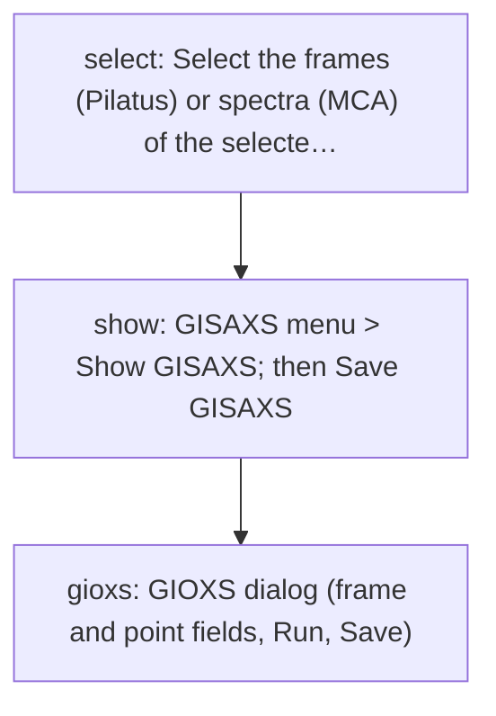

| Step | Do | Where | Controls | User decides | Automatic | Could be automatic | Known from | Issues |
|---|---|---|---|---|---|---|---|---|
| gisaxs.select (shared.frames) | Select the frames (Pilatus) or spectra (MCA) of the selected scans; Select All for all of them | left panel (image list, labelled 'Pilatus:' or 'Vortex:') | `imageListWidget`, `imageSelectAllCheckBox` | all frames (usual) or a subset (left out of the reduction, kept in remakes) | no | select all frames of a whole-series selection by default; show a movie instead of tiles (F69) | code; test tests/test_gui_workflows.py | Selecting all frames draws every frame as a tile on the Pilatus tab (owner 2026-11-22: more than 6 tiles is too many, F69) Selecting frames switches to the Pilatus tab (2) or the MCA tab (5) (code) |
| gisaxs.show | GISAXS menu > Show GISAXS; then Save GISAXS | Pilatus tab > GISAXS menu | `gisaxsComboBox`, `pilAxesComboBox`, `backgroundPushButton` | axes; background frames | no |  | code (pilGISAXS) | Actions in a combo box, like the GID menu |
| gisaxs.gioxs | GIOXS dialog (frame and point fields, Run, Save) | Pilatus tab > GIOXS | `pilGioxsPushButton`, `pdgioxs.frameLineEdit`, `pdgioxs.pointLineEdit`, `pdgioxs.runPushButton`, `pdgioxs.savePushButton` | frames and points | no |  | code; guess (purpose) |  |

## cuts — Line and area cuts of frames

**Priority** 6. **Known from:** owner 2026-11-18 (F59 via a user); owner 2026-11-22 (F68); code; tests/test_gui_cuts.py; tests/test_gui_peak_fit.py.

**Experiment.** Cuts of reflectivity or diffuse frames (I against beta, beta - alpha, Qz, Qxy; a user's request F59), beam profiles, cuts of GID maps.

**Recognised by.** any Pilatus frame; defaults could depend on the series kind (F68)

**Outputs:** <name>S# n_F# m_cut.txt or <name>S# n_sumcut.txt; workbook: line cut and fits. **Script:** `Experiment.cut(scans, 'Pix V', (lo, hi), axes='Angles').save(name)`. **Questions:** Q-CUTS-1; Q-CUTS-2; Q-CUTS-3.

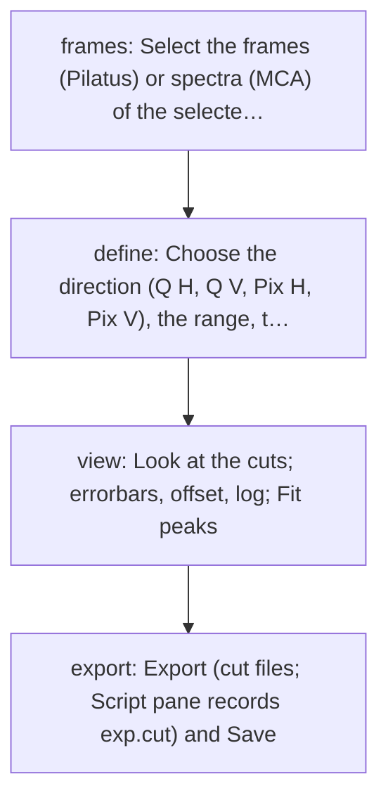

| Step | Do | Where | Controls | User decides | Automatic | Could be automatic | Known from | Issues |
|---|---|---|---|---|---|---|---|---|
| cuts.frames (shared.frames) | Select the frames (Pilatus) or spectra (MCA) of the selected scans; Select All for all of them | left panel (image list, labelled 'Pilatus:' or 'Vortex:') | `imageListWidget`, `imageSelectAllCheckBox` | all frames (usual) or a subset (left out of the reduction, kept in remakes) | no | select all frames of a whole-series selection by default; show a movie instead of tiles (F69) | code; test tests/test_gui_workflows.py | Selecting all frames draws every frame as a tile on the Pilatus tab (owner 2026-11-22: more than 6 tiles is too many, F69) Selecting frames switches to the Pilatus tab (2) or the MCA tab (5) (code) |
| cuts.define | Choose the direction (Q H, Q V, Pix H, Pix V), the range, the axes and Sum All; Line/Area Cuts | Pilatus tab | `pilCutDirComboBox`, `pilIntRangeLineEdit`, `pilAxesComboBox`, `gixSumCheckBox`, `pilPinholeCheckBox`, `pilLineAreaPushButton` | direction, range, axes (Angles for I vs beta), summed or per frame | no | one cut interface on every image plot with defaults by scan kind (F68); a range on the detector by default (F59) | code; test tests/test_gui_cuts.py; owner 2026-11-18 (F59) | Q V default range lies off a reflectivity frame: zeros, no message (F59, measured) The cut is defined on the Pilatus tab and shown on another tab |
| cuts.view | Look at the cuts; errorbars, offset, log; Fit peaks | Line/Area Cuts tab | `cutErrorbarCheckBox`, `cutOffsetCheckBox`, `cutOffsetLineEdit`, `cutLogYCheckBox`, `cutClearGraphPushButton`, `cutFitPushButton`, `cutFitOptionsPushButton` | fit options | partly |  | test tests/test_gui_peak_fit.py |  |
| cuts.export | Export (cut files; Script pane records exp.cut) and Save | Line/Area Cuts tab | `cutExportPushButton`, `cutSaveWorkbookPushButton` | file name | partly |  | code; tests/test_cut_script.py; test tests/test_gui_workbook.py |  |

## alignment — SpecPlot of motor scans (alignment)

**Priority** 6. **Known from:** code; owner 2026-11-18 (F55); owner 2026-11-19 (F43, F22a 5); owner 2026-11-23 (the typical day); tests/test_gui_workflows.py.

**Experiment.** sh / oh / ih / chi / th scans, slit scans, half-cuts; counters against a motor. Owner 2026-11-23: each sample starts with a rough alignment by a half-cut (to become a sample height scan with a horizontal beam, which also measures the beam profile), the height offset set to read zero; then a sample height scan at a fixed incident angle, sample and detector rising together, judges how flat the surface is. It is the surface curvature convolved with the beam profile (the reflected-beam ROI on the Pilatus): wide and smooth, flat-topped (super-Gaussian) when good, Gaussian-like when possibly unusable. Repeated after 30 min or more, or a large sx change.

**Recognised by.** role 'align' in a series (#U Series role=align) or an alignment scan attached to a guessed series; any scan with columns

**Outputs:** <name>_<scan>_<x>_<y>[_<monitor>].txt; workbook: SpecPlot curve (Save only). **Script:** `none for SpecPlot curves; peaks.fit_scan(x, y, sigma)`. **Questions:** Q-GEN-4.

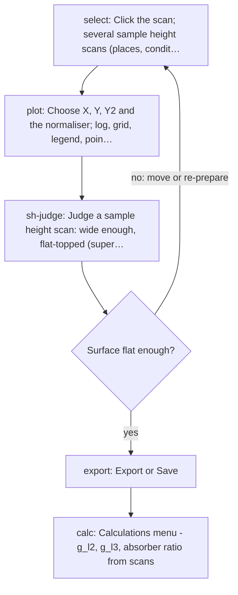

| Step | Do | Where | Controls | User decides | Automatic | Could be automatic | Known from | Issues |
|---|---|---|---|---|---|---|---|---|
| align.select (shared.series) | Click the scan; several sample height scans (places, conditions) are selected together to compare them on one plot (owner 2026-11-23) | left panel | `seriesComboBox`, `seriesWholeCheckBox`, `scanListWidget`, `scansLineEdit` | which series (or scans by number); Whole series on (default) or off | partly | select the newest series of the kind the user works on; in live mode follow it (built for whole-series selections, L3) | owner 2026-11-23; code | The Series list is a combo box with a placeholder first item ('Series: choose to select its scans'); the list of series is not visible at a glance (run 2026-11-22) Guessed series have n unknown ('4/?'); the kind is only a guess until the macros write #U Series (handoff_out/05) Selecting a scan always switches to the SpecPlot tab (code, scanListChanged), whatever the workflow |
| align.plot | Choose X, Y, Y2 and the normaliser; log, grid, legend, point labels; the fit (peak, edge or plateau) is in the title | SpecPlot tab | `spXComboBox`, `spYComboBox`, `spY2ComboBox`, `spNCheckBox`, `spNComboBox`, `spGainCheckBox`, `spPhotonCheckBox`, `spLogYCheckBox`, `spPointLabelsCheckBox` | columns and normaliser | partly | remember the columns per scan command (sh scan - Pilatus/Monc) | code; test tests/test_gui_workflows.py (motor scan plotted and fitted) |  |
| align.sh-judge | Judge a sample height scan: wide enough, flat-topped (super-Gaussian) rather than Gaussian-like; compare with the sample's earlier sh scans | SpecPlot | `spYComboBox`, `spNCheckBox` | whether to continue at this place, move, or prepare a new sample | no | a super-Gaussian fit (width, exponent) beside the earlier sh scans of the sample (F78); for a half-cut, the edge and beam size (F43) | owner 2026-11-23 | The title shows the fit chosen by fit_scan (peak, edge or plateau), not a flatness measure |
| align.export | Export or Save | SpecPlot tab | `spExportPushButton`, `specSaveWorkbookPushButton` | file name | no |  | code |  |
| align.calc | Calculations menu - g_l2, g_l3, absorber ratio from scans | Calculations menu | `actionG_l2`, `actionG_l3`, `actionAbs_ratio` | scans | no |  | code; guess (when used) |  |

## mca-look — Looking at MCA spectra

**Priority** 6. **Known from:** code.

**Experiment.** Single spectra or files from disk: calibration, line identification

**Recognised by.** Vortex scans; MCA files added from disk

**Outputs:** spectrum text file. **Script:** `exp.spectra(scans, channels)`. **Questions:** .

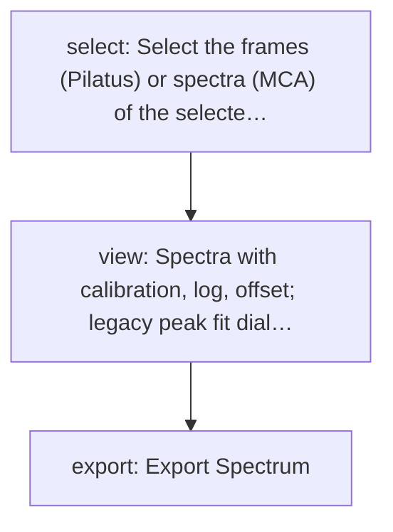

| Step | Do | Where | Controls | User decides | Automatic | Could be automatic | Known from | Issues |
|---|---|---|---|---|---|---|---|---|
| mca.select (shared.frames) | Select the frames (Pilatus) or spectra (MCA) of the selected scans; Select All for all of them | left panel (image list, labelled 'Pilatus:' or 'Vortex:') | `imageListWidget`, `imageSelectAllCheckBox` | all frames (usual) or a subset (left out of the reduction, kept in remakes) | no | select all frames of a whole-series selection by default; show a movie instead of tiles (F69) | code; test tests/test_gui_workflows.py | Selecting all frames draws every frame as a tile on the Pilatus tab (owner 2026-11-22: more than 6 tiles is too many, F69) Selecting frames switches to the Pilatus tab (2) or the MCA tab (5) (code) |
| mca.view | Spectra with calibration, log, offset; legacy peak fit dialog; add files from disk | MCA tab | `mcaCalibCheckBox`, `mcaLogYCheckBox`, `mcaOffsetCheckBox`, `mcaFitPushButton`, `mcaAddFilePushButton`, `mcaRemoveFilePushButton`, `mcaFileListWidget` |  | no | element line markers (F47) | code |  |
| mca.export | Export Spectrum | MCA tab | `mcaExportPushButton` | file name | no |  | code |  |

## flex-plot — Plot and 2D_Plot tabs on files from disk

**Priority** 6. **Known from:** code.

**Experiment.** Files written earlier (reduced curves, maps) plotted for comparison

**Recognised by.** files, not scans

**Outputs:** gradient file (Save Gradient). **Script:** `none`. **Questions:** Q-GEN-5.

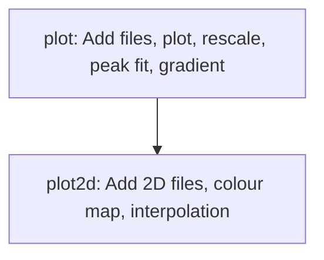

| Step | Do | Where | Controls | User decides | Automatic | Could be automatic | Known from | Issues |
|---|---|---|---|---|---|---|---|---|
| flex.plot | Add files, plot, rescale, peak fit, gradient | Plot tab | `plotAddFilePushButton`, `plotRemoveFilePushButton`, `plotFileListWidget`, `plotRSPushButton`, `plotPFPushButton`, `graPushButton`, `savegraPushButton`, `plotLogYCheckBox` | files | no |  | code |  |
| flex.plot2d | Add 2D files, colour map, interpolation | 2D_Plot tab | `twodPlotAddFilePushButton`, `twodPlotFileListWidget`, `twodCMapComboBox`, `twodLogIntCheckBox`, `twodIntPolComboBox`, `twodUpdatePlotPushButton` | files | no |  | code |  |

## session — Session - open, update, live, series, workbook, preferences, logs, panes

**Priority** 6. **Known from:** code; owner 2026-11-21/22.

**Experiment.** -

**Recognised by.** -

**Outputs:** <SPEC file>.reader.log; <SPEC file>_reader.xlsx. **Script:** `Experiment(specfile); lss_core.workbook.Workbook(...)`. **Questions:** Q-GEN-1; Q-GEN-2.

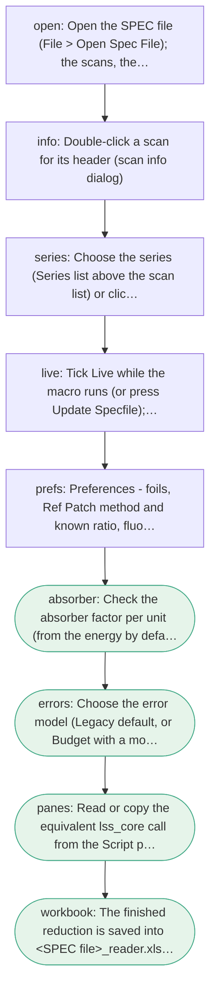

| Step | Do | Where | Controls | User decides | Automatic | Could be automatic | Known from | Issues |
|---|---|---|---|---|---|---|---|---|
| session.open (shared.open) | Open the SPEC file (File > Open Spec File); the scans, the series and the detector folders are read | File menu | `actionOpen_Spec_File` | which SPEC file | partly | reopen the last file and its workbook settings (F66 to-do); offer the series' reductions at once (F60) | code; run 2026-11-22 | Opening a file with Pilatus images presets the reflectivity ROI (21,11), the background offset (0.5), Qc (0.0217) and the absorber factor (code, openSpecFile ~l.744); nothing on screen says so A missing detector folder opens a directory chooser (F27) |
| session.info | Double-click a scan for its header (scan info dialog) | scan list | `scanListWidget`, `scanInfoDialog.scanInfoTextBrowser` |  | no |  | code (displayScanInfo) |  |
| session.series (shared.series) | Choose the series (Series list above the scan list) or click one of its scans; the whole series is selected by default | left panel | `seriesComboBox`, `seriesWholeCheckBox`, `scanListWidget`, `scansLineEdit` | which series (or scans by number); Whole series on (default) or off | partly | select the newest series of the kind the user works on; in live mode follow it (built for whole-series selections, L3) | owner 2026-11-21 (D55); test tests/test_gui_series.py; run 2026-11-22 | The Series list is a combo box with a placeholder first item ('Series: choose to select its scans'); the list of series is not visible at a glance (run 2026-11-22) Guessed series have n unknown ('4/?'); the kind is only a guess until the macros write #U Series (handoff_out/05) Selecting a scan always switches to the SpecPlot tab (code, scanListChanged), whatever the workflow |
| session.live (shared.live) | Tick Live while the macro runs (or press Update Specfile); new scans, frames and spectra are read, saved results remade | left panel, beside Update Specfile | `liveCheckBox`, `speUpSpeFilePushButton` | live on or off | partly | turn Live on when the file is still growing (a series 'in progress') | owner 2026-11-22 (D57); test tests/test_gui_live.py | Live stops by itself only for series with #U Series lines (L4); guessed series need a manual untick |
| session.prefs | Preferences - foils, Ref Patch method and known ratio, fluorescence elements, saving | File > Preferences | `actionPreferences`, `prefCalibratedCheckBox`, `prefPatchMethodComboBox`, `prefPatchAutoCheckBox`, `prefMcaCentrePushButton`, `prefSaveNoteCheckBox`, `prefAutoSaveCheckBox`, `prefNguiCheckBox`, `prefClosePushButton` |  | no |  | code | Settings that belong to one workflow (Ref Patch method, MCA elements) sit in a global dialog |
| session.absorber (shared.absorber) | Check the absorber factor per unit (from the energy by default, calibrated foils at 9.70-10.30 keV) | left panel; File > Preferences > Absorber foils | `AbsFacLineEdit`, `absFacEnergyCheckBox`, `actionPreferences`, `prefCalibratedCheckBox` | keep 'from E' (default on, D34) or type a factor | yes |  | owner 2026-11-17/18 (D23, D25, D34, F56); code | The field shows 'cal' when calibrated foils are used; what is used where (Ref Patch measures the scale, D21) is only in tooltips |
| session.errors (shared.errors) | Choose the error model (Legacy default, or Budget with a monitor model) | Errors pane (dock) | `errorModeComboBox`, `monitorKindComboBox`, `errorModel_sigma` | Legacy (default, byte-identical files) or Budget | yes |  | owner 2026-11-17 (D20, D22, D26); code | A global setting in a dock, far from the reductions it changes; which default the export should use is open (TODO B) |
| session.panes (shared.script) | Read or copy the equivalent lss_core call from the Script pane; messages in the Messages pane | Script and Messages panes (docks), View menu | `scriptView`, `messageView`, `menuView` |  | yes |  | code; docs docs/SCRIPTING.md |  |
| session.workbook (shared.workbook) | The finished reduction is saved into <SPEC file>_reader.xlsx automatically; Save stores a version with a note | Save button beside each Export; GID menu 'Save to workbook' | `prefAutoSaveCheckBox`, `prefSaveNoteCheckBox` | whether to add a 'user' version with a note | yes |  | owner 2026-11-21/22 (D53, D56); test tests/test_gui_workbook.py | Automatic saves report in the status bar only; there is no view of the workbook inside the reader |

## Controls by workflow

`S` named in a workflow step; `i` listed for the workflow in the inventory only; `B` both. Rows: inventory entries grouped by the first part of `where` (the tab or dialog); controls named in the map but missing from the inventory are listed at the end.

### (never shown)

| Control | burn-ref | burn-gid | burn-fluo | reflectivity | gid | xfntr | exafs | gisaxs | cuts | alignment | mca-look | flex-plot | session | general |
|---|---|---|---|---|---|---|---|---|---|---|---|---|---|---|
| `peakfit2` Dialog |  |  |  |  |  |  |  |  |  |  |  | i |  |  |
| `peakfitpara` Dialog |  |  |  |  |  |  |  |  |  |  |  | i |  |  |

### 2D_Plot

| Control | burn-ref | burn-gid | burn-fluo | reflectivity | gid | xfntr | exafs | gisaxs | cuts | alignment | mca-look | flex-plot | session | general |
|---|---|---|---|---|---|---|---|---|---|---|---|---|---|---|
| `tab_4` 2D_Plot |  |  |  |  | i |  |  | i |  |  |  | i |  |  |
| `twodPlotMplWidget`  |  |  |  |  | i |  |  | i |  |  |  | i |  |  |
| `twodMinHorizontalSlider` Min (%): |  |  |  |  |  |  |  |  |  |  |  | i |  |  |
| `twodMinLineEdit`  |  |  |  |  |  |  |  |  |  |  |  | i |  |  |
| `twodMaxHorizontalSlider` Max (%): |  |  |  |  |  |  |  |  |  |  |  | i |  |  |
| `twodMaxLineEdit`  |  |  |  |  |  |  |  |  |  |  |  | i |  |  |
| `twodPlotAddFilePushButton` Add Files |  |  |  |  |  |  |  |  |  |  |  | B |  |  |
| `twodPlotRemoveFilePushButton` Remove Files |  |  |  |  |  |  |  |  |  |  |  | i |  |  |
| `twodPlotFileListWidget`  |  |  |  |  |  |  |  |  |  |  |  | B |  |  |
| `twodLogIntCheckBox` Log Int |  |  |  |  |  |  |  |  |  |  |  | B |  |  |
| `twodColBarCheckBox` Show Color Bar |  |  |  |  |  |  |  |  |  |  |  | i |  |  |
| `twodCMapComboBox` CMap: |  |  |  |  |  |  |  |  |  |  |  | B |  |  |
| `twodLabelSizeSpinBox` Label Size |  |  |  |  |  |  |  |  |  |  |  | i |  |  |
| `twodTickSizeSpinBox` Tick Size |  |  |  |  |  |  |  |  |  |  |  | i |  |  |
| `twodDenFacSpinBox` Point Density Factor: |  |  |  |  |  |  |  |  |  |  |  | i |  |  |
| `twodIntPolComboBox` Image Interpolation: |  |  |  |  |  |  |  |  |  |  |  | B |  |  |
| `twodUpdatePlotPushButton` Updata Interpolation |  |  |  |  |  |  |  |  |  |  |  | B |  |  |

### Apex

| Control | burn-ref | burn-gid | burn-fluo | reflectivity | gid | xfntr | exafs | gisaxs | cuts | alignment | mca-look | flex-plot | session | general |
|---|---|---|---|---|---|---|---|---|---|---|---|---|---|---|
| `apexTab` Apex |  |  |  |  |  |  |  |  |  |  |  |  |  | i |
| `gixSpecCheckBox` DB Pos[x,y]: |  |  |  |  | i |  |  |  |  |  |  |  |  |  |
| `gixDBPosLineEdit`  |  |  |  |  | i |  |  |  |  |  |  |  |  |  |
| `gixSDDistLineEdit` SD Dist(mm): |  |  |  |  | i |  |  |  |  |  |  |  |  |  |
| `gixCcd_OffLineEdit` CCD_Pos[x,y](mm): |  |  |  |  | i |  |  |  |  |  |  |  |  |  |
| `gixBPCfacLineEdit` Bad Pix Corr: |  |  |  |  | i |  |  |  |  |  |  |  |  |  |
| `gixAxesComboBox` Axes: |  |  |  |  | i |  |  |  |  |  |  |  |  |  |
| `gixCMapComboBox` CMap: |  |  |  | i |  |  |  |  |  |  |  |  |  |  |
| `gixMplWidget`  |  |  |  |  |  |  |  |  |  |  |  |  |  | i |
| `gixLogIntCheckBox` Log Int |  |  |  |  | i |  |  |  |  |  |  |  |  |  |
| `gixMinHorizontalSlider` Min (%): |  |  |  |  | i |  |  |  |  |  |  |  |  |  |
| `gixMinLineEdit`  |  |  |  |  | i |  |  |  |  |  |  |  |  |  |
| `gixMaxHorizontalSlider` Max (%): |  |  |  |  | i |  |  |  |  |  |  |  |  |  |
| `gixMaxLineEdit`  |  |  |  |  | i |  |  |  |  |  |  |  |  |  |
| `gixMergeSameQzCheckBox` Merge Same Qzs |  |  |  | i |  |  |  |  |  |  |  |  |  |  |
| `gixRefPushButton` Reflectivity |  |  |  | i |  |  |  |  |  |  |  |  |  |  |
| `gixCutDirComboBox`  |  |  |  |  |  |  |  |  | i |  |  |  |  |  |
| `gixIntRangeLineEdit` Int Range: |  |  |  |  |  |  |  |  | i |  |  |  |  |  |
| `gixLineAreaPushButton` Line/Area Cuts |  |  |  |  |  |  |  |  | i |  |  |  |  |  |

### Bottom dock (tabbed with Messages and Errors)

| Control | burn-ref | burn-gid | burn-fluo | reflectivity | gid | xfntr | exafs | gisaxs | cuts | alignment | mca-look | flex-plot | session | general |
|---|---|---|---|---|---|---|---|---|---|---|---|---|---|---|
| `scriptDock` Script |  |  |  |  |  |  |  |  |  |  |  |  | i |  |

### Bottom dock (tabbed with Messages and Script)

| Control | burn-ref | burn-gid | burn-fluo | reflectivity | gid | xfntr | exafs | gisaxs | cuts | alignment | mca-look | flex-plot | session | general |
|---|---|---|---|---|---|---|---|---|---|---|---|---|---|---|
| `errorDock` Errors | i | i | i | i | i | i |  |  | i |  |  |  | i |  |

### Bottom dock (tabbed with Script and Errors)

| Control | burn-ref | burn-gid | burn-fluo | reflectivity | gid | xfntr | exafs | gisaxs | cuts | alignment | mca-look | flex-plot | session | general |
|---|---|---|---|---|---|---|---|---|---|---|---|---|---|---|
| `messageDock` Messages |  |  |  |  |  |  |  |  |  |  |  |  | i | i |

### Bottom of the window

| Control | burn-ref | burn-gid | burn-fluo | reflectivity | gid | xfntr | exafs | gisaxs | cuts | alignment | mca-look | flex-plot | session | general |
|---|---|---|---|---|---|---|---|---|---|---|---|---|---|---|
| `statusBar`  |  |  |  |  |  |  |  |  |  |  |  |  | i |  |

### Dialog (Burn test)

| Control | burn-ref | burn-gid | burn-fluo | reflectivity | gid | xfntr | exafs | gisaxs | cuts | alignment | mca-look | flex-plot | session | general |
|---|---|---|---|---|---|---|---|---|---|---|---|---|---|---|
| `pdburn` Dialog | i | i |  |  |  |  |  |  |  |  |  |  |  |  |
| `burnTabWidget` Trends \| Legacy | B | B |  |  |  |  |  |  |  |  |  |  |  |  |
| `burnConstantCheckBox` constant | B | B |  |  |  |  |  |  |  |  |  |  |  |  |
| `burnLinearCheckBox` linear | B | B |  |  |  |  |  |  |  |  |  |  |  |  |
| `burnExponentialCheckBox` exponential | B | B |  |  |  |  |  |  |  |  |  |  |  |  |
| `burnDoubleExponentialCheckBox` double exp. | B | B |  |  |  |  |  |  |  |  |  |  |  |  |
| `burnEstimatorComboBox` Estimator |  | B |  |  |  |  |  |  |  |  |  |  |  |  |
| `burnErrorsComboBox` Errors | B | B |  |  |  |  |  |  |  |  |  |  |  |  |
| `burnTimeComboBox` Time | B | B |  |  |  |  |  |  |  |  |  |  |  |  |
| `burnThresholdSpinBox` Change | B | B |  |  |  |  |  |  |  |  |  |  |  |  |
| `burnPositionLimitCheckBox` Position in limit |  | B |  |  |  |  |  |  |  |  |  |  |  |  |
| `burnAutoPeakCheckBox` Auto peak |  | B |  |  |  |  |  |  |  |  |  |  |  |  |
| `burnAnalysePushButton` Analyse | B | B |  |  |  |  |  |  |  |  |  |  |  |  |
| `burnSavePushButton` Save | B | B |  |  |  |  |  |  |  |  |  |  | i |  |
| `burnTrendPlotWidget`  | B | B |  |  |  |  |  |  |  |  |  |  |  |  |
| `burnResultLabel`  | B | B |  |  |  |  |  |  |  |  |  |  |  |  |
| `pdburn.plotWidget`  | i | i |  |  |  |  |  |  |  |  |  |  |  |  |
| `pdburn.refPushButton` REF | B |  |  |  |  |  |  |  |  |  |  |  |  |  |
| `pdburn.gidComboBox` GID |  | B |  |  |  |  |  |  |  |  |  |  |  |  |
| `pdburn.rangeLineEdit` Qxy range (single peak only) |  | B |  |  |  |  |  |  |  |  |  |  |  |  |
| `pdburn.closePushButton` Close | i | i |  |  |  |  |  |  |  |  |  |  |  |  |

### Dialog (GIOXS)

| Control | burn-ref | burn-gid | burn-fluo | reflectivity | gid | xfntr | exafs | gisaxs | cuts | alignment | mca-look | flex-plot | session | general |
|---|---|---|---|---|---|---|---|---|---|---|---|---|---|---|
| `pdgioxs` Dialog |  |  |  |  |  |  |  | i |  |  |  |  |  |  |
| `pdgioxs.frameLineEdit` ave frames |  |  |  |  |  |  |  | B |  |  |  |  |  |  |
| `pdgioxs.pointLineEdit` ave points |  |  |  |  |  |  |  | B |  |  |  |  |  |  |
| `pdgioxs.runPushButton` RUN |  |  |  |  |  |  |  | B |  |  |  |  |  |  |
| `pdgioxs.savePushButton` SAVE |  |  |  |  |  |  |  | B |  |  |  |  |  |  |
| `pdgioxs.closePushButton` CLOSE |  |  |  |  |  |  |  | i |  |  |  |  |  |  |
| `pdgioxs.plotWidget`  |  |  |  |  |  |  |  | i |  |  |  |  |  |  |

### Dialog (Limits Setup)

| Control | burn-ref | burn-gid | burn-fluo | reflectivity | gid | xfntr | exafs | gisaxs | cuts | alignment | mca-look | flex-plot | session | general |
|---|---|---|---|---|---|---|---|---|---|---|---|---|---|---|
| `peakpara` Dialog |  |  |  |  |  | i |  |  |  |  | i | i |  |  |
| `peakpara.minCB` Min: |  |  |  |  |  | i |  |  |  |  | i | i |  |  |
| `peakpara.maxCB` Max: |  |  |  |  |  | i |  |  |  |  | i | i |  |  |
| `peakpara.okPB` OK |  |  |  |  |  | i |  |  |  |  | i | i |  |  |
| `peakpara.cancelPB` Cancel |  |  |  |  |  | i |  |  |  |  | i | i |  |  |

### Dialog (Merge window)

| Control | burn-ref | burn-gid | burn-fluo | reflectivity | gid | xfntr | exafs | gisaxs | cuts | alignment | mca-look | flex-plot | session | general |
|---|---|---|---|---|---|---|---|---|---|---|---|---|---|---|
| `mcamerge` Dialog |  |  |  |  |  | i |  |  |  |  |  |  |  |  |
| `mcamerge.resLineEdit` 0 |  |  |  |  |  | B |  |  |  |  |  |  |  |  |
| `mcamerge.okPushButton` OK |  |  |  |  |  | B |  |  |  |  |  |  |  |  |
| `mcamerge.cancelPushButton` Cancel |  |  |  |  |  | i |  |  |  |  |  |  |  |  |

### Dialog (Peak Fit Panel)

| Control | burn-ref | burn-gid | burn-fluo | reflectivity | gid | xfntr | exafs | gisaxs | cuts | alignment | mca-look | flex-plot | session | general |
|---|---|---|---|---|---|---|---|---|---|---|---|---|---|---|
| `peakfit` Dialog |  |  |  |  |  | i |  |  |  |  | i | i |  |  |
| `peakfit.peakTypeComboBox` Peak type |  |  |  |  |  | i |  |  |  |  | i | i |  |  |
| `peakfit.numberOfPeakSpinBox` Number of Peak |  |  |  |  |  | i |  |  |  |  | i | i |  |  |
| `peakfit.invCheckBox` Inv. |  |  |  |  |  |  |  |  |  |  | i | i |  |  |
| `peakfit.bgSpinBox` BG poly order |  |  |  |  |  | i |  |  |  |  | i | i |  |  |
| `peakfit.rangeLineEdit` Fit range |  |  |  |  |  | i |  |  |  |  | i | i |  |  |
| `peakfit.peakTW` Peak Parameters |  |  |  |  |  | i |  |  |  |  | i | i |  |  |
| `peakfit.bgTW` bg Parameters |  |  |  |  |  | i |  |  |  |  | i | i |  |  |
| `peakfit.chiLineEdit` Chi_Sqaure |  |  |  |  |  | i |  |  |  |  | i | i |  |  |
| `peakfit.fitPushButton` Fit |  |  |  |  |  | i |  |  |  |  | i | i |  |  |
| `peakfit.exportFitPushButton` Export Fit |  |  |  |  |  |  |  |  |  |  | i | i |  |  |
| `peakfit.exportParaPushButton` Export Para |  |  |  |  |  |  |  |  |  |  | i | i |  |  |
| `peakfit.closePushButton` Close |  |  |  |  |  | i |  |  |  |  | i | i |  |  |

### Dialog (Pilatus GID Form Factor Setup)

| Control | burn-ref | burn-gid | burn-fluo | reflectivity | gid | xfntr | exafs | gisaxs | cuts | alignment | mca-look | flex-plot | session | general |
|---|---|---|---|---|---|---|---|---|---|---|---|---|---|---|
| `pdformfac` Dialog |  |  |  |  | i |  |  |  |  |  |  |  |  |  |
| `pdformfac.sphCheckBox` Sphere |  |  |  |  | B |  |  |  |  |  |  |  |  |  |
| `pdformfac.sphLineEdit` r (angstrom) |  |  |  |  | i |  |  |  |  |  |  |  |  |  |
| `pdformfac.ellCheckBox` Ellipsoid |  |  |  |  | i |  |  |  |  |  |  |  |  |  |
| `pdformfac.ellXYLineEdit` r_xy (angstrom) |  |  |  |  | i |  |  |  |  |  |  |  |  |  |
| `pdformfac.ellZLineEdit` r_z (angstrom) |  |  |  |  | i |  |  |  |  |  |  |  |  |  |
| `pdformfac.updatePushButton` Update Plot |  |  |  |  | B |  |  |  |  |  |  |  |  |  |
| `pdformfac.okPushButton` OK |  |  |  |  | i |  |  |  |  |  |  |  |  |  |

### Dialog (Plot Scale Setup)

| Control | burn-ref | burn-gid | burn-fluo | reflectivity | gid | xfntr | exafs | gisaxs | cuts | alignment | mca-look | flex-plot | session | general |
|---|---|---|---|---|---|---|---|---|---|---|---|---|---|---|
| `plotscale` Dialog |  |  |  |  |  |  |  |  |  |  |  | i |  |  |
| `plotscale.scaleTW` X Factor \| X Offset \| Y Factor \| Y Offset |  |  |  |  |  |  |  |  |  |  |  | i |  |  |
| `plotscale.closePB` Close |  |  |  |  |  |  |  |  |  |  |  | i |  |  |

### Dialog (Reflectivity Patch)

| Control | burn-ref | burn-gid | burn-fluo | reflectivity | gid | xfntr | exafs | gisaxs | cuts | alignment | mca-look | flex-plot | session | general |
|---|---|---|---|---|---|---|---|---|---|---|---|---|---|---|
| `refpatch` Dialog |  |  |  | i |  |  |  |  |  |  |  |  |  |  |
| `refpatch.Label` Reflectivity Patch between Scans 6 and 7 |  |  |  | i |  |  |  |  |  |  |  |  |  |  |
| `refpatch.plotWidget`  |  |  |  | i |  |  |  |  |  |  |  |  |  |  |
| `refpatch.dropPushButton` Drop |  |  |  | B |  |  |  |  |  |  |  |  |  |  |
| `refpatch.dropLineEdit` 0 |  |  |  | B |  |  |  |  |  |  |  |  |  |  |
| `refpatch.knownRatioLabel` fit +/-0.4%, foils +/-1.5% |  |  |  | B |  |  |  |  |  |  |  |  |  |  |
| `refpatch.knownRatioCheckBox` Known ratio |  |  |  | B |  |  |  |  |  |  |  |  |  |  |
| `refpatch.nextPushButton` Next>> |  |  |  | B |  |  |  |  |  |  |  |  |  |  |

### Dialog (identical scans)

| Control | burn-ref | burn-gid | burn-fluo | reflectivity | gid | xfntr | exafs | gisaxs | cuts | alignment | mca-look | flex-plot | session | general |
|---|---|---|---|---|---|---|---|---|---|---|---|---|---|---|
| `refpatchsamescan` Dialog |  |  |  | i |  |  |  |  |  |  |  |  |  |  |
| `refpatchsamescan.mergePushButton` Merge |  |  |  | B |  |  |  |  |  |  |  |  |  |  |
| `refpatchsamescan.dropPushButton` Drop |  |  |  | B |  |  |  |  |  |  |  |  |  |  |
| `refpatchsamescan.dropLineEdit` 0 |  |  |  | B |  |  |  |  |  |  |  |  |  |  |
| `refpatchsamescan.nextPushButton` Next>> |  |  |  | B |  |  |  |  |  |  |  |  |  |  |
| `refpatchsamescan.plotWidget`  |  |  |  | i |  |  |  |  |  |  |  |  |  |  |

### Errors pane

| Control | burn-ref | burn-gid | burn-fluo | reflectivity | gid | xfntr | exafs | gisaxs | cuts | alignment | mca-look | flex-plot | session | general |
|---|---|---|---|---|---|---|---|---|---|---|---|---|---|---|
| `errorModeComboBox` Error model | i | i | i | B | i | i |  |  | i |  |  |  | B |  |
| `monitorKindComboBox` Monitor model |  |  |  | S |  |  |  |  |  |  |  |  | B |  |
| `errorModel_sigma` Monitor sigma (%) |  |  |  | S |  |  |  |  |  |  |  |  | B |  |
| `errorModel_sigma_scan` Scan scatter (%) |  |  |  |  |  |  |  |  |  |  |  |  | i |  |
| `errorModel_width` t width |  |  |  |  |  |  |  |  |  |  |  |  | i |  |
| `errorModel_nu` t nu |  |  |  |  |  |  |  |  |  |  |  |  | i |  |
| `errorModel_f` Floor f |  |  |  |  |  |  |  |  |  |  |  |  | i |  |
| `errorModel_sigma_dark` Dark sigma |  |  |  |  |  |  |  |  |  |  |  |  | i |  |
| `errorModel_g` Quanta per count g |  |  |  |  |  |  |  |  |  |  |  |  | i |  |
| `errorModelLabel` legacy (per-pixel I/M^2 + I^2/M^3) ... |  |  |  |  |  |  |  |  |  |  |  |  | i |  |

### Fluorescence line fit options

| Control | burn-ref | burn-gid | burn-fluo | reflectivity | gid | xfntr | exafs | gisaxs | cuts | alignment | mca-look | flex-plot | session | general |
|---|---|---|---|---|---|---|---|---|---|---|---|---|---|---|
| `mcaFitDialog` Fluorescence line fit options |  |  |  |  |  | i | i |  |  |  |  |  |  |  |
| `mcaFitDetectorWidthCheckBox` width from the detector |  |  | S |  |  | i |  |  |  |  |  |  |  |  |
| `mcaFitNoiseSpinBox` Detector noise (FWHM) |  |  | S |  |  | i |  |  |  |  |  |  |  |  |
| `mcaFitEscapeCheckBox` strip Si escape peaks |  |  | S |  |  | i |  |  |  |  |  |  |  |  |

### GID patching worksheet

| Control | burn-ref | burn-gid | burn-fluo | reflectivity | gid | xfntr | exafs | gisaxs | cuts | alignment | mca-look | flex-plot | session | general |
|---|---|---|---|---|---|---|---|---|---|---|---|---|---|---|
| `gidWorksheetDialog` GID patching worksheet |  |  |  |  | i |  |  |  |  |  |  |  |  |  |
| `gidColumnsSpinBox` columns |  |  |  |  | B |  |  |  |  |  |  |  |  |  |
| `gidRowMinSpinBox` rows from |  |  |  |  | B |  |  |  |  |  |  |  |  |  |
| `gidRowMaxSpinBox` to |  |  |  |  | B |  |  |  |  |  |  |  |  |  |
| `gidQzDecimalsSpinBox` Qz decimals |  |  |  |  | i |  |  |  |  |  |  |  |  |  |
| `gidDthDecimalsSpinBox` angle decimals |  |  |  |  | i |  |  |  |  |  |  |  |  |  |
| `gidAreaCheckBox` Area correction |  |  |  |  | B |  |  |  |  |  |  |  |  |  |
| `gidHardSlitSpinBox` hard slit mm |  |  |  |  | i |  |  |  |  |  |  |  |  |  |
| `gidPolCheckBox` Polarisation |  |  |  |  | B |  |  |  |  |  |  |  |  |  |
| `gidVJoinKindComboBox` vertical join |  |  |  |  | i |  |  |  |  |  |  |  |  |  |
| `gidDistanceLabel` sample-detector |  |  |  |  | i |  |  |  |  |  |  |  |  |  |
| `gidAbsorberLabel` not applied |  |  |  |  | i |  |  |  |  |  |  |  |  |  |
| `gidPinholeCheckBox` Pinhole: angle per column |  |  |  |  | B |  |  |  |  |  |  |  |  |  |
| `gidPinholeDistSpinBox` S4-detector mm |  |  |  |  | B |  |  |  |  |  |  |  |  |  |
| `gidFitDistancePushButton` Fit |  |  |  |  | B |  |  |  |  |  |  |  |  |  |
| `gidFitLabel`  |  |  |  |  | B |  |  |  |  |  |  |  |  |  |
| `gidArmCheckBox` Arm correction |  |  |  |  | B |  |  |  |  |  |  |  |  |  |
| `gidResponseComboBox` response |  |  |  |  | B |  |  |  |  |  |  |  |  |  |
| `gidBeamFwhmSpinBox` FWHM um |  |  |  |  | i |  |  |  |  |  |  |  |  |  |
| `gidBeamCentreSpinBox` centre mm |  |  |  |  | i |  |  |  |  |  |  |  |  |  |
| `gidBeamCentreFitCheckBox` fit |  |  |  |  | i |  |  |  |  |  |  |  |  |  |
| `gidBeamHFwhmSpinBox` horizontal mm |  |  |  |  | i |  |  |  |  |  |  |  |  |  |
| `gidApplyJoinsCheckBox` Apply join factors |  |  |  |  | B |  |  |  |  |  |  |  |  |  |
| `gidFootprintComboBox` footprint |  |  |  |  | B |  |  |  |  |  |  |  |  |  |
| `gidTransverseComboBox` 2theta range |  |  |  |  | B |  |  |  |  |  |  |  |  |  |
| `gidMinFramesSpinBox` min frames |  |  |  |  | B |  |  |  |  |  |  |  |  |  |
| `gidLevelsLabel`  |  |  |  |  | B |  |  |  |  |  |  |  |  |  |
| `gidJoinTable` join \| direction \| from \| to \| points \| factor \| chi2/dof |  |  |  |  | B |  |  |  |  |  |  |  |  |  |
| `gidLiveCheckBox` Update the map on every change |  |  |  |  | B |  |  |  |  |  |  |  |  |  |
| `gidPatchPushButton` Patch |  |  |  |  | B |  |  |  |  |  |  |  |  |  |
| `gidDefaultsPushButton` Defaults |  |  |  |  | B |  |  |  |  |  |  |  |  |  |
| `gidClosePushButton` Close |  |  |  |  | i |  |  |  |  |  |  |  |  |  |

### Left panel

| Control | burn-ref | burn-gid | burn-fluo | reflectivity | gid | xfntr | exafs | gisaxs | cuts | alignment | mca-look | flex-plot | session | general |
|---|---|---|---|---|---|---|---|---|---|---|---|---|---|---|
| `specFileLabel` SpecFile: <name> |  |  |  |  |  |  |  |  |  |  |  |  | i |  |
| `speUpSpeFilePushButton` Update Specfile | S | S |  | S | S | S |  |  |  |  |  |  | B |  |
| `liveCheckBox` Live | B | B | i | S | S | S |  |  |  |  |  |  | B |  |
| `scansLineEdit` Scans: | S | S | S | S | S | S | S |  |  | S |  |  | S | i |
| `seriesComboBox` Series: choose to select its scans | B | B | B | B | B | B | B |  |  | S |  |  | B | i |
| `seriesWholeCheckBox` Whole series | S | S | S | S | S | S | S |  |  | S |  |  | B | i |
| `scanListWidget`  | S | S | S | S | S | S | S |  |  | S |  |  | S | i |
| `AbsFacLineEdit` Absorber Ratio: | i |  |  | i | i | i |  |  | i |  |  |  | S |  |
| `absFacEnergyCheckBox` from E | i |  |  | i | i | i |  |  |  |  |  |  | S |  |
| `imagesLabel` Detector: / Pilatus: / Vortex: |  |  |  |  |  |  |  |  |  |  |  |  |  | i |
| `imageSelectAllCheckBox` Select All | S | S | S | S | S | S | S | S | S |  | S |  |  | i |
| `gixSumCheckBox` Sum All | i | i |  |  | i |  |  | i | B |  |  |  |  |  |
| `imageListWidget`  | S | S | S | S | S | S | S | S | S |  | S |  |  | i |
| `backgroundPushButton` Background |  |  |  |  | B |  |  | B | i |  |  |  |  |  |
| `bgFacLineEdit` Fac: |  |  |  |  | B |  |  | i | i |  |  |  |  |  |
| `bgIgnoreNegCheckBox` Ignore -ve |  |  |  |  | B |  |  | i | i |  |  |  |  |  |
| `backgroundListWidget`  |  |  |  |  | B |  |  | i | i |  |  |  |  |  |
| `bgSelectAllCheckBox` Select All |  |  |  |  | B |  |  | i | i |  |  |  |  |  |
| `removePushButton` Remove |  |  |  |  | B |  |  | i | i |  |  |  |  |  |

### Line/Area Cuts

| Control | burn-ref | burn-gid | burn-fluo | reflectivity | gid | xfntr | exafs | gisaxs | cuts | alignment | mca-look | flex-plot | session | general |
|---|---|---|---|---|---|---|---|---|---|---|---|---|---|---|
| `cutAreaTab` Line/Area Cuts |  |  |  |  | i |  |  |  | i |  |  |  |  |  |
| `cutOffsetCheckBox` Offset Factor: |  |  |  |  |  |  |  |  | B |  |  |  |  |  |
| `cutOffsetLineEdit` 1.0 |  |  |  |  |  |  |  |  | B |  |  |  |  |  |
| `cutErrorbarCheckBox` Errorbar |  |  |  |  |  |  |  |  | B |  |  |  |  |  |
| `cutClearGraphPushButton` Clear Graph |  |  |  |  |  |  |  |  | B |  |  |  |  |  |
| `cutExportPushButton` Export |  |  |  |  | B |  |  |  | B |  |  |  |  |  |
| `cutSaveWorkbookPushButton` Save |  |  |  |  | B |  |  |  | B |  |  |  | i |  |
| `cutPlotMplWidget`  |  |  |  |  | i |  |  |  | i |  |  |  |  |  |
| `cutLogXCheckBox` LogX |  |  |  |  |  |  |  |  | i |  |  |  |  |  |
| `cutLogYCheckBox` LogY |  |  |  |  |  |  |  |  | B |  |  |  |  |  |
| `cutGridCheckBox` Grid |  |  |  |  |  |  |  |  | i |  |  |  |  |  |
| `cutLegendCheckBox` Legend |  |  |  |  |  |  |  |  | i |  |  |  |  |  |
| `cutLegendLocComboBox`  |  |  |  |  |  |  |  |  | i |  |  |  |  |  |
| `cutFitPushButton` Fit peaks |  | i |  |  | B |  |  |  | B |  |  |  |  |  |
| `cutFitOptionsPushButton` Fit options... |  |  |  |  | B |  |  |  | B |  |  |  |  |  |

### MCA

| Control | burn-ref | burn-gid | burn-fluo | reflectivity | gid | xfntr | exafs | gisaxs | cuts | alignment | mca-look | flex-plot | session | general |
|---|---|---|---|---|---|---|---|---|---|---|---|---|---|---|
| `mcaTab` MCA |  |  |  |  |  | i | i |  |  |  | i |  |  |  |
| `mcaPlotMplWidget`  |  |  |  |  |  | i | i |  |  |  | i |  |  |  |
| `mcaCalibCheckBox` Calib= |  |  | S |  |  | B | i |  |  |  | B |  |  |  |
| `mcaCalibConLineEdit` 0 |  |  |  |  |  | B | i |  |  |  | i |  |  |  |
| `mcaCalibLinLineEdit` 1 |  |  |  |  |  | B | i |  |  |  | i |  |  |  |
| `mcaCalibQuaLineEdit` 0 |  |  |  |  |  | B | i |  |  |  | i |  |  |  |
| `mcaOffsetCheckBox` Offset Factor: |  |  |  |  |  | S |  |  |  |  | B |  |  |  |
| `mcaOffsetLineEdit` 1.0 |  |  |  |  |  | S |  |  |  |  | i |  |  |  |
| `mcaNormComboBox` Normalized by |  |  | S |  |  | B | i |  |  |  | i |  |  |  |
| `mcaGainCheckBox` / gain |  |  |  |  |  | B | i |  |  |  | i |  |  |  |
| `mcaPhotonCheckBox` / photon |  |  |  |  |  | B | i |  |  |  | i |  |  |  |
| `mcaLogXCheckBox` LogX |  |  |  |  |  | i | i |  |  |  | i |  |  |  |
| `mcaLogYCheckBox` LogY |  |  |  |  |  | B | i |  |  |  | B |  |  |  |
| `mcaGridCheckBox` Grid |  |  |  |  |  |  |  |  |  |  | i |  |  |  |
| `mcaLegendCheckBox` Legend |  |  |  |  |  |  |  |  |  |  | i |  |  |  |
| `mcaLegendLocComboBox`  |  |  |  |  |  |  |  |  |  |  | i |  |  |  |
| `mcaExportPushButton` Export Spectrum |  |  |  |  |  | i | i |  |  |  | B |  |  |  |
| `mcaFitPushButton` Fit |  |  |  |  |  | B |  |  |  |  | B |  |  |  |
| `mcaFitAllPushButton` Fit All |  |  |  |  |  | B |  |  |  |  |  |  |  |  |
| `mcaFitLinesPushButton` Fit lines |  |  | S |  |  | B | B |  |  |  |  |  |  |  |
| `mcaFitOptionsPushButton` Fit options... |  |  | S |  |  | B | i |  |  |  |  |  |  |  |
| `mcaSumAllPushButton` Sum All |  |  | S |  |  | B | B |  |  |  |  |  |  |  |
| `mcaRanLineEdit` Range: |  |  | S |  |  | B | B |  |  |  |  |  |  |  |
| `mcaAcceptPushButton` Accept |  |  |  |  |  | B |  |  |  |  |  |  |  |  |
| `mcaXAxisComboBox` X-axis |  |  | S |  |  | B | B |  |  |  |  |  |  |  |
| `mcaDelPushButton` Delete |  |  |  |  |  | B | i |  |  |  |  |  |  |  |
| `mcaMergePushButton` Merge |  |  |  |  |  | B |  |  |  |  |  |  |  |  |
| `mcaExportIntPushButton` Export Integral |  |  | S |  |  | B | B |  |  |  |  |  |  |  |
| `mcaSaveWorkbookPushButton` Save |  |  | S |  |  | B | B |  |  |  |  |  | i |  |
| `mcaDataListWidget`  |  |  | S |  |  | B | i |  |  |  |  |  |  |  |
| `mcaIntPlotMplWidget`  |  |  |  |  |  | i | i |  |  |  |  |  |  |  |
| `mcaAddFilePushButton` Add Files |  |  |  |  |  | i |  |  |  |  | S | i |  |  |
| `mcaRemoveFilePushButton` Remove Files |  |  |  |  |  | i |  |  |  |  | S | i |  |  |
| `mcaFileListWidget`  |  |  |  |  |  | i |  |  |  |  | S | i |  |  |

### Main window (right of the left panel)

| Control | burn-ref | burn-gid | burn-fluo | reflectivity | gid | xfntr | exafs | gisaxs | cuts | alignment | mca-look | flex-plot | session | general |
|---|---|---|---|---|---|---|---|---|---|---|---|---|---|---|
| `PlotWidget` SpecPlot \| Pilatus \| Reflectivity \| Line/Area Cuts \| MCA \| Plot \| 2D_Plot |  |  |  |  |  |  |  |  |  |  |  |  |  | i |

### Main window, under the left panel and tabs

| Control | burn-ref | burn-gid | burn-fluo | reflectivity | gid | xfntr | exafs | gisaxs | cuts | alignment | mca-look | flex-plot | session | general |
|---|---|---|---|---|---|---|---|---|---|---|---|---|---|---|
| `commandLineEdit` Command: | i | i |  | i | i | i |  |  |  |  |  |  | i |  |

### Menu bar

| Control | burn-ref | burn-gid | burn-fluo | reflectivity | gid | xfntr | exafs | gisaxs | cuts | alignment | mca-look | flex-plot | session | general |
|---|---|---|---|---|---|---|---|---|---|---|---|---|---|---|
| `menuFile` File |  |  |  |  |  |  |  |  |  |  |  |  | i |  |
| `actionOpen_Spec_File` Open Spec File | S | S | S | S | S | S | S |  |  |  |  |  | B |  |
| `actionPreferences` Preferences... |  |  | S | i |  | S | S |  |  |  |  |  | B |  |
| `actionQuit` Quit |  |  |  |  |  |  |  |  |  |  |  |  | i |  |
| `menuBeamlines` Beamlines |  |  |  |  |  |  |  |  |  |  |  |  | i |  |
| `actionAPS_15IDC` APS-15IDC |  |  |  |  |  |  |  |  |  |  |  |  | i |  |
| `actionAPS_9IDC` APS-9IDC |  |  |  |  |  |  |  |  |  |  |  |  | i |  |
| `menuCalculations` Calculations |  |  |  | i |  |  |  |  |  | i |  |  |  |  |
| `actionG_l2` g_l2 |  |  |  |  |  |  |  |  |  | B |  |  |  |  |
| `actionG_l3` g_l3 |  |  |  |  |  |  |  |  |  | B |  |  |  |  |
| `actionAbs_ratio` abs ratio |  |  |  | i |  |  |  |  |  | B |  |  |  |  |
| `menuTools` Tools |  |  |  |  |  |  |  |  |  |  |  |  |  | i |
| `actionToolsWindow` All tools… |  |  |  |  |  |  |  |  |  |  |  |  |  | i |
| `menuHelp` Help |  |  |  |  |  |  |  |  |  |  |  |  | i |  |
| `actionDocumentation` Documentation |  |  |  |  |  |  |  |  |  |  |  |  | i |  |
| `actionAbout` About |  |  |  |  |  |  |  |  |  |  |  |  | i |  |
| `menuView` View |  |  |  |  |  |  |  |  |  |  |  |  | B |  |
| `messageDock_toggleViewAction` Messages |  |  |  |  |  |  |  |  |  |  |  |  | i |  |
| `scriptDock_toggleViewAction` Script |  |  |  |  |  |  |  |  |  |  |  |  | i |  |
| `errorDock_toggleViewAction` Errors |  |  |  |  |  |  |  |  |  |  |  |  | i |  |

### Messages pane

| Control | burn-ref | burn-gid | burn-fluo | reflectivity | gid | xfntr | exafs | gisaxs | cuts | alignment | mca-look | flex-plot | session | general |
|---|---|---|---|---|---|---|---|---|---|---|---|---|---|---|
| `messageView`  |  |  |  |  |  |  |  |  |  |  |  |  | B |  |

### Peak fit options

| Control | burn-ref | burn-gid | burn-fluo | reflectivity | gid | xfntr | exafs | gisaxs | cuts | alignment | mca-look | flex-plot | session | general |
|---|---|---|---|---|---|---|---|---|---|---|---|---|---|---|
| `cutFitDialog` Peak fit options |  |  |  |  | i |  |  |  | i |  |  |  |  |  |

### Peak fit options / Fluorescence line fit options

| Control | burn-ref | burn-gid | burn-fluo | reflectivity | gid | xfntr | exafs | gisaxs | cuts | alignment | mca-look | flex-plot | session | general |
|---|---|---|---|---|---|---|---|---|---|---|---|---|---|---|
| `cutFitShapeComboBox` Shape |  |  |  |  | i | i | i |  | i |  |  |  |  |  |
| `cutFitBackgroundComboBox` Background |  |  |  |  | i | i | i |  | i |  |  |  |  |  |
| `cutFitNumberSpinBox` Peaks per cut (0 = automatic) |  |  |  |  | i | i | i |  | i |  |  |  |  |  |
| `cutFitMaxSpinBox` At most |  |  |  |  | i | i | i |  | i |  |  |  |  |  |
| `cutFitProminenceSpinBox` Sensitivity (sigma) |  |  |  |  | i | i | i |  | i |  |  |  |  |  |
| `cutFitWindowSpinBox` Window half width (0 = automatic) |  |  |  |  | i | i | i |  | i |  |  |  |  |  |
| `cutFitFwhmSpinBox` Fixed FWHM (0 = fitted) |  |  |  |  | i | i | i |  | i |  |  |  |  |  |
| `cutFitRangeLineEdit` x range (min:max) |  |  |  |  | i | i | i |  | i |  |  |  |  |  |
| `cutFitCentresLineEdit` Centres |  |  |  |  | i | i | i |  | i |  |  |  |  |  |
| `cutFitFixCheckBox` fix the centres |  |  |  |  | i | i | i |  | i |  |  |  |  |  |
| `cutFitResultLabel`  |  |  |  |  | i | i | i |  | i |  |  |  |  |  |
| `cutFitNowPushButton` Fit now |  |  |  |  | i | i | i |  | i |  |  |  |  |  |
| `cutFitSavePushButton` Save results... / Save to workbook |  |  |  |  | i | i | i |  | i |  |  |  | i |  |

### Pilatus

| Control | burn-ref | burn-gid | burn-fluo | reflectivity | gid | xfntr | exafs | gisaxs | cuts | alignment | mca-look | flex-plot | session | general |
|---|---|---|---|---|---|---|---|---|---|---|---|---|---|---|
| `pilatusTab` Pilatus | i | i |  | i | i |  |  | i | i |  |  |  |  |  |
| `pilSpecCheckBox` DB Pos[x,y]: | S | i |  | B | i |  |  | i | i |  |  |  |  |  |
| `pilDBPosLineEdit`  | S |  |  | B | i |  |  | i | i |  |  |  |  |  |
| `pilSDDistLineEdit` SD Dist(mm): |  |  |  | i | i |  |  | i | i |  |  |  |  |  |
| `pilBPCiteSpinBox` Bad Pix Corr. Iter. | B | i |  | B | i |  |  | i | i |  |  |  |  |  |
| `pilBPCfacSpinBox` Fact. | B | i |  | B | i |  |  | i | i |  |  |  |  |  |
| `pilAxesComboBox` Axes: |  | S |  | i | B |  |  | B | B |  |  |  |  |  |
| `pilCMapComboBox` CMap: | i | B |  | i | B |  |  | i | i |  |  |  |  |  |
| `pilAspectComboBox` Aspect: |  | S |  |  | i |  |  | i | i |  |  |  |  |  |
| `pilMplWidget`  | i | i |  | i | i |  |  | i | i |  |  |  |  |  |
| `pilLogIntCheckBox` Log Int | i | B |  | i | B |  |  | i | i |  |  |  |  |  |
| `pilPinholeCheckBox` Pinhole |  | i |  |  | B |  |  |  | B |  |  |  |  |  |
| `pilMoviePushButton` Movie | i | B |  |  | B |  |  |  |  |  |  |  |  | i |
| `pilMinHorizontalSlider` Min (%): | i | B |  | i | i |  |  | i | i |  |  |  |  |  |
| `pilMinLineEdit`  | i | B |  | i | B |  |  | i | i |  |  |  |  |  |
| `pilMaxHorizontalSlider` Max (%): | i | B |  | i | i |  |  | i | i |  |  |  |  |  |
| `pilMaxLineEdit`  | i | B |  | i | B |  |  | i | i |  |  |  |  |  |
| `pilMergeSameQzCheckBox` Merge Same Qzs |  |  |  | B |  |  |  |  |  |  |  |  |  |  |
| `pilLowQzCorCheckBox` Low Qz Corr. |  |  |  | B |  |  |  |  |  |  |  |  |  |  |
| `pilRefPushButton` Reflectivity |  |  |  | B |  |  |  |  |  |  |  |  |  |  |
| `pilRefPatchPushButton` Ref Patch |  |  |  | B |  |  |  |  |  |  |  |  |  |  |
| `pilHSlitLineEdit` HSlits(Pixels): |  | i |  |  | B |  |  |  |  |  |  |  |  |  |
| `gidComboBox` GID |  |  |  |  | B |  |  |  |  |  |  |  |  |  |
| `gisaxsComboBox` GISAXS |  |  |  |  |  |  |  | B |  |  |  |  |  |  |
| `pilBurnPushButton` Burn Test | B | B |  |  |  |  |  |  |  |  |  |  |  |  |
| `pilGioxsPushButton` GIOXS |  |  |  |  |  |  |  | B | i |  |  |  |  |  |
| `pilCutDirComboBox`  |  |  |  |  | B |  |  |  | B |  |  |  |  |  |
| `pilIntRangeLineEdit` Int Range: min:max |  |  |  |  | B |  |  |  | B |  |  |  |  |  |
| `pilLineAreaPushButton` Line/Area Cuts |  |  |  |  | B |  |  |  | B |  |  |  |  |  |
| `gidPatchPushButton` GID Patch |  |  |  |  | B |  |  |  |  |  |  |  |  |  |
| `gidWorksheetPushButton` Worksheet... |  |  |  |  | i |  |  |  |  |  |  |  |  |  |

### Plot

| Control | burn-ref | burn-gid | burn-fluo | reflectivity | gid | xfntr | exafs | gisaxs | cuts | alignment | mca-look | flex-plot | session | general |
|---|---|---|---|---|---|---|---|---|---|---|---|---|---|---|
| `tab_3` Plot |  |  |  |  |  |  |  |  |  |  |  | i |  |  |
| `PlotMplWidget`  |  |  |  |  |  |  |  |  |  |  |  | i |  |  |
| `plotAddFilePushButton` Add Files |  |  |  |  |  |  |  |  |  |  |  | B |  |  |
| `plotRemoveFilePushButton` Remove Files |  |  |  |  |  |  |  |  |  |  |  | B |  |  |
| `plotMoveUpPushButton`  |  |  |  |  |  |  |  |  |  |  |  | i |  |  |
| `plotMoveDownPushButton`  |  |  |  |  |  |  |  |  |  |  |  | i |  |  |
| `plotFileListWidget`  |  |  |  |  |  |  |  |  |  |  |  | B |  |  |
| `plotRSPushButton` Rescale |  |  |  |  |  |  |  |  |  |  |  | B |  |  |
| `plotPFPushButton` Peak Fit |  |  |  |  |  |  |  |  |  |  |  | B |  |  |
| `graPushButton` Gradient |  |  |  |  |  |  |  |  |  |  |  | B |  |  |
| `savegraPushButton` Save Gradient |  |  |  |  |  |  |  |  |  |  |  | B |  |  |
| `plotLogXCheckBox` LogX |  |  |  |  |  |  |  |  |  |  |  | i |  |  |
| `plotLogYCheckBox` LogY |  |  |  |  |  |  |  |  |  |  |  | B |  |  |
| `plotGridCheckBox` Grid |  |  |  |  |  |  |  |  |  |  |  | i |  |  |
| `plotLegendCheckBox` Legend |  |  |  |  |  |  |  |  |  |  |  | i |  |  |
| `plotLegendLocComboBox`  |  |  |  |  |  |  |  |  |  |  |  | i |  |  |
| `onedStyComboBox` Style: |  |  |  |  |  |  |  |  |  |  |  | i |  |  |
| `onedLabelSizeSpinBox` Label Size |  |  |  |  |  |  |  |  |  |  |  | i |  |  |
| `onedTickSizeSpinBox` Tick Size |  |  |  |  |  |  |  |  |  |  |  | i |  |  |

### Preferences

| Control | burn-ref | burn-gid | burn-fluo | reflectivity | gid | xfntr | exafs | gisaxs | cuts | alignment | mca-look | flex-plot | session | general |
|---|---|---|---|---|---|---|---|---|---|---|---|---|---|---|
| `preferencesDialog` Preferences |  |  |  | i |  | i | i |  |  |  |  |  | i |  |
| `prefCalibratedCheckBox` Calibrated foils |  |  |  | i | i | i |  |  |  |  |  |  | S |  |
| `prefFoilTable`  |  |  |  | i |  | i |  |  |  |  |  |  |  |  |
| `prefFoilRangeLabel` 9.70-10.30 keV |  |  |  | i |  | i |  |  |  |  |  |  |  |  |
| `prefPatchAutoCheckBox` Known ratio when fit error > |  |  |  | B |  |  |  |  |  |  |  |  | S |  |
| `prefPatchThresholdSpinBox` 3.0 % |  |  |  | B |  |  |  |  |  |  |  |  |  |  |
| `prefPatchMethodComboBox`  |  |  |  | B |  |  |  |  |  |  |  |  | S |  |
| `prefMcaChannel1CheckBox` 1 |  |  | S |  |  | B | i |  |  |  |  |  |  |  |
| `prefMcaChannel2CheckBox` 2 |  |  |  |  |  | i | i |  |  |  |  |  |  |  |
| `prefMcaChannel3CheckBox` 3 |  |  |  |  |  | i | i |  |  |  |  |  |  |  |
| `prefMcaChannel4CheckBox` 4 |  |  |  |  |  | i | i |  |  |  |  |  |  |  |
| `prefMcaChannel5CheckBox` 5 |  |  |  |  |  | i | i |  |  |  |  |  |  |  |
| `prefMcaChannel6CheckBox` 6 |  |  |  |  |  | i | i |  |  |  |  |  |  |  |
| `prefMcaChannel7CheckBox` 7 |  |  |  |  |  | i | i |  |  |  |  |  |  |  |
| `prefMcaAllPushButton` All |  |  | S |  |  | S | B |  |  |  |  |  |  |  |
| `prefMcaCentrePushButton` Centre |  |  | S |  |  | B |  |  |  |  |  |  | S |  |
| `prefSaveNoteCheckBox` Ask for a note on every Save |  |  |  |  |  |  |  |  |  |  |  |  | B |  |
| `prefAutoSaveCheckBox` Save every reduction automatically |  |  |  |  |  |  |  |  |  |  |  |  | B |  |
| `prefNguiCheckBox` ngui (new layout, prototype) |  |  |  |  |  |  |  |  |  |  |  |  | B |  |
| `prefSumAllLegacyCheckBox` Sum All: average of normalised frames (legacy) |  |  |  |  |  |  |  |  |  |  |  |  |  | i |
| `prefRepeatsLegacyCheckBox` Ref Patch repeats: average (legacy) |  |  |  | i |  |  |  |  |  |  |  |  |  |  |
| `prefGisaxsRawCheckBox` GISAXS: raw counts (legacy) |  |  |  |  |  |  |  |  |  |  |  |  |  | i |
| `prefMcaFitLegacyCheckBox` Fluorescence fit: legacy Fit dialog |  |  |  |  |  |  |  |  |  |  |  |  |  | i |
| `prefBurnLegacyCheckBox` Burn test: show the Legacy tab |  |  |  |  |  |  |  |  |  |  |  |  |  | i |
| `prefBadgesComboBox` State badges: on / when not default / off |  |  |  |  |  |  |  |  |  |  |  |  |  | i |
| `prefClosePushButton` Close |  |  |  |  |  |  |  |  |  |  |  |  | B |  |

### Reflectivity

| Control | burn-ref | burn-gid | burn-fluo | reflectivity | gid | xfntr | exafs | gisaxs | cuts | alignment | mca-look | flex-plot | session | general |
|---|---|---|---|---|---|---|---|---|---|---|---|---|---|---|
| `refTab` Reflectivity |  |  |  | i |  |  |  |  |  |  |  |  |  |  |
| `refQzListWidget`  |  |  |  | B |  |  |  |  |  |  |  |  |  |  |
| `refSlitLineEdit` Slit(H,V): | B |  |  | B |  |  |  |  |  |  |  |  |  |  |
| `refBGDirComboBox` BG Dir: | B |  |  | B |  |  |  |  |  |  |  |  |  |  |
| `refCenCheckBox` Cen(H,V) |  |  |  | B |  |  |  |  |  |  |  |  |  |  |
| `refCenLineEdit`  |  |  |  | B |  |  |  |  |  |  |  |  |  |  |
| `refBGOffLineEdit` BG Offset (degree): | B |  |  | B |  |  |  |  |  |  |  |  |  |  |
| `refSeaWinLineEdit` Search Win: |  |  |  | B |  |  |  |  |  |  |  |  |  |  |
| `refBPCFacLineEdit` Bad Pixel Correction fac: |  |  |  | B |  |  |  |  |  |  |  |  |  |  |
| `refAnalyzePushButton` Analyze |  |  |  | B |  |  |  |  |  |  |  |  |  |  |
| `refAcceptPushButton` Accept |  |  |  | B |  |  |  |  |  |  |  |  |  |  |
| `refAnalyzeAllPushButton` Analyze All |  |  |  | B |  |  |  |  |  |  |  |  |  |  |
| `refADDataPlotWidget`  |  |  |  | i |  |  |  |  |  |  |  |  |  |  |
| `refBadPixListWidget` Bad Pixels: |  |  |  | i |  |  |  |  |  |  |  |  |  |  |
| `refQLineEdit` Q: |  |  |  | i |  |  |  |  |  |  |  |  |  |  |
| `refRLineEdit` R: |  |  |  | i |  |  |  |  |  |  |  |  |  |  |
| `refRErrLineEdit` R_Err: |  |  |  | i |  |  |  |  |  |  |  |  |  |  |
| `refPerRErrLineEdit` %R_Err: |  |  |  | i |  |  |  |  |  |  |  |  |  |  |
| `refComLineEdit` Comments: |  |  |  | i |  |  |  |  |  |  |  |  |  |  |
| `reflectivityDataLabel` Reflectivity Data: |  |  |  | i |  |  |  |  |  |  |  |  |  |  |
| `refNormFacCheckBox` Norm Factor |  |  |  | B |  |  |  |  |  |  |  |  |  |  |
| `refNormLineEdit`  |  |  |  | B |  |  |  |  |  |  |  |  |  |  |
| `refDelPushButton` Delete |  |  |  | B |  |  |  |  |  |  |  |  |  |  |
| `refDataTabWidget` Ref \| Norm Ref |  |  |  | i |  |  |  |  |  |  |  |  |  |  |
| `refDataListWidget` Ref |  |  |  | B |  |  |  |  |  |  |  |  |  |  |
| `refNormRefListWidget` Norm Ref |  |  |  | B |  |  |  |  |  |  |  |  |  |  |
| `refRefDataPlotwidget`  |  |  |  | i |  |  |  |  |  |  |  |  |  |  |
| `refExportPushButton` Export |  |  |  | B |  |  |  |  |  |  |  |  |  |  |
| `refCovarianceCheckBox` + covariance |  |  |  | B |  |  |  |  |  |  |  |  |  |  |
| `refSaveWorkbookPushButton` Save |  |  |  | B |  |  |  |  |  |  |  |  | i |  |
| `refQcLineEdit` Qc: |  |  |  | B |  |  |  |  |  |  |  |  |  |  |
| `refQoffLineEdit` Qoff: |  |  |  | B |  |  |  |  |  |  |  |  |  |  |
| `refRRFCheckBox` R/RF |  |  |  | B |  |  |  |  |  |  |  |  |  |  |
| `refLogYCheckBox` LogY |  |  |  | B |  |  |  |  |  |  |  |  |  |  |
| `refQzSqrCheckBox` Qz^2 |  |  |  | B |  |  |  |  |  |  |  |  |  |  |
| `refLegendCheckBox` Legend |  |  |  | B |  |  |  |  |  |  |  |  |  |  |
| `refLegendLocComboBox`  |  |  |  | i |  |  |  |  |  |  |  |  |  |  |
| `refAddFilePushButton` Add Files |  |  |  | B |  |  |  |  |  |  |  | i |  |  |
| `refRemoveFilePushButton` Remove Files |  |  |  | B |  |  |  |  |  |  |  | i |  |  |
| `refRefFileListWidget`  |  |  |  | B |  |  |  |  |  |  |  | i |  |  |

### Scan Details

| Control | burn-ref | burn-gid | burn-fluo | reflectivity | gid | xfntr | exafs | gisaxs | cuts | alignment | mca-look | flex-plot | session | general |
|---|---|---|---|---|---|---|---|---|---|---|---|---|---|---|
| `scanInfoDialog` Scan Details |  |  |  |  |  |  |  |  |  | i |  |  |  | i |
| `scanInfoDialog.scanInfoTextBrowser` Full Scan Info: |  |  |  |  |  |  |  |  |  |  |  |  | S | i |
| `scanInfoDialog.impInfoTextBrowser` Important Scan Info: |  |  |  |  |  |  |  |  |  |  |  |  |  | i |

### Scan Details (absorber ratio calculation)

| Control | burn-ref | burn-gid | burn-fluo | reflectivity | gid | xfntr | exafs | gisaxs | cuts | alignment | mca-look | flex-plot | session | general |
|---|---|---|---|---|---|---|---|---|---|---|---|---|---|---|
| `absratioDialog` Scan Details |  |  |  | i |  |  |  |  |  | i |  |  |  |  |

### Scan Details (bad pixels)

| Control | burn-ref | burn-gid | burn-fluo | reflectivity | gid | xfntr | exafs | gisaxs | cuts | alignment | mca-look | flex-plot | session | general |
|---|---|---|---|---|---|---|---|---|---|---|---|---|---|---|
| `pilBadPixDialog` Scan Details |  |  |  | i |  |  |  |  |  |  |  |  |  |  |
| `pilBadPixDialog.peakCenTextBrowser`  |  |  |  | i |  |  |  |  |  |  |  |  |  |  |

### Scan Details (beam centre off)

| Control | burn-ref | burn-gid | burn-fluo | reflectivity | gid | xfntr | exafs | gisaxs | cuts | alignment | mca-look | flex-plot | session | general |
|---|---|---|---|---|---|---|---|---|---|---|---|---|---|---|
| `pilPeakCenDialog` Scan Details |  |  |  | i |  |  |  |  |  |  |  |  |  |  |
| `pilPeakCenDialog.peakCenTextBrowser`  |  |  |  | i |  |  |  |  |  |  |  |  |  |  |

### Scan Details (g_l2 calculation)

| Control | burn-ref | burn-gid | burn-fluo | reflectivity | gid | xfntr | exafs | gisaxs | cuts | alignment | mca-look | flex-plot | session | general |
|---|---|---|---|---|---|---|---|---|---|---|---|---|---|---|
| `g_l2Dialog` Scan Details |  |  |  |  |  |  |  |  |  | i |  |  |  |  |
| `g_l2Dialog.g_l2CalPushButton` Calculate |  |  |  |  |  |  |  |  |  | i |  |  |  |  |
| `g_l2Dialog.g_l2centercheckBox` Centers: |  |  |  |  |  |  |  |  |  | i |  |  |  |  |

### Scan Details (g_l3 calculation)

| Control | burn-ref | burn-gid | burn-fluo | reflectivity | gid | xfntr | exafs | gisaxs | cuts | alignment | mca-look | flex-plot | session | general |
|---|---|---|---|---|---|---|---|---|---|---|---|---|---|---|
| `g_l3Dialog` Scan Details |  |  |  |  |  |  |  |  |  | i |  |  |  |  |
| `g_l3Dialog.g_l3CalPushButton` Calculate |  |  |  |  |  |  |  |  |  | i |  |  |  |  |
| `g_l3Dialog.g_l3centercheckBox` Centers: |  |  |  |  |  |  |  |  |  | i |  |  |  |  |

### Script pane

| Control | burn-ref | burn-gid | burn-fluo | reflectivity | gid | xfntr | exafs | gisaxs | cuts | alignment | mca-look | flex-plot | session | general |
|---|---|---|---|---|---|---|---|---|---|---|---|---|---|---|
| `scriptView`  |  |  |  |  |  |  |  |  |  |  |  |  | B |  |

### SpecPlot

| Control | burn-ref | burn-gid | burn-fluo | reflectivity | gid | xfntr | exafs | gisaxs | cuts | alignment | mca-look | flex-plot | session | general |
|---|---|---|---|---|---|---|---|---|---|---|---|---|---|---|
| `specPlotTab` SpecPlot |  |  |  |  |  |  |  |  |  | i |  |  |  | i |
| `spXComboBox` X: |  |  |  |  |  |  |  |  |  | B |  |  |  | i |
| `spYComboBox` Y1: |  |  |  |  |  |  |  |  |  | B |  |  |  | i |
| `spY2ComboBox` Y2: |  |  |  |  |  |  |  |  |  | B |  |  |  | i |
| `spNCheckBox`  |  |  |  |  |  |  |  |  |  | B |  |  |  | i |
| `spNComboBox` N: |  |  |  |  |  |  |  |  |  | B |  |  |  | i |
| `spGainCheckBox` / gain |  |  |  |  |  | i |  |  |  | B |  |  |  | i |
| `spPhotonCheckBox` / photon |  |  |  |  |  | i |  |  |  | B |  |  |  | i |
| `specPlotMplWidget`  |  |  |  |  |  |  |  |  |  | i |  |  |  | i |
| `spLogXCheckBox` LogX |  |  |  |  |  |  |  |  |  | i |  |  |  | i |
| `spLogYCheckBox` LogY |  |  |  |  |  |  |  |  |  | B |  |  |  | i |
| `spGridCheckBox` Grid |  |  |  |  |  |  |  |  |  | i |  |  |  | i |
| `spLegendCheckBox` Legend |  |  |  |  |  |  |  |  |  | i |  |  |  | i |
| `spPointLabelsCheckBox` Point # |  |  |  |  |  |  |  |  |  | B |  |  |  | i |
| `spLegendLocComboBox`  |  |  |  |  |  |  |  |  |  | i |  |  |  | i |
| `spExportPushButton` Export |  |  |  |  |  |  |  |  |  | B |  |  |  | i |
| `specSaveWorkbookPushButton` Save |  |  |  |  |  |  |  |  |  | B |  |  | i |  |

### Status bar, right

| Control | burn-ref | burn-gid | burn-fluo | reflectivity | gid | xfntr | exafs | gisaxs | cuts | alignment | mca-look | flex-plot | session | general |
|---|---|---|---|---|---|---|---|---|---|---|---|---|---|---|
| `errorsBadgeLabel` legacy errors \| budget errors |  |  |  |  |  |  |  |  |  |  |  |  |  | i |
| `normBadgeLabel` / Monc \| / Monc / gain \| / photon |  |  |  |  |  |  |  |  |  |  |  |  |  | i |
| `patchBadgeLabel` joint patch \| legacy patch |  |  |  | i |  |  |  |  |  |  |  |  |  | i |

### Wait

| Control | burn-ref | burn-gid | burn-fluo | reflectivity | gid | xfntr | exafs | gisaxs | cuts | alignment | mca-look | flex-plot | session | general |
|---|---|---|---|---|---|---|---|---|---|---|---|---|---|---|
| `progressDialog` Wait |  |  |  |  |  |  |  |  |  |  |  |  |  | i |

