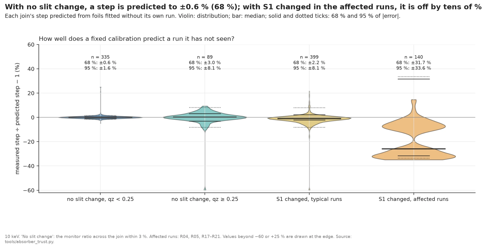
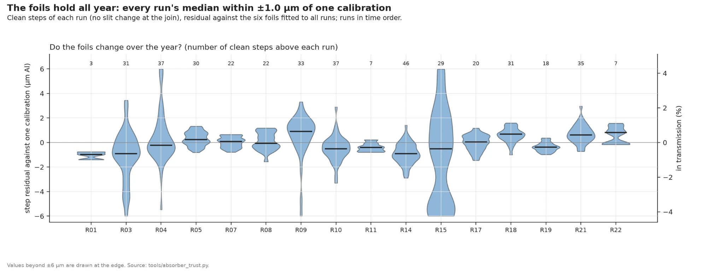
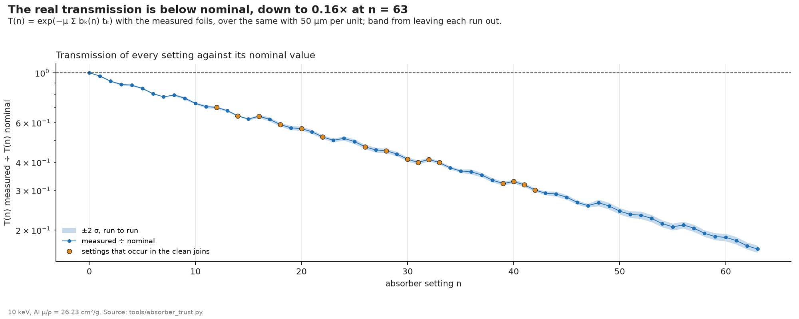
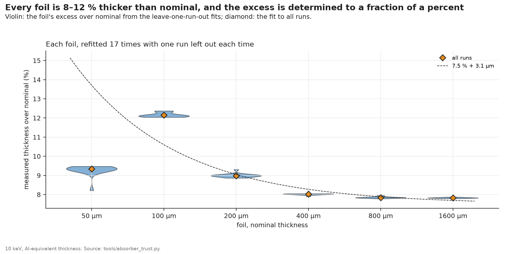
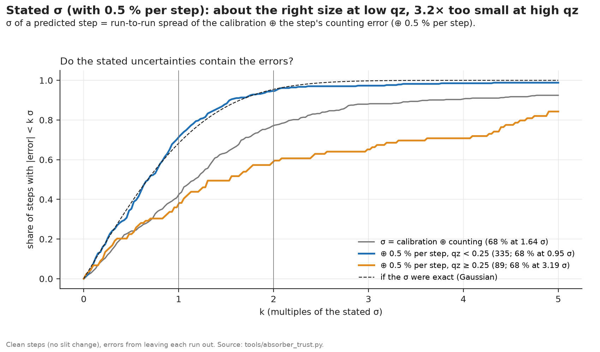

# How far can the ChemMatCARS absorber ratios be trusted?

*A data-driven account of the attenuator used for X-ray reflectivity at ChemMatCARS (APS 15-ID-C), from one year of users' reflectivity data at 10 keV. Generated by `tools/absorber_trust.py`; every number below is computed from the data. Runs are labelled R01 to R22 in time order; no user, sample or date is identified.*

## In short

- **The six foils are well calibrated and stable.** Fitted from 409 clean overlaps, each foil is known to better than 1 µm of aluminium, and over the whole year each run's overlaps agree with one fixed calibration to within ±1.0 µm (≈ ±0.7 % in transmission).
- **A step between two settings is predicted to about ±0.6 % (68 %), ±1.6 % (95 %)** when the slits stay the same at the join and the overlap is at low qz, in a run the calibration did not see (measured by leaving each run out).
- **At high qz** (overlap above 0.25 Å⁻¹, few counts) the same holds on average, but single steps scatter more: ±3.0 % (68 %).
- **When the incident slit S1 changes at the same join, trust drops.** In typical runs the steps scatter ±2.2 % (68 %). In a group of runs (R04, R05, R17–R21) the beam monitor did not follow the slit change, and steps there are off by -26 % (median). There, patch the scans; don't use a fixed factor.
- **The nominal values (50 µm per unit) are too thin by 8–12 % per foil**: use the measured foils, not the nominal ones.

## What the absorber is

The attenuator is a stack of six aluminium foils, nominally 1, 2, 4, 8, 16 and 32 units of 50 µm, inserted in binary combinations: setting n (0 to 63) puts foil k in the beam when bit k of n is set. The beam transmitted at setting n is T(n) = exp(−μ Σₖ bₖ(n) tₖ), with tₖ each foil's thickness and μ aluminium's attenuation coefficient (NIST SRD 126: μ/ρ = 26.23 cm²/g at 10 keV, ρ = 2.699 g/cm³, so 1 µm of Al attenuates 0.71 %).

## How the foils were measured

A reflectivity curve spans many decades, so it is measured in segments: each later segment has fewer foils in and starts at qz values the previous one already measured. At those shared qz, the detector counts divided by the beam monitor (and the monitor's gain) in the two segments differ only by the foils that changed. That ratio, a **step**, is a direct measurement of those foils' transmission, with no model of the reflectivity curve: it cancels at equal qz.

- 963 such joins at 10 keV were found in one year of users' data. 409 are **clean**: the ratio of the two beam monitors (one before and one after the incident slit) is unchanged across the join (within 3 %), and the overlap points agree with each other (χ²/dof < 20).
- A least-squares fit of the six foils to the clean steps (each step's counting error plus 0.5 %, outliers beyond 5 robust standard deviations dropped) keeps 389 joins, determines all six foils, and leaves a scatter of 0.87 µm per join.
- An independent analysis, written separately from the same overlap table, gave the same foils to 0.1 µm.

| foil | nominal (µm) | measured (µm) | ± fit | ± run to run | excess over nominal |
|---|---|---|---|---|---|
| 0 (1 units) | 50 | **54.7** | 0.1 | 0.6 | +9.3 % |
| 1 (2 units) | 100 | **112.2** | 0.1 | 0.5 | +12.2 % |
| 2 (4 units) | 200 | **218.0** | 0.2 | 0.8 | +9.0 % |
| 3 (8 units) | 400 | **432.1** | 0.2 | 0.6 | +8.0 % |
| 4 (16 units) | 800 | **862.7** | 0.4 | 1.3 | +7.8 % |
| 5 (32 units) | 1600 | **1725.1** | 0.5 | 1.3 | +7.8 % |

'± run to run' is the leave-one-run-out (jackknife) standard deviation: how much the foil changes when any one of the 17 runs is left out. Every foil is thicker than nominal by about 7.5 % plus 3 µm (figure 4).

## Why the ratios can be trusted

1. **They agree with each other.** The 389 clean steps, spanning many foil combinations, are fitted by six numbers to 0.87 µm per step (≈ 0.6 %).
2. **They don't change over the year.** Each run's clean steps, against the one calibration, have median residuals within ±1.0 µm (figure 2). Calibrating on the first half of the year alone gives the same foils to better than 1 µm.
3. **They predict runs they never saw.** Leaving each run out of the fit and predicting its steps, the errors in the clean, low-qz joins are ±0.6 % (68 %) and ±1.6 % (95 %), centred on +0.01 % (figure 1).
4. **The stated uncertainties were tested against the errors** (figure 5). The run-to-run spread of the calibration and the step's counting error alone are too small: 68 % of the errors need 1.64 σ. Adding the scatter of one step measured in the fit (0.5 % per step) gives 65 % within 1 σ and 87 % within 2 σ (Gaussian: 68 %, 95 %); 68 % needs 1.09 σ overall, 0.95 σ at low qz and 3.19 σ at high qz. So the stated σ, with the 0.5 % term, is about the right size at low qz and should be scaled by about 3.2 at high qz.

## When to trust them, and how far (10 keV)

| situation | joins | median error | 68 % within | 95 % within | advice |
|---|---|---|---|---|---|
| no slit change, qz < 0.25 | 335 | +0.0 % | ±0.6 % | ±1.6 % | Use the measured foils. Quote ±0.6 % (68 %). |
| no slit change, qz ≥ 0.25 | 89 | +0.2 % | ±3.0 % | ±8.1 % | Use the measured foils, but quote ±3 % (68 %): single steps scatter more than their counting errors explain (figure 5), not because the foils differ. |
| S1 changed, typical runs | 399 | -1.0 % | ±2.2 % | ±8.1 % | Use with care, or patch: the slit change adds scatter. |
| S1 changed, affected runs | 140 | -26.0 % | ±31.7 % | ±33.6 % | Don't use a fixed factor. Patch the scans. |

*Error = measured step ÷ predicted step − 1, the prediction made without the step's own run.*

**Outside these tables, the calibration is not established:**

- **Other energies.** Everything here is at 10 keV. At other energies the same foils should hold in µm of aluminium, but only if they are pure aluminium; this was not tested. At 30 keV the beamline uses copper foils, which are not covered.
- **Settings the data never saw.** Each foil is determined, but settings above 42 never occur in the clean joins; their transmission is predicted from the foils, not measured.
- **When the incident slit changes at the same time.** The beam monitor is meant to follow slit changes. In most runs it does to about 1–2 %; in the affected runs it did not, by up to 46 %. Comparing scans at different slit settings through the monitor alone is unsafe in those runs, whatever the absorber.

## Transmission of each setting

With the measured foils, T(n) is below its nominal value by a factor that grows with the number of units in the beam (figure 3). For a few settings commonly used in reflectivity:

| setting n | foils in (b5…b0) | T, nominal | T, measured | ± (run to run) | measured ÷ nominal |
|---|---|---|---|---|---|
| 2 | 000010 | 0.4927 | 0.452 | 0.32 % | 0.918 |
| 6 | 000110 | 0.1196 | 0.09661 | 0.40 % | 0.808 |
| 12 | 001100 | 0.0143 | 0.01003 | 0.56 % | 0.702 |
| 16 | 010000 | 0.00347 | 0.002226 | 0.91 % | 0.642 |
| 20 | 010100 | 0.0008422 | 0.0004758 | 1.05 % | 0.565 |
| 24 | 011000 | 0.0002044 | 0.0001045 | 1.06 % | 0.511 |
| 26 | 011010 | 0.0001007 | 4.723e-05 | 1.06 % | 0.469 |
| 30 | 011110 | 2.444e-05 | 1.01e-05 | 0.98 % | 0.413 |
| 33 | 100001 | 8.452e-06 | 3.372e-06 | 0.88 % | 0.399 |
| 42 | 101010 | 3.495e-07 | 1.054e-07 | 0.85 % | 0.301 |
| 52 | 110100 | 1.014e-08 | 2.362e-09 | 1.92 % | 0.233 |

## Figures

**Figure 1.** How well a fixed calibration predicts a run it has not seen, by situation (violin: the distribution of the prediction errors; bar: the median; ticks: 68 % and 95 %).

**Figure 2.** The clean steps of each run against the one calibration: the foils hold over the year.

**Figure 3.** Measured over nominal transmission for every setting, with its run-to-run band.

**Figure 4.** Each foil's thickness, as the leave-one-run-out distribution, against nominal.

**Figure 5.** Do the stated uncertainties cover the errors? Share of clean steps within k σ, against k.

## Method notes

- Detector: the Pilatus region of interest; monitor: the ion chamber after the incident slit, divided by its logged gain; each point's error is its Poisson error plus 0.05 % for the monitor.
- Step = Poisson-weighted mean of the ratio over the qz values both segments measured (matched to 1e-5 in L), no interpolation.
- A join counts as having no slit change when the monitor ratio (after / before the incident slit) is within 3 % across it.
- Prediction error by leaving one run out; uncertainty of a prediction = jackknife spread over runs ⊕ the step's counting error.
- Limits: users' data, not a dedicated calibration; joins at 10 keV only; few joins exercise the two thickest foils alone.
