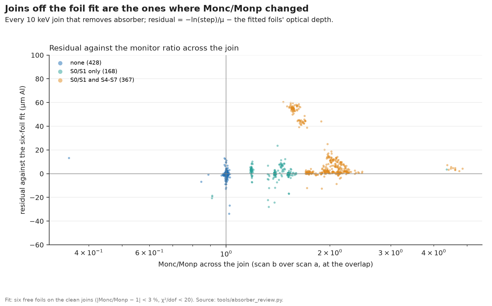
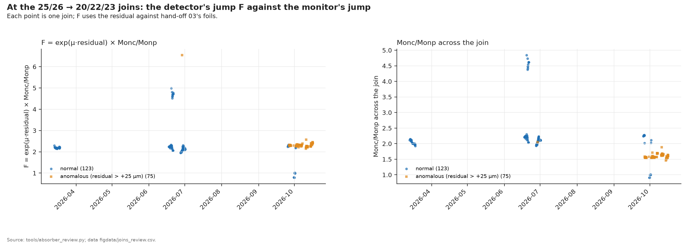
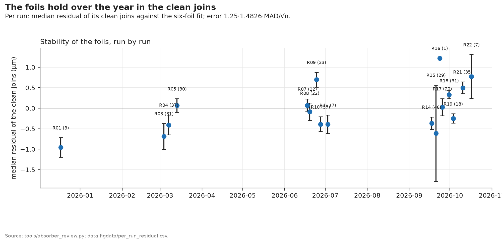
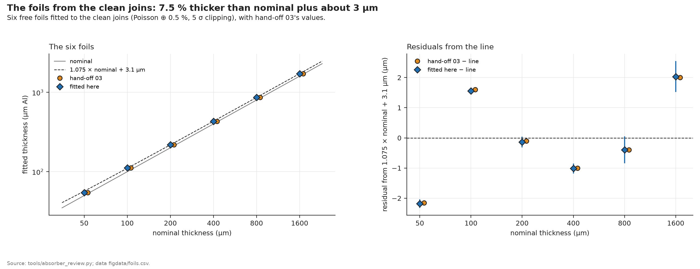
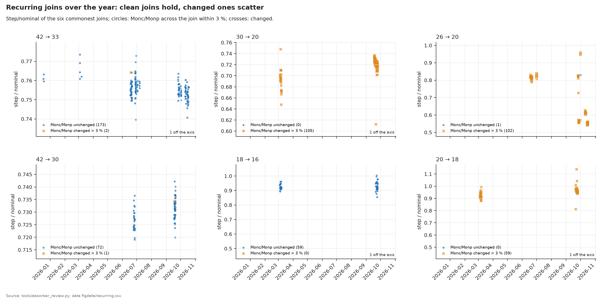
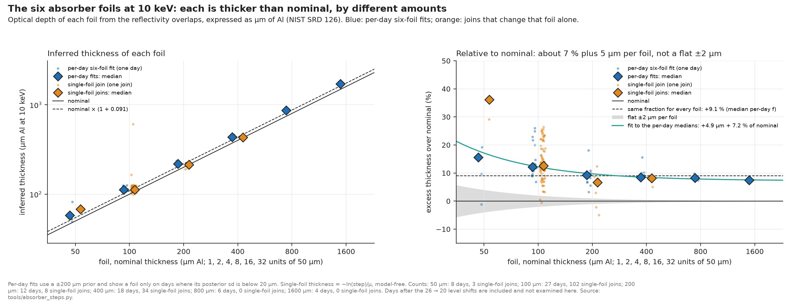
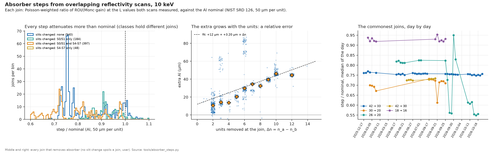
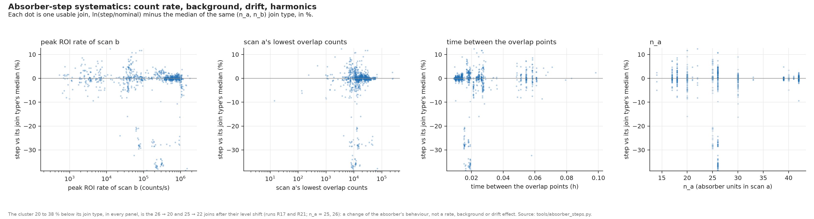

# Hand-off to LSS_Reader2: answer to hand-off 03 (absorber review)

Written 2026-11-18 by the agent with the SPEC files. File and run ids are anonymous (F…, R…), as in `joins.csv`.
Nothing was checked at the beamline. Measured = computed from the SPEC files; reasoning = argued.

## What to read

| File | What it holds |
|---|---|
| `REVIEW_03.md` | The four checks of your §2, which of your numbers were reproduced, and the five figures' list |
| `figdata/*.csv` | The data behind the five figures (`joins_review.csv` is every join with both residuals, F, the monitors per second for scans a and b, and Monc/Monp along scan b) |
| `REPORT.md` | The hand-off 02 answer, revised in place where your review was right (slit statement, slit check, answer 3) |
| `joins.csv` | Regenerated: the slit classifier is fixed, and columns `monc_cps_a/b`, `monp_cps_a/b`, `monc_monp_b_last_over_first` are new |

The figures are below and in `figures/`. **Dates have been removed from every CSV in this package** (the `day` and `date` columns); rows keep their anonymous file, run and scan ids, so their order within a run is kept.

## Results (all measured)

- **Your foil fit reproduces exactly.** 409 clean joins, 389 kept, rank 6, scatter 0.87 µm. Foils 54.7 / 112.2 /
  218.0 / 432.1 / 862.7 / 1725.1 µm, within 0.1 µm of yours. By half-year and at a 1 % Monc/Monp tolerance, no
  foil moves more than 1 µm (the second half alone does not determine foils 4 and 5).
- **The foils are constant all year.** Each run's median residual of clean joins is within ±1.2 µm.
- **Your P29 holds: the jumps are the monitor.**
  - At 25/26 → 20/22/23 with S1 0.04 → 0.10 mm, the blades are the same in normal and anomalous joins (S4 1 → 4 mm,
    centres 0).
  - It is **scan a's Monc that reads high** at the narrow gap. Within R17, Monc/Monp in scan a rose ×1.35 after
    2026-09-26 while scan b's moved ×0.93. Monp is unchanged across every join, and F stays 2.2–2.3.
- **It is not a Monc preamp offset.** That would need about 7.6e4 counts/s; Monc reads 7–150 counts/s with the
  beam off on every such day, the anomalous period included.
- **Patching at the overlap does not fix the rest of scan b in the anomalous series.** Monc/Monp along scan b falls
  ×0.92 there against ×0.82 normally.
- **Your classifier point was right.** No join has S4 moved without S1; the 367 "S4–S7" joins were S1 + S4.

## Your numbers, reproduced or not

All reproduced: R04/R05 at about +11 µm (+10.6, +11.5), and R18's S1-only joins at a ratio of 0.91 and −19 to
−21 µm (S1 0.2 → 0.1 mm, F 0.79). One correction: "F = 2.2–2.3 every time" holds for S1 0.04 → 0.10 mm only. A
June group at 0.02 → 0.10 mm has F ≈ 4.7 (Monc follows it, ×4.58). One isolated R10 join (+164 µm, F 6.5) is a
failed join, not part of the series.

## Open

- **Why Monc over-reads at the narrow S1 gap from 2026-09-26 (R17–R21) and slightly in R04/R05.** It needs beam
  (not an offset). Candidates are scatter from the S1 blades into Monc, or where the beam sits on the narrow slit
  (reasoning; not determined).
- **The owner's position.** The owner said Monc normalises S1 changes; the data agree for most runs and disagree
  for these. Paths that compare scans at different S1 gaps through Monc alone, without patching, are off by up to
  46 % in those runs.
- `joins.csv` holds per-join data from users' beamtimes. The owner decides whether it may go to a public fork.

## Figures

**Figure 1.** Residual of every join against the six-foil fit, against Monc/Monp across the join, by slit class. The clean cluster sits at a ratio of 1; the +54 µm cluster at 1.55–1.62 is the anomalous series.

**Figure 2.** The 25/26 → 20/22/23 joins over time: the detector's jump F (left) stays 2.2–2.3 at the S1 0.04 → 0.10 mm change while Monc/Monp across the join (right) drops to 1.55–1.62 in the anomalous series. The June group near 4.7 is an S1 0.02 → 0.10 mm change.

**Figure 3.** Per-run median residual of the clean joins: the foils hold to ±1.2 µm all year.

**Figure 4.** The six foils fitted from the clean joins against nominal, with 1.075 × nominal + 3.1 µm and the residuals from it; hand-off 03's values beside them.

**Figure 5.** Step/nominal of the six commonest joins over time; circles: Monc/Monp across the join within 3 %, crosses: changed.

**Figure 6** (hand-off 02 answer). Each foil's thickness from the per-day fits and from joins that change that foil alone.

**Figure 7** (hand-off 02 answer). Step/nominal of every join, the extra Al against the units removed, and the commonest joins over time.

**Figure 8** (hand-off 02 answer). Residuals against count rate, background, time between the overlap points and n_a.
