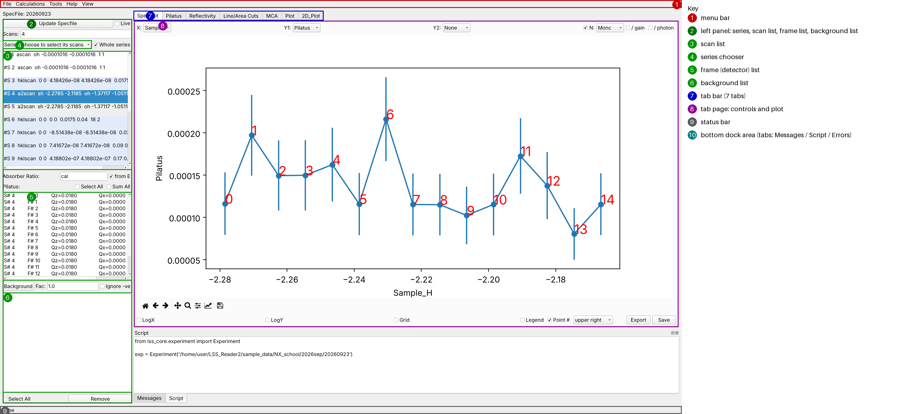
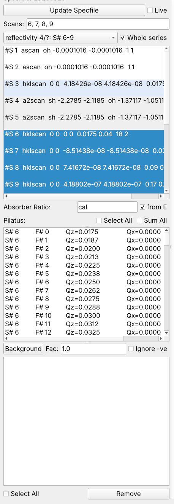

# 1. The window

[Contents](README.md) · next: [Normalisation, absorbers and errors](02_normalisation.md)

## Starting the reader

- **Windows, packaged build:** unzip the release's `LSS_Reader-2.0.0-Windows.zip` anywhere and run `LSS_Reader.exe` in the
  folder. Nothing else needs installing.
- **macOS, packaged build:** unzip and open `LSS_Reader.app`. It is not signed yet, so the first time,
  right-click it and choose Open.
- **From the source:** `pip install -r requirements.txt`, then `python LSS_Reader.py` from the repository
  folder (the program finds its window layouts and icons relative to that folder).

The window is wide. On a laptop screen, maximise it; the panes at the bottom can be hidden from the View
menu to give the plots room.

## Opening a SPEC file

**File → Open Spec File** and choose the file. The reader then:

- reads every scan (`#S` line) and its parameters;
- finds the detector data in the fixed folders beside the SPEC file: Pilatus frames in `pilatus/`
  (`<spec>_SCAN-<n>_<frame>.tif`) and MCA spectra in `vortex/` (`<spec>_<n>_mca`). If a folder the file
  needs is not there, a folder chooser asks where it is;
- recognises the **series**: the scans one experiment macro took together;
- takes the workbook's write access if no other reader has it (see [below](#two-readers-on-one-file)),
  and opens its per-file log.

A file that is not a SPEC file (it does not start with `#F`) is refused with a message, and nothing
changes. Repeated scan numbers, a scan whose `#L` line names more or fewer columns than its rows hold, and
a last data line that SPEC is still writing are all read as far as they can be, with one message each.

**Update Specfile** reads the file again after SPEC has written more, without resetting the window. For
data still being taken, tick **Live** instead ([below](#live-mode)).

**Double-click a scan** to open its details: the scan's lines from the SPEC file and a digest of the
detector, energy, absorber, sample position, Q, slits and direct-beam pixel.

## The left panel

From top to bottom:

- **Series** (the drop-down above the scans). Each series of the file, as "kind done/planned (status):
  S# scans", for example "reflectivity 4/?: S# 6-9". Choosing one selects its data scans in one action;
  alignment scans taken between them are not selected. The series come from the file's `#U Series` lines
  where the macros write them, and are otherwise guessed:

  | Kind | Guessed from |
  |---|---|
  | reflectivity | L scans whose Qz ranges move up and overlap |
  | gid | consecutive `ascan dth` scans with images |
  | xfntr | L scans marked `#V` |
  | energy | `escan` scans |
  | burn | `ascan ih` scans that do not move |

  "?" means the file does not say how many scans were planned. The status is complete, partial (a scan
  stopped early), aborted, or still being written. The item's tooltip says how the series was found and
  what is missing.

- **Whole series** (ticked by default). Clicking any scan of a series selects all its data scans.
  Ctrl-click still removes one; alignment scans are selected alone; scan numbers you type are never
  widened. Untick it to select scans one at a time.

- **The scan list.** One row per scan. Scans that belong to a series are faintly tinted by kind: blue
  reflectivity, green GID, orange XFNTR, purple energy scan, red burn, grey for the alignment scans taken
  within a series. Hover a row for its series, its place in it ("scan 2 of
  4") and its status.

- **Absorber Ratio** with **from E**. The transmission factor per absorber unit, used to undo the
  absorbers ([chapter 2](02_normalisation.md#absorbers)). With **from E** ticked (the default) it follows
  the energy of the selected scans and reads "cal" when the calibrated foils are in use.

- **The frame list** (labelled "Pilatus:" or "Vortex:" after the detector). The frames or spectra of the
  selected scans, each with its scan (S#), frame (F#), Qz, Qx and absorber ("Abs=n", or "Abs=?" when the
  setting cannot be read). **Select All** selects every frame. **Sum All** adds the selected frames into
  one ([chapter 4](04_frames.md#summing-frames)).

- **Background**, **Fac**, **Ignore -ve** and the background list: frames to subtract from the others
  ([chapter 4](04_frames.md#background-frames)). **Remove** takes the selected frames out of that list.

## The tabs

Each tab holds one kind of work:

| Tab | For | Chapter |
|---|---|---|
| SpecPlot | Any column of a scan against any other; alignment, sample height | [3](03_specplot.md) |
| Pilatus | The frames of the selected scans, and the buttons that start every image reduction | [4](04_frames.md) |
| Reflectivity | The counted box per frame, the patched curve, R/R_F, Export | [5](05_reflectivity.md) |
| Line/Area Cuts | Cuts of frames and of GID maps, and their peak fits | [7](07_cuts.md) |
| MCA | Fluorescence spectra, their sums and line fits | [8](08_fluorescence.md) |
| Plot | Any text files from disk, overlaid | [12](12_plots.md) |
| 2D_Plot | x y z map files from disk | [12](12_plots.md) |
| Compare | Every reflectivity saved for this file, overlaid | [10](10_timeline_compare.md) |
| Timeline | The whole session on one time axis | [10](10_timeline_compare.md) |

**Greyed-out buttons.** On the Pilatus tab, Reflectivity and Ref Patch need a reflectivity series, GID
Patch and the GID menu a GID series, and Burn Test a burn scan. When the selected scans are all reflectivity,
all GID, all burn or all GISAXS, the tools for other kinds are greyed out, and their tooltip says what they
need. With a mixed selection, or any other kind, everything stays enabled.

**Plot options...**, at the right end of the tab bar, sets the look of the plots on the tab on show:
fonts, ticks, grid, legends, line widths, labels and ranges ([chapter 12](12_plots.md#plot-options)).

**Docked windows.** The burn test opens under the tab area; the GID worksheet and the fit options open
on the right of it. Close hides one; drag its title bar to another edge, or double-click it to float it
as a separate window.

## The panes at the bottom

**Messages**, **Script** and **Errors** sit under the tabs, so the lists on the left keep the window's
full height. All three are hidden at first; show them from the **View** menu, which remembers your choice.

- **Messages** says what each action did, what it could not do, and why. It opens by itself, and comes to
  the front, only for a warning or an error. Quieter notices ("Saved to the workbook") go to it without
  opening it, and show for a few seconds in the status bar.
- **Script** shows each reduction as a line of Python, so you can repeat it in a script
  ([chapter 13](13_scripts_tools.md)).
- **Errors** chooses the error model ([chapter 2](02_normalisation.md#the-error-model)).

**View → Residuals above fits** adds a small panel above every plot that shows a fit: the residuals
(data − fit)/σ of the fitted points, and χ²/dof in the legend. For a good fit with the right error bars
the points scatter about zero, mostly within ±2. A wave, a slope or a run on one side means the model
misses something; a spread much wider than ±2 means the model or the errors are wrong. Off by default;
kept between sessions.

## The status bar

- **Messages for a few seconds:** what was saved, where an export went.
- **State badges**, at the right: three short labels for the settings that change numbers everywhere,
  the error model ("legacy errors"), the monitor normalisation ("/ Monc") and the reflectivity patch method
  ("joint patch"). A badge drawn amber is set away from its default. Hover for the detail; click to open
  the setting. **File → Preferences → Layout** shows them always, only when not at the default, or never.
- **The yellow "read-only" light**, when another reader has the workbook ([below](#two-readers-on-one-file)).

## Live mode

Tick **Live** (beside Update Specfile) while data are still being taken. Every 5 seconds the reader checks
the SPEC file, the Pilatus folder and the latest fluorescence scan's MCA file, and reads anything new
without resetting the window:

- New scans and points appear. A selection that was a whole series grows with the series; any other
  selection stays as it was. The tab, the SpecPlot axes and the frame selection are kept (if all frames
  were selected, the new ones join). A frame whose image has not reached the disk yet waits for it.
- **Saved results are remade.** A result in the workbook whose series has gained scans, or whose scans
  have gained points, is made again from the recipe stored with it and saved as a new version marked
  "live"; the old version is marked superseded. If it is the result on screen (the reflectivity, the MCA
  integrals, an open burn test, the GID map), the new one replaces it there. Remakes run in the
  background; the window stays usable. Frames you left out of a result stay out of its remakes.
- Results that have no recipe (SpecPlot curves, fitted MCA lines, cuts of GID maps) are only marked out of
  date.
- Live mode stops by itself when the series it follows writes that it is complete (if the macro writes
  series lines); otherwise untick it.

## Two readers on one file

Only one reader at a time writes a SPEC file's workbook: the first to open the file. A small `.lock` file
sits beside the workbook while it is open. A second reader of the same file works normally but saves
nothing (results, notes, masks) and says so; it shows a yellow **read-only** light at the right of the
status bar, whose tooltip names who has the file open.

- **File → Give up the workbook's write access:** this reader stops saving, and the next reader takes the
  access. It then shows the light itself and does not take the access back on its own.
- **File → Ask for the workbook's write access** (or right-click the light): takes the access if it is
  free; otherwise the reader holding it is shown your request, with Release and Keep.
- A reader that crashed or went to sleep loses the lock after 3 minutes. The read-only reader tries every
  30 seconds.
- Results made while read-only are not saved afterwards: redo them once you have the access.

## Preferences

**File → Preferences** holds the settings kept between sessions, in one window of groups:

| Group | What it sets |
|---|---|
| Reduction options | For each action with an old and a new method, which one it uses ([chapter 2](02_normalisation.md#old-and-new-methods)) |
| Absorber foils | Whether the calibrated foil thicknesses are used near 10 keV ([chapter 2](02_normalisation.md#absorbers)) |
| Ref Patch | When a join uses the foils' known ratio instead of its fitted factor ([chapter 5](05_reflectivity.md#the-known-ratio)) |
| Fluorescence detector | Which elements of the seven-element detector are summed ([chapter 8](08_fluorescence.md#the-detector)) |
| Saving | Whether Save asks for a note, and whether reductions save themselves ([chapter 11](11_saving.md)) |
| Layout | The state badges; the new-layout prototype |

The **ngui (new layout, prototype)** box in the Layout group opens a second window with a sketch of a
proposed layout. Nothing in it works; its tooltips say where each control lives today.

Preferences are kept in `~/.lss_reader/preferences.json`. The display settings of the Pilatus tab (zoom,
colour map, scale) are kept too, but are reset when another SPEC file is opened.

## Logs

- **Per file:** `<SPEC file>.reader.log` beside the SPEC file (or under the log folder below, if the SPEC
  file's folder cannot be written; a message says so).
- **Per session:** `~/.lss_reader/logs/session-<date>-<time>-<pid>.log`, with a `.fault.log` beside it
  after a hard crash.

The logs hold every message and the details messages leave out. Send them with a bug report.

## Menus

| Menu | Items |
|---|---|
| File | Open Spec File; Preferences...; Give up / Ask for the workbook's write access; Quit (Ctrl+Q) |
| Calculations | g_l2, g_l3, abs ratio ([chapter 3](03_specplot.md#the-calculations-menu)) |
| View | Messages, Script, Errors; Residuals above fits |
| Tools | Demonstrations and figures, by area; All tools… ([chapter 13](13_scripts_tools.md#the-tools-menu)) |
| Help | Documentation (opens the quick start); About |

Quitting loses nothing: results are already in the workbook.
