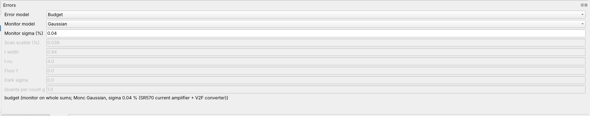

# 2. Normalisation, absorbers and errors

[Contents](README.md) · previous: [The window](01_window.md) · next: [Alignment scans](03_specplot.md)

Everything the reader shows from a detector has been through the same three steps: divided by the beam
monitor, multiplied back by the absorbers' attenuation, and given an error that comes from counting
statistics. This chapter says what each step does and which settings change it. Those settings act on
every tab, which is why their current values are shown as badges in the status bar.

## The monitor

The SPEC file records, for every point, the counts of the ionisation chambers. **Monc** is the one the
reader divides by: it sits upstream of the absorbers, so it measures the beam before it is attenuated.
(Monp and Monb are other monitors; SpecPlot can divide by any column.)

What you see is therefore **counts per monitor count**: a number proportional to photons detected per
photon arriving, as long as the monitor's gain, the energy and the geometry stay the same. It is not per
second: the counting time enters only through the monitor, which counts over the same time.

Everything shown is per Monc, frames and their colour scales included, cuts, GISAXS and GID maps.

**Two options**, on the SpecPlot and MCA tabs (one setting for both, and for everything else):

- **/ gain** also divides by the Monc amplifier's gain (its sensitivity, from the `#M Monc Gain` line;
  the last one above the scan if the scan has none), relative to the usual 5 µA/V. Use it when scans were
  taken at different gains and must be on one scale. Scans with an unknown gain get no factor.
- **/ photon** divides by the incident photons instead: the photons per second through the Monc chamber,
  worked out from its current, its gain and the gas's absorption at the scan's energy (5–30 keV). This
  includes "/ gain". The estimate carries about ±3.6 % below 13 keV, more above; that is a common scale on
  every point, so it is not in the error bars. Scans with an unknown gain or energy keep per-count values.

### Summing frames

When frames are added (**Sum All**, repeated scans merged in Ref Patch, GISAXS), the reader adds their
counts and their monitors first and divides once: ΣN/ΣM. A frame with more monitor counts weighs more,
which gives the most likely common rate. With equal monitors this is the same as the average of the
normalised frames. The old average stays as an option ([below](#old-and-new-methods)).

## Absorbers

The absorbers are binary foils. SPEC's `#A` line gives the setting in units: setting n means a foil
stack equivalent to n units, and n = 0 means no absorber. The reader multiplies each normalised frame by
**absfac**ⁿ, absfac being the transmission factor per unit, shown in the **Absorber Ratio** field of the
left panel.

- **from E** (ticked by default) sets absfac from the energy of the selected scans (`#W`):
  - at 9.70–10.30 keV, from the **calibrated foils**: each foil's thickness measured from hundreds of joins
    of real reflectivity data at 10 keV. The field then reads "cal". (File → Preferences → Absorber foils
    turns this off.)
  - otherwise, up to 10.52 keV, from 50 µm of aluminium per unit and aluminium's attenuation at that
    energy;
  - elsewhere the foil is not known, so the field keeps its value and a message says so. Untick from E and
    type the factor.
- The default without an energy is 1.4247: 50 µm of aluminium at 10 keV.
- Energy scans use the energy in their header.

A frame whose absorber setting cannot be read shows "Abs=?" in the frame list.

GID frames are divided by the monitor but not multiplied by absfac: a GID set is taken at one absorber
setting, and the joins between scans absorb any difference.

For fluorescence, a spectrum's absorber is the last `#A` above its scan.

## Dead time of the fluorescence detector

The seven-element detector corrects its own dead time. The single-element detector's spectra are
multiplied by real time over live time (`#@CTIME` in the MCA file).

## The error model

Each count N is Poisson: σ = √N. The monitor M is a count too. The reader propagates both through every
sum, subtraction and division, so every point it shows carries its error.

The **Errors** pane (View → Errors) chooses how the monitor's part is counted:

- **Legacy** (the default): the monitor treated as Poisson on every pixel and added in quadrature. These
  are the numbers the reader has always given.
- **Budget:** the monitor's own measured scatter is applied once to each whole sum. Its monitor model is
  a Gaussian of 0.04 % per reading (the default), a Student t scaled to the scan's own scatter, or Counting
  (a fixed fraction, the dark counts' scatter, and the quanta per count). The Gaussian and Student t values
  describe the present Monc electronics (an SR570 amplifier and a voltage-to-frequency converter). Re-measure them if the electronics
  change.

The choice applies to what is computed from then on. The badge "legacy errors" or "budget errors" in the
status bar shows which is in use.

## Old and new methods

Where the reader has an old method and a better new one, both are kept. **File → Preferences → Reduction
options** chooses which each action uses:

| Option | Default | Old method |
|---|---|---|
| Reflectivity patch | Joint fit: one smooth curve through both scans at a join, the factor fitted with it | Legacy fit: the second scan interpolated onto the first and one ratio fitted; reproduces older files exactly |
| Sum All | Counts and monitors added, then divided once | The average of the frames each normalised alone |
| Ref Patch repeats | Counts and monitors added, then divided once | The equal-weight average |
| GISAXS | Per Monc | Raw counts |
| Fluorescence fit | Fit lines | The old Fit dialog, with its Fit, Fit All and Accept buttons |
| Fit lines weights | Poisson maximum likelihood | Least squares weighted by the error bars, which reads weak lines low |
| Burn test | The Trends tab only | Also the Legacy tab with the original plots |

**Ctrl+click** on Ref Patch or Fit lines runs the other method once, and the Messages pane says so.

Why each new method is the default, with the measurements behind it, is written in
`docs/OUTPUT_DECISIONS.md`.
