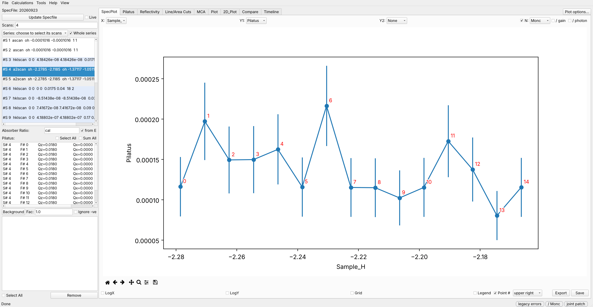

# 3. Alignment scans: the SpecPlot tab

[Contents](README.md) · previous: [Normalisation](02_normalisation.md) · next: [Pilatus frames](04_frames.md)

SpecPlot draws any column of the selected scans against any other: motor scans, slit scans, half-cuts,
sample-height scans, absorber scans. Selecting a scan brings this tab to the front.

## Plotting

- **X:** the column for the x axis. By default the scan's first column; an hklscan is plotted against the
  index it moves (L when nothing moves).
- **Y1:** the column on the left axis, by default the last (the detector counter). **Y2:** a second column
  on the right axis.
- **N:** the column to divide by, with its box ticked (the default): Monc when the scan has it, otherwise
  the column before the last. **/ gain** and **/ photon** beside it change the monitor normalisation
  everywhere ([chapter 2](02_normalisation.md#the-monitor)).
- **LogX, LogY, Grid, Legend.** A log axis with nothing positive to show stays linear, with a note in the
  status bar.
- **Point #** (on) labels each point with its index in the scan, 0, 1, 2, … Numbers that would overlap are
  hidden; zoom in and they come back.
- **Time_s** and **Time_from_start_s**, offered as x columns, put the selected scans on one true time axis
  or each scan from its own start. The item's tooltip says how the times were obtained.

Several scans can be plotted together; the legend names them.

## The automatic fit

The reader fits the scan plotted (the last one selected, when several are) and writes the result in the
plot's title, with the fit drawn dashed:

- as a **peak** (Peak=, Cen=, FWHM=), an **edge** (a half-cut: Edge= and Edge Width=, the edge width being
  the beam's FWHM) or a **box**, a plateau (Cen=, Width=, Edge widths=), whichever fits best; the legend
  says which ("Fit (peak)", and so on);
- **not at all** when the scan's background alone describes it (a flat noisy line, or a ramp such as the
  Epoch column). No fit line and no fitted numbers are drawn.

Turn on **View → Residuals above fits** to see how well the fit describes the scan.

## Sample-height scans

A sample-height scan (sh, or sh with oh) plotted against sh gets a second fit: a **super-Gaussian**, drawn
dash-dotted in purple. The title's last line gives its FWHM in µm, its exponent p, and, for comparison,
how well a plain Gaussian fits (χ²/dof).

- p = 2 is a Gaussian; a larger p is flatter-topped. A usable scan is wide and flatter than a Gaussian:
  at this beamline, a FWHM of about 65 µm or more. The reader gives the numbers; the judgment is yours.
- The peak fit of a height scan is made only when the signal is at least twice its background and its
  FWHM is over 20 µm.
- A scan with no reflected beam (the peak not 10 σ above its edges) is not fitted.

The Timeline tab draws every height scan of the session with this fit ([chapter 10](10_timeline_compare.md)).

## Export and Save

- **Export** writes one text file per selected scan, named after the scan and the columns:
  `<name>_<scan>_<x>_<y>[_<monitor>].txt`, with x, y and its error; with Y2 set, a second file for Y2.
- **Save** stores the curves and the fit in the SPEC file's workbook, with a note. SpecPlot curves are raw
  data, not a reduction, so they are not saved automatically.

## The Calculations menu

Three small calculations from alignment scans. Each opens a window that shows its result as text; nothing
is applied to the reader's settings.

- **g_l2:** from the centres of two or more sh scans at different incidence angles (fitted on SpecPlot),
  fits the crystal-to-sample distance g_l2 and an offset, from centre = offset − g_l2 · sin α.
- **g_l3:** the same fit on oh scans, giving g_l2 − g_l3 (g_l3 being the sample-to-detector distance)
  and an offset.
- **abs ratio:** from an absorber scan, fits the ratio per absorber unit, the source intensity and a dead
  time. It uses the counter chosen in SpecPlot's Y1. The ratio is not copied into the Absorber Ratio field:
  type it there (with from E unticked) if you want to use it.

Tick **Centers:** in the g_l2 or g_l3 window to type the centres instead of using the fitted ones.
