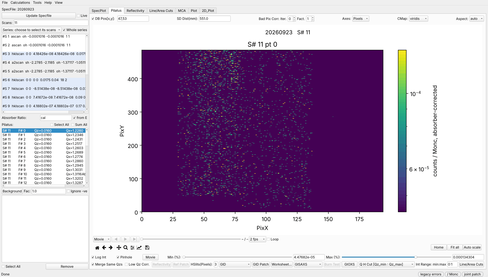
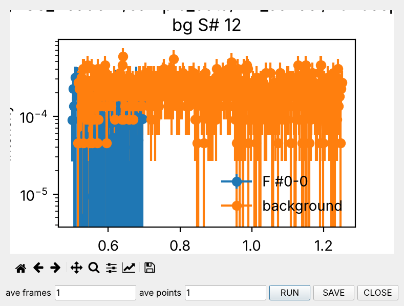

# 4. Pilatus frames

[Contents](README.md) · previous: [Alignment scans](03_specplot.md) · next: [Reflectivity](05_reflectivity.md)

The Pilatus tab shows the frames selected in the frame list, and holds the buttons that start every image
reduction: Reflectivity and Ref Patch ([chapter 5](05_reflectivity.md)), GID Patch and the GID menu
([chapter 6](06_gid.md)), Line/Area Cuts ([chapter 7](07_cuts.md)), Burn Test ([chapter 9](09_burn_tests.md)),
GISAXS and GIOXS ([below](#gisaxs-and-gioxs)).

## Geometry

- **DB Pos[x,y]** ticked: the direct-beam pixel and the sample–detector distance (**SD Dist**) are taken
  from the SPEC file. Untick to type them.
- **Axes:** the image's axes in **Pixels**, **Angles** (2θ and β) or **Q** (Qxy and Qz).
- **Pinhole** (ticked by default): frames taken with the detector arm out of the specular (Det_Th > 1°)
  get their horizontal angle through the S4 pinhole, from the S4–detector distance, each column seeing its
  own 2θ. The vertical angle always uses the sample–detector distance. Untick to use the sample–detector
  distance for both. Why the pinhole matters is explained in the [GID addendum](gid_patching.md).
- Each frame of a reflectivity scan has its own incidence angle, worked out from its Qz, so on an Angles
  axis the reflected beam sits at β = α.

## How frames are shown

- **One or two frames** are shown side by side. **Three or more** play as a **movie** of one large frame
  (the default), or are shown as 4 or 6 tiles sampled first to last ("6 of 41 shown"): the view box beside
  Movie chooses. The **Movie** button plays any two or more.
- **Movie bar:** ◀ one frame back, ▶ play or pause, ▶| one frame forward, a slider, the position, the speed
  (2 frames per second by default; about 10 is the practical top), **Loop**, and the frame's scan, point,
  Qz or 2θ, time, absorber and Monc. With the image focused, the space bar plays or pauses, and the arrow
  keys step (pausing first). The frame list marks the frame on show.
- **Colour scale.** One scale for the whole selection, per Monc and corrected for the absorbers, so frames
  can be compared by eye. By default its top is at the 99.9th percentile of the selected frames, with the
  direct beam left out, and its bottom at the 1st percentile. Type **Min** and **Max** (Enter) or use the
  sliders to fix it; **Auto scale** goes back to the automatic limits.
- **Log Int:** a log scale. On by default for reflectivity, GID and GISAXS frames, off for direct-beam and
  dark frames.
- **CMap:** the colour map, viridis by default. **Aspect:** auto or equal.
- **Zoom.** Draw a box with the toolbar's zoom tool. **Fit all** (or the house icon) shows the whole frame;
  **Home** returns to the last box you drew.

The zoom, colour map, aspect, axes, log choice and typed limits are kept through redraws, frame and scan
changes and the next session. They are reset when another SPEC file is opened. Log choices and limits are
kept per kind of frame (reflectivity, GID, direct beam, …).

## Saturation

Pixels counting faster than 1 × 10⁵ counts per second are drawn amber, and faster than 1.5 × 10⁵ red: an
absorber is needed there. A small red label in the frame's corner counts them ("3 px > 1.5e5 cps: absorber
needed"). The rate is the raw counts over the point's counting time (SPEC's Seconds), not the per-monitor
value the colour scale shows (with background frames in use, it is worked out on the subtracted frame). In a sum of frames, a pixel above the limit in any one frame is marked.

These limits are for the Pilatus 100K. Whether the detector has already corrected its counts for rate is
not known to the reader.

## The box close-up

For reflectivity frames, reflectivity burns and direct-beam frames, a panel beside the frame shows the
**counted box**: the
frame zoomed onto the signal box (white), both background boxes (cyan) and some diffuse scattering around
them, on its own colour scale. Drag the splitter to widen it. The same panel is on the Reflectivity tab.

- The outlines are exactly the pixels the reduction sums. Dashed outlines show where the boxes were before
  the peak search moved them.
- Below the picture: the column and row profiles across the boxes, the sums (signal, backgrounds, net ±
  σ), and the **checks**: peak off centre (by more than 25 % of the half-width), clipped (more than 1 % of
  the signal on or beyond the box's edge), a background box 2 px or less from the signal box, saturation,
  the direct beam inside a box. Each check's tooltip gives its reason.
- **Log** switches the close-up's scale and profiles (on by default; one setting for both tabs). It does
  not change the frame's Log Int.

Hover the close-up to read the pixel under the cursor.

## Bad pixels

**Bad Pix Corr. Iter.** and **factor** set a bad-pixel pass over every frame as it is read, in every
workflow. A pixel is replaced by the mean of its four neighbours when it is above both
(2 + 2/iterations) × factor × that mean and the frame's noise floor.

- 0 iterations (the default) is off. 1 or 2 passes; the factor runs from 1 to 40, larger being gentler.
- Below factor 10 the pass takes real signal on sparse frames: at factor 4 it removed about half of a real
  point on some sparse high-Qz reflectivity frames.
- For reflectivity, prefer the Reflectivity tab's own pass over the counted box
  ([chapter 5](05_reflectivity.md#bad-pixels-in-the-box)).

Changing either reads the frames again.

## Summing frames

**Sum All** (above the frame list) shows the selected frames as one: counts and monitors added, then
divided once ([chapter 2](02_normalisation.md#summing-frames)). Cuts of a summed frame are summed too.

## Background frames

Select frames and press **Background** to put them in the background list (replacing what was there).
Nothing is subtracted yet: select frames in the background list, and their average, scaled by **Fac**, is
subtracted from the frames shown. **Ignore -ve** sets pixels that go negative to zero (it takes effect at
the next frame selection). **Remove** takes the selected frames out of the list; the list's **Select All**
selects them all. Background subtraction is
not yet available from scripts.

## GISAXS and GIOXS

- **GISAXS → Show GISAXS** shows one frame, or the sum of the selected frames, in Q, per Monc. **Export
  GISAXS** writes it as a text file (`_gisaxs.txt`, rows of Qxy, Qz, I, σ). To go back to plain frames,
  select the frames again.
- **GIOXS** opens a window of background-subtracted Qz profiles of off-specular frames, averaged over
  **ave frames** frames and **ave points** points. RUN recomputes; **Export** writes each profile as
  `<name>_frame<A>-<B>_gio.txt` and the background as `_bg_gio.txt`.

