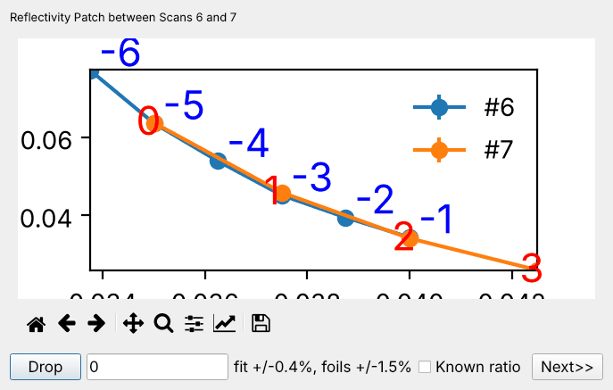
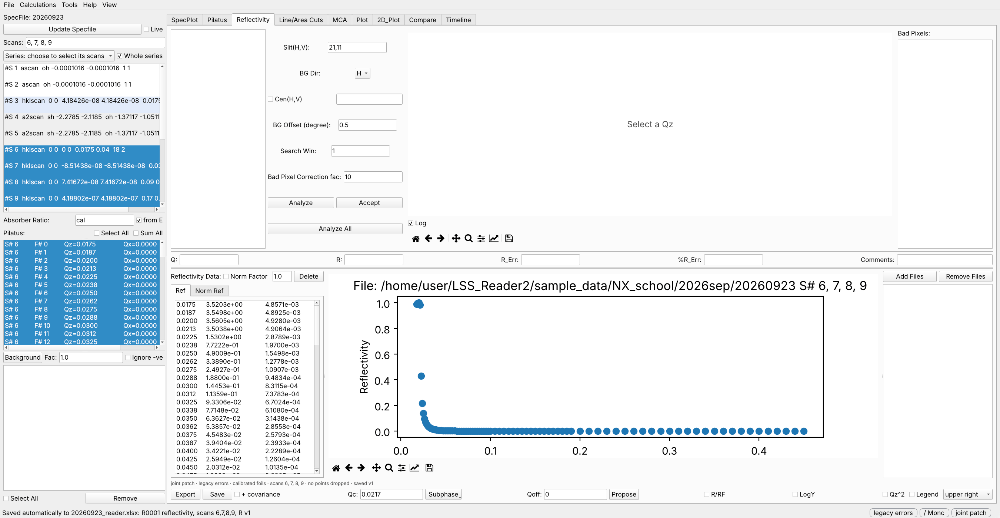

# 5. Reflectivity

[Contents](README.md) · previous: [Pilatus frames](04_frames.md) · next: [GID](06_gid.md)

A reflectivity is measured by a macro as several scans in Qz, each through a different absorber so that
the detector never saturates, usually with alignment scans before and between them. The reader counts the
reflected beam in a box on every frame, subtracts the background beside it, joins the scans into one curve
with a fitted scale factor at each overlap, and normalises the curve so that its plateau below the critical
edge reads 1. The [quick start](quick_start.md#3-reduce-a-reflectivity) walks through this on the NX school
data in two pages; this chapter gives every option.

## In short

1. Choose the reflectivity series in the series chooser, and tick **Select All** above the frame list.
2. Optional: on the Pilatus tab press **Reflectivity**, and check the counted box on a few frames.
3. On the Pilatus tab press **Ref Patch**, and step through the joins with **Next>>**.
4. On the Reflectivity tab, set **Qc** (from **Subphase**), and if you want R/R_F, **Propose** a Qoff.
5. **Export** writes `<name>_ref.txt` and `<name>_rrf.txt` for XModFit. The result is already saved in the
   workbook.

## The counted box

These settings, at the top of the Reflectivity tab, are used by Ref Patch, by Analyze and by the burn test:

| Control | Default | What it sets |
|---|---|---|
| **Slit(H,V)** | 21,11 | The signal box, in pixels, horizontal by vertical |
| **BG Dir** | H | Whether the two background boxes sit left and right (H) or above and below (V) the signal box |
| **BG Offset (degree)** | 0.5 | How far the background boxes sit from the signal box, in degrees |
| **Bad Pixel Correction fac** | empty (off) | A bad-pixel pass over the three boxes ([below](#bad-pixels-in-the-box)) |

The signal box is centred where the geometry puts the reflected beam (from the direct-beam pixel and the
frame's angle); a peak search may move it onto the beam. The net signal is the signal box less the mean of
the two background boxes, scaled to the signal box's size, with the errors of all three.

On the Pilatus tab:

- **Merge Same Qzs** (on): frames at the same Qz are grouped into one entry of the Qz list.
- **Low Qz Corr.:** a narrower signal box (5 pixels high) for frames at 0.02 < Qz < 0.03 Å⁻¹.

## Looking at single frames: Reflectivity and Analyze

**Reflectivity** (Pilatus tab) lists every selected frame on the Reflectivity tab by Qz, scan:frame and
absorber. Select one to see its counted box on the close-up: the signal box white, the background boxes
cyan, with the checks beside it ([chapter 4](04_frames.md#the-box-close-up)). This is the way to check the
box before patching.

**Analyze** finds the peak in the selected Qz's frame (within **Search Win**, a multiple of the slit),
sums the box less the background, and shows the result in **Q**, **R**, **R_Err** and **%R_Err**. R here is
the net intensity per monitor, times the absorber factor; it is not yet normalised. **Accept** adds the
point to the curve, with the text in **Comments**; **Analyze All** analyses and accepts every Qz in turn.
Tick **Cen(H,V)** to type the box's centre instead of the expected beam position.

Analyze is the old point-by-point path. Ref Patch is the usual one.

## Ref Patch

Press **Ref Patch** on the Pilatus tab. Before joining, the reader checks every frame: is the reflected
beam more than 2 pixels from where the geometry puts it, and were bad pixels corrected inside the signal
box? One message names the frames (details in the log), and those points are marked on the finished plot.

### Identical scans

If two or more scans cover the same Qz range with the same number of points (repeats of one macro step),
a window shows each group overlaid first:

- **Merge** adds the group's counts and monitors point by point, then divides once. A repeat with more
  monitor counts weighs more.
- **Drop** leaves out the scan numbers typed beside it.
- **Next>>** goes to the next group; **Finish!** on the last starts the patch.

Closing this window stops the Ref Patch.

### The patch window

The window shows one join at a time: the curve patched so far and the next scan, scaled, on their
overlap, with each point's number. Below the plot: the fitted factor, its error, and how it was fitted.

- **Next>>** accepts the join and goes on; on the last join it reads **Finish!** and puts the curve on the
  Reflectivity tab.
- **<< Back** undoes the last step: the last Drop, or the last join accepted. A join comes back as you left
  it. Going back and repeating the same steps gives the same curve.
- **Cancel** (or Esc, or closing the window) stops the patch. The Reflectivity tab keeps the curve it had,
  and the Messages pane says at which join the patch stopped.
- **Drop:** type point numbers as the plot labels them, for example `-1, 0`, and press Drop. Negative
  numbers are points of the curve patched so far, 0 and up are points of the next scan. Each drop refits
  the join.
- **Restore all** brings back every dropped point of these scans, including those dropped in earlier
  patches, and starts again from the first join.
- **Known ratio** uses the calibrated foils' attenuation ratio instead of the fitted factor at this join
  ([below](#the-known-ratio)). The label beside it compares the two errors, for example "fit +/-0.4%, foils
  +/-1.5%".
- **The join table** lists the joins accepted so far and the one on show (in italics): the scans, the
  factor and its error in per cent, where the factor came from (joint fit, legacy fit or known ratio), the
  points dropped, and the fit's note. It stays with the result.

With **View → Residuals above fits** on, the window also draws the joint fit's curve over the join and the
residuals of both scans' points.

Starting another Ref Patch while one is open replaces it, and says so.

### How a join is fitted

By default (**joint fit**) the reader draws one smooth curve through both scans, over the overlap and up
to 2 points either side, and fits the factor together with it. It tries a ladder of curves: the widest
window with a polynomial of order 4, then higher orders up to 7, then a narrower window, then the overlap
alone, and takes the first that describes the data (χ² with p ≥ 0.7). The factor's error is scaled up by
√(χ²/dof) whenever the scatter exceeds the error bars. This fit is unbiased on a thick film's fringes and its errors are honest; the old fit was biased
there by several per cent, and its errors were 1.1–4.8 times too small.

The join's note tells you how it went:

- "the best fit of the ladder": no curve reached p 0.7, but the fit is fine;
- "no adequate fit": even the best curve fails at p 0.01, so look at this join;
- an inflation factor, when no curve passed and the error was inflated.

If every curve of the ladder fails (too few points of a scan, for example), the legacy fit is used for that
join, and Messages says so. The legacy fit of a join with only one coinciding point (after a drop, say) uses
that point's ratio, with its counting error. **File → Preferences → Reduction options** switches every join to the legacy fit; **Ctrl+click** on
Ref Patch uses the other fit once.

### The known ratio

Near 10 keV the foils' thicknesses are calibrated, so the attenuation between two absorber settings is
known independently of the data. At a join, the reader uses this **known ratio** instead of the fitted
factor by itself when all of these hold (File → Preferences → Ref Patch):

- the fitted factor's error is above 3 %;
- the ratio is at least twice as precise as the fit (its error is 3.2 times larger when the overlap is at
  Qz ≥ 0.25 Å⁻¹);
- Monc/Monp shows no slit change across the join;
- the ratio and the fit agree within 3 σ.

The patch window shows the choice, and its Known ratio box can undo it.

### Dropped points are kept

When a patch finishes, its dropped points are kept as the **mask** of those scans, in the workbook. The
next Ref Patch of the same scans leaves them out from the start; a message says which, and the line under
the plot says "N masked". Masked points are drawn as grey crosses in the patch window and on the
Reflectivity tab, and are not exported. **Restore all** clears the mask.

## The Reflectivity tab after a patch

- **Ref** lists Qz, R and its error as patched.
- **Norm Ref** lists the same divided by the highest R below Qc, so that the plateau reads 1 (when the
  curve starts below Qc; otherwise R is left as patched), and also by
  **Norm Factor** when that box is ticked. **This is what Export writes.**
- **Delete** removes the selected points of the Ref list.
- **The line under the plot** says how the curve was made: the patch method, the error model, the absorber
  model, the scans, the points dropped and masked, and "saved vN" once it is in the workbook. Its tooltip
  lists every join. It describes the curve as it was made: changing a preference afterwards changes the
  next Ref Patch, not this line.
- **Marks on the plot:** an open square for a point whose beam was off centre, a cross for a point with bad
  pixels corrected in its box. The **Bad Pixels** list at the top right gives those pixels by Qz.
- **LogY**, **Qz^2** (plot against Qz²) and **Legend** change the plot only.
- **Add Files** overlays reflectivity files from disk (`_ref.txt`, `_rrf.txt`) for comparison.
  To compare curves saved in the workbook, use the [Compare tab](10_timeline_compare.md#compare).

## R/R_F, Qc and Qoff

**R/RF** plots R divided by the Fresnel reflectivity of the subphase, R_F(Qz + Qoff). It needs Qc, and
optionally a small offset Qoff.

1. **Set Qc first, from the subphase.** **Subphase** (right of Qc) offers water (Qc 0.02173 Å⁻¹), D₂O and
   several salt solutions, each from its density and electron density (hover an entry for its source), and
   **From an electron density...** for any other.
2. **Then propose Qoff.** **Propose** fits the curve on show at that Qc and offers two values in a menu:
   the edge fit, with its error, and the smoothness of R/R_F through the edge (the by-eye criterion) as a
   second opinion. Nothing changes until you pick one or type a value.

Qc and Qoff move the edge together, so a wrong Qc moves Qoff by the same amount; that is why Qc comes from
the subphase and not from a fit. The beamline's Qz resolution rounds the edge, which reads as a slightly
negative Qoff: the proposal makes R/R_F continuous, but it is a true angle offset only once R_F is
convolved with the resolution, which the reader does not do yet.

R/RF is a display choice: Export writes both files either way. Save puts R/R_F in the workbook while it is
ticked.

## Bad pixels in the box

**Bad Pixel Correction fac** sets a bad-pixel pass over the three boxes only, on the frame's counts before
the sums: a pixel above 4 × the factor × the mean of its four neighbours, and above the frame's noise floor,
takes that mean. The pixels corrected are listed with the result. Empty (the default) means no pass.
A factor of 10 removed 90 % of hot pixels on sparse synthetic frames without touching clean ones, while 3
can take half of a real sparse point. It is used by Ref Patch and Analyze.

## Export

**Export** writes the files XModFit reads:

| File | Columns |
|---|---|
| `<name>_ref.txt` | Qz (Å⁻¹), R, σ_R: the normalised curve (Norm Ref) |
| `<name>_rrf.txt` | Qz + Qoff, R/R_F, σ, at the Qc and Qoff in the fields, whether or not R/RF is ticked |
| `<name>_ref.cov.json`, `<name>_rrf.cov.json` | With **+ covariance** only: the errors' correlations |

- The name is proposed from the SPEC file, the sample (when the macro recorded it) and the scans, for
  example `20260923_S6-9`. The dialog's title says what endings are added; a name typed with the ending is
  not given it twice.
- The folder is the one the last Export went to, kept between sessions, so exports go straight to your
  fitting folder.
- Messages and the status bar then say which files were written, and which existing files they replaced.

**+ covariance** (off by default). The patch's scale factors are fitted, and a factor's error is shared by
every point of its scan and of every later scan. The points' errors are therefore correlated, and a fit that
treats them as independent is overconfident (on synthetic films, parameter errors up to 4 times too small).
The sidecar holds, point for point, the counting-only error, which scans each point came from, and the
covariance of the scale factors, for a fitter that can use them. The text files do not change. It is
written only for a Ref Patch whose reduction can be replayed exactly; otherwise a message says why.
`docs/reports/downstream_covariance.md` explains how to use it.

**Save** stores the curve, with the settings that made it, in the workbook. A Ref Patch is saved
automatically anyway; Save adds a version with a note ([chapter 11](11_saving.md)).
