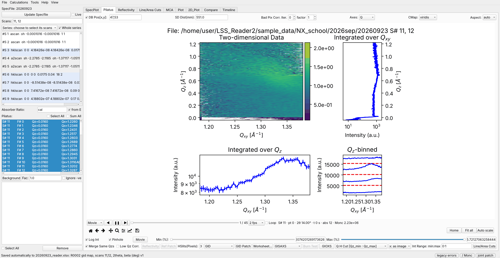
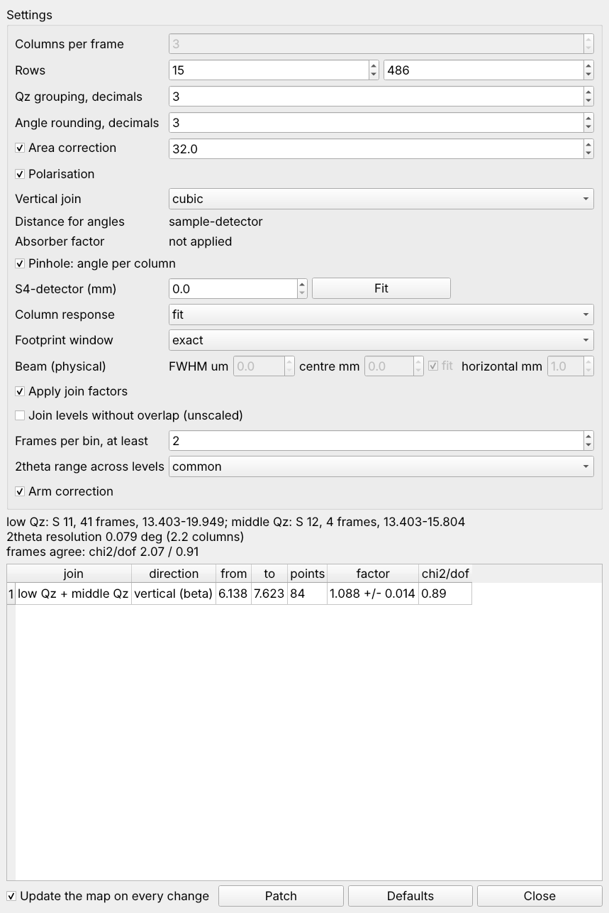

# 6. Grazing-incidence diffraction (GID)

[Contents](README.md) · previous: [Reflectivity](05_reflectivity.md) · next: [Cuts](07_cuts.md)

A GID set is a series of detector-angle scans (`ascan dth`) at a fixed incidence angle below the critical
angle, one Pilatus frame per point. Each scan covers one **Qz level**: the arm at its lowest height, then
raised for higher β. The reader puts every frame's pixels at their angles, joins the scans of a level and
then the levels into one **map** of intensity against (2θ, β) or (Qxy, Qz), with its integrals.

This chapter is how to make a map. How the patch works, every option with its advantages and costs, and
eight diagrams are in the technical addendum, [GID patching](gid_patching.md).

## Making a map

1. Choose the GID series (NX school: scans 11 and 12) and tick **Select All**.
2. On the Pilatus tab, set **Axes** to Angles or Q.
3. Press **GID Patch**. The map is shown on the Pilatus tab, with the intensity integrated over each axis,
   and is saved in the workbook by itself.
4. Open the **Worksheet...** to see what each join did, and to change settings.
5. **GID → Export GID** writes the text files.

By default the patch uses the **pinhole geometry**: every pixel gets its own 2θ and β through the S4
pinhole, and every column that sees the lit strip of sample through S4 and the S5 slits is used. Untick
**Pinhole: angle per column** in the worksheet for the legacy patch, which sums a few columns around the
direct beam (**HSlits(Pixels)**, 3 by default) and places them at the frame's detector angle.

GID frames are divided by the monitor but not multiplied by the absorber factor: a GID set is taken at one
absorber setting, and any difference between scans is taken up by the joins.

## The GID menu

The drop-down labelled GID, beside GID Patch:

| Item | What it does |
|---|---|
| GID Patch Relax | GID Patch with the Q map on the largest rectangle the data reach. Empty regions are filled with 10⁻¹⁰, which integrated cuts sum as data |
| Export GID | Writes the map and its integrals as text files ([below](#export-gid)) |
| Form Factor | Overlays the minima of a sphere's or an ellipsoid's form factor on the map |
| Save to workbook | Saves the map with a note (it is saved automatically anyway) |

## The worksheet

**Worksheet...** opens, docked on the right, every setting of the patch, with what each join did. With
**Update the map on every change** ticked (the default), each change patches again after a short pause,
so you see each option's effect at once; otherwise press **Patch**. **Defaults** puts every setting back.

The settings most often touched:

| Setting | Default | What it does |
|---|---|---|
| Rows | 15 to the frames' last | The β range used. The last row follows the frames (486 on the Pilatus 100K) until you type another |
| Qz grouping, decimals; Angle rounding, decimals | 3, 3 | How frames are grouped into levels, and ordered |
| Area correction | on | Divide by the share of the footprint seen through the slits |
| Polarisation | on | Divide by 1 − (sin 2θ cos β)² |
| S4-detector (mm) | 0: from the header | The pinhole's distance; **Fit** calibrates it from single frames ([below](#calibrating-the-s4detector-distance)) |
| Column response | fit | How each column's sensitivity is found ([below](#the-column-response)) |
| Footprint window | exact | Which columns see the footprint through S4: traced ray by ray, or "IDL", centred on the direct-beam column as the IDL code did |
| 2θ range across levels | common | The range every level covers, or "all" (each level's range, empty where it has no data) |
| Frames per bin, at least | 2 | 2θ bins seen by fewer frames are left out (the map's edges) |
| Arm correction | on | Treats the arm's distance as a path when the arm is raised (pinhole only) |
| Apply join factors | on | Off: the factors are fitted and shown but not applied, so the data stay as collected |
| Join levels without overlap (unscaled) | off | A stopgap for levels that share no β ([below](#levels-that-do-not-overlap)) |

Below the settings: the Qz levels of the last patch (scans, frames, detector-angle range), each with
"frames agree: χ²/dof", and the **join table**. The frames-agree χ²/dof says how well the frames of a level
agree with each other once patched: the yardstick for comparing methods. A join factor with χ²/dof well
above 1 means the scans or levels disagree where they overlap (the illumination changed, stray light, or
the geometry is wrong).

### The column response

The same 2θ is seen by many columns, in different frames, and the columns do not see the sample equally.
The column response corrects for that:

- **fit** (the default): one factor per column, estimated from the data. The frames of a level agree best
  with it on every data set measured.
- **beam:** one profile along the beam axis instead, shared by all frames. Better for a narrow beam, which
  lights a column differently from frame to frame. It also gives the beam's centre and FWHM on the sample,
  a check of the beam.
- **physical:** computed from the geometry and a Gaussian beam, not fitted per column. Its fields: the
  beam's vertical FWHM in µm (0: fitted; take it from a half-cut), its centre (fitted unless you untick
  **fit**) and its horizontal FWHM (about 1 mm). It keeps each level's absolute scale.
- **physical+fit:** the physical response times one factor per column for what physics misses.
- **none:** flat.

Every kind fits each scan's scale with it.

### Calibrating the S4–detector distance

**Fit** fits the strongest peak of the first level in every single frame that holds it, without patching.
A wrong distance makes the peak drift with the column that sees it; the distance where the frames agree is
the calibrated one. It is filled in when reliable (enough frames, they agree, no drift left); otherwise it
is only shown, and the label's tooltip says why.

### Levels that do not overlap

A level whose rows share no β with the level below has nothing to fit its join factor on, so the patch
stops with a message. Ticking **Join levels without overlap (unscaled)** adds such a level as collected
(monitor and absorbers only, no factor), so you get a map. Any offset between the levels then shows as a
step at the seam, the errors are counting only, the join table says "UNSCALED" with the intensity ratio
across the seam, and Export GID writes a `#` line at the top of each file saying so.

## Export GID

Export GID needs a map and Axes set to Angles or Q. It writes three files:

| Axes Q | Axes Angles | Columns |
|---|---|---|
| `<name>_qxy_gid.txt` | `<name>_dth_gid.txt` | Qxy (or 2θ), I, σ: integrated over Qz (or β) |
| `<name>_qz_gid.txt` | `<name>_beta_gid.txt` | Qz (or β), I, σ: integrated over Qxy (or 2θ) |
| `<name>_q2d_gid.txt` | `<name>_agnle2d_gid.txt` | Qxy, Qz, I, σ (or 2θ, β, I, σ): the map, one cell per row |

(`agnle2d` is spelled as the original program spelled it, since scripts may expect it.)

The map is also kept in the workbook's Maps sheet, as a grid: select the value block in Excel and add a
colour scale to see it.

Cuts of the map, for example a Bragg rod or a profile over a Qz band, are made on the Line/Area Cuts tab
([chapter 7](07_cuts.md#cuts-of-a-gid-map)).

## When the patch says no

- **Frames that are not a GID set** (one frame per Qz, as in a reflectivity) stop the patch with a message:
  that the frames lie at more Qz levels than a GID patch takes (19 at most), or, with fewer, naming the level
  that has nothing to patch.
- **Pixels axes:** Export GID needs Angles or Q, and says so.
