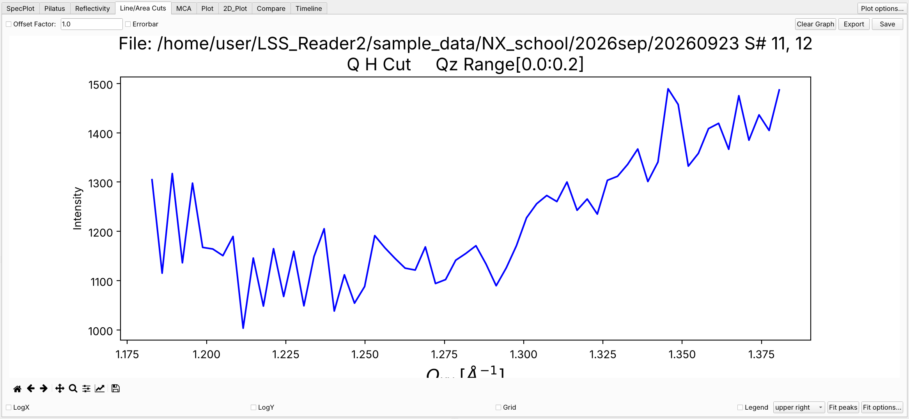

# 7. Line and area cuts, and diffuse scattering

[Contents](README.md) · previous: [GID](06_gid.md) · next: [Fluorescence](08_fluorescence.md)

A cut sums a band of a frame, or of a GID map, into a profile: intensity against one axis, with errors.
Cuts are set up on the Pilatus tab and drawn on the Line/Area Cuts tab.

## Making a cut

On the Pilatus tab, at the right of the bottom row:

1. **The direction:**

   | Direction | Sums | Range typed in |
   |---|---|---|
   | Q H Cut | a horizontal band | Qz_min : Qz_max |
   | Q V Cut | a vertical band | Qxy_min : Qxy_max |
   | Pix H Cut | rows | Pix_bottom : Pix_top |
   | Pix V Cut | columns | Pix_left : Pix_right |

2. **Int Range:** the band, as `min:max`. Choosing a direction puts its default range in the box:
   - the pixel cuts span the frames' rows or columns (0:485 and 0:194 on the Pilatus 100K);
   - with frames shown, the Q cuts default to a band about the reflected beam: half the counted box
     (Slit H,V) either side, which is 5 rows in Qz or 10 columns in Qxy by default.
3. **x:** the cut's x axis (right of the direction): **as image** (the default), or the diffuse-scattering
   axes **β**, **β − α**, **Qz** (vertical cuts) and **Qxy** (horizontal cuts). Axes that do not fit the
   direction are greyed out; hover an entry for its formula. Only x changes, not the intensities.
4. Press **Line/Area Cuts**.

Each selected frame gives its own cut; with **Sum All** ticked the selected frames are summed first, and
one cut is drawn. A Q cut of frames whose range lies off the detector is refused, with a message, and the
default band is put in the box instead.

Every cut is per Monc and absorber-corrected, as the frames are.

## The Line/Area Cuts tab



- Each press of **Line/Area Cuts** replaces the plot with the new cuts; **Clear Graph** empties it.
- **Offset Factor** spreads the curves apart by the factor typed; **Errorbar** draws error bars;
  **LogX**, **LogY**, **Grid**, **Legend**.
- **Export** writes each frame's cut as `<name>S# 7_F# 3_cut.txt` (the frame's scan and number), or a
  summed cut as `<name>S# 7_sumcut.txt`, with x, I, σ. A cut of a GID or GISAXS map is written to the name as typed. If the frame selection or Sum
  All changed since the cut was made, Export asks you to make the cut again.
- **Save** stores the cuts, and any fits, in the workbook. Cuts are saved automatically anyway.

## Fitting peaks in cuts

**Fit peaks** finds and fits the peaks of every plotted cut at once. A peak is a feature that stands out of
a running-median background by the chosen number of σ; each is fitted with its neighbours and a polynomial
background, weighted by the error bars. The fits are drawn dashed over the cuts, and their centre, FWHM and
area, with errors and χ²/dof, are listed in the Messages pane. A fit that does not describe its data says
so, and a cut with nothing above the background says "no peak stands 5.0 sigma above the background".

**Fit options...** (docked on the right) sets:

- the shape: Gaussian, Lorentzian or pseudo-Voigt;
- the background: none to cubic;
- the number of peaks (0: automatic), or their centres;
- the range, and the sensitivity in σ;
- **Export results...**: the fitted values as a table.

Turn on **View → Residuals above fits** to judge each fit.

## Cuts of a GID map

With a GID map on show ([chapter 6](06_gid.md)), the Q cuts act on the map:

- **Q H Cut** over a Qz band gives a profile against Qxy: the in-plane peaks of that band.
- **Q V Cut** over a Qxy band gives a profile against Qz: a **Bragg rod**. For the NX school map, Qxy
  1.25:1.35 is the rod of its peak.

A range outside the map's Q range gives the message "Please enter the appropriate integral type and range".

## Diffuse scattering: I against β, β − α, Qz or Qxy

The frames of a reflectivity hold, beside the reflected beam, the diffuse scattering from the surface's
roughness. Three cuts are the usual ones:

1. **The specular rod and the diffuse scatter beside it.** A **Q V Cut** over a narrow Qxy band about the
   beam (the default band, ±10 columns), with **x: β − α**. The reflected beam sits at β − α = 0, with the
   diffuse wings either side.
2. **Off-specular.** The same cut over a Qxy band away from 0.
3. **I against Qxy at a fixed exit angle.** A **Pix H Cut** over a few rows, with **x: Qxy**.

**I against β** is a **Pix V Cut** with **x: β** (or Axes: Angles). β comes from the row, the
sample–detector distance and the frame's incidence angle; α comes from the frame's Qz.

In a script the same cuts are, for example:

```python
from lss_core.experiment import Experiment
exp = Experiment('sample_data/NX_school/2026sep/20260923')
cut = exp.cut([7], 'Q V', (-0.005, 0.005), axes='beta-alpha')   # I against beta - alpha
cut = exp.cut([7], 'Pix V', (90, 104), axes='beta')             # I against beta
cut.save('dppc_')                                               # the files Export writes
```

`docs/SCRIPTING.md` ("Cuts") gives the other options, including the band about the beam
(`cuts.centred_range`) and the range the detector covers (`cuts.covered_range`); `lss_core/cuts.py` has
the formulas. Exporting a cut of frames in the window writes its call in the Script pane (cuts of a GID or GISAXS map
have no script call yet).
