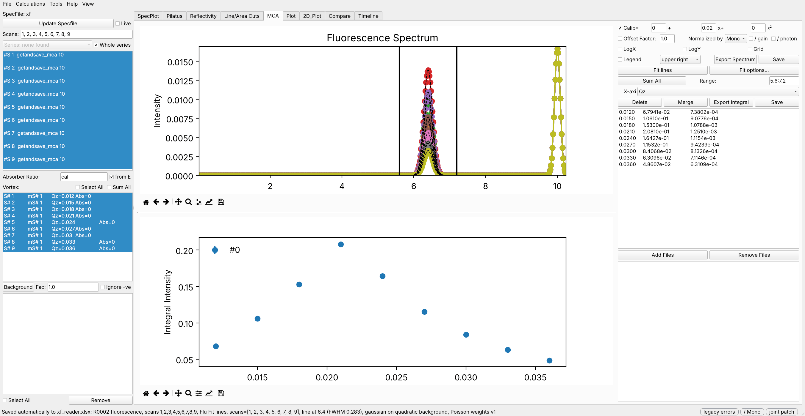

# 8. Fluorescence: the MCA tab

[Contents](README.md) · previous: [Cuts](07_cuts.md) · next: [Burn tests](09_burn_tests.md)

The MCA tab shows the fluorescence spectra of the selected scans, normalised, and reduces each spectrum to
one intensity: a sum over a window, or a fitted line. Plotted against Qz this is an **XFNTR** curve
(fluorescence near total reflection); against the energy, an **EXAFS** or XANES scan.

## The detector

Spectra are read from `vortex/<spec>_<n>_mca` beside the SPEC file: several spectra per file, one per point.

- **The seven-element detector:** **File → Preferences → Fluorescence detector** chooses the elements summed
  into one spectrum per point. **All** (the default) is for energy scans; **Centre** selects element 1, the
  central one, for XFNTR. The frame list shows "ch …" for the elements in use. This detector corrects its
  own dead time.
- **The single-element detector:** its spectra are corrected for dead time by real over live time.

## The spectra

- **Calib=** (ticked): the energy calibration from the MCA file, energy = a + b·x + c·x², filling the three
  fields. Untick to type your own.
- **Normalized by:** the monitor to divide by (Monc, Monb, Mond) or None for raw counts. **/ gain** and
  **/ photon** as in [chapter 2](02_normalisation.md#the-monitor).
- The absorber of a spectrum is the last `#A` above its scan; the Absorber Ratio field gives the factor.
- **Offset Factor** stacks the spectra apart; **LogX**, **LogY**, **Grid**, **Legend**.
- **Export Spectrum** writes each selected spectrum as `<name><scan>_<point>_<Qz>_mca.txt` (energy, I, σ);
  **Save** beside it stores them in the workbook.

## One intensity per spectrum

Set **Range** (min:max, in the spectrum's x units: keV once calibrated) around the element's line, and
choose the **X-axis** of the result: Frame, Qz (XFNTR) or Energy (EXAFS). Then:

- **Sum All** adds each spectrum's counts inside the window: the simplest measure, which includes the
  background under the line.
- **Fit lines** fits the line in every selected spectrum. Use it when the background under the line matters,
  which is usual.

The results are listed (x, intensity, error) and plotted below the spectra.

### Fit lines: the reader's fit and XeRay

Fit lines fits each spectrum two ways, and shows both:

- **The reader's fit** (circles, "#0 reader's fit"; the black dashed curves over the spectra). The silicon
  escape peaks are stripped from each spectrum; the sum of all the selected spectra is fitted for the line's
  position and width; then every spectrum is fitted for its height and background, by Poisson maximum
  likelihood. By default the shape is a Gaussian on a quadratic background, which follows the spill-over of
  the elastic scatter. **This is the number that is merged and exported in `_flu.txt`.**
- **XeRay** (squares, "#0 XeRay"; the red dotted curves). One Gaussian on a straight line, by unweighted
  least squares, as in XeRay, the program familiar from the Lee group. Its intensity and error are listed at
  the end of each line ("XeRay I σ") and exported in `_flu_xeray.txt`.

Both give the line asked for (the first energy in Fit options, which should be the element's; the strongest
line when none is given) as its area over the channel width: the same units as Sum All, with the background
removed.

**Why both.** XeRay is familiar, but its error, √(counts in the window), leaves out the background and is
too small where the background is large; on real data its intensity was rarely within 2 % of the truth.
The reader's fit is more accurate, and its errors are honest. Keep XeRay's numbers for comparison with
earlier work.

### Fit options

**Fit options...** (docked on the right) sets, for the reader's fit:

- the shape and the background;
- the number of lines, or their energies (the first given is the one reported);
- the sensitivity;
- **strip Si escape peaks** (on);
- **width from the detector** (off): fixes the line width at the detector's resolution, from **Detector
  noise (FWHM)**. The 0.12 keV default is an assumption; measure it on the detector in use. Off, the width
  comes from the sum of the spectra.

The options are kept between sessions, and with the result in the workbook. The command saved with the fit
says which options were used.

The old Fit dialog, with Fit, Fit All and Accept, is still there: tick **Fluorescence fit: legacy Fit
dialog** in Preferences → Reduction options, or Ctrl+click Fit lines.

## Merging points

Repeated scans give several points at the same Qz. **Merge** merges the points closer than a window on the
x axis into one measurement. The default window is 0.1 × the Qz grid step on the Qz axis (0 otherwise). A small jitter in Qz
(3 × 10⁻⁵ Å⁻¹) is allowed for in the error bars, through the curve's slope at each point. Choose which scans to merge yourself: one run, one energy,
one sample, the same line shape.

**Delete** removes the selected rows from the list.

## Export and Save

- **Export Integral** writes `<name>_flu.txt` (x, I, σ, with x as chosen in X-axis; its first line is a `#`
  comment saying how it was made) and, after Fit lines, `<name>_flu_xeray.txt` in the same three columns,
  its header saying which fit.
- **Save** stores the result, with all three x columns, any line fits (XeRay's included), and the settings,
  in the workbook. Sums, line fits and merges are saved automatically anyway.
- **Add Files** overlays earlier `_flu.txt` files on the result's plot.

## Energy scans

Energy scans (EXAFS around an edge, or ±dE about it) are plotted against the energy point by point. Set
X-axis to Energy; the absorber factor follows each scan's energy when from E is ticked. All seven elements
are summed by default.
