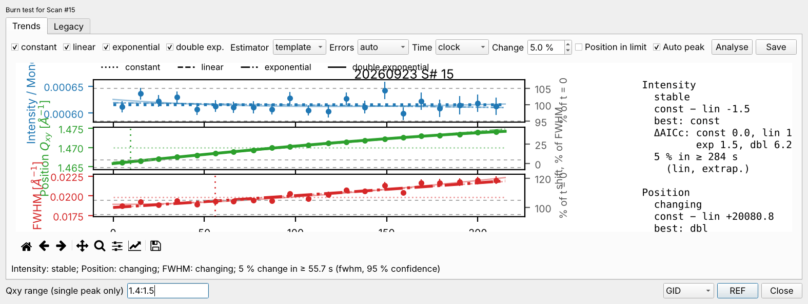

# 9. Burn tests

[Contents](README.md) · previous: [Fluorescence](08_fluorescence.md) · next: [Timeline and Compare](10_timeline_compare.md)

A **burn test** asks whether the beam changes the sample. The sample is held at one condition and exposed
again and again: the beamline's standard is `ascan ih a a n t`, a motor scan that does not move, with one
Pilatus frame per point. If the signal drifts, the exposure planned for the measurement may damage the
sample; the burn test says how long, or how much dose, it takes to change it by 5 %.

The reader recognises these scans as burns (red in the scan list). A burn with Det_Th above 2° is analysed
as a **GID burn** (the Bragg peak's intensity, position and width), otherwise as a **reflectivity burn**
(the counted box's intensity).

## Running one

Select the burn scan, tick **Select All**, and press **Burn Test** on the Pilatus tab. The burn window opens
under the tab area, already analysed, on its **Trends** tab.

A reflectivity burn uses the Reflectivity tab's box settings (Slit, BG Dir, BG Offset).

## What the Trends tab shows

- **One panel per quantity:** for a reflectivity burn the intensity; for a GID burn the intensity, the
  position and the FWHM. Each has a right-hand axis in per cent: intensity and FWHM as a percentage of the
  best model's value at the start, the position as its shift in per cent of the FWHM. Grey dashed lines
  mark ± the threshold.
- **Four models**, each a check box: **constant** (no change), **linear** (a steady drift), **exponential**
  (a decay or growth with time constant τ) and **double exp.** (a fast and a slow change). They are compared
  by AICc, Akaike's criterion for small samples: the lowest wins, and a difference below 2 means the data
  cannot tell two models apart. The best model is drawn thick, the others faint.
- **"Stable"** when a constant fits as well as a line.
- **The 5 % time:** how long until the intensity or the width changes by the threshold (5 % by default; the
  position by 5 % of the FWHM), given as a 95 % confident lower bound, from the best model that can change.
  It is drawn as a dotted vertical line.
- **The summary** beside the panels: the verdict, constant against linear, the best model, each model's
  ΔAICc, the 5 % time, and the settings.

## Settings

| Setting | Default | What it does |
|---|---|---|
| Estimator (GID) | template | How each frame's peak is measured. **template**: the mean frame is the peak's shape, and each frame is fitted as that shape scaled, shifted and stretched. **moments**: the old sum, centroid and r.m.s. width; a steady shoulder under the peak dilutes its shift. **fit**: one peak of the cut fit options' shape |
| Errors | auto | **scatter**: the errors scaled to the frames' own scatter (for GID); **counting**: the errors as computed (for reflectivity); auto picks by kind |
| Time | clock | Wall time from the first exposure (the shutter closes between exposures), or **exposure**, the counting time accumulated |
| Change | 5.0 % | The change that matters |
| Position in limit | off | Let the position's change set the limit too. Off, it is shown but not counted: whether a shift matters is your judgment |
| Auto peak (GID) | on | The strongest peak of the mean frame, 3 FWHM either side; off, the Qxy range typed beside it |
| Rows from frame (GID) | on | Sum only the detector rows where the mean frame has its signal (the strongest peak's columns, the rows above 10 % of its maximum, 2 rows either side). The rows found are shown beside it; off, type first:last (empty: all rows) |

**Analyse** measures every frame and fits again.

## Dose

The trends can be fitted against the dose instead of time (**Axis**: time or dose). The dose is worked out
either way:

- **Dose in:** photons at the Monc chamber's exit (with the absorbers taken out), which needs the chamber's
  gain; or Monc counts. Without a known gain, counts are used, and the result says so.
- **Beam (mm):** the beam's width and height at the sample, for a dose per mm² of footprint. Greyed values
  are found by the reader: the width from the file's S1 horizontal slit scans when one is accepted, else
  1 mm; the height from the sample-height scans nearest the burn with the same S1 gap (at 10 keV with S1 at
  0.04 mm or less, a measured default when no scan is accepted). Type to override. Without a height the burn is still analysed, with the dose in photons rather than per mm², and the result
  line says so.
- **Fast mode:** tick it if the shutter stayed open between frames, so that the dose counts the wall time.
  The SPEC file does not say which.
- **"Dose: …"** gives the peak dose, at the beam's centre (the trends use it), and the average over the area
  that receives most of it. Its tooltip compares the most exposed 10 % with the rest.

## Beam damage, or a sample changing by itself?

A drift can be the beam's doing (it follows the dose) or the sample's own (it follows time: evaporation,
an exchange with the subphase). Two or more burns of one kind of sample at different absorbers can tell them
apart:

1. Select the frames of all the burn scans, and press Burn Test. Each is analysed; **S# …** chooses whose
   trends are drawn.
2. The **Dose or time** tab draws each burn against time and against the dose, with the verdict below.
   If the burns fall on one curve against the dose, it is beam damage; on one curve against time, the
   sample is changing by itself. The verdict gives the drift rate as rate ∝ flux^β with β's interval
   (β ≈ 1: the dose; β ≈ 0: time), or says that the data cannot tell.

- **Compare** chooses the quantity (for GID burns, the position often decides).
- **Strip scatter ρ** is how much the rate differs between two spots of one sample at the same flux, beyond
  counting, as a fraction of the rate. 0 (the default) means counting errors only. On real reflectivity
  burns ρ is about 1: spots differ by about their own rate. So a verdict made with ρ = 0 on real data is
  overconfident; set ρ near 1 to see how sure it really is.
- The test assumes reciprocity: the same dose gives the same change at any rate.

## Export and Save

- **Export** writes `<name>_burn.txt` (the values over time, and the dose when Axis is dose, with errors) and
  `<name>_burn_trends.txt` (every model: χ²/dof, AICc, weight, parameters, the change time).
- **Save** stores the same in the workbook (the Data and Trends sheets). Burn tests are saved automatically
  anyway.

## The legacy tab

The original burn plots are on a **Legacy** tab, shown when **Burn test: show the Legacy tab** is ticked in
Preferences → Reduction options. Its **REF** button and GID list also open it.

## The dose on the timeline

The Timeline tab can colour every spot of the sample by the dose it has received so far, as a fraction of
the dose at which its burn test changed by 5 % ([chapter 10](10_timeline_compare.md#dose)).
