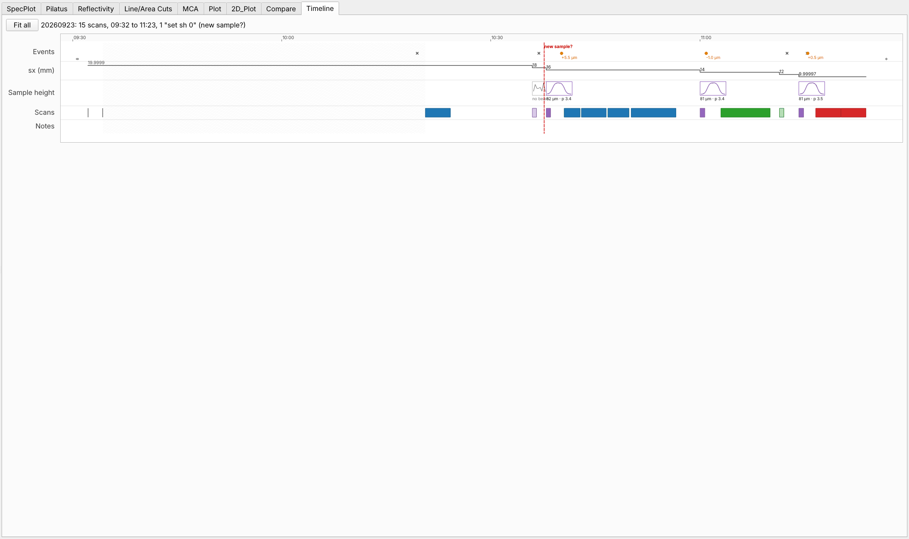
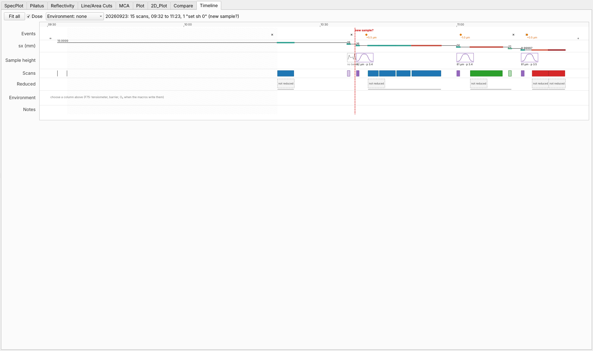
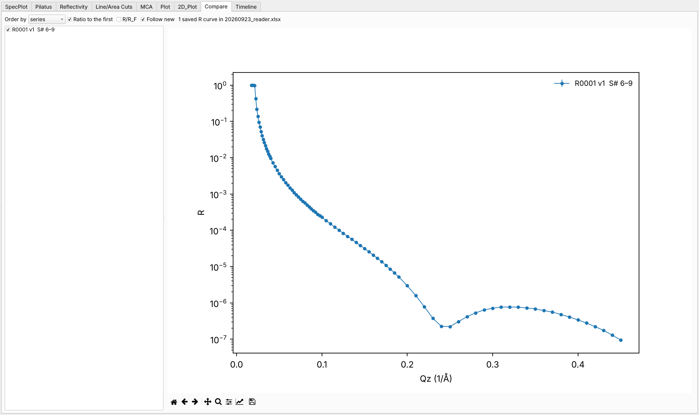

# 10. Timeline and Compare

[Contents](README.md) · previous: [Burn tests](09_burn_tests.md) · next: [Saving](11_saving.md)

## Timeline

The last tab shows the whole session on one time axis, on the SPEC file's local clock: when each sample
came in, where the beam was on it, how its surface looked, what was measured and what has been reduced.

### The lanes, from top to bottom

- **Events.** A red dashed line marked **"new sample?"** where the sample height was set to 0 (`set sh 0`).
  That is almost always a new sample, but sometimes the same one after conditions changed, so it is a guess
  for you to confirm ([below](#answering-and-adding-notes)). Orange dots mark re-referencing after a height
  scan (in µm); crosses, aborted scans; small grey dots, macro files loaded; a dotted line, where SPEC
  reopened the file.
- **sx:** the sample's x position, from each scan's header.
- **Sample height:** each sample-height scan as a small picture of its points (grey) and its super-Gaussian
  fit (purple), with its FWHM and flatness p under it ([chapter 3](03_specplot.md#sample-height-scans)). A
  grey frame and "no beam" when the scan saw no reflected beam.
- **Scans:** one bar per scan, coloured by kind (reflectivity blue, GID green, sample height purple, burn
  red); aborted scans are paler.
- **Reduced:** every result saved in the workbook, as a small picture at its scans' times (a reflectivity
  as log R against Qz). Amber and dashed when its scans have grown since; a dashed "not reduced" box for a
  series not yet reduced. Hover for its version, time and note; click to open it (a reflectivity on the
  Compare tab, other kinds by selecting their scans).
- **Environment:** any column of the SPEC file over the session, chosen with **Environment: …** in the
  toolbar. Surface pressure, barrier area and O₂ readings, once the macros write them, are listed first (in
  mN/m, cm² and %). Any other column works too: Monc shows the beam over the session.
- **Notes:** your notes, each at its time (a yellow band when one covers a span).

Long gaps without scans are hatched across every lane.

### Moving around

The wheel zooms the time axis about the cursor; drag to pan; double-click or **Fit all** shows the whole
file. Hover anything for details. Click a scan bar or a height scan to select that scan: it opens on
SpecPlot, with its fit.

The tab reads the SPEC file when it is shown, and again after Update Specfile or a live read when the file
has grown. New results appear when the tab is shown again.

### Answering and adding notes

- **Right-click a "new sample?" line** to answer it: *A new sample* or *The same sample*. The line then says
  so (grey and solid for the same sample).
- **Right-click anywhere else** to add a note at that time; its first line is its title.

Answers and notes are kept in the workbook, with versions, so they come back when the file is opened
again. The latest answer is the one drawn.

### Dose

Tick **Dose** to colour the sx line by the dose each spot has received so far, as a fraction of the dose at
which the burn test changed by 5 %: teal none, yellow half, red the burn's dose, dark red twice it.

- The burn used is the sample's own (between the same two "new sample?" lines), or else the nearest in time.
- One beam is assumed for the whole file, so its size cancels. Positions within half the beam's width are
  one spot, and every scan counts in full.
- Each segment's tooltip gives the scan's dose, the spot's total and the burn used.
- Analysing the burns takes a few seconds.

This answers "has this spot had too much beam?" before you measure there again.

## Compare

Just left of Timeline, the **Compare** tab lists every reflectivity saved in the SPEC file's workbook,
whether saved automatically or with Save, each with its version and scans. It is the check for a sample's
stability from place to place and over time.

- **Tick** the curves to overlay (log R against Qz). Hover an item for its series, the time it was saved,
  its sample position sx and its note.
- **Ratio to the first:** a panel below shows each ticked curve divided by the first ticked one, over the
  Qz range both cover. The other curve is interpolated, so neighbouring points of a ratio are correlated.
- **Order by:** series, time saved, or sx. This sets the list's order and the colours.
- **R/R_F** lists the saved R/R_F curves instead.
- **Follow new** (on) ticks each curve as it is saved, so the comparison keeps itself up to date while data
  come in.

Curves exported earlier, as files, can be overlaid on the Reflectivity tab with Add Files.
