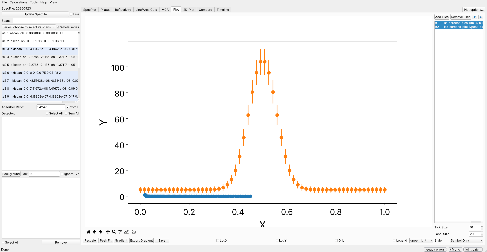
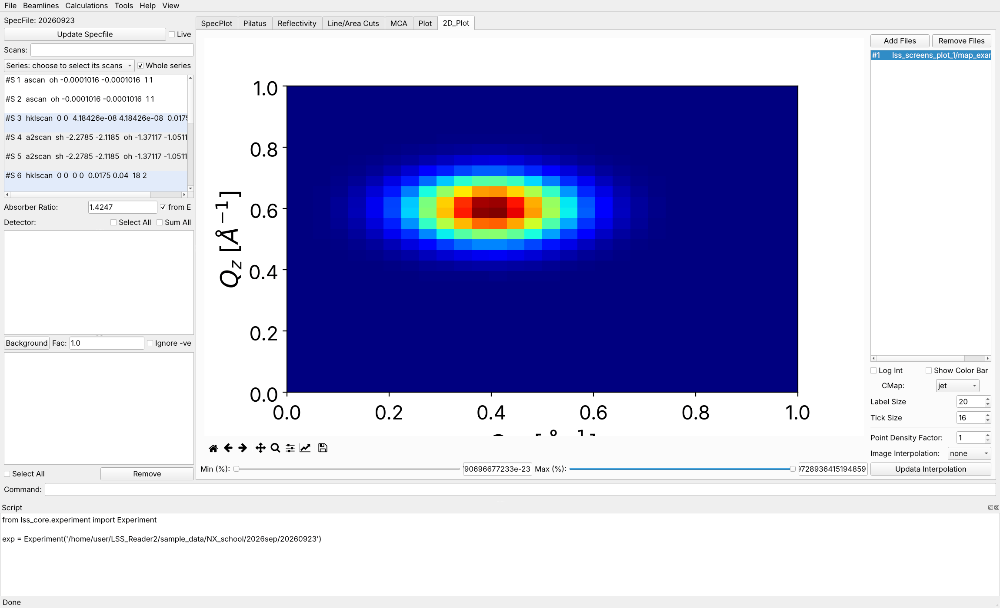
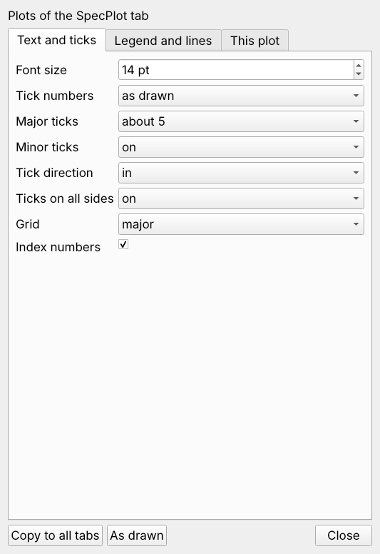

# 12. Plots from files, and plot options

[Contents](README.md) · previous: [Saving](11_saving.md) · next: [Scripts and Tools](13_scripts_tools.md)

## The Plot tab

The Plot tab overlays any text files of columns: reduced curves exported earlier, a fit from elsewhere,
anything with x, y and (optionally) an error column.

- **Add Files** adds files to the list; **Remove Files** removes the selected ones. Select files to plot
  them; the arrows reorder the list. Legends show each file's name.
- **LogX**, **LogY**, **Grid**, **Legend**; **Tick Size**, **Label Size** and **Style** (the line and marker
  style).
- **Rescale** opens a table of x factor, x offset, y factor and y offset for each selected file; edits
  redraw at once. Use it to shift curves apart or put them on one scale.
- **Peak Fit** opens the fit window: Gaussian or Lorentzian peaks on a polynomial background, with start
  values and limits you can edit (double-click a cell for its limits), **Inv.** for dips, a fit range, and
  the reduced χ². **Export Fit** writes the fitted curve (`_fit.txt`), **Export Para** the parameters
  (`_par.txt`; nan where an error could not be estimated). With Residuals above fits on, it shows the
  residuals of the fitted points.
- **Gradient** plots the derivative dy/dx of the selected file; **Export Gradient** writes it (`_der.txt`).
- **Save** stores the selected files, as read, in the workbook.

The MCA tab's legacy **Fit** opens the same fit window on one spectrum.

## The 2D_Plot tab

The 2D_Plot tab draws x y z text files as maps, for example a GID map exported as `_q2d_gid.txt`.

**Add Files**, then select the file. **CMap**, **Log Int**, **Min (%)** and **Max (%)**, **Show Color
Bar**, **Label Size** and **Tick Size** set the look. **Point Density Factor** and **Image Interpolation**
set how scattered points are put on a grid; press **Updata Interpolation** after changing them.

## Plot options

**Plot options...**, at the right end of the tab bar, sets the look of the plots on the tab on show. Each tab
keeps its own settings, between sessions and whenever the tab redraws. The button shows `*` when some are set.
Options start at **as drawn**, the plot as the reader draws it, except three: the font size starts at
"auto", the legend's place at "best", and index numbers are shown.

It has three pages:

- **Text and ticks:** font size (by default at least as large as the tab labels, whatever the display
  scaling); tick numbers plain or scientific; about how many major ticks; minor ticks; tick direction (out,
  in, across); ticks on all four sides, as many journals want; the grid (at the major, or the major and
  minor ticks); index numbers on or off.
- **Legend and lines:** the legend shown or hidden, its place and its frame; every curve's line width and
  marker size; titles hidden, to give the data more room.
- **This plot:** choose one plot of the tab (a tab can hold two, such as the MCA spectra and their
  integrals), then
  - rename its title or axis labels. The new text is used whenever the reader draws the same text again:
    plot another column, and that column keeps its own name;
  - fix the x or y range. **Use the current view** takes the zoom you are looking at. Zoom and pan still
    work, and the fixed range comes back when the plot is redrawn;
  - style each curve (colour, line, width, marker, size), kept either for the curve's name (a fit, a scan)
    or for its place in the drawing order (the first curve, the second, …).

**Copy to all tabs** gives the first two pages to every tab. **As drawn**, **Plot as drawn** and **Curve as
drawn** put things back.

The Pilatus tab's box close-up and the residual panels are always left as drawn.

### One-off edits

**One-off editor...** opens matplotlib's own editor of one plot (what used to be the toolbar's "Customize"
icon): title, axis limits, labels, scales, line styles. These edits last only until the tab redraws the
plot, and are not saved. A plot is redrawn when another scan or frame is selected, when one of the tab's
display boxes is toggled (Log Y, Grid, Point #, …), when new data arrive in Live mode, and when anything in
Plot options changes. So set the kept options first, and the one-off edits last.

For example: on SpecPlot, the one-off editor renames the y axis "Counts" and colours the line red; select
scan 5, and "Pilatus" and blue come back. A grid set in Plot options stays for scan 5, and after a restart.

The Ref Patch window and the burn test keep matplotlib's Customize icon on their own toolbars.

## Every plot's toolbar

Under each plot: **Home** (the original view), **Back** and **Forward** (through the views), **Pan** (left
button pans, right button zooms), **Zoom** (to a rectangle), **Subplots**, and **Save** (the figure as an
image).
