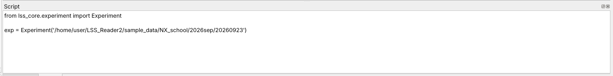

# 13. Scripts and the Tools menu

[Contents](README.md) · previous: [Plots](12_plots.md) · next: [Troubleshooting](14_troubleshooting.md)

## Repeating a reduction in a script

Everything the window reduces is done by `lss_core`, a Python package that needs no window and no Qt.
A script therefore gives the same numbers as the window; for reflectivity this is checked byte for byte
against files the window saved.

```python
from lss_core.experiment import Experiment

exp = Experiment('sample_data/NX_school/2026sep/20260923')
result = exp.reflectivity([6, 7, 8, 9])
result.save('dppc')                     # dppc_ref.txt and dppc_rrf.txt
```

Run scripts from the repository folder, or put it on `sys.path`. The same object makes cuts
(`exp.cut`), GID maps (`exp.gid`), fluorescence intensities (`exp.fluorescence`) and burn tests
(`exp.burn`), with the window's defaults and the same options.

**The Script pane** (View → Script) writes the call for what you just did: opening the file, a patch with
your drops, merges and settings, an export, a GID map, a cut. Copy it into a script to repeat the reduction
on other scans or files. It is also written to the log.

The [scripting guide](../SCRIPTING.md) lists every call and its options, and what is not scriptable yet
(background-subtracted frames, GISAXS).



## The Tools menu

The **Tools** menu holds the demonstrations and figure generators behind the reader's methods: how each
method was tested on data with a known answer, and the figures in the documents. They are grouped by area:

- Burn tests
- Reflectivity patching
- GID and pinhole geometry
- Monitor, scans, SPEC files
- Fluorescence (MCA)
- Synthetic data sets
- The reader's window and manual
- Made elsewhere (figures made from private data, listed but not regenerable here)

**All tools…** opens the Tools window at its overview (also `python -m lss_toolbox` on its own). An item's
page says what it demonstrates, links its documents, says whether its committed figures are older than
their code, and offers **Settings** (the defaults, or a variation a document describes), the script's
options, the **Command** it will run, and **Run** (or **Open window** for the interactive demonstrators,
**Make and open** for a synthetic data set). Results can be shown, compared with the committed ones pixel
for pixel, and opened in their folder.

Some items worth knowing:

- **Open a synthetic data set…** writes a SPEC file with frames or spectra drawn from a known truth and
  opens it in the reader: reduce it and compare with the truth. A good way to learn a workflow.
- **Fit demonstrator (window)…** patches synthetic reflectivity scans by every method, with the truth
  drawn; the space bar draws new noise.
- **Burn line-cut demonstrator (window)…** does the same for the burn-test estimators.
- **Screenshots of every area of the window…** remakes the pictures in this manual.
- **Every control and its tooltip (manual)…** remakes [controls.md](controls.md).

Runs go to `~/.lss_reader/tools/<item>/<date-time>/` (or under `$LSS_READER_TOOLS_DIR`), with a `run.json` recording the command, the times
and the exit code. A packaged build lists the items but cannot run them (it has no Python and no tools
inside); Run's tooltip says so. `docs/TOOLS.md` describes every item.
