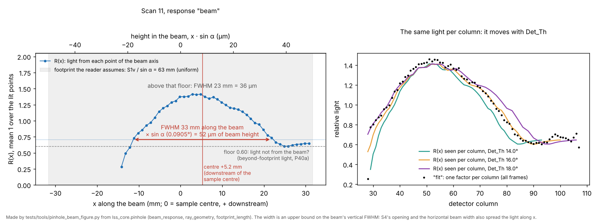
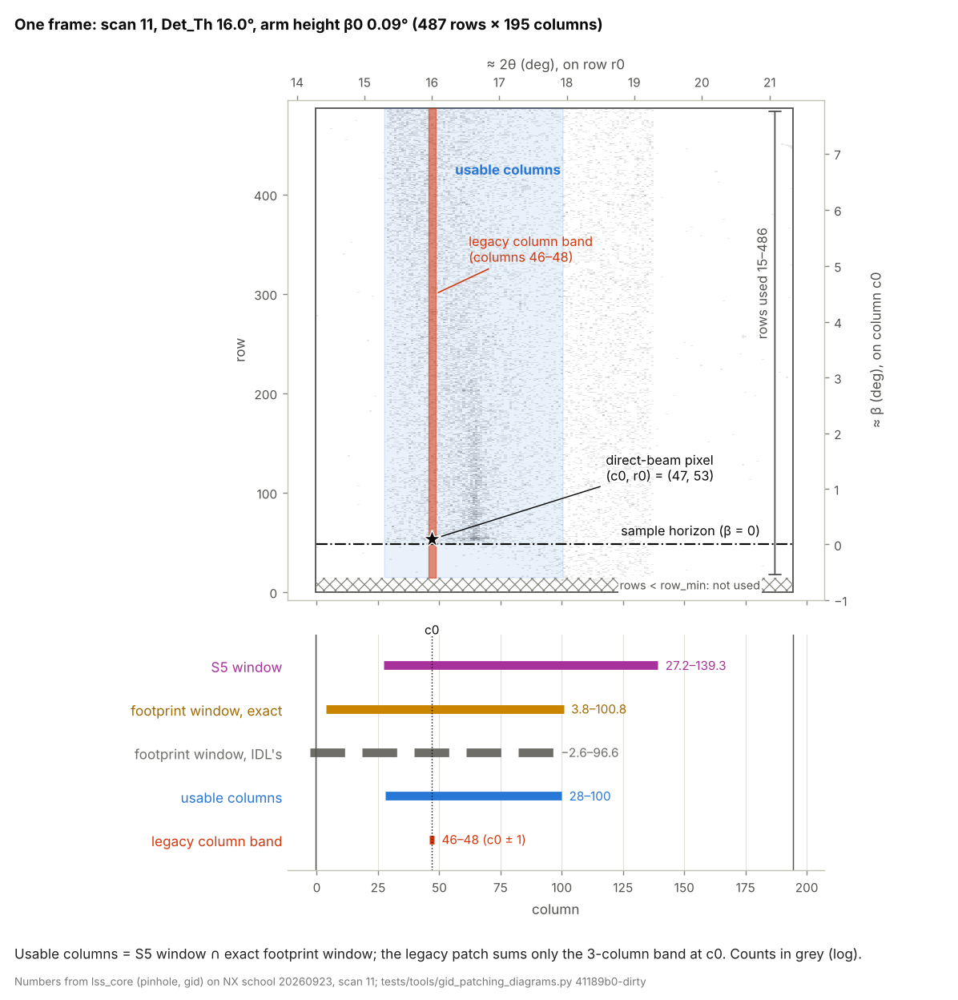
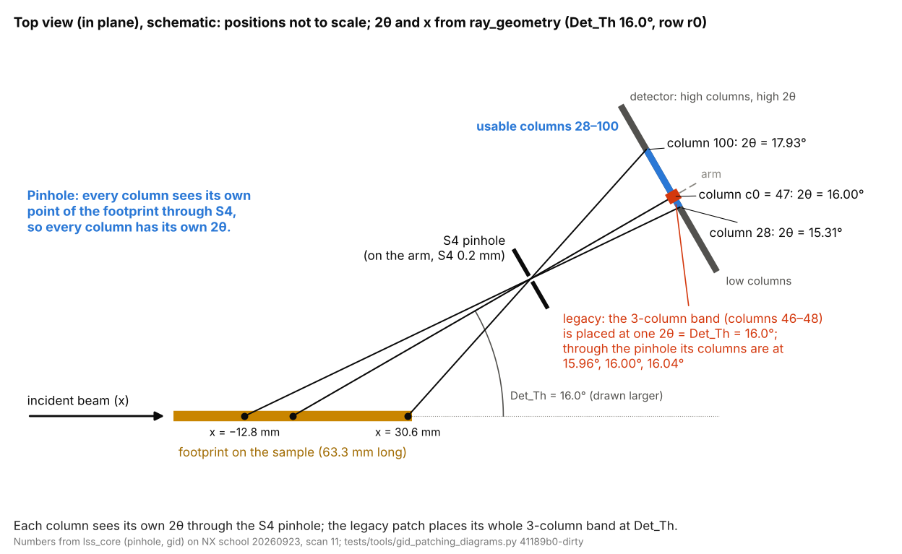
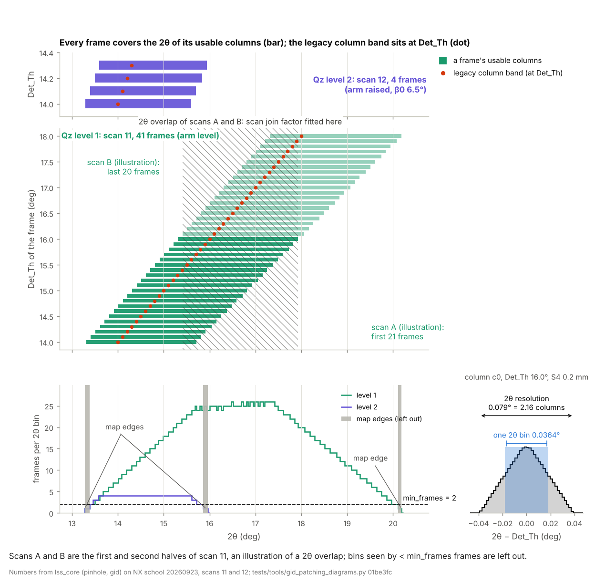
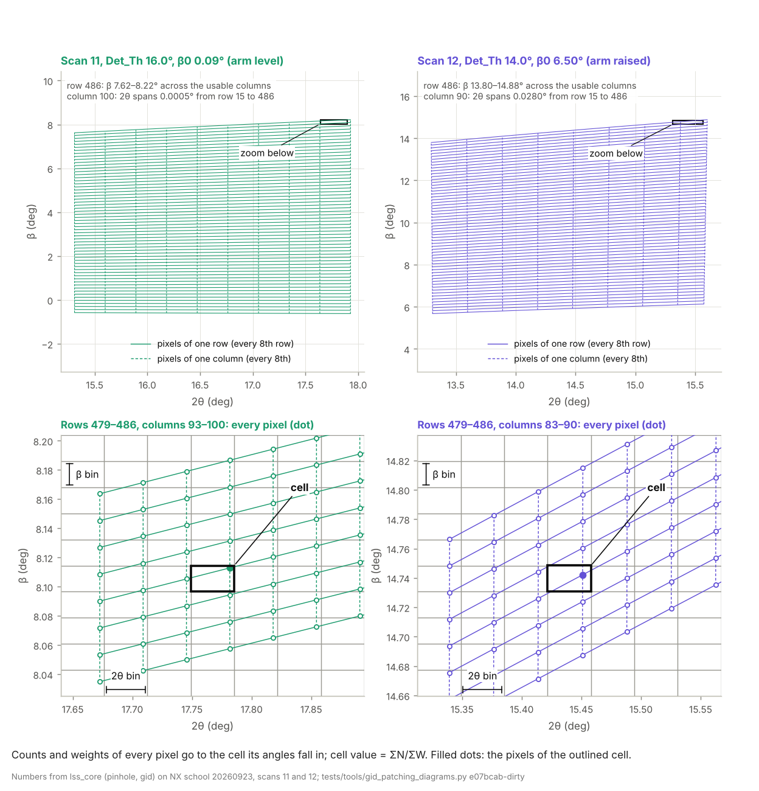
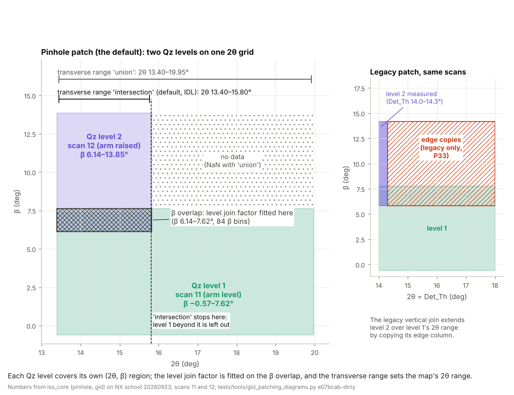
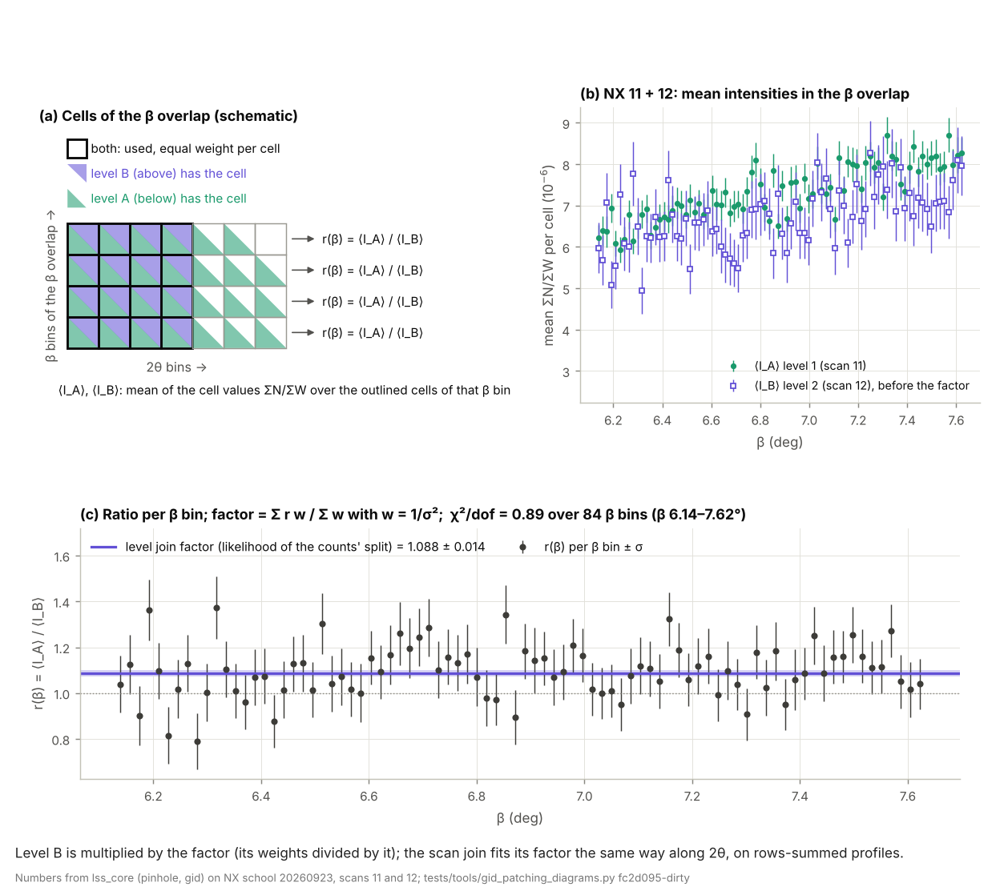
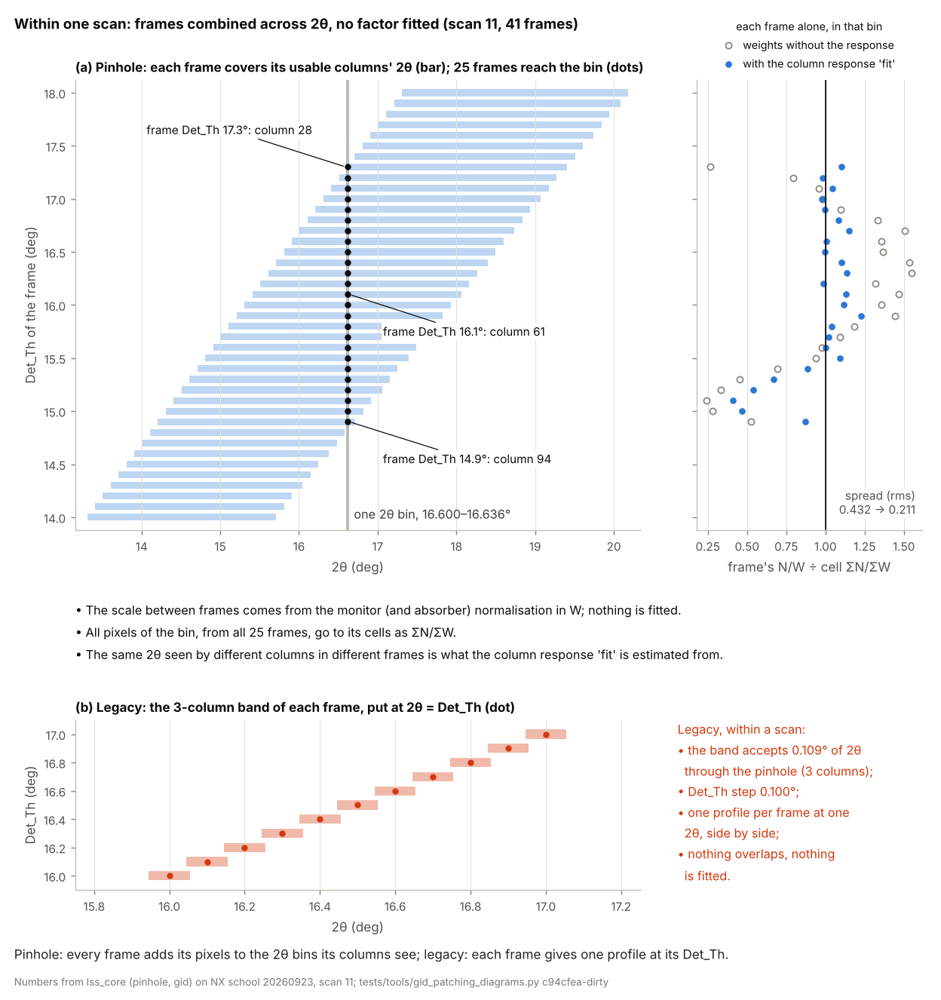
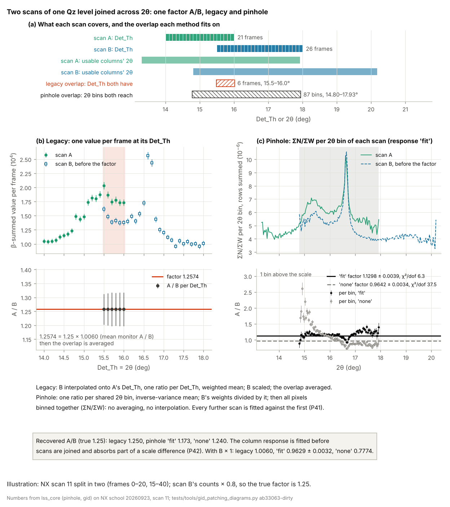

# GID patching: the options, and what each costs (technical addendum)

Part of the user manual, as a technical addendum (owner, 2026-11-20). It
describes how LSS_Reader2 turns a set of Pilatus frames from grazing-incidence
diffraction (GID) scans into one map of intensity against (2θ, β) or
(Qxy, Qz), every option that changes that map, and the advantages and
disadvantages of each choice. Numbers are from the public NX school data
(`sample_data/NX_school/2026sep/20260923`, GID scans 11 and 12) unless
stated. **Measured** marks a number obtained by running the reader; **read**
marks something established by reading code or documents only.

Where to find things: the window's GID menu > Worksheet holds every setting
below; scripts use `Experiment.gid(scans, params=GIDParams(...))`
(`docs/SCRIPTING.md`, "GID maps"); the code is `lss_core/gid.py` (legacy
patch, settings, output) and `lss_core/pinhole.py` (pinhole patch). Every
output-changing default is also in `docs/OUTPUT_DECISIONS.md`; open physics
issues are the P-numbers in `docs/PHYSICS_ISSUES.md`.

Figures: `docs/manual/figures/gid_patching/`, made by
`python tests/tools/gid_patching_diagrams.py` from the reader's own geometry
code and the NX data.

---

## 1. Terms

The same words are used in the worksheet, in the figures and below.

| Term | Meaning | Figure |
|---|---|---|
| **frame** | One detector image: rows × columns (487 × 195 on NX, one 200K module). | 1 |
| **row**, **column** | Vertical and horizontal pixel index. Rows go with the exit angle β, columns with the in-plane angle 2θ. | 1 |
| **direct-beam pixel** (c0, r0) | Where the direct beam would hit the detector at the frame's arm position. | 1 |
| **Det_Th** | The detector arm's in-plane angle for a frame. A **scan** sweeps Det_Th in steps. | 2, 3 |
| **arm height** β0 | The arm's elevation. Raising the arm reaches higher β, i.e. a higher Qz **level**. | 4, 5 |
| **Qz level** | All frames taken at one arm height (one or more scans). NX scan 11 is the low level (arm level), scan 12 the next (arm raised to β0 = 6.5°). | 5 |
| **sample horizon** | The row where β = 0; nothing from the surface reaches below it. | 1 |
| **rows used** | `row_min`–`row_max` (default 15–486): the rows taken from every frame. | 1 |
| **S5 window** | Columns that the S5 slits (in front of the detector) let through. | 1 |
| **footprint window** | Columns that see the lit strip of sample (the footprint) through the S4 pinhole. **Exact** (default): traced ray by ray, fully lit through the whole S4 opening. **IDL's**: the same width, centred on c0 (an option). | 1, 2 |
| **usable columns** | S5 window ∩ footprint window: the columns the pinhole patch uses. | 1, 3 |
| **legacy column band** | The few columns around c0 (default 3) that the legacy patch sums. | 1, 3 |
| **2θ bin**, **β bin**, **cell** | The pinhole map's grid: 2θ bins one column wide (pixel / S4–detector distance), β bins one row wide (at the direct beam); a cell is one (2θ bin, β bin). | 4 |
| **2θ resolution** | The spread of 2θ one column accepts through the S4 opening plus its own width: 0.079° = 2.2 columns on NX (S4 0.2 mm; measured). It is coarser than one 2θ bin. | 3 |
| **2θ overlap** | 2θ bins seen by two scans of the same level: where the **scan join factor** is fitted ("horizontal join"). | 3 |
| **β overlap** | β bins seen by two Qz levels: where the **level join factor** is fitted ("vertical join", "Qz join"). | 5, 6 |
| **map edges** | 2θ bins seen by fewer than `min_frames` frames; left out. | 3 |
| **transverse range** | The 2θ range of a map joined from several levels: 'intersection' (bins every level has; default, as the IDL code) or 'union' (all). | 5 |
| **edge copies** | Legacy patch only (P33): where the vertical join fills a level's missing 2θ range with copies of its edge column. | 5 |
| **column response** | How much light each column records, relative to the others, for the same scattering: one factor per column ('fit'), or one profile along the beam axis ('beam'), estimated from the data; section 3b. | 7, beam figure |

## 2. What happens to the frames, in order

1. **Frames are read and normalised.** Each frame's counts, monitor
   (Monc), absorber setting and angles come from the SPEC file and the
   image. Bad pixels can be replaced (`bad_pixel_iterations`, `factor`);
   background-subtracted frames can be used from the window (not from
   scripts yet).
2. **Frames are grouped into Qz levels** by their Qz rounded to
   `qz_decimals`, and ordered by Det_Th rounded to `dth_decimals`.
3. **Each frame contributes columns at angles.** Legacy: the legacy column
   band, summed, placed at the frame's Det_Th. Pinhole: every usable column,
   each pixel at its own exact (2θ, β) (figure 2, figure 4).
4. **Weights.** Each pixel's weight W is its monitor × the area
   (footprint) correction × the polarisation factor × the column response.
5. **One map per level.** Legacy: the frames' profiles side by side, scans
   joined in their 2θ overlap by interpolation. Pinhole: counts N and
   weights W summed into cells, value ΣN/ΣW, scans joined by a fitted
   factor applied to W (figure 3, figure 4).
6. **Levels are joined** in their β overlap by a fitted factor (figure 5,
   figure 6), and the map is cut to the transverse range.
7. **Output.** The map on Angles (2θ, β) or regridded on Q (Qxy, Qz), with
   its integrals over each axis and four slices; "Save GID" writes three
   files and the equivalent script call.

## 3. The two patch methods

### Legacy patch (`pinhole=False`; "Pinhole: angle per column" unticked)

The original program's method. From each frame it sums the legacy column
band around c0 (default 3 columns) into one profile against β, and places
that profile at the frame's Det_Th. Scans of a level are joined by a factor
fitted on the ratio of their β-summed profiles in the 2θ overlap (the
second scan linearly interpolated onto the first's angles), then averaged
in the overlap. Levels are joined by interpolating the upper level onto the
lower level's 2θ grid and fitting one factor on the β-integrated profiles in
the β overlap (`vjoin_kind`, cubic by default).

| Advantages | Disadvantages |
|---|---|
| Simple; reproduces every map made with the original program exactly (tests pin it). | Uses 3 of ~70 lit columns: on NX scan 11, 3.2 × 10⁴ counts against 5.65 × 10⁵ for the pinhole patch (measured; 15–17× fewer). Relative errors on equal bins 3.8× larger (measured, C10). |
| No assumption about the pinhole geometry: valid without a pinhole (Det_Th ≤ 1°, or no S4). | Each frame gives one 2θ: the map's 2θ step is the Det_Th step, and the column band's own width (3 columns ≈ 0.11°) blurs it. NX Bragg peak FWHM 0.0180 ± 0.0009 against 0.0155 ± 0.0002 Å⁻¹ pinhole (measured). |
| Familiar to existing users. | β taken per row from the sample distance: exact only at the direct-beam column of a level arm (P38). |
| | Joins interpolate (linear, cubic), so overlap values are smoothed and errors correlated; the vertical join copies the upper level's edge column over 2θ it never measured (edge copies, P33); the relaxed Q grid fills empty regions with 1e-10, which integrated cuts sum as data (P33). NX 11 + 12 level factor 0.900 ± 0.048 with χ²/dof 9.2 (measured). |
| | Known defects with three Qz levels: first high-level frame not rescaled by the monitor (P36, P31); one high-level scan picks the middle level's key (P37). Footprint correction 2 % asymmetric in ±2θ (P5). |

### Pinhole patch (default; `pinhole=True`)

With the S4 slit acting as a pinhole in front of the detector (NX: S4 0.2 mm,
271 mm from the detector), each detector column looks through S4 at one
point of the footprint, so each column has its own 2θ (figure 2). The
pinhole patch uses every usable column of every frame, with exact per-pixel
angles (Mati Meron's IMG_COO_CONV transform, `pinhole.pixel_angles`): β
depends on the column (each column sees another part of the footprint, at
another distance), and 2θ on the row when the arm is raised (figure 4).
Counts and weights go to cells; a cell's value is ΣN/ΣW. Scans of a level
and the levels themselves are joined by fitted factors on shared cells,
without interpolation (figure 6).

| Advantages | Disadvantages |
|---|---|
| All usable columns: ~15–17× the counts of the legacy band on NX (measured). | Depends on geometry the file must describe correctly: S4–detector distance, S4 opening, S5 opening, S1 vertical, α, c0. A wrong pinhole distance smears features (a distance fitted from the data ranged 258–280 mm on NX, so the header value, 271 mm, is the default; measured). |
| 2θ per column: bins one column wide (0.036° on NX), true resolution 2.2 columns, set by S4's opening (measured). | Needs a column response (relative sensitivity and illumination of each column), estimated from the data; with a narrow beam it varies with Det_Th (see "Column response"). |
| Exact angles: on NX β per row was off by up to 0.41° (arm level) and 0.74° (arm raised) inside the usable columns; joining with exact angles took the NX level join's χ²/dof from 1.31 to 0.83 (measured, P38). | Only valid where there is a pinhole: at Det_Th ≤ 1° the reader uses no pinhole (IDL's rule). |
| No interpolation: overlap cells hold summed counts, errors stay Poisson (ΣN). Counts are conserved (invariant I21, tested). | Light that does not come from the footprint through the pinhole (beam-path scattering, slit scattering, P40) is treated as signal; the exact window and the raised arm interact with a stray-light streak (see "Footprint window"). |
| NX Bragg peak: σ/I 1.02 % per own bin against 2.55 % legacy; level join 1.068 ± 0.013, χ²/dof 0.93 (measured). | The level join factor depends on which columns each level uses when the illumination along the beam changes between the levels' scans (sample height drift of a few µm moves the footprint by mm at α = 0.09°; owner, 2026-11-19). The joined map stays consistent; the factor's value is a normalisation. |

## 3a. Joining across 2θ (Det_Th): within a scan, and between scans

A map's 2θ range is built from many frames at different Det_Th. That
happens at two scales, and the two methods do both differently
(figures 7 and 8). Qxy follows from 2θ (and β), so this is also the join
along Qxy.

### Within one scan: no factor is fitted

Frames of one scan are put on one scale by the monitor (and absorber)
normalisation alone; nothing is fitted between them.

- **Pinhole.** Each frame's usable columns span about 2.6° of 2θ (NX), and
  Det_Th steps by 0.1°, so the frames overlap heavily: a 2θ bin is seen by
  up to 26 frames, each time through a different column (figure 7a). All
  their pixels go into the same cells as ΣN/ΣW, so the overlap is an
  average weighted by counts, not by a fitted factor. The same 2θ seen
  through different columns is also what the column response is estimated
  from: in the cells, column-to-column differences and frame-to-frame
  differences are separated by assuming the response depends on the column
  only ('fit') or on the point of the beam axis only ('beam'). Measured on
  the 2θ bin 16.600–16.636° (25 frames): each frame's own N/W scatters about
  the cell's ΣN/ΣW with an rms of 0.43 without a response and 0.21 with
  'fit' (figure 7a): the response removes half of the frame-to-frame
  scatter, not all of it.
- **Legacy.** Each frame gives one profile at its Det_Th (the legacy column
  band, ≈ 0.11° wide through the pinhole, at steps of 0.1°): profiles side
  by side, no overlap, nothing averaged (figure 7b).

| | Advantages | Disadvantages |
|---|---|---|
| Pinhole | Every 2θ seen many times, through many columns: counts add up, and column sensitivity can be measured from the data. | The frames' relative scale rests on the monitor and on the response model: if the light a column receives changes from frame to frame (narrow beam, sample height drift), the response cannot fully follow it, and the residual shows up as structure along 2θ and in the joins. |
| Legacy | Simple; no model beyond the monitor. | One 3-column sample per frame; any frame-to-frame illumination change goes straight into the map. |

### Between scans of one level: one factor per scan

When a level is measured in several scans (e.g. two Det_Th ranges, as in
the owner's GID runs, overlapping by 0.4°), their scales can differ
(absorbers, slits, beam drift between scans), so a factor is fitted where
they overlap in 2θ (figure 8).

- **Legacy** (`gid.hjoin`): the β-summed value of each frame of the second
  scan is interpolated linearly onto the first scan's Det_Th values in their
  overlap; the ratios are fitted to one factor; the second scan is scaled,
  and in the overlap the two scans are **averaged** (each interpolated onto
  the finer grid). The overlap is the Det_Th values both scans have.
- **Pinhole** (`pinhole.level_map`): the rows-summed ΣN/ΣW of the first scan
  and of each further scan per shared 2θ bin; the ratios' inverse-variance
  mean is the factor, applied to that scan's weights; then all pixels are
  binned together. No interpolation, no averaging of two maps. The overlap
  is every 2θ bin both scans' usable columns reach (many more than the
  shared Det_Th values: 87 bins against 6 frames in the example below).

**Measured (2026-11-20), NX scan 11 split into two scans** A (frames 0–20,
Det_Th 14.0–16.0°) and B (frames 15–40, 15.5–18.0°), B's counts × 0.8, so
the factor A/B must change by 1.25 (`tests/test_gid_scan_join.py`):

| Method | A/B, B as measured | A/B, B × 0.8 | change (should be 1.25) |
|---|---|---|---|
| Legacy | 1.006 (the scans' mean monitors differ) | 1.257 | **1.250** |
| Pinhole, response 'fit' (default) | 0.963 ± 0.003, χ²/dof 6.9 | 1.130 | **1.173** |
| Pinhole, response 'beam' | 0.963, χ²/dof 8.0 | 1.130 | 1.173 |
| Pinhole, response 'none' | 0.777, χ²/dof 43 | 0.964 | 1.240 |

Figure 8c shows the per-bin ratio of the two pinhole scans: not flat but
rising from about 1.0 at 14.8° to about 1.3 at 17.9°, with a dip at the
Bragg peak. A sees the high end of the overlap through its high columns and
B through its low ones, so the slope is the column response's misfit made
visible; it is why χ²/dof is 6–7. Two things follow (P42). First, the column response is fitted on all
frames of the level **before** the scans are joined, so it absorbs about a
third of a real scale difference between scans: the pinhole join recovers
1.173 of 1.25. Second, two halves of the same scan, which should join at
1.000, join at 0.963 with χ²/dof 6.9: the per-column response does not
describe the frames well enough, and the scan factor takes up the misfit.
With no response at all the join sees the scale (1.240), but the halves are
then 22 % apart (columns differ). The legacy join recovers the scale
exactly, but from 6 shared Det_Th values and with interpolation. The
remedy, to be decided: estimate the scan factors together with the response
(alternating, as the response itself is estimated), and measure again on
these splits.

| | Advantages | Disadvantages |
|---|---|---|
| Pinhole scan join | Many shared 2θ bins; no interpolation; counts conserved. | P42: biased by the response fit (above); P41: every scan is fitted against the level's first scan only. |
| Legacy scan join | Recovers a scale between scans exactly (above). | Few shared values (the Det_Th both scans have); interpolates; averages the overlap (smoothing, correlated errors); needs Det_Th overlap, not just 2θ overlap. |

## 3b. The column response

**What it is.** In the pinhole patch, each column of a frame records the
scattering at its own 2θ. If every column were equally efficient and saw
an equally lit piece of sample, a column's counts per monitor count would
depend only on the sample's scattering at that (2θ, β). They do not, for
three reasons:

1. **Illumination.** Through S4, each column looks at one point of the
   footprint (figure 2). The footprint is not lit evenly: the beam's
   vertical profile, stretched along the surface by 1/sin α (a few tens of
   mm on NX), is brightest near the middle and falls off towards the ends.
   Columns that look at the bright middle record more than columns that look
   at the dim ends. This is the largest effect: about a factor of 2.4
   between the brightest and dimmest interior columns on NX, more at the
   edges (figure below; measured).
2. **Geometric acceptance.** Near the edges of the usable columns, the S4
   opening and the S5 slit let a column see only part of the footprint, or
   part of its own pixel (the ramps of P39).
3. **Pixel sensitivity.** Small differences between detector pixels (a
   per-cent or so is typical for a flat-field-corrected Pilatus; not
   measured here).

The **column response** R is the factor by which a column records more or
less than the average, for these reasons together. The patch divides by it,
by putting it into the weights: W = monitor × area × polarisation × R.

**How it is estimated ('fit', the default).** The same 2θ is seen by many
columns in different frames of a scan (figure 7a: up to 26 frames). So the
data can separate "what the sample scatters at this 2θ" from "how much this
column records": the reader alternates between the two, S(2θ) from all the
columns that see each 2θ bin, then R(column) from all the 2θ each column
saw, twenty times, and normalises R to a mean of 1 over each level's columns
(`pinhole.column_response`). Measured on the 2θ bin 16.6° of NX scan 11: the
frames that reach it scatter about the bin's value by 43 % rms without a
response and 21 % with 'fit'.

**The alternatives.**
- **'beam'**: instead of one factor per column, one profile along the beam
  axis (reason 1 only), shared by all frames of a level, with each column
  mapped, frame by frame, to the point of the footprint it sees
  (`pinhole.beam_response`). It is a physical quantity, the footprint's
  illumination, and it gives the beam's centre and width on the sample (NX:
  33 mm along the beam, at most 52 µm of beam height; figure below).
- **'none'**: R = 1; counts per monitor only.

**What it cannot do.**
- **Light that changes from frame to frame.** 'fit' assumes a column always
  records the same fraction. But a column sees a different point of the
  footprint at each Det_Th, so with a narrow beam its light changes along
  the scan (synthetic 30 µm beam: 'fit' 0.93–1.04 of the truth inside, 0.71–
  2.8 at the edges; 'beam' 0.98–1.02 and 0.88–1.04; measured). 'beam'
  follows that, but assumes the illumination is the same for all frames of
  a level, which a sample height drift breaks.
- **Absolute scale.** Normalising R to a mean of 1 per level discards each
  level's own scale, so the levels must then be joined by a fitted factor.
  As collected, with no response, NX's two levels (same absorbers, slits,
  gain and monitor) differ by 22 %; with 'fit' the fitted level factor is
  1.068, with 'beam' 1.139: the empirical response hides part of a real
  difference (physics_notes 2026-11-20).
- **Scale between scans.** R is fitted on all frames of a level before the
  scans are joined, so it absorbs part of a real scale difference between
  scans (P42, section 3a).

**A more physical alternative (proposed, not built):** R from what is known
or measured rather than fitted: the slits' acceptance (computable now,
`pinhole.column_acceptance`) times the beam's profile along the footprint
(measured by a half-cut next to each level, or the one-profile 'beam' fit).

*Left: the light from each point of the footprint along the beam (response
'beam', NX scan 11). Right: the same light as each column sees it at three
Det_Th (coloured), against the one-factor-per-column 'fit' (black): the
column that looks at a given point moves with Det_Th, so one factor per
column is an average. Made by `tests/tools/pinhole_beam_figure.py`.*

## 4. The options

Defaults are what a user gets without changing anything. "Worksheet" is
the label in GID > Worksheet; `name` is the `GIDParams` field.

### 4.1 Frames and levels (both methods)

| Option | Values (default) | Advantages | Disadvantages |
|---|---|---|---|
| Rows (`row_min`, `row_max`) | 0–486 (15–486) | Leaves out the bottom rows (shadow, beam stop) and so the region below the sample horizon. | Rows cut away reduce the β range; the top rows of the lower level are the β overlap with the next level, so cutting them shrinks the overlap. |
| Qz grouping, decimals (`qz_decimals`) | integer (3) | Frames whose Qz differs only by rounding form one level. | Too few decimals merges distinct levels; too many splits one level into several. Legacy: at most three levels (low, middle, high), any further level goes into "high". |
| Det_Th rounding (`dth_decimals`) | integer (3) | Orders frames robustly against motor jitter. | Legacy only in practice; too few decimals merges distinct frames. |
| Frames (`points`), direct beam (`db_pos`) | all frames; from the header | Leave out bad frames; correct a wrong c0, r0. | A typed c0 applies to all frames. |
| Bad pixels (`bad_pixel_iterations`, `bad_pixel_factor`) | 0 (off), 1 | Removes hot pixels. | The threshold factor is used for detection but not for replacement (P16). |
| Background-subtracted frames | off | Removes a measured background. | Window only (not scriptable yet). |

### 4.2 Which columns, at which angle

| Option | Values (default) | Advantages | Disadvantages |
|---|---|---|---|
| Pinhole: angle per column (`pinhole`) | on / off (on, D40) | See section 3. | See section 3. |
| Columns per frame (`columns`, legacy only) | integer (3) | A wider band gives more counts. | Blurs 2θ by the band's width (the band is placed at one angle); the area correction must follow (it does, through the band width). |
| Footprint window (`footprint`, pinhole) | exact / IDL (exact, D51) | **Exact**: uses every column that sees the footprint through the whole S4 opening: on NX +3.3 % counts, 2θ to 19.93° (IDL: 19.82°), Bragg peak unmoved (measured). **IDL's**: reproduces earlier maps and the IDL code exactly. | **Exact**: on raised-arm frames (β0 > 1°) the high edge stays at IDL's, because the extra 3–4 columns there catch a stray-light streak (P40b; NX: 2.4× brighter in rows 60–150 than lower rows, against 1.5× in the old edge columns; measured). So only the lower level gains the edge columns, which shifts the NX level factor from 1.097 to 1.068 ± 0.013 (a normalisation, not an error of the map). **IDL's**: drops a few lit columns at the high-2θ edge (P39). |
| S4–detector (mm) (`pinhole_distance_mm`) | number (0 = header, 271 on NX) | A typed value overrides a wrong header. "Fit" estimates it from a feature's drift (diagnostic). | The fit depends on the column response by several mm (258–280 on NX); use it to check, not to set. |
| Arm correction (`arm_correction`) | on / off (on) | Includes the arm's own offset (`g_l3`) in the sample–detector distance used for β. | — (off only to compare with older maps). |

### 4.3 Weights

| Option | Values (default) | Advantages | Disadvantages |
|---|---|---|---|
| Area correction (`area_correction`), hard slit offset (`hard_slit_offset_mm`) | on (on), 32 mm | Divides by the fraction of the footprint the slits let the detector see, which changes with Det_Th. The 32 mm shortens the sample–detector distance with hard slits. | Uniform footprint assumed (S1v / sin α); a narrow Gaussian beam is not uniform (see "Column response"); 2 % asymmetric in ±2θ (P5). |
| Polarisation (`polarisation`) | on (on) | Divides by 1 − (sin 2θ cos β)², the horizontally polarised synchrotron beam's factor. | Not small: 5.1 % at 2θ = 13°, 7.6 % at 16°, 11.7 % at 20° (from the formula, β = 0), changing across a map; off only to compare. |
| Column response (`response`, pinhole) | fit / beam / none (fit) | **fit**: one factor per column, estimated from the data (the same 2θ is seen by many columns in different frames): absorbs pixel sensitivity, S4 and S5 edge effects and the mean illumination. **beam**: one profile along the beam axis shared by all frames: through S4 each column sees one point of the footprint, and that point moves with Det_Th, so a narrow beam lights a column differently in each frame; it also measures the beam's size and position on the sample (NX: footprint FWHM 33 mm along the beam, i.e. ≤ 52 µm vertically; 36 µm above the beyond-footprint floor; measured). **none**: flat. | **fit**: cannot follow illumination that changes from frame to frame: on synthetic frames lit by a 30 µm beam, 0.93–1.04 of the truth inside, 0.71–2.8 at the edges (measured). **beam**: 0.98–1.02 inside, 0.88–1.04 at the edges on the same frames (measured), but assumes the illumination is the same for all frames of a level (sample height drift breaks this) and does not absorb pixel-to-pixel sensitivity. **none**: no correction at all. |

### 4.4 Binning (pinhole)

| Option | Values (default) | Advantages | Disadvantages |
|---|---|---|---|
| 2θ bin width | one column, p/D_p (0.036° on NX) | Keeps all the information; levels share one 2θ grid (`shared_edges`), so their bins coincide and need no interpolation. | Finer than the true resolution (2.2 columns): neighbouring bins are correlated. Coarser bins (per-column resolution, ~2 columns) are a pending decision. |
| β bin width | one row at the direct beam; the joined map uses the largest row step of any level | No level skips a β bin. | An assumption (OUTPUT_DECISIONS, open). |
| Frames per bin, at least (`min_frames`) | integer (2) | Drops map edges seen only by one frame's weakest columns. | Higher values shrink the 2θ range; an assumption (open). |
| Overlapping pixels in a cell | ΣN/ΣW (counts over weights) | Unbiased at low counts (0.4 counts/pixel: 1.00 ± 0.01; invariant I21, tested). | Departs from IDL, which weights each pixel by its own error (biased at low counts: 0.31× the true mean at 0.4 counts/pixel, IDL review); **to confirm with the owner**. |

### 4.5 Joins

| Option | Values (default) | Advantages | Disadvantages |
|---|---|---|---|
| Scan join (within a level) | pinhole: one factor per scan on the 2θ-overlap profiles, applied to W; legacy: interpolated ratio fit, then the overlap averaged | Pinhole: no interpolation, counts conserved. | Pinhole: biased by the column response, which is fitted before the scans are joined (recovers 1.173 of an injected 1.25, P42; section 3a). Each further scan is fitted against the **first** scan of the level, so every scan must overlap the first; scans that overlap only in a chain (A–B, B–C) leave the factor undefined (P41, read only). Legacy: a scan with no overlap is placed unscaled, with a warning. |
| Level join (between levels) | pinhole: one factor per level on the β overlap, equal weight per cell (figure 6); legacy: β-integrated profiles, interpolated (`vjoin_kind`: cubic) | Equal weight per cell avoids the 2.6 % bias of summed counts, which weight a 2θ feature differently in each level (measured on synthetic data). The factor's error is carried into the map's errors (its relative error × the level's share of the weight). | The factor depends on the columns used when the illumination changed between the levels' scans (section 3); the β overlap is short (NX: β 6.1–7.6°, 84 β bins), at the lower level's top rows and the upper level's bottom rows, where stray light (P40) lies. |
| 2θ range across levels (`transverse`) | intersection / union (intersection) | **intersection**: every 2θ bin has every level, as the IDL code (IMG_JOIN). **union**: keeps all measured 2θ. | **intersection**: a short level (NX scan 12: 4 frames, 2θ 13.4–15.8°) cuts the whole map to its range. **union**: NaN where a level is missing at that β. |
| GID Patch Relax (`relax=True`) | off | The Q map on the largest rectangle the data reach. | Fills empty regions with 1e-10, which the integrated cuts sum as data (P33). |

### 4.6 Output

| Option | Values (default) | Notes |
|---|---|---|
| Axes | Angles (2θ, β) / Q (Qxy, Qz) / Pixels | Q: the (2θ, β) map regridded linearly onto (Qxy, Qz) with the first frame's α (a second interpolation). "Save GID" needs Angles or Q. |
| Integrals and slices | h (over the vertical axis), v (over the horizontal), four vertical slices | Written by "Save GID"; the slices split the positive vertical range into four. |

## 5. Choosing

- **Most data (pinhole slit set, Det_Th > 1°):** the defaults: pinhole,
  exact footprint window, response 'fit', intersection. Look at the worksheet's
  join table: a level factor with χ²/dof well above 1 means the levels
  disagree in their β overlap (illumination change, stray light, wrong
  geometry).
- **A narrow, well-focused beam, or illumination that changes with Det_Th:**
  try response 'beam' and compare; its centre and FWHM on the sample are a
  check of the beam (a half-cut scan next to each GID level measures it
  directly; F43).
- **Reproducing an old map or the IDL code:** legacy patch (pinhole off)
  for the original program; footprint window "IDL" for the IDL code's
  pinhole columns.
- **A short or aborted level:** 'union' keeps the other levels' full 2θ
  range; the join factor rests on fewer cells.
- **Comparing levels quantitatively:** remember that a level factor is a
  normalisation fitted where the levels overlap; it moves when the columns
  used change (section 3).

## 6. Known limitations

P5 (area correction asymmetry), P16 (bad-pixel replacement), P31/P36/P37
(legacy, three levels), P33 (legacy edge copies, relaxed fill), P38 (per-axis
angles still used in cuts and image axes), P39 (fixed: exact window), P40
(stray light; raised-arm exception), P41 (pinhole scan join against the
first scan only), P42 (pinhole scan join biased by the response fit), and the open assumptions in
`docs/OUTPUT_DECISIONS.md` (minimum frames per bin, β step, ΣN/ΣW vs IDL
weights, the 1° raised-arm threshold). Comparisons behind the numbers above:
`docs/COMPARISONS.md` C10, C11, C14, C21–C24; figures of the geometry:
`docs/figures/pinhole/`; before/after maps: `docs/figures/gid_compare/`;
the beam profile: `docs/figures/pinhole_beam/`.

## Figures

Made by `python tests/tools/gid_patching_diagrams.py` (NX school data only;
numbers from `lss_core`).

**1. One frame.** Scan 11 at Det_Th 16°: direct-beam pixel (47, 53), rows
used 15–486, sample horizon near row 48; S5 window 27.2–139.3, exact
footprint window 3.8–100.8, IDL's −2.6–96.6, usable columns 28–100; legacy
column band 46–48.

**2. Each column has its own 2θ.** From above (not to scale): through the
S4 pinhole, column 28 sees x = −12.8 mm of the footprint at 2θ 15.31°, c0
sees the centre at 16.00°, column 100 sees x = 30.6 mm at 17.93°. The legacy
patch puts its three columns (15.96°, 16.00°, 16.04° through the pinhole) at
Det_Th.

**3. Which 2θ each frame reaches.** One bar per frame (scan 11: 41 frames,
scan 12: 4); frames per 2θ bin with the `min_frames` line and the map edges;
a 2θ overlap between two scans of one level (scan 11 split in two, as an
illustration); one 2θ bin (0.0364°) against the 2θ resolution (0.079° =
2.16 columns).

**4. Pixels into cells.** The exact (2θ, β) of the pixels over the cell
grid. Arm level (scan 11): the top row spans β 7.62–8.22° across the usable
columns, and 2θ changes by 0.0005° along a column. Arm raised (scan 12): the
top row spans β 13.80–14.88°, and 2θ changes by 0.028° along column 90.

**5. Levels and overlaps.** Pinhole patch: level 1 (scan 11) β −0.57–7.62°,
level 2 (scan 12) β 6.14–13.85°; β overlap 6.14–7.62° (84 β bins);
transverse range 'intersection' 2θ 13.40–15.80°, 'union' 13.40–19.95°.
Legacy patch of the same scans: level 2 measured at Det_Th 14.0–14.3° only,
the rest of its 2θ range filled by edge copies (P33).

**6. A level join factor.** Cells both levels have, equal weight per cell,
a ratio per β bin, and the weighted mean: NX 11 + 12, 1.068 ± 0.013,
χ²/dof 0.93 over 84 β bins (the tool recomputes it as `join_levels` does
and checks it against the reader's value). The scan join fits its factor
the same way along 2θ, on rows-summed profiles.

**7. Within one scan.** (a) Pinhole: every frame of scan 11 as a strip over
its usable columns' 2θ; the 2θ bin 16.600–16.636° is reached by 25 frames,
through column 28 at Det_Th 17.3°, column 61 at 16.1°, column 94 at 14.9°;
each frame's N/W in that bin against the cell's ΣN/ΣW, rms 0.43 without a
response, 0.21 with 'fit'. (b) Legacy: one 3-column profile per frame at its
Det_Th, 0.109° wide through the pinhole at 0.100° steps: side by side,
nothing fitted.

**8. Joining two scans.** NX scan 11 split into A (Det_Th 14.0–16.0°) and B
(15.5–18.0°), B's counts × 0.8. (a) The overlap each method uses: legacy, 6
Det_Th values (15.5–16.0°); pinhole, 87 2θ bins (14.80–17.93°). (b) Legacy:
one ratio per shared Det_Th, factor 1.2574 = 1.25 × 1.006 (the scans' mean
monitors). (c) Pinhole: ratio per shared 2θ bin; 'fit' 1.1298 ± 0.0039
(χ²/dof 6.3), 'none' 0.9642 ± 0.0034 (χ²/dof 37.5); the ratio's slope across
the overlap is the response's misfit (P42).

