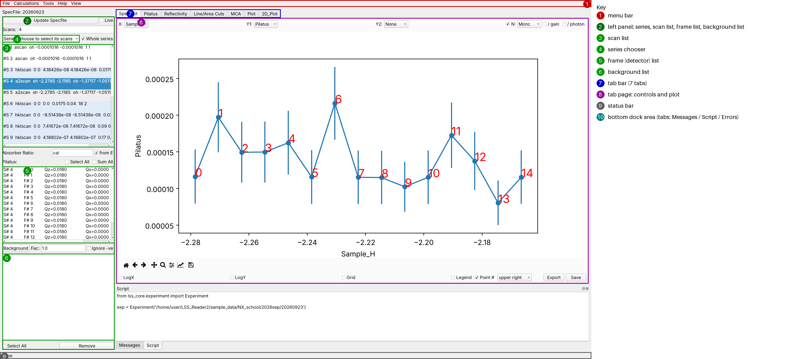
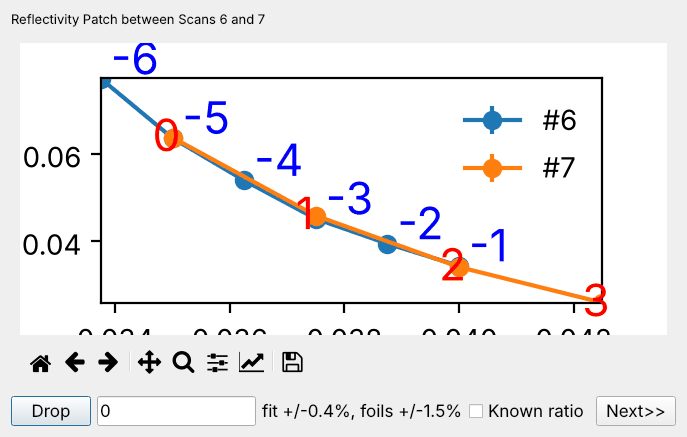
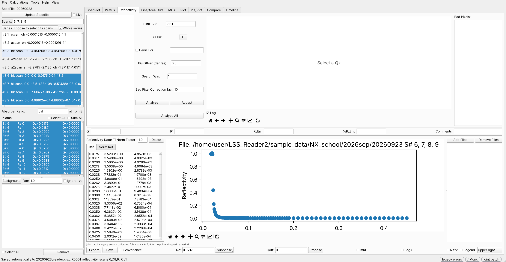

# LSS-Reader 2.0: quick start

Two pages: open a SPEC file, reduce a reflectivity, export it for XModFit. The screenshots use the public
NX school data in `sample_data/NX_school/` (scans 6–9 are a reflectivity of DPPC on water at 10 keV), so you
can follow along. Every control explains itself in its **tooltip**: hover over it.

## 1. Start the reader

- **Windows (packaged build):** unzip `LSS_Reader-Windows.zip` anywhere and run `LSS_Reader.exe` in the
  folder. Nothing else needs installing.
- **macOS (packaged build):** unzip and open `LSS_Reader.app`. The app is not signed yet, so the first time
  you must right-click it and choose Open.
- **From the source:** `pip install -r requirements.txt`, then `python LSS_Reader.py` from the repository
  folder.

## 2. Open a SPEC file

**File → Open Spec File**, and choose the SPEC file. The Pilatus images and MCA spectra are found beside it
by themselves.

- **The left panel** lists the scans (`#S` lines). Below them are the Pilatus frames of the selected scans.
- **The series chooser** ("Series: choose to select its scans") selects all the scans that one macro took
  together, for example the four scans of a reflectivity. With **Whole series** ticked (the default),
  clicking one scan of a series selects the whole series.
- **The tabs** across the top hold one kind of analysis each: SpecPlot (any column of a scan), Pilatus
  (the frames), Reflectivity, Line/Area Cuts, MCA (fluorescence), Plot, 2D_Plot, Compare, Timeline.
- **The Messages pane** at the bottom says what happened (View menu). The reader never stops you with a
  pop-up, and it does not close on an error.
- **Live:** tick it while data are still coming in, and new scans and frames appear as they are written.

## 3. Reduce a reflectivity

1. **Choose the scans:** in the series chooser, choose the reflectivity series (NX: scans 6–9).
2. **Select their frames:** tick **Select All** above the frame list.
3. **Check the box (optional):** on the **Pilatus** tab, click **Reflectivity**. The Reflectivity tab then
   lists every frame's Qz; select one to see, on its close-up, the counted box around the reflected beam
   (white) and the two background boxes beside it (cyan). **Slit(H,V)** sets the box in pixels (21,11 by
   default), and **BG Offset** sets where the background boxes sit.
4. **Patch:** on the **Pilatus** tab, click **Ref Patch**. The scans were taken through different
   absorbers, so each joins the next with a scale factor fitted where the two overlap.

- **The patch window shows one join at a time:** the two scans on the overlap, and below them the fitted
  factor, its error and how it was fitted.
- **Next>>** accepts the join and goes on. **<< Back** returns to the previous join, and **Cancel**
  stops.
- **To leave bad points out,** type their numbers as the plot labels them, for example `-1, 0`, and click
  **Drop**. **Restore all** brings dropped points back.
- **Known ratio** uses the calibrated absorber foils instead of the fit. By default the reader does this by
  itself when the fit's error is above 3 % and the foils are at least twice as precise (File →
  Preferences).

After the last join, the patched curve is on the **Reflectivity** tab:

- **Ref** lists Qz, R and its error as patched. **Norm Ref** lists the same divided by the highest R below
  Qc, so that the plateau reads 1, or by **Norm Factor** when that is ticked. That is what Export writes.
- **R/RF** divides by the Fresnel curve of the subphase. Set **Qc** first: **Subphase** offers the usual
  ones (water 0.0217 Å⁻¹). Then **Propose** suggests a **Qoff**, a small angle offset that makes R/R_F
  smooth through the edge. Nothing changes until you type or pick a value.
- **The line under the plot** says how it was made (patch method, errors, foils, dropped points), and the
  status bar says where it was saved.

## 4. Export and save

- **Export** (Reflectivity tab) writes `<name>_ref.txt` (Qz, R, dR) and `<name>_rrf.txt` (R/R_F, at the Qc
  and Qoff in the fields, whether or not R/RF is ticked): the files XModFit reads. The name is proposed
  from the SPEC file, the sample and the scans. Messages then says which files were written and which
  existing ones they replaced.
  **+ covariance** also writes the error correlations of the patch, for a fitter that can use them
  (off by default).
- **Save** stores the result, with the settings that made it, in the SPEC file's **workbook**
  (`<SPEC file>_reader.xlsx`, beside the outputs). Results are also saved there automatically. The
  **Compare** tab lists every saved reflectivity of the file, to overlay them.
- **The Script pane** (View menu) shows each action as a line of Python (`lss_core`), to repeat it in a
  script. See `docs/SCRIPTING.md`.
- **Two readers on one file:** the first to open it writes the workbook. A second shows a yellow
  "read-only" light at the bottom right and saves nothing until it gets write access (File → Ask for the
  workbook's write access; the holder can File → Give up the workbook's write access).

**Plot options...**, at the right of the tabs, sets the font size, ticks and grid of each tab's plots.

## Where next

- **GID:** the Pilatus tab's GID patch, the worksheet, maps and Line/Area Cuts.
  `docs/manual/gid_patching.md` explains the geometry.
- **Fluorescence:** the MCA tab, sums and **Fit lines**.
- **Burn tests:** whether the beam changes the sample. Pilatus tab, Burn test.
- **Tools menu:** demonstrations and figures of how each method works. `docs/TOOLS.md` lists them.
- **Every control and its tooltip:** `docs/manual/controls.md`.
- **Help → Documentation** opens this guide.
