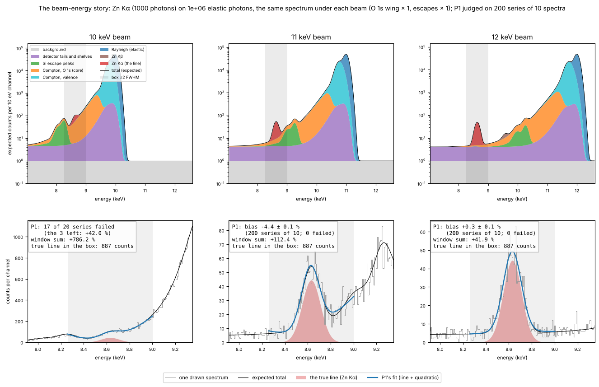

# Measuring an MCA line on synthetic spectra: a reader's guide (F90)

Tools man, 2026-11-24. This guide wraps up the synthetic MCA project. On
2026-11-24 the owner paused the project:

> "this synthetic MCA data project is getting out of hand. Let's wait for
> real data and relax the requirement of zinc at 10kev. It served as a
> good stress test but is probably an unsolvable problem. Likely we would
> just increase the excitation energy to separate the lines. But don't
> lose all the work we've done so far, make sure it gets a full demo
> treatment (figures, clear docs) and inclusion in the tools menu."

Here you will find what the synthetic spectra contain, what each way of
measuring a line does, and what the stress test taught. The full numbers
are in study B (`docs/studies/mca_fit/summary.md`) and in the comparison
ledger (`docs/COMPARISONS.md`, rows C42 and C47).

- **Measured** below means that a tool was run and the number is its
  output.
- **Read** means taken from code or a document without running it.
- **From memory** marks a physical constant that was not checked against
  a table here.

All data are synthetic, so every figure is public. **P1 is the default
of "Fit lines" since 2026-11-24**, under the owner's rule 12: "Make the
best method the default if it has been comprehensively demonstrated and
tested and has a demonstrator presentation effort behind it". This guide
and study B are that effort. The old weighting stays as a legacy switch.

## 1. How to try it

Each item below is in the reader's **Tools** menu and in
`python -m lss_toolbox`. Every one has variations on its page.

| Item | Category | What it makes |
|---|---|---|
| MCA fit demo: the beam-energy story | Fluorescence (MCA) | figure 8 below, with its numbers (about 15 s) |
| Study B figures: MCA line intensities | Fluorescence (MCA) | figures 1–7 (B1–B7) from the gauntlet's study run |
| MCA line-fit gauntlet (synthetic, judged) | Fluorescence (MCA) | every estimator over many conditions, judged against the truth |
| Open a synthetic data set, variation "MCA: the hard case" | Synthetic data sets | ten spectra as MCA files, opened in the reader |

The same from a shell, run from the repository root:

    python tests/tools/mca_fit_demo.py --out docs/figures/mca_fit_demo          # figure 8
    python tests/tools/mca_fit_demo.py --out DIR --beams 10,12,14 --wing 0.5     # change the beam, the wing...
    python tests/tools/synthetic_dataset.py --out DIR --kind mca --beam 12       # ten spectra to fit in the reader
    python tests/tools/mca_study.py --gauntlet docs/studies/mca_fit/gauntlet --out docs/studies/mca_fit   # B1-B7

**In the reader itself.** Open the MCA data set, select all ten spectra on
the MCA tab, and press "Fit lines". In Fit options, give the line's
energy (8.631 keV for Zn Kα) and the box (`box_keV` in `truth.json`,
8.26–9.00 keV). P1 is the default; the Preferences check box "Fit lines:
data weights (legacy)" gives the old weighting. P2 and P3 are check
boxes in Fit options (section 3).
`truth.json` beside the SPEC file gives the line's true counts per
spectrum, the number a fit should find.

## 2. What the synthetic spectrum contains

The generator is `tests/synthetic/mca.py`. Its docstring gives every
formula and source. Each photon belongs to one **source** (a line, the
elastic scatter, the Compton scatter). The detector turns it into one of
four **kinds** (photopeak, tail, shelf, escape). Every part is kept
separately, channel by channel, so an estimate can be compared with
exactly the counts it should have found.

| Part | Where it sits | The number used | Where it comes from | How sure |
|---|---|---|---|---|
| **The line**: Kα1, Kα2, Kβ1 | Zn Kα 8.631 keV (intensity-weighted), Kβ 9.572 keV | 1e3 Zn photons per spectrum; Kα1 : Kα2 : Kβ = 100 : 51 : 17 | X-ray Data Booklet (Thompson et al. 2009, Tables 1-2, 1-3) | energies: sure; ratios: from memory (measured Kβ/Kα 0.12–0.14) |
| **Rayleigh** (elastic) | the beam energy E0 | 1e6 photons | a free parameter: geometry and polarisation | — |
| **Compton**, valence (O 2s, 2p, H 1s) | E_C = E0 / (1 + (E0/mc²)(1 − cos 2θ)): 9.81 keV for 10 keV at 90° | as many Compton as Rayleigh photons | Compton 1923 (exact); impulse approximation (Eisenberger and Platzman 1970), each shell a hydrogenic momentum density, Clementi–Raimondi exponents | shape: approximate (from memory) |
| **Compton, O 1s** (the "wing") | broad, below E_C, cut off at E0 − 0.543 keV | water's 2 O 1s electrons | the same, with the binding cut-off (Ribberfors 1975) | **the main uncertainty** (section 4.3) |
| **Photopeak** | each photon's own energy | FWHM² = noise² + 8 ln2 ε F E: 0.186 keV at Zn Kα | standard Si detector resolution | sure |
| **Tail** and **shelf** | below each photon's energy: an exponential (0.15 keV) and a flat step to 0 | 1 % and 0.2 % of every photon | the Hypermet terms (Phillips and Marlow 1976) | **assumed** |
| **Si escape peaks** | 1.740 keV below each parent: the elastic's at 8.26 keV, in Zn Kα's box | Reed's fraction: 0.10 % at 10 keV, 0.15 % at 8.6 keV | Reed and Ware 1972 | the formula: sure; its constants: from memory |
| **Background** | flat | 1 count per channel | an assumption | — |
| **Noise** | every channel | Poisson | — | sure |

**Si escape peaks.** A photon absorbed in the silicon can lose a Si Kα
photon (1.740 keV) out of the detector, so it is counted 1.740 keV low.
Reed's fraction is small (0.10 % at 10 keV), but the elastic line is a
thousand times stronger than Zn. Its escape peak at 8.26 keV therefore
holds about as many photons as the whole Zn line (1.0e3), and it sits on
the lower edge of Zn Kα's box, half inside. The Compton escape (8.07 keV)
adds its tail. `--escape` scales the fraction (0: no escape peaks, 3:
three times Reed's).

**What lies under the line** in the hard case (measured, figure 1: counts
inside the ±2 FWHM box, 8.26–9.00 keV):

| Part | Counts in the box |
|---|---|
| the line | 887 |
| O 1s Compton wing | 5,681 |
| Si escape peaks | 570 |
| detector tails and shelves | 471 |
| valence Compton | 175 |
| flat background | 75 |

The line is 11 % of what is in the box.

## 3. The six ways of measuring a line

The **box** is ±2 FWHM of the detector around the line: 8.26–9.00 keV
for Zn Kα. The **fits** put a Gaussian on a quadratic background over
the box and fit the selected spectra together. They share one centre and
width, and each spectrum gets its own height and background (the
reader's "Fit lines", `lss_core.peaks.fit_series`).

**Window sum** (the reader's Sum All). It counts everything in the box:

$$\hat A_{\rm win} = \sum_{i\in\rm box} n_i,\qquad E[\hat A_{\rm win}] = A\,f_{\rm box} + B_{\rm box}.$$

f_box ≈ 1 is the line's share inside the box. B_box is all the scatter
in the box, and nothing takes it off.

**Window − sides** (a comparator; not in the reader). The same sum minus
a straight line through two bands, one FWHM wide, on either side of the
box:

$$\hat A = \sum_{\rm box} n_i - N_{\rm box}\,\big[(1-t)\,\bar n_L + t\,\bar n_R\big],$$

with t the box centre's position between the bands' centres. It works
when the background is straight across the box, and it is not straight
under Zn at 10 keV.

**Fit, data weights** (the reader's default until 2026-11-24; now the
legacy switch "Fit lines: data weights"). Each spectrum's linear
step weights each channel by its own counts, which is Neyman's χ²:

$$\min \sum_i \frac{(n_i-\mu_i)^2}{n_i}.$$

A channel that fluctuated down gets more weight than one that fluctuated
up, so the fit is pulled low.

**P1: the Poisson fit** (the default since 2026-11-24). The same model, but
each spectrum's step maximises the Poisson likelihood:

$$\ln L = \sum_i \big[n_i \ln \mu_i - \mu_i\big],\qquad \sum_i\Big(\frac{n_i}{\mu_i}-1\Big)\frac{\partial\mu_i}{\partial a_k}=0 .$$

Every term has zero expectation at the truth, so the estimate is
unbiased to order 1/N (Cash 1979; Baker and Cousins 1984). It is computed
as weighted least squares, with each channel's weight the model's (not
the data's), iterated.

**P2: the width from the detector** (option "width from the detector").
The fit's width is fixed at the detector's resolution at the line,

$$\mathrm{FWHM} = \sqrt{\mathrm{noise}^2 + 8\ln 2\,\varepsilon F E},$$

instead of being free. A free width can swallow a neighbouring bump or
collapse onto noise. "noise" is the electronic part, 0.12 keV unless set.

**P3: Si escapes stripped** (option "strip Si escape peaks"). Before the
fit, the escape of what was measured 1.740 keV higher is taken off each
channel, at Reed's fraction:

$$y'(E) = y(E) - f(E+1.740)\,y(E+1.740).$$

AXIL and PyMca correct escapes this way.

## 4. What the stress test taught

### 4.1 P1 against data weights: the −19/N law

On a clean line (no scatter, 1 count per channel of background), the
data-weighted fit reads low by a fixed number of counts. That is a
relative bias falling as 1/N with the line's counts N:

$$\frac{E[\hat A]-A}{A}\approx -\frac{c}{N},\qquad c\approx 19\ \text{counts (measured, figure 3)}.$$

| Line counts | data weights | P1 |
|---|---|---|
| 100 | −23 % | +1.8 % |
| 400 | −5.0 % | +0.4 % |
| 1000 | −1.5 % | within its errors |
| 9000 | +0.2 % | 0.0 % |

This needs no real data. It is about the weights, not the background,
and it holds in every condition the gauntlet tried (figure 7). It matters
most at the weak end of an XFNTR curve, at high Qz. On the "smooth, weak"
curve, the worst point is 13 % off with data weights and 1.2 % off with
P1 (figure 5). Below about 50 counts every fit becomes unstable.

### 4.2 Why the window sum fails under scatter

The window sum counts B_box with the line. In the hard case B_box is
about 8 times the line, so the sum reads +786 %. On smooth scatter
alone it still reads +28 %. Worse for XFNTR, B_box does not follow the
line: the elastic and Compton scatter grow above the critical angle while
the line does not. In the hard series the window's ratio to the truth
runs from 0.76 below Qc to over 1.5 above it (68 % at the worst point,
figure 5). The window sum failed in all 20 cells of the robustness map
(figure 7), whatever the assumptions. The side bands do not rescue it:
6 % of random conditions within 1 % (figure 6).

### 4.3 Why Zn at 10 keV is out of reach

Under a 10 keV beam the O 1s Compton wing (water's two core electrons)
spreads from the Compton peak down past Zn Kα. Under the line it is
curved, and it is six times the line (section 2). A quadratic over the
box cannot follow it, and the fit either fails or trades line for wing:

- the reader's fit, P1 and P1+P2+P3 all fail in 60–90 % of series in the
  hard case (study B, part 1);
- one feature at a time (figure 4), the wing alone gives −10 % at a
  quarter of water's and −24 % at water's. P2 and P3 cut the other
  features' effects, but nothing removes the wing's;
- the robustness map (figure 7): with a wing of half of water's or more,
  most fits fail. P1+P2+P3 is within 1 % in only 2 of its 20 cells (no
  wing and no escape; half of water's wing with Reed's escapes).

So the answer at 10 keV depends on the wing's real size, and the
synthetic data cannot settle that: the wing is where the generator is
least sure (hydrogenic shells, not tabulated Hartree–Fock profiles). The
owner's conclusion stands: probably unsolvable at 10 keV, and not
required.

### 4.4 The beam-energy route

Raising the beam moves the scatter up and away from the line, and the
line stays where it is. Figure 8 shows the same Zn spectrum under 10, 11
and 12 keV beams, with the same line and elastic photons. Measured by
`mca_fit_demo.py`, 200 series of 10 spectra per beam:

| Beam | Elastic escape | Compton peak | window sum | P1 |
|---|---|---|---|---|
| 10 keV | 8.26 keV, inside the box | 9.81 keV, wing under the line | +786 % | 17 of 20 series failed (the run stops a method that cannot pass) |
| 11 keV | 9.26 keV, just above the box | 10.77 keV | +112 % | −4.4 ± 0.1 % |
| 12 keV | 10.26 keV, well above | 11.72 keV | +42 % | **+0.3 ± 0.1 %** |

At 12 keV, P1 alone measures the line to better than 1 %, with no
failures and without P2 or P3. Study B's own run gave +0.5 %, and P1+P3
gave +0.4 %. The window sum is still 42 % high, mostly from the shelves
of the strong scatter, which reach down under the line, and the flat
background.

**What this assumes.** The line keeps its photons. In fact Zn's K-shell
photoabsorption falls roughly as E^−2.7 to E^−3 above the edge (from
memory), so from 10 to 12 keV the line loses about 40 %. Measured with
600 line photons at 12 keV (`--beams 12 --photons 600`), P1 is
−0.1 ± 0.2 %, still unbiased. Its error grows by about √(1/0.6) ≈ 1.3.

**Change it and see** (the demo's options, also variations in the Tools
menu):

- `--wing 0.5`, half of water's wing: at 10 keV P1 still fails in 14 of
  20 series; at 11 keV −4.8 %; at 12 keV +0.4 %;
- `--escape 3`, three times Reed's escapes: at 11 keV P1 reads −11.5 %
  (the Compton escape, 9.03 keV, sits on the box's edge); at 12 keV
  +0.4 %;
- `--element Fe`: Fe Kα (6.40 keV) sits far from the scatter at either
  beam, and P1 is +0.6 % at both 10 and 12 keV. The window sum is still
  +38 % and +33 % (the shelves of the scatter and the flat background);
- `--photons 1e4`: ten times the line. P1 is +6.0 % at 10 keV (no
  failures now, but the wing still pulls), −0.6 % at 11 keV and +0.4 % at
  12 keV. The window sum is +79 %, +12 % and +5 %.

## 5. The figures

All are PNG files in the repository, made by the tools of section 1.

**Figure 1** (`docs/studies/mca_fit/B1_anatomy.png`). The hard case's
parts stacked on a log scale: Zn Kα (1e3 photons) under a 10 keV beam
(1e6 elastic photons), with the ±2 and ±3 FWHM boxes. Inside the box,
the O 1s wing, the elastic's escape peak and the shelves outweigh the
line.

**Figure 2** (`B2_replicates.png`). Six replicates at about 90, 270 and
1000 line counts, on the hard detector with a quarter of water's wing.
Each panel shows every estimator's fit over the box, with residuals
beneath. A free width collapses or swallows the escape peak, and P2
holds it.

**Figure 3** (`B3_weighting.png`). The bias against the line's counts on
a clean line: data weights and P1, with the fitted −c/N law (c ≈ 19).

**Figure 4** (`B4_features.png`). The bias ± 2 standard errors of each
estimator, one feature at a time from the smooth baseline. Also at 11
and 12 keV.

**Figure 5** (`B5_series.png`). XFNTR curves (smooth, smooth and weak,
surface + bulk, hard) divided by the truth, per estimator.

**Figure 6** (`B6_pass_rates.png`). The share of 150 random conditions
within 1 %, by estimator and by class of condition.

**Figure 7** (`B7_robustness.png`). Where each conclusion holds, over
the escape fraction (0–3 × Reed) and the O 1s wing (0–2 × water's).

**Figure 8** (`docs/figures/mca_fit_demo/beam_energy.png`, new). The
beam-energy story. Top row: the same spectrum's parts stacked under 10,
11 and 12 keV beams, with the box shaded. Bottom row: one drawn spectrum
in the box, the true line, and P1's fit, with P1's bias over 200 series
and the window sum's written on each panel.

## 6. Limits, and what would change the conclusions

- **The generator is paused** (2026-11-24, `docs/SYNTHETIC_DATA.md`). Its
  known limits:
  - the Compton scatter is computed shell by shell from hydrogenic
    momentum densities, not from tabulated Hartree–Fock profiles (Biggs,
    Mendelsohn and Mann 1975, which could not be installed here);
  - Reed's escape constants are from memory;
  - the detector's tail and shelf are assumed.
- **A blank spectrum** (pure water or the subphase, at the same beam,
  Qz, detector position and counting time) would measure the wing and the
  escape fraction directly. It is `docs/DATA_NEEDS.md` row 3. One blank
  per beam energy and geometry would check the generator along both axes
  of figure 7.
- **Real spectra with a line** would test section 4.1 directly. The
  public NX school data has no MCA spectra.
- **What holds whatever the background:** the weighting result (4.1) and
  the window sum's failure under scatter (4.2). What depends on the
  generator is the 10 keV hard case (4.3), and with it the margin at
  11 keV.

## 7. Where the numbers are

| What | Where |
|---|---|
| Study B: questions, tables, recommendation | `docs/studies/mca_fit/summary.md` |
| The gauntlet's tables (verdict, series, conditions) | `docs/studies/mca_fit/gauntlet/` |
| Figure 8's numbers | `docs/figures/mca_fit_demo/beam_energy.csv`, `numbers.json` |
| The first gauntlet (window vs fit) | `docs/COMPARISONS.md` C42, `docs/comparisons_data/mca_fit_gauntlet/` |
| Study B in the ledger | `docs/COMPARISONS.md` C47 |
| The generator's physics | `tests/synthetic/mca.py` (docstring), `docs/SYNTHETIC_DATA.md` |
| The owner's decisions | `docs/physics_notes.md` (F90 entries), `docs/FEATURE_REQUESTS.md` F90 |
