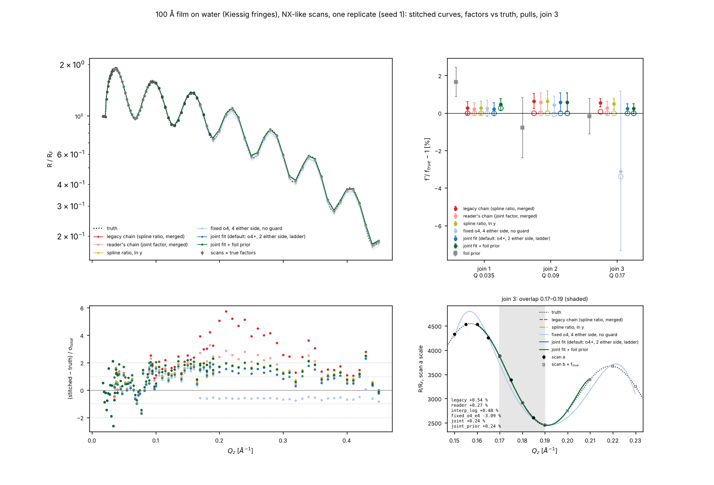
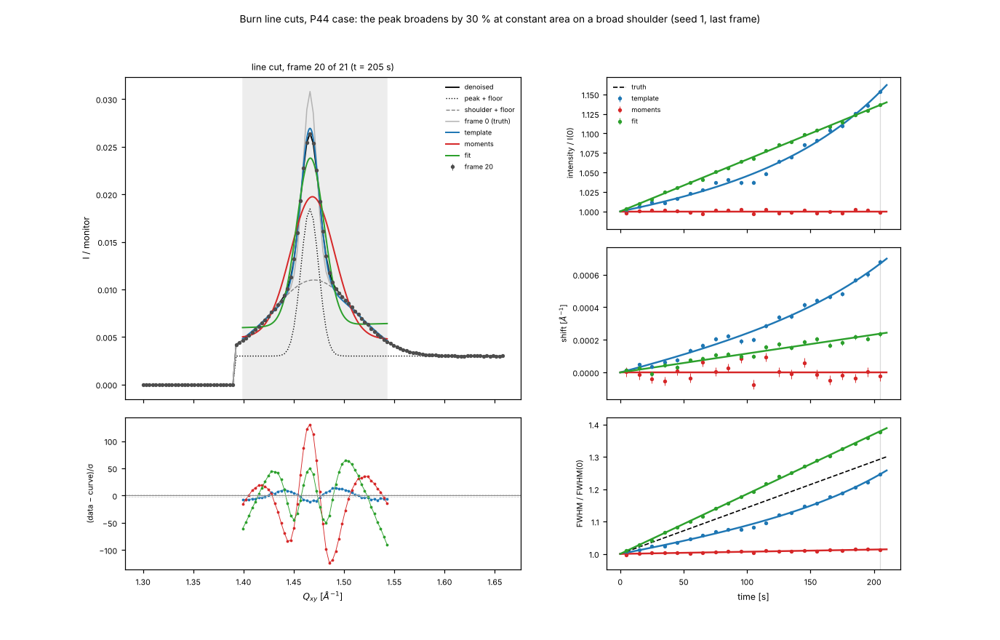

# Fit demonstrator: patching and burn line cuts on synthetic data

Written 2026-11-22 by a subagent at the owner's request:

> Have a subagent make a report with ~5 figures and reusable code that
> produces a demonstration of fitting the synthetic data via plot displays
> of the synthetic data, the denoised version, the fits of all kinds, with
> a little gui to custom the plotted items and switch to new replicate
> with spacebar. For burn tests i will also need a demo of the line cut
> fits, so just add that as a mode to the demonstrator.

"Measured" below means the tool was run and the number is its output
(`docs/figures/patch_demo/numbers.json`, written by the same run as the
figures); "read" means taken from code or a document without running it.
All data are synthetic, so every figure is public. No `lss_core` module
was changed.

**Updated 2026-11-22 (later)** for three changes on main: the joint fit's
new default (`patching.joint_factor`: 2 points either side, `N_EXT`, and
the guard ladder keeping the first fit with χ² p ≥ 0.3, commits 6bb29bf,
b51bae2; the reader's patch now uses it); the owner's monitor model
("monc doesn't have poisson noise, it's more like a strict 0.05%
uncertainty": `xrr_scans.REAL_MONITOR`, now the demonstrator's default);
and the owner on the critical edge ("we dont need to patch across critical
edge ... we start from a place of 'plenty', with 1e6 counts per second in
the ROI at total reflection"): the edge case is now an aside, and figure 3
shows realistic joins. Every figure and number below was regenerated.

## 1. What it is and how to launch it

    python tests/tools/patch_demo.py                  # the window
    python tests/tools/patch_demo.py --mode burn --seed 5
    python tests/tools/patch_demo.py --save docs/figures/patch_demo   # this report's figures, headless (2.5 min)
    python tests/tools/patch_demo.py --save DIR --quick   # smoke run, few replicates (16 s)
    python tests/tools/patch_demo.py --views DIR      # the window's two default views as PNG

The window (PyQt5 with an embedded matplotlib canvas and its toolbar):

- **Mode**: *Reflectivity patching* or *Burn line cuts*.
- **Space bar** (or the button): a new noise replicate (seed + 1); every
  method is refitted and the figure redrawn (≈ 0.4 s for reflectivity,
  ≈ 1.3 s for a burn, measured). The space bar works whatever control has
  the focus (an application event filter; checkboxes are not toggled by it).
- **Reflectivity controls**: truth (bare water, DPPC monolayer, film with
  Kiessig fringes and its thickness), scan plan (NX-like grids; the NX
  ranges with every overlap staggered; four scans sharing 4 points; the
  same staggered; as an aside, a staggered overlap across Qc), counts
  (×0.02 to ×100 the NX rates), monitor (the owner's 0.05 %, default, or
  Poisson), foils off calibration, view (R or R/R_F), which join the
  close-up shows; a checkbox per method (15) and per
  plotted item (13: scans as measured, scans × true factors, denoised
  scans, truth, stitched curves, σ_total and σ_counting bands, draws from
  the covariance, pulls, factors, factors from the denoised data, foil
  prior, join close-up).
- **Burn controls**: change (none, fade, broaden at constant area, shift,
  fade under a 3× shoulder, rising floor), amount, monitor (sets the
  counts), frame shown; a checkbox per estimator (template, moments, fit)
  and per item (noisy line cut, denoised line cut, its true parts, frame 0,
  estimator curves, fit window, residuals, trends, all trend models, true
  trend).
- A notes pane lists what the methods reported (guard steps, prior used or
  not and why, failures, trend verdicts). Explanations are in tooltips.

### Code (reusable, GUI-free)

| Module | What |
|---|---|
| `tests/demonstrator/refl.py` | `Config`, `replicate(config, seed)`, `denoised(rep)`, `METHODS`, `run_method`, `run_all`, `join_curve` (a joint fit's curve), `spline_curve` (the legacy interpolation), `survey(config, seeds)`, `chi2_vs_truth` |
| `tests/demonstrator/burnmode.py` | `Config`, `replicate`, `run_estimator`, `run_all`, `frame_curve` (each estimator's curve on a frame), `true_change`, `measured_change`, `survey` |
| `tests/demonstrator/draw.py` | `refl_figure(fig, rep, results, show, ...)`, `burn_figure(...)`, the item lists |
| `tests/demonstrator/figures.py` | this report's figures and `numbers.json` |
| `tests/demonstrator/window.py` | the window: `open_demo(parent=None, mode='refl', seed=0)` creates and shows it (the entry point for a Tools menu; it deletes itself on close); `DemoWindow(mode, seed, refl_config, burn_config, parent)` |
| `tests/tools/patch_demo.py` | the command line |
| `tests/test_patch_demo.py` | 21 tests (one slow), 14 s |

```python
import sys; sys.path[:0] = ['.', 'tests']          # as the test suite has it
from demonstrator import refl, burnmode as bm
rep = refl.replicate(refl.Config(truth='film', plan='nx', thickness=100), seed=3)
res = refl.run_all(rep)                             # {method: MethodResult}
res['joint'].factors / rep.true_steps - 1           # per join (patching.joint_factor defaults)
res['joint'].stitched.covariance('log')             # N × N
clean = refl.run_all(refl.denoised(rep))            # the same methods without noise: bias alone
b = bm.replicate(bm.Config(change='broaden'), seed=1)
r = bm.run_all(b)                                   # {estimator: EstimatorResult}
x, y = bm.frame_curve(b, r['template'], 20)         # the template fitted to frame 20
```

How the curves are rebuilt. `patching.JoinFit` keeps δ = ln f but not the
polynomial; at fixed δ the maximum-likelihood coefficients are those of the
joint fit, so `refl.join_curve` fits the coefficients alone at δ̂ (same
window, order, baseline and likelihood). Tested: with δ free the same code
gives `joint_factor`'s δ to 1e-10, and the curve at the window's points
gives back the fit's χ² to 1e-6 (both likelihoods, R/R_F and raw). The
burn template curve is rebuilt from the per-frame parameters
`measure_gid` returns and gives back its χ²/dof to 1e-9 (tested).

## 2. The synthetic truth

**Reflectivity** (`tests/synthetic/xrr.py`, `xrr_scans.py`;
`docs/SYNTHETIC_DATA.md` §3): R(Qz) by the Parratt recursion (L. G.
Parratt, Phys. Rev. 95, 359 (1954; links in this report from memory),
https://doi.org/10.1103/PhysRev.95.359) with Névot–Croce roughness (L.
Névot and P. Croce, Rev. Phys. Appl. 15, 761 (1980),
https://doi.org/10.1051/rphysap:01980001503076100), σ = 3 Å, water β at
10 keV. The film (100 Å, 0.383 e/ų) gives Kiessig fringes of period
2π/d = 0.063 Å⁻¹ (H. Kiessig, Ann. Phys. 402, 769 (1931),
https://doi.org/10.1002/andp.19314020702). Scans as measured: Poisson
counts in the reader's three boxes through the calibrated foils, rates of
NX school scans 6–9 (read from the public SPEC file by the generator's
author). Monc by default as the owner describes it: no Poisson noise, a
0.05 % relative uncertainty (`xrr_scans.REAL_MONITOR`; a Poisson Monc is
the option `Config(monitor='poisson')`). Errors `'counting+monitor'` (the
monitor's 0.05 % added to each point). Added here: the
foils are not exactly the calibration: each replicate draws the true steps
from the prior's own covariance (`patching.known_steps`), so the foil prior
is right on average with the error it claims. The anchor's true scale puts
the stitched curves on R (normalising to R = 1 below Qc is a separate step).

**Burn** (`tests/synthetic/burn_profiles.py`): 21 frames of 10 s; a sharp
peak (Qxy 1.466 Å⁻¹, FWHM 0.016) on a broad shoulder (centre 1.47, σ 0.04)
and a floor; Poisson at monitor 1e7. The P44 case is `broaden`: FWHM +30 %
at constant area, the shoulder steady.

Methods (`refl.METHODS`): the reader's chain (`reflectivity.patch`: each
scan against everything joined so far, the overlap averaged, the factor's
own error folded in) with the legacy spline-ratio factor (`legacy`) and
with the joint factor, the reader's default since 2026-11-22 (`reader`);
from `lss_core.patching`: spline ratio linear and log, coinciding points,
the joint fit with its defaults (`joint`: order 4 rising, 2 points either
side, the guard ladder), with 4 points either side (`joint_e4`), raw, log
likelihood, with the correlated foil prior; single fits of fixed order and
window without the guard (`fixed_o2_e0`, `fixed_o2_e4`, `fixed_o4_e2`,
`fixed_o4_e4`, the last being the old default window without its guard);
the global fit. The burn profiles are normalised by a fixed monitor (no
monitor noise), so the monitor model does not enter the burn mode. Design and earlier measurements: `docs/reports/ref_patch_joint_fit.md`.
Burn estimators: `lss_core.burn` (`template`, `moments`, `fit`), trends by
`lss_core.trends.compare` (AICc, Hurvich & Tsai, Biometrika 76, 297 (1989),
https://doi.org/10.1093/biomet/76.2.297; Burnham & Anderson 2002,
https://doi.org/10.1007/b97636), errors from the scatter as the reader does
for GID burns.

## 3. Figures

Regenerate all: `python tests/tools/patch_demo.py --save docs/figures/patch_demo`
(deterministic: fixed seeds; 200 reflectivity replicates per survey, 100
per join in figure 3, 30 burn replicates per change; 4.5 min). Numbers: `numbers.json`,
`factor_summary_*.csv`, `burn_estimator_summary.csv` beside the figures.

### Figure 1. A Kiessig-fringe film, every method, one replicate



100 Å film on water, NX-like scans (absorbers 41, 32, 23, 16 chosen by the
generator), seed 1, NX counts, the owner's monitor. Top left: the noisy
scans × their true factors, the truth, the stitched curve of six methods
in R/R_F with σ_total bands. Top right: f̂/f_true − 1 per join with the
reported error; hollow markers: the same method on the denoised scans;
grey: the foil prior. Bottom left: pulls (stitched − truth)/σ_total.
Bottom right: join 3 (Q 0.17–0.19) on scan a's scale with each method's
curve.

Measured (this replicate, joins 1/2/3, %): default joint +0.21/+0.58/+0.24
(errors 0.36/0.49/0.27; the ladder took order 7 at join 1 and 5 at join 3,
2 points either side); the reader's chain with the joint factor
+0.21/+0.57/+0.27; legacy +0.27/+0.64/+0.54 (errors 0.35/0.41/0.22); spline
in ln y +0.27/+0.64/+0.48; the old window without its guard (fixed o4,
4 either side) +0.25/+0.45/**−3.09** (error inflated to 4.3); with the
prior +0.45/+0.58/+0.24 (used at join 1 only: Monc/Monp changes ×2.70 and
×1.18 across joins 2 and 3, where the slits open, so the P29 guard refuses
it). Noise-free: default joint −0.000/−0.002/−0.000, legacy
−0.011/−0.001/+0.086, fixed o4 e4 +0.006/−0.053/−3.38. χ²/N of the
stitched curve against the truth with the full covariance 0.84–0.86 for
every non-legacy method shown (with σ_total as independent errors
0.86–1.97). The legacy pulls reach 5–6 above Q = 0.2 Å⁻¹, the reader's
chain with the joint factor about 3: their error columns fold each
factor's own error in without inheritance (P4).

### Figure 2. Factors over 200 replicates: bias, scatter, honesty


Left: the 100 Å film on NX-like grids; middle: the same film with every
overlap staggered (no shared Qz); right: bare water on NX-like grids; NX
counts, the owner's monitor. Top: bias ± SD of f̂ (%); bottom: pull SD
(SD of (δ̂ − δ_true)/σ_reported; 1 = honest errors). Measured (bias / SD % /
pull SD, joins 1; 2; 3):

| Method | Film, NX grids | Film, staggered | Water, NX grids |
|---|---|---|---|
| legacy chain | +0.02/0.36/**1.43**; −0.08/0.57/**1.42**; +0.09/0.29/**1.47** | −0.04/0.51/**2.48**; +0.06/0.66/**2.09**; −0.01/0.44/**3.88** | +0.02/0.48/**1.40**; −0.08/0.50/**1.42**; +0.02/0.28/**1.48** |
| reader's chain, joint factor | +0.04/0.39/1.02; −0.03/0.57/1.02; 0.00/0.26/0.71 | −0.01/0.43/0.94; +0.09/0.57/0.92; +0.03/0.40/0.78 | +0.06/0.52/1.01; −0.04/0.50/0.94; +0.01/0.26/0.79 |
| spline ratio | +0.02/0.36/0.94; −0.08/0.56/0.97; +0.10/0.28/0.88 | −0.04/0.51/0.94; +0.06/0.66/0.98; −0.01/0.44/0.92 | +0.02/0.48/0.92; −0.07/0.50/0.95; +0.02/0.28/0.97 |
| **joint (default)** | +0.04/0.39/1.02; −0.04/0.57/1.05; +0.02/0.29/0.96 | −0.01/**0.43**/0.94; +0.08/**0.58**/1.00; +0.03/**0.41**/0.99 | +0.06/0.52/1.01; −0.03/0.52/1.02; +0.01/0.28/1.05 |
| joint, 4 either side, ladder | +0.04/0.34/0.98; −0.04/0.55/1.07; +0.02/0.29/0.96 | +0.03/0.41/1.00; +0.08/0.53/1.02; −0.02/0.43/1.06 | +0.05/0.44/0.95; −0.02/0.48/1.01; +0.01/0.27/1.07 |
| joint + foil prior | +0.03/0.33/1.00; as default at 2, 3 | −0.01/0.41/0.93; as default at 2, 3 | +0.06/0.48/0.99; as default at 2, 3 |
| fixed o2, 4 either side, no guard | −0.47/0.27/0.71; −1.37/0.39/0.19; **−7.74**/0.21/0.01 | −0.29/0.32/0.86; −1.23/0.43/0.39; **+11.5**/0.25/0.02 | +0.03/0.33/0.92; +0.01/0.35/0.92; 0.00/0.22/1.01 |
| fixed o4, 4 either side, no guard | +0.03/0.30/0.91; −0.08/0.48/0.98; **−3.43**/0.23/0.05 | +0.03/0.36/0.90; +0.07/0.50/0.95; **−0.98**/0.33/0.08 | +0.03/0.38/0.89; −0.02/0.41/0.93; 0.00/0.23/0.97 |
| global fit (no guard) | +0.03/0.30/**0.09**; −0.07/0.48/**0.10**; **−3.37**/0.23/**0.09** | +0.03/0.36/0.12; +0.08/0.50/0.13; −0.97/0.33/0.13 | +0.03/0.38/0.91; −0.01/0.41/0.95; +0.01/0.23/0.98 |

Coinciding points: SD 0.35–0.70 % on NX grids, unbiased; it fails on the
staggered grids (no shared Qz), as it says.

Findings (measured): the default joint fit is unbiased within 0.1 % at
every join of the three sets and its errors are honest (pull SD
0.94–1.05). On NX grids its scatter is 0–8 % *above* the spline ratio's
(film join 1: 0.39 against 0.36 %; water join 1: 0.52 against 0.48 %), the
price of the smaller window (4 either side: 0.34 and 0.44 %); on the
staggered film it is 6–16 % below (0.43 against 0.51 % at join 1). The
guard is what makes the joint fit safe on a fringe-rich film: without it
the old window (order 4, 4 either side) is −3.4 % (NX grids) or −1.0 %
(staggered) at join 3, and order 2 with 4 either side −7.7 % or +11.5 %.
The legacy error understates the scatter by a factor 1.4–1.5 (NX grids)
and 2.1–3.9 (staggered; with a Poisson monitor it was 1.3–1.4 on NX grids
before this update). The reader's chain with the joint factor (fitted
against the merged data) gives the joint fit's factor at join 1 and
similar ones after, with honest or conservative errors (pull SD
0.71–1.02). The prior helps at join 1 only (SD 0.33 against 0.39 % on the
film); elsewhere the monitor guard refuses it. **The global fit has no
guard and one χ² inflation for all joins**: on the film its last join is
−3.37 % (NX grids) or −0.97 % (staggered), and the misfit there inflates
every join's error about ten-fold (pull SD 0.09–0.13).

### Figure 3. Join close-ups: realistic joins, and the critical edge as an aside


Top left: water's first join on coinciding points (standard plan, Q
0.0325–0.04 Å⁻¹, where R has fallen 50–200× from total reflection),
noise-free, in R/R_F on scan a's scale. Top right: the 100 Å film's join 3
with a staggered overlap on a fringe (Q 0.179–0.192), noise-free. Bottom
left, **an aside**: a staggered overlap straddling Qc (water, scan a to
0.0275 in steps of 0.0025, scan b from 0.02125 in steps of 0.005), which
the owner does not do in practice ("we dont need to patch across critical
edge"). Bottom right: noise-free deviation (bars, clipped at ±6 %) and
mean ± SD over 100 replicates per join.

Measured (noise-free / mean of 100 noisy replicates / pull SD; %):

| Join | legacy chain | joint (default) | joint, 4 either side, ladder | fixed o4, 4 either side | fixed o2, 4 either side | spline in ln y | joint raw |
|---|---|---|---|---|---|---|---|
| water, first join, coinciding | **0.000** / −0.07 / 1.45 | **−0.001** / −0.03 / 0.94 | −0.32 / −0.13 / 1.04 | −0.32 / −0.30 / 0.94 | | | |
| film, staggered, join 3 | +0.01 / −0.01 / **4.89** | −0.02 / +0.04 / 0.86 | −0.17 / −0.02 / 0.95 (order 7) | −0.98 / −0.95 / 0.07 | +12.2 / +11.5 / 0.02 | | |
| aside: across Qc | −16.6 / −18.2 / 0.03 | **+2.44 / +2.40** / 0.72 | | | | −1.75 / −1.79 / 0.30 | −7.89 / −8.21 / 0.06 |

Water's first join: the legacy fit is exact where every overlap point of
scan a is also a point of scan b (no interpolation), and so is the new
default (2 either side); the old window (4 either side) is 0.32 % low
noise-free, a model bias its χ² does not reveal at these counts, which is
why main moved the default to 2 points either side (the gauntlet, C36).
Film, staggered on a fringe: the default joint fit is within 0.02 %;
without the guard the fixed windows are off by 1 % (order 4) and 12 %
(order 2); the legacy factor is right here (+0.01 %) but its error is 4.9
times too small. The aside: across Qc no method is right; the joint fit's
ladder finds no adequate fit (χ²/dof 17.5 at best, order 4, 1 either side)
and inflates the error, which still leaves +2.4 % at about 2.4 of its σ
(the pull SD 0.72 is the scatter about that offset). Why (reasoned from
the curve): the baseline ln R_F of `patching.fresnel` has a kink at Qc =
0.0217 Å⁻¹ while the true curve is rounded. The legacy fit is −16.6 %
(−13.7 % with a Poisson monitor, whose weights differ).

### Figure 4. Error bands: the same diagonal, a different covariance


DPPC on water, NX-like scans, default joint fit, the owner's monitor.
Left: the stitched curve with ± σ_meas (counting and monitor only) and ±
σ_total (√(σ_meas² + y² diag W Σ Wᵀ), `Stitched.sigma_total`), and four
draws from the full covariance (`Stitched.covariance('log')`) about the
truth: whole scans move together. Middle: the correlation matrix of ln y
(blocks: the scans; each later scan correlated with the earlier through
the chained factors). Right: χ²/N of the stitched curve against the truth
over 200 replicates.

Measured (N = 96 points, 200 replicates): with the full covariance χ²/N =
1.00 ± 0.15 (the χ² distribution's √(2/N) = 0.144); with σ_total as
independent errors 1.01 ± **0.56**, nearly four times the spread a correct
error model gives; the legacy curve with its own error column 1.88 ±
1.50. The level of the last scan (weighted mean of ln y − ln truth over
its points): observed scatter 0.77 % over the replicates; the diagonal
predicts 0.16 % (4.7 × too small), the full covariance 0.77 % (√Σ_KK =
0.71 % on seed 1). This is the P4 point of
`docs/reports/ref_patch_joint_fit.md` §4–5.1 seen directly: the per-point
band is right, but a fit or average over many points needs the covariance
(G. D'Agostini, Nucl. Instrum. Meth. A 346, 306 (1994),
https://doi.org/10.1016/0168-9002(94)90719-6).

### Figure 5. Burn line cuts, the P44 case



The peak broadens by 30 % at constant area under a steady shoulder (seed
1). Left: the last frame's line cut, its noisy points, the denoised cut and
its parts, frame 0's truth, and each estimator's curve in the window
(shaded); residuals below. Right: the three quantities over time relative
to t = 0 (position: shift), each estimator's best trend model, the truth
dashed.

Measured (this replicate; change over the 210 s test from the linear
model): FWHM template +24.0 %, fit +38.8 %, moments +1.4 % (true +30 %);
intensity template +14.6 %, fit +14.0 %, moments −0.01 % (true 0); position
template **+0.00065 Å⁻¹**, fit +0.00024, moments 0.0000 (true 0). The
template reads the broadening as a gain (P44) and also as a shift of 4 % of
the FWHM, close to the 5 %-of-FWHM position criterion of the burn test:
stretching a template that holds part of the shoulder (centred 0.004 Å⁻¹
above the peak) moves its centroid. Per-frame χ²/dof (median): template
28, Gaussian fit 2229 (one Gaussian does not describe peak + shoulder at
these counts). The template and the fit call all three quantities
changing; the moments only the width.

### Figure 6. What each estimator reads, 30 replicates per change


Mean ± SD of the change over the test (linear trend) per estimator, for
each kind of change, against the truth. Measured (mean; SD ≤ 0.3 % or 3e-5
Å⁻¹ everywhere; the systematic errors dominate):

| Change (truth) | template | moments | fit |
|---|---|---|---|
| fade (area −20 %) | −13.6 % | −8.3 % | −9.2 % |
| fade under a 3× shoulder (−20 %) | −9.3 % | −3.8 % | **+2.8 %** |
| broaden (FWHM +30 %, area 0) | FWHM +23.7 %, area **+14.4 %**, shift +0.00066 | FWHM **+1.4 %** | FWHM +38.5 %, area +13.8 % |
| shift (+0.0040 Å⁻¹) | +0.00384 | **+0.00181** | +0.00376 |
| floor ×1.5 (nothing) | 0.0 % | 0.0 % | area −1.1 %, FWHM −2.0 % |
| fade: spurious FWHM | −1.1 % | +3.9 % | **+13.1 %** |
| none: called stable (intensity / position / FWHM) | 97 / 90 / 97 % | 97 / 87 / 93 % | 93 / 90 / 93 % |

Every estimator under-reads a fading peak because the window holds part of
the shoulder (the template comes closest, with 68 % of the true change); the Gaussian
fit turns a fade under a strong shoulder into a gain and a fade into a
broadening; the moments miss a broadening and half a shift (this extends
the one-seed first look in `docs/SYNTHETIC_DATA.md` §4 and P44 to 30
replicates and to the spurious changes). On constant data the verdict
"stable" holds in 87–97 % of replicates (30 each; the nominal level of the
Δ ≤ 2 rule is not a false-alarm rate, so this is a characterisation, not
a check).

## 4. Findings to pass on (not fixed here; reproducers)

None is a crash or a wrong formula; they are limits of methods as coded,
measured on synthetic truth. The core modules were not changed.

1. **The critical edge (an aside now: the owner does not patch there)**:
   noise-free, the default joint fit is +2.44 % (the ladder finds no
   adequate fit), raw −7.9 %, spline in ln y −1.75 %, legacy −16.6 %.
   `refl.run_method(refl.denoised(refl.replicate(refl.Config(truth='water',
   plan='edge'), 0)), 'joint')`. If it ever matters: a baseline R_F with
   absorption and the rounded edge, or no points below Qc in the window.
   Test: `test_the_p1_aside_as_coded`.
2. **`patching.global_fit` has no guard and one χ² inflation** (order 4, 4
   points either side at every join): on a 100 Å film its last join is
   −3.4 % (NX grids) or −1.0 % (staggered) and every join's error is
   inflated about ten-fold. It equals `chain(likelihood='log',
   guard_p=0, n_ext=4)` to the fourth digit on NX-like grids (measured
   before the default changed; on `standard_plan` grids, whose windows
   share points, they differ by up to 0.2 % at one join). Test:
   `test_global_fit_has_no_guard_as_coded`.
3. **The default joint fit's scatter on NX grids** is 0–8 % above the
   spline ratio's (figure 2), the price of 2 points either side; 4 either
   side would be 5–8 % below it but carries the 0.3 % bias at water's
   first join (figure 3). Measured here; the choice is main's (gauntlet,
   C36).
4. **The legacy error** understates the scatter by 1.4–1.5 on NX grids and
   2.1–3.9 on staggered grids with the owner's monitor model (pull SD,
   figure 2; 4.9 at the staggered film's join 3, figure 3).
5. **Burn template reads a broadening as a shift** (+0.00066 Å⁻¹ = 4 % of
   the FWHM, 30 replicates), besides the known area gain (P44). The
   Gaussian fit reads a fade as +13 % FWHM and a fade under a shoulder as a
   gain. `bm.run_all(bm.replicate(bm.Config(change='broaden'), 1))`.

## 5. Tests

`tests/test_patch_demo.py` (20 tests, 14 s, and one slow test of the
figure writer, 20 s; measured): replicates reproducible from their seed
(both modes); denoised scans equal the truth on each scan's scale (1e-12);
without foil errors the prior is the truth; the owner's monitor by default
(0.05 % scatter of Monc; Poisson 0.21 % as the option); every method within
0.15 % of the truth at ×100 counts, and within 3 reported σ except the
legacy chain (its error is too small); the rebuilt join curve is the joint
fit (δ to 1e-10, χ² to 1e-6); legacy and spline ratio agree on the first
join; realistic joins, the P1 aside and the global fit as coded; the
coinciding method fails on staggered grids with a message; χ²/N with the
full covariance near 1; the burn mode recovers a 0.004 Å⁻¹ shift (template
and fit within 10 %) and reads a broadening; the rebuilt frame curves give
back the reported χ²; the views are written headless; every plotted item
can be drawn; the window (offscreen): space bar, space on a focused
checkbox (a new replicate, no toggle), checkboxes, monitor, view, join,
plan, mode switch, burn controls; `open_demo(parent, mode)` with a parent
window; `recorder.exceptions == []` in both window tests.
