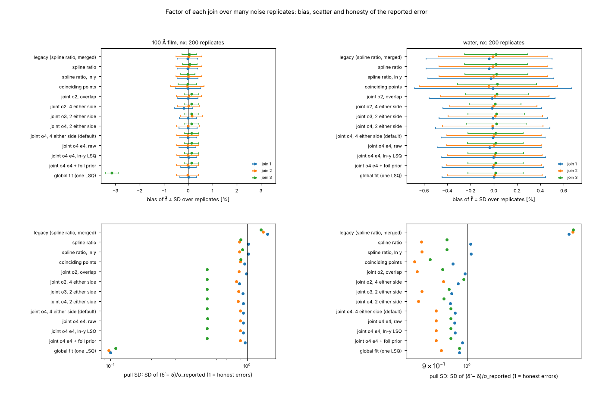
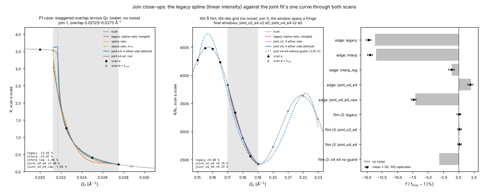
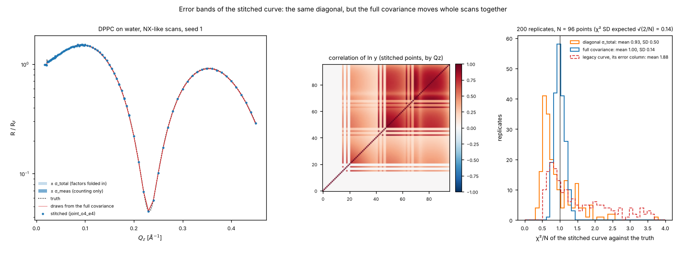
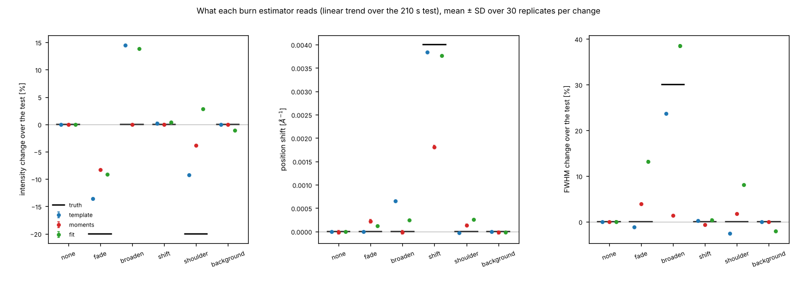

# Fit demonstrator: patching and burn line cuts on synthetic data

Written 2026-11-22 by a subagent at the owner's request:

> Have a subagent make a report with ~5 figures and reusable code that
> produces a demonstration of fitting the synthetic data via plot displays
> of the synthetic data, the denoised version, the fits of all kinds, with
> a little gui to custom the plotted items and switch to new replicate
> with spacebar. For burn tests i will also need a demo of the line cut
> fits, so just add that as a mode to the demonstrator.

"Measured" below means the tool was run and the number is its output
(`docs/figures/patch_demo/numbers.json`, written by the same run as the
figures); "read" means taken from code or a document without running it.
All data are synthetic, so every figure is public. No `lss_core` module
was changed.

## 1. What it is and how to launch it

    python tests/tools/patch_demo.py                  # the window
    python tests/tools/patch_demo.py --mode burn --seed 5
    python tests/tools/patch_demo.py --save docs/figures/patch_demo   # this report's figures, headless (2.5 min)
    python tests/tools/patch_demo.py --save DIR --quick   # smoke run, few replicates (16 s)
    python tests/tools/patch_demo.py --views DIR      # the window's two default views as PNG

The window (PyQt5 with an embedded matplotlib canvas and its toolbar):

- **Mode**: *Reflectivity patching* or *Burn line cuts*.
- **Space bar** (or the button): a new noise replicate (seed + 1); every
  method is refitted and the figure redrawn (≈ 0.4 s for reflectivity,
  ≈ 1.3 s for a burn, measured). The space bar works whatever control has
  the focus (an application event filter; checkboxes are not toggled by it).
- **Reflectivity controls**: truth (bare water, DPPC monolayer, film with
  Kiessig fringes and its thickness), scan plan (NX-like grids; four scans
  sharing 4 points; the same staggered; a staggered overlap across Qc),
  counts (×0.02 to ×100 the NX rates), foils off calibration, view (R or
  R/R_F), which join the close-up shows; a checkbox per method (13) and per
  plotted item (13: scans as measured, scans × true factors, denoised
  scans, truth, stitched curves, σ_total and σ_counting bands, draws from
  the covariance, pulls, factors, factors from the denoised data, foil
  prior, join close-up).
- **Burn controls**: change (none, fade, broaden at constant area, shift,
  fade under a 3× shoulder, rising floor), amount, monitor (sets the
  counts), frame shown; a checkbox per estimator (template, moments, fit)
  and per item (noisy line cut, denoised line cut, its true parts, frame 0,
  estimator curves, fit window, residuals, trends, all trend models, true
  trend).
- A notes pane lists what the methods reported (guard steps, prior used or
  not and why, failures, trend verdicts). Explanations are in tooltips.

### Code (reusable, GUI-free)

| Module | What |
|---|---|
| `tests/demonstrator/refl.py` | `Config`, `replicate(config, seed)`, `denoised(rep)`, `METHODS`, `run_method`, `run_all`, `join_curve` (a joint fit's curve), `spline_curve` (the legacy interpolation), `survey(config, seeds)`, `chi2_vs_truth` |
| `tests/demonstrator/burnmode.py` | `Config`, `replicate`, `run_estimator`, `run_all`, `frame_curve` (each estimator's curve on a frame), `true_change`, `measured_change`, `survey` |
| `tests/demonstrator/draw.py` | `refl_figure(fig, rep, results, show, ...)`, `burn_figure(...)`, the item lists |
| `tests/demonstrator/figures.py` | this report's figures and `numbers.json` |
| `tests/demonstrator/window.py` | the window |
| `tests/tools/patch_demo.py` | the entry point |
| `tests/test_patch_demo.py` | 17 tests, 10 s |

```python
import sys; sys.path[:0] = ['.', 'tests']          # as the test suite has it
from demonstrator import refl, burnmode as bm
rep = refl.replicate(refl.Config(truth='film', plan='nx', thickness=100), seed=3)
res = refl.run_all(rep)                             # {method: MethodResult}
res['joint_o4_e4'].factors / rep.true_steps - 1     # per join
res['joint_o4_e4'].stitched.covariance('log')       # N × N
clean = refl.run_all(refl.denoised(rep))            # the same methods without noise: bias alone
b = bm.replicate(bm.Config(change='broaden'), seed=1)
r = bm.run_all(b)                                   # {estimator: EstimatorResult}
x, y = bm.frame_curve(b, r['template'], 20)         # the template fitted to frame 20
```

How the curves are rebuilt. `patching.JoinFit` keeps δ = ln f but not the
polynomial; at fixed δ the maximum-likelihood coefficients are those of the
joint fit, so `refl.join_curve` fits the coefficients alone at δ̂ (same
window, order, baseline and likelihood). Tested: with δ free the same code
gives `joint_factor`'s δ to 1e-10, and the curve at the window's points
gives back the fit's χ² to 1e-6 (both likelihoods, R/R_F and raw). The
burn template curve is rebuilt from the per-frame parameters
`measure_gid` returns and gives back its χ²/dof to 1e-9 (tested).

## 2. The synthetic truth

**Reflectivity** (`tests/synthetic/xrr.py`, `xrr_scans.py`;
`docs/SYNTHETIC_DATA.md` §3): R(Qz) by the Parratt recursion (L. G.
Parratt, Phys. Rev. 95, 359 (1954; links in this report from memory),
https://doi.org/10.1103/PhysRev.95.359) with Névot–Croce roughness (L.
Névot and P. Croce, Rev. Phys. Appl. 15, 761 (1980),
https://doi.org/10.1051/rphysap:01980001503076100), σ = 3 Å, water β at
10 keV. The film (100 Å, 0.383 e/ų) gives Kiessig fringes of period
2π/d = 0.063 Å⁻¹ (H. Kiessig, Ann. Phys. 402, 769 (1931),
https://doi.org/10.1002/andp.19314020702). Scans as measured: Poisson
counts in the reader's three boxes through the calibrated foils, Poisson
Monc and Monp, rates of NX school scans 6–9 (read from the public SPEC
file by the generator's author). Errors `'counting+monitor'` (pulls of
unit scatter, tested in `test_synthetic_xrr_scans.py`). Added here: the
foils are not exactly the calibration: each replicate draws the true steps
from the prior's own covariance (`patching.known_steps`), so the foil prior
is right on average with the error it claims. The anchor's true scale puts
the stitched curves on R (normalising to R = 1 below Qc is a separate step).

**Burn** (`tests/synthetic/burn_profiles.py`): 21 frames of 10 s; a sharp
peak (Qxy 1.466 Å⁻¹, FWHM 0.016) on a broad shoulder (centre 1.47, σ 0.04)
and a floor; Poisson at monitor 1e7. The P44 case is `broaden`: FWHM +30 %
at constant area, the shoulder steady.

Methods: every method of `lss_core.patching` (spline ratio linear and log,
coinciding points, joint fit orders 2–4 with 0–4 points either side, R/R_F
or raw, Poisson-like or log likelihood, the correlated foil prior, the
global fit) and the legacy chain (`reflectivity.patch`, factors by
`stitching.fitted_factor` against everything joined so far, the legacy
error). Design and earlier measurements: `docs/reports/ref_patch_joint_fit.md`.
Burn estimators: `lss_core.burn` (`template`, `moments`, `fit`), trends by
`lss_core.trends.compare` (AICc, Hurvich & Tsai, Biometrika 76, 297 (1989),
https://doi.org/10.1093/biomet/76.2.297; Burnham & Anderson 2002,
https://doi.org/10.1007/b97636), errors from the scatter as the reader does
for GID burns.

## 3. Figures

Regenerate all: `python tests/tools/patch_demo.py --save docs/figures/patch_demo`
(deterministic: fixed seeds; 200 reflectivity replicates per survey, 100
for the edge, 30 burn replicates per change). Numbers: `numbers.json`,
`factor_summary_*.csv`, `burn_estimator_summary.csv` beside the figures.

### Figure 1. A Kiessig-fringe film, every method, one replicate


100 Å film on water, NX-like scans (absorbers 41, 32, 23, 16 chosen by the
generator), seed 1, NX counts. Top left: the noisy scans × their true
factors, the truth, the stitched curve of six methods in R/R_F with
σ_total bands. Top right: f̂/f_true − 1 per join with the reported error;
hollow markers: the same method on the denoised scans; grey: the foil
prior. Bottom left: pulls (stitched − truth)/σ_total. Bottom right: join 3
(Q 0.17–0.19) on scan a's scale with each method's curve.

Measured (this replicate, %): join 1/2/3 deviations legacy +0.15/+0.07/+0.53
(errors 0.46/0.55/0.20), spline ratio +0.15/+0.08/+0.52, joint o4 e4
+0.24/+0.01/+0.58 (errors 0.35/0.67/0.48), with prior +0.47/+0.01/+0.58
(prior used at join 1 only: Monc/Monp changes ×2.70 and ×1.19 across joins
2 and 3, where the slits open, so the P29 guard refuses it). χ²/N of the
stitched curve against the truth with the full covariance 0.92–0.94 for
every non-legacy method. The legacy pulls reach 3.6 above Q = 0.2 Å⁻¹: its
error column has the factor errors without inheritance (P4).

### Figure 2. Factors over 200 replicates: bias, scatter, honesty



Left: the 100 Å film; right: bare water; NX-like grids, NX counts. Top:
bias ± SD of f̂ (%); bottom: pull SD (SD of (δ̂ − δ_true)/σ_reported; 1 =
honest errors). Measured (bias / SD % / pull SD, joins 1, 2, 3):

| Method | Film | Water |
|---|---|---|
| legacy | −0.03/0.41/**1.41**; +0.02/0.52/**1.31**; +0.06/0.30/**1.26** | −0.04/0.54/**1.38**; −0.01/0.47/**1.39**; +0.02/0.27/**1.40** |
| spline ratio | −0.03/0.41/1.02; +0.02/0.52/0.88; +0.07/0.30/0.90 | −0.04/0.54/1.01; −0.01/0.47/0.87; +0.02/0.27/0.94 |
| coinciding points | −0.01/0.51/0.96; −0.04/0.69/0.89; −0.03/0.38/0.90 | −0.01/0.67/0.96; −0.05/0.60/0.85; +0.03/0.34/0.89 |
| joint o2, 4 either side | **−0.18**/0.37/0.88; +0.01/0.44/0.83; +0.14/0.30/0.51 | −0.01/0.42/0.97; −0.00/0.37/0.93; +0.01/0.22/0.99 |
| joint o4, 4 either side (default) | +0.00/**0.35**/0.94; −0.03/**0.45**/0.89; +0.14/0.30/**0.51** | −0.01/**0.45**/0.96; +0.00/**0.41**/0.91; +0.01/**0.24**/0.95 |
| joint o4 e4 + foil prior | +0.01/0.32/0.97; −0.03/0.45/0.89; +0.14/0.30/0.51 | −0.01/0.44/0.99; same as default at 2, 3 |
| global fit | +0.01/0.34/**0.10**; −0.03/0.45/**0.10**; **−3.14**/0.25/**0.11** | +0.00/0.44/0.98; +0.01/0.41/0.92; +0.02/0.24/0.98 |

Findings (measured): every method except the global fit on the film is
unbiased within 0.2 %. The default joint fit's scatter is 13–17 % below
the spline ratio's where its window is used in full (12–17 %: film joins
1–2, water all joins); on the film's join 3 the χ² guard steps every joint variant
down to order 2 on the overlap alone (the 4-points-either-side window
spans 0.15–0.23 Å⁻¹, more than a fringe), so they all give the same
number, +0.14 % (noise-free +0.15 %), with an error inflated by √(χ²/dof)
(pull SD 0.51: conservative). The legacy error understates the scatter
by a factor 1.26–1.41 (pull SD; the report's NX-grid 1.49 in kind). The prior helps at join 1
only (SD 0.32 against 0.35 %); elsewhere the monitor guard refuses it.
**The global fit has no guard and one χ² inflation for all joins**: on the
film its last join is −3.14 % in every replicate (SD 0.25 %) and the
misfit there inflates every join's error about ten-fold (pull SD 0.10).

### Figure 3. Join close-ups: the legacy spline against the joint fit's one curve



Left: the P1 case, a staggered overlap straddling Qc (water, scan a to
0.0275 in steps of 0.0025, scan b from 0.02125 in steps of 0.005;
noise-free), on scan a's scale in R. Middle: the film's join 3 (noise-free)
in R/R_F, with the default joint fit as the guard leaves it (order 2,
overlap only) and, dotted, the same fit with the guard off (order 4, 4
points either side). Right: the noise-free deviation (bars) and the mean ±
SD over replicates (100 at the edge, 200 for the film).

Measured, edge (noise-free / mean of 100 replicates, %): legacy −13.65 /
−14.69, spline ratio −13.47 / −14.49, spline in ln y −1.08 / −1.15, joint
o4 e4 in R/R_F **+2.00 / +1.94**, joint raw **−7.05 / −7.35**. The guard
steps every joint variant down to the overlap alone (χ²/dof 11.7 there in
R/R_F, 310 raw) and inflates the error (to ≈ 1.1 % in R/R_F, ≈ 6 % raw,
from the pull SDs 0.38 and 0.067 and the scatter 0.41 %); the R/R_F joint
fit stays about 1.8 reported σ off. The legacy error is ≈ 11 % here
(pull SD 0.034: `absolute_sigma=False` scales it by the misfit), so its
−14.7 % is 1.3 of its own σ. Why (reasoned, from
the curve in the left panel): the baseline ln R_F of `patching.fresnel`
has a kink at Qc = 0.0217 Å⁻¹ (sharp, no absorption) while the true curve
is rounded (roughness, absorption, Qc 0.02175), so a polynomial in
ln(R/R_F) cannot follow both sides of the edge; in raw ln R the edge is a
step no low-order polynomial follows. **The joint fit does not remove the
P1 bias when the overlap straddles the critical edge**; the spline in
ln y is the least biased there (−1.1 %). Film join 3: legacy +0.085 %, the
guarded joint fits +0.149 %, the unguarded order-4 window −3.15 % (χ²/dof
285): the guard is what keeps the joint fit right on a fringe-rich film at
NX steps.

### Figure 4. Error bands: the same diagonal, a different covariance



DPPC on water, NX-like scans, default joint fit. Left: the stitched curve
with ± σ_meas (counting only) and ± σ_total (√(σ_meas² + y² diag W Σ Wᵀ),
`Stitched.sigma_total`), and four draws from the full covariance
(`Stitched.covariance('log')`) about the truth: whole scans move together.
Middle: the correlation matrix of ln y (blocks: the scans; each later scan
correlated with the earlier through the chained factors). Right: χ²/N of
the stitched curve against the truth over 200 replicates.

Measured (N = 96 points, 200 replicates): with the full covariance χ²/N =
1.00 ± 0.14 (the χ² distribution's √(2/N) = 0.144); with σ_total as
independent errors 0.93 ± **0.50**, three and a half times the spread a
correct error model gives; the legacy curve with its own error column 1.88
± 1.47. The level of the last scan (weighted mean of ln y − ln truth over
its points): observed scatter 0.69 % over the replicates; the diagonal
predicts 0.16 % (4.3 × too small), the full covariance 0.76 % (√Σ_KK =
0.75 %). This is the P4 point of `docs/reports/ref_patch_joint_fit.md`
§4–5.1 seen directly: the per-point band is right, but a fit or average
over many points needs the covariance (G. D'Agostini, Nucl. Instrum.
Meth. A 346, 306 (1994), https://doi.org/10.1016/0168-9002(94)90719-6).

### Figure 5. Burn line cuts, the P44 case


The peak broadens by 30 % at constant area under a steady shoulder (seed
1). Left: the last frame's line cut, its noisy points, the denoised cut and
its parts, frame 0's truth, and each estimator's curve in the window
(shaded); residuals below. Right: the three quantities over time relative
to t = 0 (position: shift), each estimator's best trend model, the truth
dashed.

Measured (this replicate; change over the 210 s test from the linear
model): FWHM template +24.0 %, fit +38.8 %, moments +1.4 % (true +30 %);
intensity template +14.6 %, fit +14.0 %, moments −0.01 % (true 0); position
template **+0.00065 Å⁻¹**, fit +0.00024, moments 0.0000 (true 0). The
template reads the broadening as a gain (P44) and also as a shift of 4 % of
the FWHM, close to the 5 %-of-FWHM position criterion of the burn test:
stretching a template that holds part of the shoulder (centred 0.004 Å⁻¹
above the peak) moves its centroid. Per-frame χ²/dof (median): template
28, Gaussian fit 2229 (one Gaussian does not describe peak + shoulder at
these counts). The template and the fit call all three quantities
changing; the moments only the width.

### Figure 6. What each estimator reads, 30 replicates per change



Mean ± SD of the change over the test (linear trend) per estimator, for
each kind of change, against the truth. Measured (mean; SD ≤ 0.3 % or 3e-5
Å⁻¹ everywhere; the systematic errors dominate):

| Change (truth) | template | moments | fit |
|---|---|---|---|
| fade (area −20 %) | −13.6 % | −8.3 % | −9.2 % |
| fade under a 3× shoulder (−20 %) | −9.3 % | −3.8 % | **+2.8 %** |
| broaden (FWHM +30 %, area 0) | FWHM +23.7 %, area **+14.4 %**, shift +0.00066 | FWHM **+1.4 %** | FWHM +38.5 %, area +13.8 % |
| shift (+0.0040 Å⁻¹) | +0.00384 | **+0.00181** | +0.00376 |
| floor ×1.5 (nothing) | 0.0 % | 0.0 % | area −1.1 %, FWHM −2.0 % |
| fade: spurious FWHM | −1.1 % | +3.9 % | **+13.1 %** |
| none: called stable (intensity / position / FWHM) | 97 / 90 / 97 % | 97 / 87 / 93 % | 93 / 90 / 93 % |

Every estimator under-reads a fading peak because the window holds part of
the shoulder (the template comes closest, with 68 % of the true change); the Gaussian
fit turns a fade under a strong shoulder into a gain and a fade into a
broadening; the moments miss a broadening and half a shift (this extends
the one-seed first look in `docs/SYNTHETIC_DATA.md` §4 and P44 to 30
replicates and to the spurious changes). On constant data the verdict
"stable" holds in 87–97 % of replicates (30 each; the nominal level of the
Δ ≤ 2 rule is not a false-alarm rate, so this is a characterisation, not
a check).

## 4. Findings to pass on (not fixed here; reproducers)

None is a crash or a wrong formula; they are limits of methods as coded,
measured on synthetic truth. The core modules were not changed.

1. **Joint fit across the critical edge** (P1 case): +2.0 % (R/R_F), −7.0 %
   (raw), noise-free, guard engaged; spline in ln y −1.1 %, legacy −13.7 %.
   `refl.run_method(refl.denoised(refl.replicate(refl.Config(truth='water',
   plan='edge'), 0)), 'joint_o4_e4')`. A remedy to try: the baseline
   R_F with absorption and the rounded edge (the profile's own R_F, or
   `xrr.fresnel`), or excluding points below Qc from the window. Test:
   `test_the_p1_case_as_coded`.
2. **`patching.global_fit` has no guard and one χ² inflation**: on a
   100 Å film at NX steps its last join is −3.1 % and every join's error is
   inflated ten-fold. It equals `chain(likelihood='log', guard_p=0)`
   to the fourth digit on NX-like grids (measured, film and water, one
   replicate each; on `standard_plan` grids, whose windows share points,
   they differ by up to 0.2 % at one join), so its docstring's "equals
   chain" holds only without the guard. Test:
   `test_global_fit_has_no_guard_as_coded`.
3. **Burn template reads a broadening as a shift** (+0.00066 Å⁻¹ = 4 % of
   the FWHM, 30 replicates), besides the known area gain (P44). The Gaussian
   fit reads a fade as +13 % FWHM and a fade under a shoulder as a gain.
   `bm.run_all(bm.replicate(bm.Config(change='broaden'), 1))`.
4. **Coarse late scans on thick films**: at NX steps (0.01 Å⁻¹ from 0.17)
   the default window spans more than a 100 Å film's fringe; the guard
   saves the factor but the result is the order-2 overlap-only fit with an
   inflated error (pull SD 0.51). On `standard_plan` (steps up to 0.02) the
   film's last join has χ²/dof 85 even on the overlap alone.

## 5. Tests

`tests/test_patch_demo.py` (17 tests, 10 s, measured): replicates
reproducible from their seed (both modes); denoised scans equal the truth
on each scan's scale (1e-12); without foil errors the prior is the truth;
every method within 0.15 % and 3 σ of the truth at ×100 counts; the rebuilt
join curve is the joint fit (δ to 1e-10, χ² to 1e-6); legacy and spline
ratio agree on the first join; the P1 case and the global fit as coded;
the coinciding method fails on staggered grids with a message; χ²/N with
the full covariance near 1; the burn mode recovers a 0.004 Å⁻¹ shift
(template and fit within 10 %) and reads a broadening; the rebuilt frame
curves give back the reported χ²; the views are written headless; every
plotted item can be drawn; the window (offscreen): space bar, space on a
focused checkbox (a new replicate, no toggle), checkboxes, view, join,
plan, mode switch, burn controls, with `recorder.exceptions == []`.
