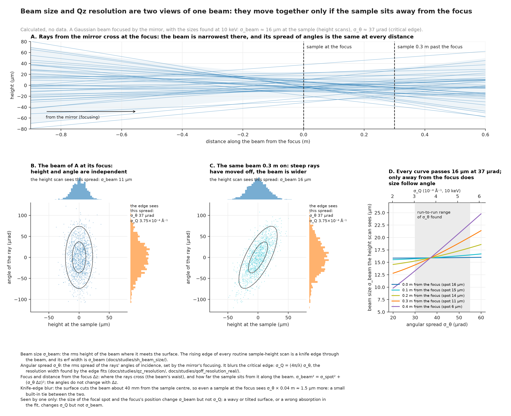
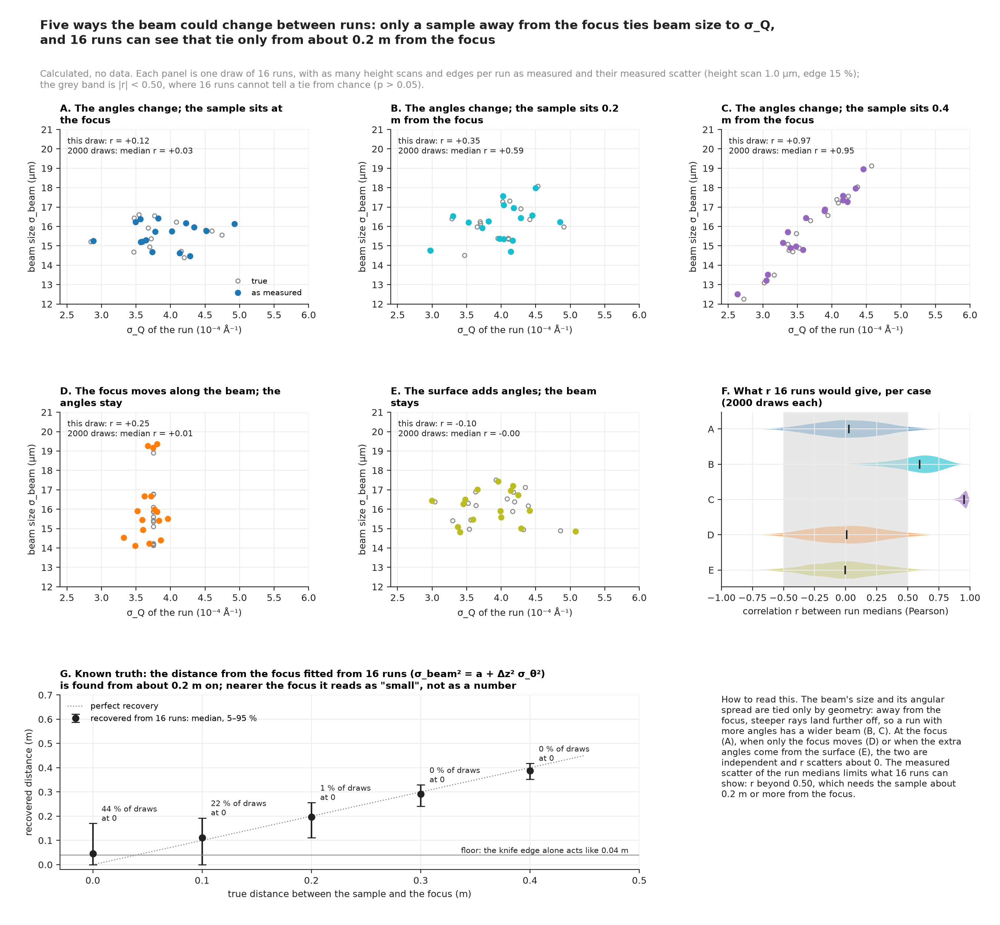
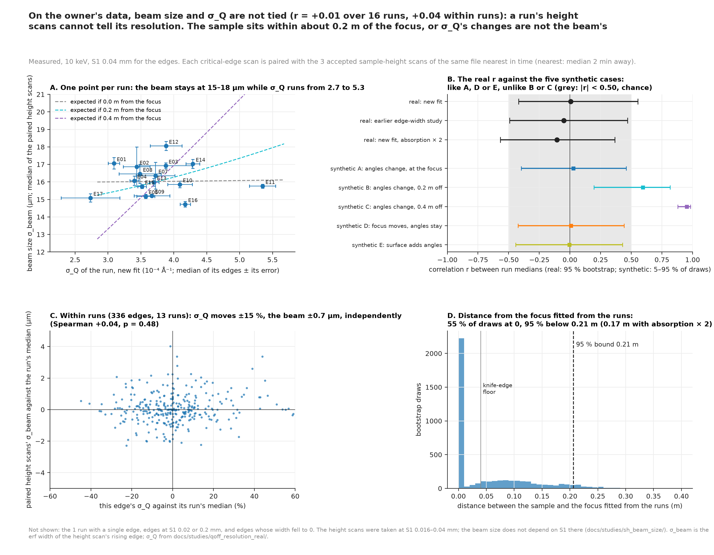

# Is the beam's size tied to the Qz resolution? Synthetic cases, then the owner's history

The owner's question (2026-11-27): "how correlated are the beam size (from the sample-height scan's edge
width) and the Qz sigma? Illustrate with synthetic cases, then analyse the history."

**The answer: on the owner's data they are not correlated.** The run medians give r = +0.01 over 16 runs
(95 % bootstrap interval −0.42 to +0.55). Within runs, edge by edge, the Spearman correlation is +0.04
(p = 0.48, 336 edges). Between runs the beam stays at 14.7–18.1 µm (σ, ±5 %), while σ_Q goes from
2.7 to 5.3 × 10⁻⁴ Å⁻¹ (±15 %). So **a run's height scans cannot tell you its resolution: the edge has to be
fitted.** The geometry gives two readings, and these data cannot tell them apart:
- the sample sits within about 0.2 m of the mirror's focus (95 % bound 0.21 m);
- or σ_Q's changes from run to run are not changes of the beam.

## Terms used here

- **Beam size σ_beam**: the rms height of the beam where it meets the liquid surface. Every routine
  sample-height scan has a rising edge where the surface cuts into the beam like a knife edge. The erf width
  of that edge is σ_beam ([`docs/studies/sh_beam_size/`](../sh_beam_size/summary.md)).
- **Angular spread σ_θ**: how much the rays' angles of incidence differ from each other. The mirror's focusing
  sets it.
- **σ_Q**: the resolution width in Qz, σ_Q = (4π/λ) σ_θ (10.14 Å⁻¹ × σ_θ at 10 keV). It blurs the
  critical edge, and the edge fits measure it.
  - The new fit finds the angle offset and σ_Q together
    ([`docs/studies/qoff_resolution_real/`](../qoff_resolution_real/summary.md)).
  - The earlier edge-width study is [`docs/studies/qz_resolution/`](../qz_resolution/summary.md).
- **Focus, and the distance from it Δz**: the focus is where the rays from the mirror cross, so the beam is
  narrowest there. Δz is how far the sample sits from that point along the beam.
- **Knife-edge blur**: the surface cuts the beam about 40 mm from the sample's centre. That adds
  σ_θ × 0.04 m ≈ 1.5 µm to every height scan, a small built-in tie between the two.

## 1. How the two numbers are made from one beam (Figure 0)

Think of every ray by two numbers: its height at the sample and its angle (Figure 0, B and C).
- The height scan sees only the spread of heights, the top histogram: that is σ_beam.
- The critical edge sees only the spread of angles, the right histogram: that is σ_θ, and so σ_Q.

The rays travel in straight lines, so the height at the sample is y = y₀ + θ Δz. Here y₀ is the ray's height
at the focus. That gives

    σ_beam² = σ_spot² + (σ_θ Δz)²     and σ_θ is the same at every distance.

At the focus (B), height and angle are independent. Making the angles wider changes σ_Q but not the beam's
size. Away from the focus (C), the steeper rays have drifted further, so wider angles also mean a wider
beam. Figure 0 D shows that: every curve passes through the typical 16 µm and 37 µrad, but only the curves
for a sample away from the focus rise with σ_θ.

## 2. Five synthetic cases (Figure 1)

The tool `tests/tools/beam_size_vs_resolution_synthetic.py` draws 16 runs per case. It matches the real
measurements: as many height scans and edges per run, with their measured scatter (1.0 µm per height scan,
15 % per edge). Each case gets 2000 draws (`synthetic_cases.csv`).

| case | what changes between runs | median r | 5–95 % | share with \|r\| > 0.50 |
|---|---|---|---|---|
| A | the angles; the sample sits at the focus | +0.03 | −0.40 to +0.46 | 5 % |
| B | the angles; the sample sits 0.2 m from the focus | +0.59 | +0.20 to +0.82 | 69 % |
| C | the angles; the sample sits 0.4 m from the focus | +0.95 | +0.88 to +0.98 | 100 % |
| D | the focus moves along the beam; the angles stay | +0.01 | −0.42 to +0.44 | 6 % |
| E | the surface adds angles (e.g. waves); the beam stays | −0.00 | −0.44 to +0.43 | 5 % |

With 16 runs, any |r| below 0.50 could be chance (p > 0.05).

**Known truth for Δz** (Figure 1 G). This checks the estimator: fit σ_beam² = a + Δz² σ_θ² to the 16 run
medians.
- From 0.2 m on, it recovers the true distance: medians 0.20, 0.29 and 0.39 m for true 0.2, 0.3 and 0.4 m.
- Nearer than that, it returns "small" rather than a number. At a true 0, 44 % of the draws fit exactly 0,
  and the 95th percentile is 0.17 m.
- The knife edge alone acts like 0.04 m, so the fit never reads less than that.

## 3. The history (Figure 2)

**The data.**
- 349 critical-edge scans: 10 keV, incident slit S1 0.04 mm, 16 runs with at least 4 edges. These are the
  same edges and the same anonymous run labels E01… as in the two edge studies.
- Each edge's σ_Q comes from those studies.
- Each edge is paired with the 3 accepted sample-height scans of the same SPEC file nearest in time. The
  nearest is a median 2 min away (90 % within 18 min, all within 2 h).
- σ_beam is the median erf width of those height scans. The height scans were taken with S1 at 0.016–0.04 mm,
  narrower than the edges' slit. In that range the beam's size does not depend on S1 (sh_beam_size study).

**Between runs** (A, B):

| σ_Q from | Pearson r (95 % bootstrap) | Spearman |
|---|---|---|
| new fit | +0.01 (−0.42 to +0.55) | +0.02 (p = 0.94) |
| earlier edge-width study | −0.05 (−0.49 to +0.47) | −0.01 (p = 0.97) |
| new fit with the absorption × 2 (it fits the edges best) | −0.11 (−0.57 to +0.37) | −0.21 (p = 0.44) |

The real r matches cases A, D and E and is unlike B and C. One run makes the point (A): E11 has the
largest σ_Q of all (5.3 × 10⁻⁴ Å⁻¹, 40 % above the median) and an ordinary beam (15.8 µm). If the
sample sat 0.4 m from the focus, that run's beam would be about 22 µm.

**Within runs** (C). Edges of the same run, against their run's medians: σ_Q moves ±15 % (robust SD), the
paired height scans ±0.7 µm. The two moves are independent: Spearman +0.04, p = 0.48, 336 edges in 13 runs
with at least 6 edges. Pearson's −0.15 comes from a few outlying edges. So the series-to-series changes of
the edge's width are not seen in the beam's size either.

**The distance from the focus** (D). The fit to the 16 runs gives Δz = 0 (the slope comes out
slightly negative). The bootstrap over runs puts 55 % of draws at 0, with a 95 % bound of 0.21 m (0.17 m
if σ_Q is taken from the absorption × 2 fit). The synthetic check (Figure 1 G) shows the estimator could
have seen 0.2 m or more.

## 4. What it means

- **For the reader:** σ_Q cannot be predicted from a run's height scans. A resolution for R/R_F, or for the
  Propose button's offset, has to come from the edge itself, or from a per-beamtime value that someone
  measures.
- **For the beam:** either the sample sits close to the focus, or the run-to-run changes in σ_Q are not the
  beam's. The second reading would mean the changes come from something the beam does not carry: the
  surface (waves, slope), or the edge model (absorption, the residual pattern of the qoff study). These
  data cannot tell the two apart.
  - A test that could: a run with the sample deliberately moved along the beam by a known distance, or with
    the mirror's focus changed. That is a beamline measurement, not a reanalysis.
- **Measured or derived:**
  - The correlations and the Δz bound are measured on the private files.
  - The model (straight rays, a Gaussian beam with its waist at the focus) is an assumption. The real beam
    has a core and tails (sh_beam_size study); a tail would change the numbers, not the logic.

## Not shown, and why

- 1 run with a single edge; 11 edges at S1 0.02 mm and 11 at 0.2 mm (too few for their own runs); 28
  edges at S1 0.04 mm whose fitted width fell to 0.
- The released runs before 2019: the height-scan fits of the sh_beam_size study cover only the private files,
  so these runs were not paired.
- Per-edge times and the height scans themselves: the published numbers are run medians and deviations
  from them, with no dates, names, files or scan numbers.

## Files

| file | what |
|---|---|
| `B0_one_beam_two_views.png` | calculated explainer: rays and phase space, what each measurement sees |
| `B1_synthetic_cases.png`, `synthetic_cases.csv`, `synthetic_distance_recovery.json` | five synthetic cases, their r, and the Δz known-truth check; `python tests/tools/beam_size_vs_resolution_synthetic.py --out docs/studies/beam_size_vs_resolution` |
| `B2_history.png` | the real data (private generator) |
| `runs.csv` | per run, as follows |
| `numbers.json` | every number quoted here |

The columns of `runs.csv`:
- `edges`;
- `sigma_beam_um`, the median of the paired height scans, and `sigma_beam_se_um`, its bootstrap error;
- `sh_s1_mm`, the height scans' S1 gap;
- `sigma_q_sq` (new fit), `sigma_q_r13` (earlier study) and `sigma_q_b2` (absorption × 2), in Å⁻¹, each
  with its bootstrap error `sigma_q_se_*`.

**Regenerate:**
- Figure 0, Figure 1 and their numbers are public:
  `python tests/tools/beam_size_vs_resolution_synthetic.py --out docs/studies/beam_size_vs_resolution`.
- Figure 2, `runs.csv` and `numbers.json` come from the private generator on the owner's PC
  (`sample_data/private/xr/scripts/beamq_pair.py`, then `beamq_publish.py`). It is not regenerable here.
