# A GID burn peak on a shoulder: which estimator reads the truth? (P44)

Tools man, 2026-11-27. Synthetic burns with a known truth, and NX school burns 14 and 15 as the public
real check. **Measured** throughout: every number is from one run of the tool (`results.csv`, `nx.csv`,
`reference_noise.csv`, `numbers.json`, `numbers_reference.json` beside this file). The whole chain on NX
burn 15, from a raw frame to the verdict, with the statistics explained for a newcomer, is
[`walkthrough.md`](walkthrough.md).

## The question

A GID burn test measures one spot 21 times and asks whether the beam changes the peak. The peak is sharp
and sits on a broad hump, the **shoulder**. The reader's estimator, **shoulder stretched with the peak** (`stretched`), fits each frame as
the mean frame's whole shape (peak and shoulder) scaled by A, slid by δ and stretched by w. When the peak
widens, the stretch widens the shoulder too, and A·w counts the shoulder's extra width as intensity (P44).
The **shoulder separated** estimators (`separated`, `separated_held`) fit a Gaussian to the shoulder beside the peak (`burn.separate_shoulder`) and stretch
only the rest. Do they read the truth, on which shoulders, at which counts, and what do they say about NX?

## The estimators

**Names** (renamed 2026-11-27 at the owner's request, "too opaque"; the old names still work in scripts and saved files):

| name here | code name | what it means | until 2026-11-27 |
|---|---|---|---|
| shoulder stretched with the peak | `stretched` | the whole mean frame, shoulder included, is stretched to fit each frame | `template` |
| shoulder separated | `separated` | the shoulder is fitted apart and not stretched; its amplitude B is free per frame | `split` |
| shoulder separated and held | `separated_held` | the same with B held at 1: the shoulder assumed steady | `split_fixed` |

Short forms below: **stretched**, **separated**, **separated & held**.

| name | each frame is fitted as | per frame |
|---|---|---|
| `stretched` (the reader's default) | A × the mean frame's shape (stretched by w, slid by δ) + a line | 5 parameters |
| `moments` (the legacy test) | no fit: the window's sum, centroid and second moment above a chord | — |
| `separated` | A × the peak's shape P (stretched, slid) + **B** × the shoulder S (not stretched) + a line | 6 |
| `separated_held` | the same with B = 1: the shoulder assumed steady | 5 |
| `fit` (NX only) | one Gaussian + a line | 5 |

The separated reading's intensity is A·w × P's area, its FWHM w × P's FWHM, its position P's centroid + δ. `separated`
also reports the shoulder (B × S's area) as a fourth quantity.

## The design

- **The burns** (`tests/synthetic/burn_profiles.py`): 21 frames of 10 s, a peak of FWHM 0.016 Å⁻¹ at
  1.466 on a shoulder of σ 0.04 at 1.47, a flat floor. Each change grows linearly over the test.

| case | what changes | true change of the intensity, FWHM |
|---|---|---|
| `none` | nothing (false alarms) | 0, 0 |
| `fade` | the peak's area −20 % | −20 %, 0 |
| `broaden` | the peak's FWHM +30 % at constant area | 0, +30 % |
| `shift` | the peak's centre +0.004 Å⁻¹ | 0, 0 |
| `shoulder` | a fade of −20 % under a shoulder 3 × stronger | −20 %, 0 |
| `background` | the flat floor +50 % | 0, 0 |
| `shoulder_grows` | the shoulder +50 %, the peak steady | 0, 0 (shoulder +50 %) |
| `both_fade` | the peak −20 % and the shoulder −30 % | −20 %, 0 (shoulder −30 %) |
| `nx15_like` | FWHM +20 % and area −13 %: NX burn 15 as separated reads it | −13 %, +20 % |

- **Part A**: every case on four shoulder shapes (Gaussian, Lorentzian, lopsided, a Gaussian with a
  narrow second hump beside the peak), at high counts: monitor 1e7, where one frame's intensity is known
  to 0.19 %. What remains there is bias, not noise.
- **Part B**: the Gaussian shoulder at fewer counts: monitor 1e6 (0.6 % per frame), **6e4 (2.1 %, as NX
  burn 15: 2.0 %)** and **1e4 (3.9 %, as NX burn 14: 3.8 %)**. The match is of one frame's stretched
  intensity error (`NX_MONITORS`, tested).
- **300 replicates per cell.** Each replicate goes through the reader's own trend analysis
  (`burn.analyse`, errors from the scatter: the GID default). The change over the test is read from the
  straight line through the frames, with its σ; the verdict is the reader's: **changing** when a line beats
  a constant by more than 2 in AICc (`trends.STABLE_DELTA`).
- **Per cell**: the bias (mean read − truth) and SD of the change, the pull SD ((read − truth)/σ: 1 when
  the errors are honest), the share of 95 % intervals (±1.96σ) that hold the truth, and the share of burns
  called changing. These are explained step by step in the walkthrough, steps 5 and 6.

Changes are in **percentage points** (pp): a fade of −20 % read as −13.6 % has a bias of +6.4 pp.

## 1. A Gaussian shoulder (S1)

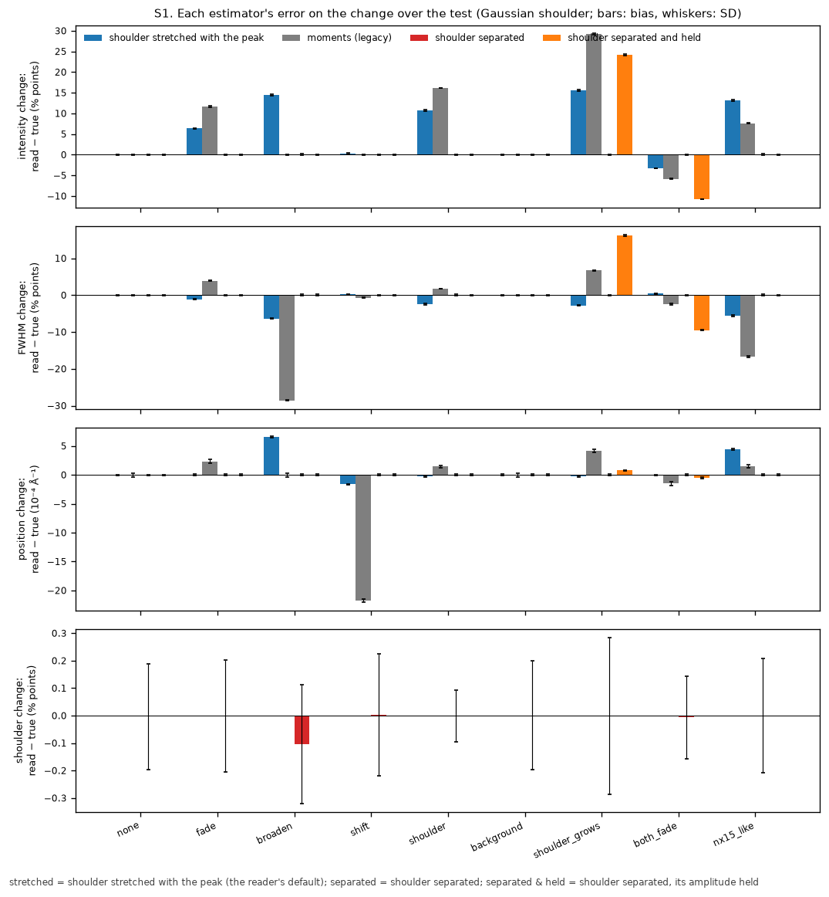

**The intensity: bias of the change over the test** (pp, 300 burns, monitor 1e7; the SD is 0.10–0.19 pp
for every estimator):

| case | truth | stretched | moments | separated | separated & held |
|---|---|---|---|---|---|
| `none` | 0 | −0.00 | −0.00 | −0.00 | −0.01 |
| `fade` | −20 | **+6.43** | +11.68 | −0.00 | −0.00 |
| `broaden` | 0 | **+14.44** | −0.00 | +0.13 | +0.02 |
| `shift` | 0 | +0.23 | −0.01 | −0.01 | −0.01 |
| `shoulder` | −20 | **+10.76** | +16.16 | −0.01 | −0.01 |
| `background` | 0 | −0.00 | +0.00 | −0.01 | −0.01 |
| `shoulder_grows` | 0 | +15.62 | +29.22 | −0.01 | **+24.20** |
| `both_fade` | −20 | −3.28 | −5.85 | −0.00 | **−10.76** |
| `nx15_like` | −13 | **+13.19** | +7.60 | +0.03 | +0.00 |

**The FWHM** (pp): stretched reads a +30 % broadening as +23.7 % (−6.32) and the NX 15-like +20 % as
+14.5 % (−5.52); the moments read almost none of either (−28.59, −16.69). Separated is within 0.1 pp in
every case; `separated_held` too, except when the shoulder changes (+16.22 when it grows, −9.50 when it fades).

**The position** (10⁻⁴ Å⁻¹): stretched reads a false drift of +6.6 when the peak broadens and +4.4 on
the NX 15-like burn, and misses 1.6 of a true 40 when it shifts; the moments miss 21.8 of the 40 (the
shoulder holds the centroid back). Both splits are within 0.01.

**What it shows:**
- **Stretched is biased whenever the peak's width or the shoulder changes, and also when the peak
  simply fades** (it scales the steady shoulder with the peak: a −20 % fade reads −13.6 %). On the NX
  15-like burn it reads −13 % as −0.2 %. It is unbiased only when nothing changes or the floor changes.
- **Separated reads every quantity of every case to 0.13 pp or better**, including the shoulder itself
  (`shoulder_grows`: +50 % read to 0.00 pp; `both_fade`: −30 % to 0.01).
- **`separated_held` is as good as separated while the shoulder is steady, and misleads when it is not**:
  a shoulder growing 50 % under a steady peak reads as a peak gaining 24 % and broadening 16 %. So the two
  disagreeing is the sign of a changing shoulder.
- **The price is precision:** the separated reading's SD is 1.06–1.47 × the stretched reading's (`separated_held`: 0.84–1.29 ×).

## 2. Other shoulder shapes (S2)

Separated fits a Gaussian to the shoulder. When the shoulder is not one, part of it is left in P and
stretched with the peak. **The intensity's bias** (pp, monitor 1e7):

| shape | case | stretched | moments | separated | separated & held |
|---|---|---|---|---|---|
| Lorentzian | `fade` | +7.2 | +10.5 | +1.2 | +1.8 |
| | `broaden` | +16.2 | −0.0 | +4.4 | +2.0 |
| | `shoulder` | +15.3 | +15.4 | +3.8 | +5.2 |
| | `shoulder_grows` | +19.2 | +26.3 | +3.1 | +22.8 |
| | `nx15_like` | +16.0 | +6.8 | +3.6 | +2.6 |
| lopsided | `fade` | +6.4 | +9.8 | +2.2 | +2.6 |
| | `broaden` | +10.8 | −0.0 | +4.6 | +3.0 |
| | `shoulder` | +12.2 | +14.9 | +5.2 | +6.1 |
| | `shoulder_grows` | +16.8 | +24.5 | +5.7 | +21.3 |
| | `nx15_like` | +11.9 | +7.2 | +5.2 | +4.5 |
| two humps | `fade` | +10.8 | +12.5 | +4.6 | +4.3 |
| | `broaden` | +12.9 | +0.0 | +5.6 | +3.2 |
| | `shoulder` | +16.4 | +16.8 | +11.5 | +11.4 |
| | `shoulder_grows` | +28.7 | +31.2 | +11.7 | +39.3 |
| | `nx15_like` | +16.9 | +8.6 | +7.7 | +6.3 |

**What it shows:**
- **Separated is less biased than stretched in every case where the intensity changes or the peak
  broadens,** on every shape: by 3.7–6.2 × on the Lorentzian shoulder, 2.3–3.0 × on the lopsided one and
  1.4–2.5 × with two humps (the ratio of the absolute biases over `fade`, `broaden`, `shoulder`,
  `shoulder_grows`, `both_fade` and `nx15_like`). Its worst is +5.7 pp on the lopsided shoulder and
  +11.7 pp with two humps.
- **One exception, small:** a pure shift on the two-hump shoulder, where separated reads a false −3.0 pp
  and stretched +2.2 pp (lopsided: −0.8 against +2.5).
- **With two humps no estimator copes:** the narrow hump beside the peak is neither shoulder nor peak.
- **The moments read a broadening at constant area without bias on every shape** (a sum does not care
  about the width), but nothing else: they miss most of any fade and all of any broadening.
- **The FWHM** (`results.csv`): the separated reading's bias on a +30 % broadening is +2.1 pp (Lorentzian), −0.8
  (lopsided), −4.4 (two humps), against the stretched reading's +3.6, −7.8, −9.3.
- **A broadening moves the separated reading's shoulder when the shoulder is not a Gaussian:** the shoulder reads a
  false fade of 6.3 pp (Lorentzian), 4.9 (lopsided) and 4.6 (two humps) on the +30 % broadening, against
  0.1 on the Gaussian shoulder. So a shoulder change read alongside a broadening is not proof that the
  shoulder changed (hand-off 10, question 2).

## 3. Verdicts and coverage (S3)

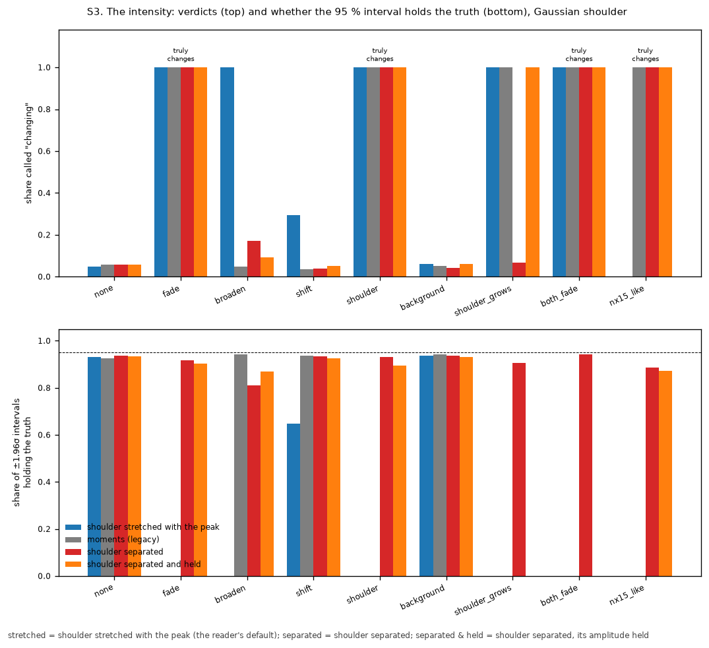

**The intensity, Gaussian shoulder, monitor 1e7:** share called "changing" / share of 95 % intervals that
hold the truth / pull SD. Bold: the verdict is wrong in most burns.

| case | stretched | moments | separated | separated & held |
|---|---|---|---|---|
| `none` | 5 % / 93 % / 1.06 | 6 % / 93 % / 1.08 | 6 % / 94 % / 1.06 | 6 % / 93 % / 1.03 |
| `fade` | 100 % / 0 % / 13.7 | 100 % / 0 % / 16.8 | 100 % / 92 % / 1.08 | 100 % / 90 % / 1.14 |
| `broaden` | **100 %** / 0 % / 5.09 | 5 % / 94 % / 1.03 | 17 % / 81 % / 1.25 | 9 % / 87 % / 1.20 |
| `shift` | 29 % / 65 % / 0.97 | 4 % / 94 % / 1.01 | 4 % / 93 % / 1.06 | 5 % / 93 % / 1.03 |
| `shoulder` | 100 % / 0 % / 12.8 | 100 % / 0 % / 40.3 | 100 % / 93 % / 1.09 | 100 % / 89 % / 1.19 |
| `background` | 6 % / 94 % / 1.06 | 5 % / 94 % / 1.07 | 4 % / 94 % / 1.02 | 6 % / 93 % / 1.04 |
| `shoulder_grows` | **100 %** / 0 % / 18.5 | **100 %** / 0 % / 36.7 | 7 % / 91 % / 1.15 | **100 %** / 0 % / 30.6 |
| `both_fade` | 100 % / 0 % / 8.04 | 100 % / 0 % / 10.3 | 100 % / 94 % / 1.00 | 100 % / 0 % / 23.3 |
| `nx15_like` | **0 %** / 0 % / 4.74 | 100 % / 0 % / 11.5 | 100 % / 89 % / 1.20 | 100 % / 87 % / 1.26 |

**What it shows:**
- **The stretched reading's verdicts are wrong in three cases:** it calls a broadening at constant area and a
  growing shoulder "changing" every time, and the NX 15-like fade "stable" every time. Its intervals never
  hold the truth when anything but the floor changes.
- **The separated reading's verdicts are right in every case,** and its intervals hold the truth in 81–94 % of burns.
  Its pull SD is 1.00–1.25: its σ is up to 25 % too small, worst when the peak broadens, where 17 % of
  steady burns are called changing (5 % is the rate when nothing changes).
- **No false alarms when nothing changes:** 4–6 % for every estimator, as the AICc threshold gives.

## 4. Fewer counts (S4)

Part B repeats the Gaussian shoulder at fewer counts. **The intensity** (pp: bias ± SD, 300 burns per cell;
then the share called "changing" and the share of 95 % intervals holding the truth):

| case | monitor | stretched | moments | separated | separated & held |
|---|---|---|---|---|---|
| `none` | 1e6 | −0.02 ± 0.29, 4 %, 96 % | −0.02 ± 0.39, 4 %, 95 % | −0.01 ± 0.41, 4 %, 95 % | −0.02 ± 0.32, 3 %, 96 % |
| | 6e4 | −0.01 ± 1.34, 3 %, 95 % | +0.11 ± 1.58, 6 %, 93 % | −0.09 ± 1.68, 3 %, 95 % | +0.02 ± 1.38, 3 %, 96 % |
| | 1e4 | +0.16 ± 2.90, 4 %, 94 % | +0.30 ± 4.00, 5 %, 92 % | −0.00 ± 4.10, 5 %, 93 % | +0.22 ± 3.43, 6 %, 93 % |
| `fade` (−20 %) | 1e6 | +6.49 ± 0.32, 100 %, 0 % | +11.67 ± 0.38, 100 %, 0 % | −0.01 ± 0.39, 100 %, 94 % | −0.01 ± 0.32, 100 %, 93 % |
| | 6e4 | +6.93 ± 1.23, 100 %, 0 % | +11.74 ± 1.54, 100 %, 0 % | +0.01 ± 1.52, 100 %, 93 % | +0.08 ± 1.26, 100 %, 94 % |
| | 1e4 | +7.32 ± 2.68, 98 %, 23 % | +11.79 ± 3.73, 54 %, 9 % | +0.08 ± 3.51, 100 %, 94 % | +0.27 ± 2.99, 100 %, 94 % |
| `broaden` (0) | 1e6 | +14.33 ± 0.49, **100 %**, 0 % | −0.02 ± 0.39, 4 %, 95 % | +0.06 ± 0.57, 6 %, 90 % | −0.02 ± 0.40, 5 %, 91 % |
| | 6e4 | +11.71 ± 2.76, **99 %**, 0 % | +0.13 ± 1.58, 5 %, 94 % | −1.78 ± 2.57, 18 %, 79 % | −0.66 ± 1.74, 10 %, 89 % |
| | 1e4 | +2.16 ± 3.53, 9 %, 89 % | +0.20 ± 3.82, 5 %, 94 % | **−9.37** ± 4.74, **55 %**, 37 % | −4.96 ± 3.69, 29 %, 66 % |
| `nx15_like` (−13 %) | 1e6 | +13.01 ± 0.47, **5 %**, 0 % | +7.58 ± 0.37, 100 %, 0 % | −0.06 ± 0.48, 100 %, 91 % | −0.05 ± 0.38, 100 %, 89 % |
| | 6e4 | +10.45 ± 2.07, **32 %**, 0 % | +7.76 ± 1.54, 88 %, 0 % | −2.00 ± 2.19, 100 %, 75 % | −0.84 ± 1.63, 100 %, 85 % |
| | 1e4 | +5.75 ± 3.10, 63 %, 49 % | +7.73 ± 3.68, **24 %**, 48 % | −6.14 ± 4.22, 98 %, 56 % | −3.34 ± 3.44, 99 %, 74 % |

**The FWHM** falls short as well when it changes: on the +30 % broadening separated reads −3.6 pp at 6e4
and −18.7 pp at 1e4 (stretched −10.2, −22.5); on the NX 15-like +20 %, −4.4 and −13.4 (stretched −9.2,
−15.7).

**What it shows:**
- **No false alarms at any count:** 3–6 % of steady burns are called changing, by every estimator, and
  the pull SDs stay within 0.95–1.09.
- **A plain fade is read without bias by both splits at every count** (within 0.3 pp), with 93–94 % of
  intervals holding the truth. Stretched keeps its +6.5 to +7.3 pp of P44.
- **When the peak's width changes, every fitted estimator drifts with the counts.** Separated reads the
  NX 15-like fade 2.0 pp too deep at NX 15's counts (6e4) and 6.1 pp at NX 14's (1e4), and only 75 % and
  56 % of its intervals hold the truth. On a broadening at constant area it calls 18 % (6e4) and 55 %
  (1e4) of the burns changing, against 5 % when nothing changes. `separated_held` drifts about half as far
  (−0.8 and −3.3 pp on `nx15_like`).
- **The stretched reading's P44 shrinks at low counts, for the wrong reason:** the same drift cancels part of it
  (+13.0 pp at 1e6, +10.5 at 6e4, +5.8 at 1e4). It still calls the NX 15-like fade "changing" in only
  32 % of the burns at NX 15's counts, where the splits call it in all.
- **The drift is the reference's noise** (section 6): the mean frame every frame is fitted against is noisy
  at these counts, and the stretch w turns its noise into a bias. A noiseless reference removes it.
- **For NX 15** (6e4), if the synthetic noise transfers: the separated reading's −13.3 % would be about −11 % and its
  +21 % broadening about +25 %. Section 6 shows that real frames may not follow the synthetic noise
  model.

## 5. NX school burns 14 and 15 (S5)

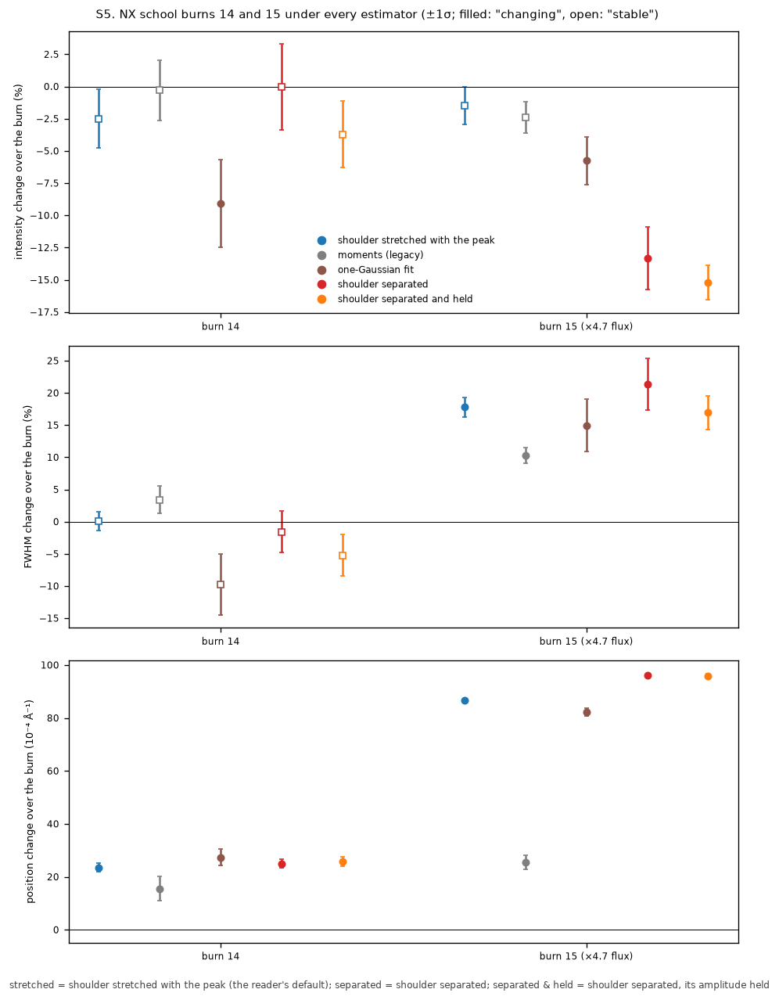

The real check: NX school burns 14 and 15, 21 frames of 10 s on one spot, the second at 4.7 × the flux
(`nx.csv`). Change over the burn ± σ (straight line), and the verdict:

| burn | estimator | intensity | FWHM | position (10⁻⁴ Å⁻¹) | frames' χ²/dof |
|---|---|---|---|---|---|
| 14 | stretched | −2.5 % ± 2.3 stable | +0.1 % ± 1.5 stable | +23.5 changing | 1.04 |
| | moments | −0.3 % ± 2.3 stable | +3.4 % ± 2.2 stable | +15.5 changing | — |
| | fit (one Gaussian) | −9.1 % ± 3.4 changing | −9.8 % ± 4.7 stable | +27.3 changing | 9.57 |
| | **separated** | **−0.0 % ± 3.4 stable** | −1.6 % ± 3.3 stable | +25.0 changing | 1.03 |
| | separated & held | −3.7 % ± 2.6 stable | −5.2 % ± 3.2 stable | +25.8 changing | 1.01 |
| 15 | stretched | **−1.5 % ± 1.5 stable** | +17.8 % ± 1.5 changing | +86.6 changing | 4.24 |
| | moments | −2.4 % ± 1.2 stable | +10.3 % ± 1.2 changing | +25.4 changing | — |
| | fit (one Gaussian) | −5.8 % ± 1.9 changing | +15.0 % ± 4.1 changing | +82.3 changing | 41.3 |
| | **separated** | **−13.3 % ± 2.4 changing** | +21.4 % ± 4.0 changing | +96.0 changing | **2.17** |
| | separated & held | −15.2 % ± 1.3 changing | +16.9 % ± 2.6 changing | +95.8 changing | 2.29 |

**The separated reading's shoulder:** burn 14 −5.9 % ± 3.3 % stable, burn 15 −2.8 % ± 2.8 % stable. B per frame lies
in 0.89–1.11 (14) and 0.96–1.15 (15). The shoulder found has a FWHM of 0.098 and 0.103 Å⁻¹ (σ 0.042,
0.044), 8.5 and 6.9 × the peak's (burn 14: 0.0115 Å⁻¹, burn 15: 0.0150).

**What it shows:**
- **Burn 15 is P44 on real data.** The peak broadens by about 20 % under every estimator that fits it.
  - Stretched reads the intensity as steady.
  - Both splits read a fade of 13–15 %, and the one-Gaussian fit 6 %.
  - Separated describes the frames twice as well as stretched (χ²/dof 2.17 against 4.24).
- **Burn 14 is steady** under every estimator but the one-Gaussian fit, which does not describe the frames
  (χ²/dof 9.6).
- **The shoulder does not change in either burn,** and the free and fixed splits agree within their
  errors. By section 1, that agreement is what a steady shoulder gives.
- **The position drift is about 10 % larger under separated on burn 15** (+96.0 against +86.6). The
  drift per dose of burn 15 over burn 14 (flux ratio 4.68) becomes 0.82 instead of 0.79. That is not a
  change to F76's reading of these two burns.
- **One frame's intensity error** is 3.8 % (burn 14) and 2.0 % (burn 15) under stretched
  (`frame_rel_error`). That is the error the synthetic monitors 1e4 and 6e4 have (section 4).

## 6. The reference's noise (S6)

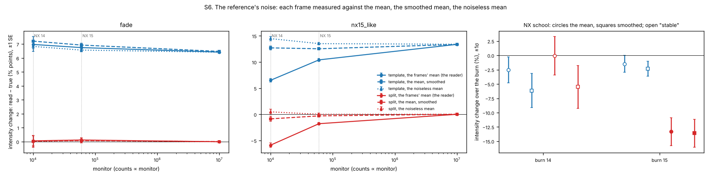

Section 4 shows biases at low counts that high counts do not have. Part R (`--only R`) asks where they
come from. Every frame is fitted against the **reference**, the mean of the 21 frames, and that mean
carries its own counting noise. Each synthetic burn is read three ways:
- against the frames' mean, as the reader does;
- against the mean smoothed by a weighted spline inside the window (χ² ≈ the number of points;
  `smooth_reference`);
- against the noiseless mean.

The table gives the intensity's bias in pp (100 burns per row, straight line through the frames,
`reference_noise.csv`). The mean frame's noise is its median σ as a share of its peak (`mean_frame_noise`):
0.03 %, 0.35 % and 0.85 % at monitors 1e7, 6e4 and 1e4. NX 15's is 0.29 %, NX 14's 0.51 %.

| case, monitor | stretched: mean | smoothed | noiseless | separated: mean | smoothed | noiseless |
|---|---|---|---|---|---|---|
| `fade`, 1e7 | +6.43 | +6.48 | +6.42 | −0.00 | +0.00 | −0.00 |
| `fade`, 6e4 | +6.75 | +6.93 | +6.57 | +0.12 | +0.09 | +0.08 |
| `fade`, 1e4 | +6.98 | +7.22 | +6.84 | +0.06 | +0.04 | +0.02 |
| `nx15_like`, 1e7 | +13.39 | +13.37 | +13.41 | +0.02 | +0.04 | +0.03 |
| `nx15_like`, 6e4 | **+10.42** | +12.54 | +13.53 | **−1.77** | −0.28 | +0.03 |
| `nx15_like`, 1e4 | **+6.52** | +12.71 | +14.48 | **−5.87** | −0.85 | +0.49 |

The standard errors are 0.01–0.02 pp at 1e7, 0.12–0.25 at 6e4 and 0.29–0.50 at 1e4.

**What it shows (synthetic):**
- **When the peak's width changes, the reference's noise pulls the read change down,** and more as the
  counts fall: separated by −1.8 pp at NX 15's noise and −5.9 pp at NX 14's.
  - A noiseless reference reads the truth.
  - A plain fade, where the stretch stays near 1, shows nothing.
- **For stretched the pull hides part of P44:** its +13.5 pp bias reads as +10.4 and +6.5.
- **The smoothed mean removes most of it** (separated −0.28 and −0.85 pp), at no cost at high counts.

**On NX it does not behave as on synthetic burns** (`reference_nx.csv`, the bottom panel). Each burn is
re-read against its smoothed mean frame, through the reader's own trend analysis:

| | stretched: mean | smoothed | separated: mean | smoothed |
|---|---|---|---|---|
| burn 14 | −2.5 % ± 2.3 stable | −6.1 % ± 3.0 stable | −0.0 % ± 3.4 stable | −5.5 % ± 3.8 stable |
| burn 15 | −1.5 % ± 1.5 stable | −2.3 % ± 1.3 stable | −13.3 % ± 2.4 changing | −13.6 % ± 2.5 changing |

The **shift** (smoothed − mean, on the same burn) is what to compare.
- **Synthetic, at 6e4**, close to NX 15's noise: the separated reading's shift is +1.49 ± 1.00 pp per burn and the
  the stretched reading's +2.12 ± 1.49.
  - **NX 15's shifts are −0.27 and −0.82 pp, 1.8 and 2.0 SD below.**
- **NX 14's peak does not broaden,** so the `fade` rows apply: a shift of 0 ± 0.5–1.9 pp.
  - **NX 14's separated shift is −5.5 pp, about 3 SD from it.**

So on NX the smoothing moves the reads down, where on synthetic burns it moves them up. Either the real
mean frames carry less of the noise that matters, or the spline does not suit a real mean frame (it may
round a peak sharper or less Gaussian than the synthetic one), or both. Two burns cannot tell these
apart; hand-off 10 asks for every real burn. **Until then the smoothed reference is not an option to
offer.** The NX numbers of section 5 stand as read.

## 7. The judgment

**P44 is real, it is large, and it changes a verdict on public data.**
- On synthetic burns stretched reads:
  - a fade of 20 % as 13.6 %;
  - a broadening at constant area as a 14 % gain, which it calls "changing" every time;
  - an NX 15-like burn (FWHM +20 %, intensity −13 %) as −0.2 %, which it calls "stable" every time at
    high counts, and in 68 % of the burns at NX 15's counts (sections 1, 3, 4).
- On NX burn 15 it reads −1.5 % ± 1.5 % "stable", while both splits read a fade of 13–15 % "changing"
  and describe the frames twice as well (section 5).

**Separated estimators fix it where their assumption holds, and reduce it where it does not.**
- On a Gaussian shoulder at high counts separated reads every quantity of every case to 0.13 pp, the
  shoulder's own change included, with intervals that are up to 25 % short (pull SD ≤ 1.25).
- On the other shoulder shapes it is 1.4–6 × less biased than stretched (worst +5.7 pp, or +11.7 with
  a second narrow hump), and a broadening there leaks into its shoulder (section 2).
- `separated_held` (B = 1) is as good, and steadier at low counts, while the shoulder is steady. It is badly
  wrong when the shoulder changes. So the two disagreeing is the signal to look at the shoulder.

**Their weak point is the reference's noise at real counts** (sections 4 and 6).
- When the peak's width changes, the noisy mean frame biases every fitted estimator: separated by −2 pp
  at NX 15's counts and −6 pp at NX 14's, with intervals too short.
- A smoothed mean frame removes this on synthetic burns. On the two NX burns it moves the reads the other
  way, so it is not offered until more real burns are read (hand-off 10).

**What NX burns 14 and 15 say.**
- Burn 14 is steady under every estimator that describes its frames.
- Burn 15 fades by 13 % ± 2.4 % (separated; `separated_held` 15 % ± 1.3 %) while the peak broadens by about 20 %.
  Its shoulder is steady (−2.8 % ± 2.8 %; B 0.96–1.15), and the free and fixed splits agree. If the
  synthetic noise transfers to real frames, the fade is nearer 11 %. Either way it is a fade, which the
  stretched misses.
- The drift per dose of burn 15 over 14 moves from 0.79 to 0.82: no change to F76's reading.

**Recommendation.**
1. **Report separated beside stretched for GID burns,** both intensity changes with their verdicts, so
   that a disagreement shows P44. `separated_held` is the check on the shoulder. Both are in `lss_core.burn`
   (`measure_gid(..., estimator='separated')`) for scripts today.
2. **The reader's default stays stretched, and the burn dialog is unchanged.** Changing either is the
   owner's choice, and rule 12 (paused) would ask for this study, its tests and a demonstrator first. The
   first two exist, and the walkthrough is the third.
3. **Real burns decide the rest** (hand-off `docs/handoff_out/10-gid-burn-shoulder.md`, DATA_NEEDS
   row 19). How often does P44 change a real verdict? Do real shoulders change? Is a Gaussian shoulder
   good enough? Does the reference's noise matter at real counts?

**How sure.**
- **High** that stretched is biased whenever the width or the shoulder changes, and in which direction.
  Every synthetic case shows it, at every count, and NX 15 shows it on real data.
- **High** that separated reads a Gaussian shoulder's burns correctly at high counts.
- **Moderate** on the size of the separated reading's read on real burns. It depends on the shoulder's shape (section 2)
  and on the reference's noise (sections 4 and 6), and two public burns cannot pin either down.

## 8. Real GID burns (non-cloud agent)

Hand-off 10's six questions (`docs/handoff_out/10-gid-burn-shoulder.md`, issue #155), answered on the
private GID burns of the owner's PC, 2026-11-27.

### 8a. How one burn becomes a row of numbers

The steps are first explained on the public NX burn 15 (BW2–BW5; the walkthrough, `walkthrough.md`,
explains each in full). Then section 8a′ shows the same chain, burn by burn, for NX 15 and for four
private burns spread over time. The owner allowed these four to be shown in full on 2026-11-27, with no
detector frame (`docs/notes/2026-11-27-four-private-burns-published.md`). Every private burn went
through exactly these steps, by the same code (`exp.burn(scan, estimator=…)`).

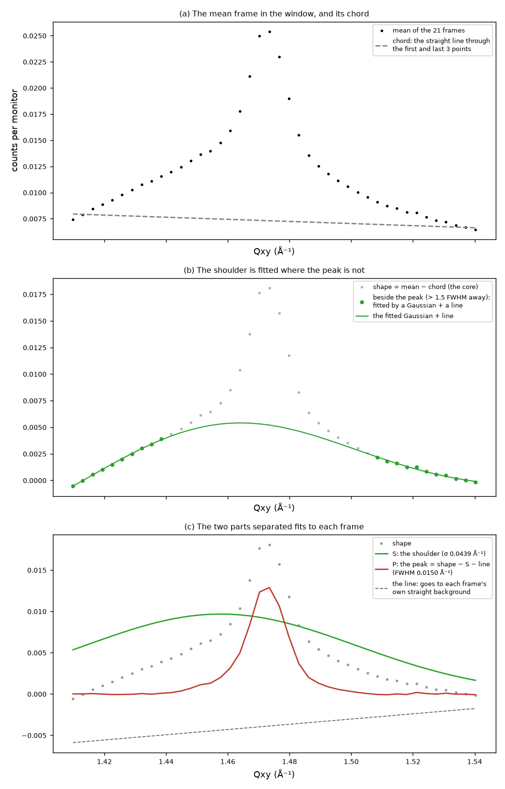

**Step 1, the mean frame and its two parts (BW2).**
- The burn's frames are averaged into one mean line cut.
- Separated fits a broad Gaussian (the **shoulder**) to the parts of it more than 1.5 FWHM from the peak.
  What is left near the centre is the **peak**.
- For each burn the CSV keeps:
  - `shoulder_found`: whether such a Gaussian was found;
  - its size against the peak's (`shoulder_to_peak_area`, `shoulder_to_peak_fwhm`).

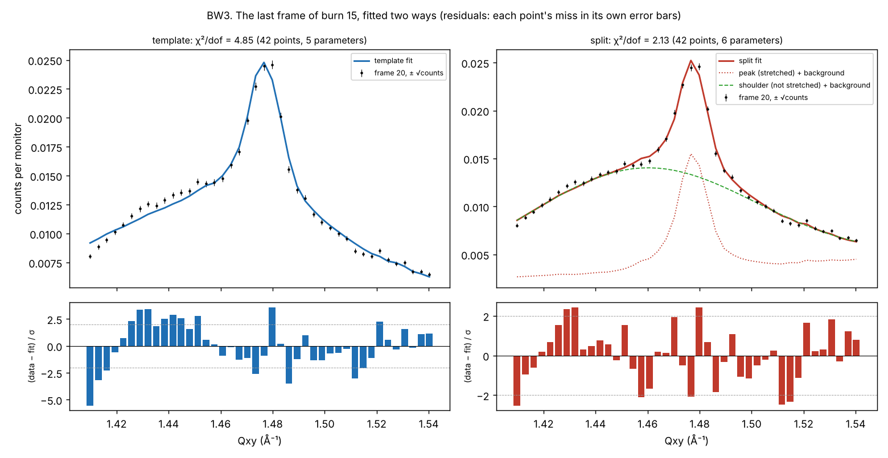

**Step 2, each frame fitted (BW3).**
- **Stretched** stretches the whole mean frame, shoulder and all, to fit each frame.
- **Separated** stretches only the peak and adds the shoulder unstretched, with its own amplitude B
  (`separated_held` keeps B = 1).
- Each fit gives the frame's intensity, position and FWHM with their errors.
- How well the model describes the frame is its **χ²/dof**: the squared misfit in units of the counting
  error, per degree of freedom. About 1 means the model is as good as the counts allow; much above 1, it
  misses something real.
- The CSV keeps the mean over the frames (`frame_chi2_dof`), and B's mean, minimum and maximum.

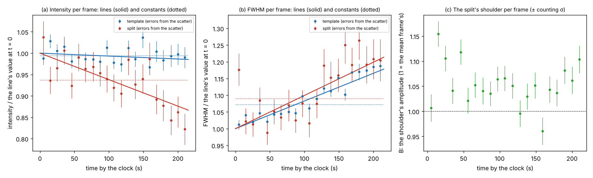

**Step 3, one number per frame, and a line through them (BW4).**
- A straight line is fitted through each quantity against time.
- The **change over the burn** (`change`) is the line's slope × the burn's duration, divided by the line's
  value at the start. So −0.13 means the peak lost 13 % over the burn.
- Its σ comes from the line's parameter errors, scaled by the frames' own scatter.

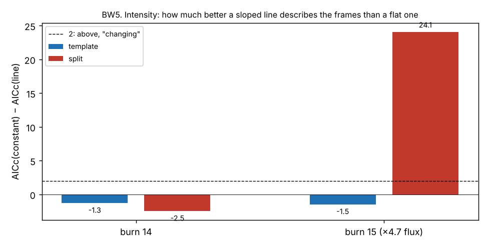

**Step 4, the verdict (BW5).**
- A constant and a line are compared by AICc: a fit's χ² plus a penalty for each parameter, corrected for
  few points.
- If the line beats the constant by more than 2, the verdict is **"changing"**; otherwise **"stable"**.
  That is the reader's rule, unchanged here.
- NX 15 shows the point of the whole study. The stretched reading's intensity is "stable" (−1.5 % ± 1.5 %), while
  the separated reading's is "changing" (−13.3 % ± 2.4 %). The width grows 18 % and the shoulder it stretches
  absorbs the fade.

So each burn gives, per estimator and quantity, one change ± σ, one verdict, and its fit quality. That is
one row of `gid_split.csv`. Everything below is counted from that file.

### 8a′. The whole chain, burn by burn: NX School GID Burn 15 and four private GID burns

**Which four.** Among the well-measured private GID burns that have a shoulder, one burn per run was taken:
the one whose intensity change is nearest its run's median (a typical burn, not a showcase). Of those
runs, the earliest, the latest and the ones nearest a third and two thirds of the time span were kept. The
private runs with GID burns span 0.8 years. **GID Burn Examples 1–4** are 0, 0.5, 0.5 and 0.8 years after
Example 1: the run nearest a third of the span has no eligible burn, so Examples 2 and 3 come from runs
close in time. They are numbered in time order, with no date, run, file or scan. Their labels in
`gid_split.csv` are given, so every number below can be found there. Burns whose first frame is weaker
than the rest are not used (owner, 2026-11-27; section 8b).

**How to read each figure** (one per burn, top to bottom):
- **(a)** The mean frame less its chord (grey), divided into the shoulder (green, a broad Gaussian fitted
  outside the grey core) and the peak (red, the rest).
- **(b)** The first and last raw line cuts, with their counting errors. Any change over the burn is here
  before any model.
- **(c, d)** The last frame fitted by each model, with its residuals below in units of its own error bar.
  A good fit leaves residuals scattered within ±2 with no pattern.
- **(f, g)** Intensity and FWHM per frame under all three readings, each divided by its line's value at
  the start, with the line drawn through it. The legend gives the change over the burn ± σ and the
  verdict.
- **(h)** B per frame: the shoulder's amplitude, as the separated reading fits it. 1 is the mean frame's.
- **(i)** The verdict statistic: how much better a sloped line describes the intensities than a flat one
  (AICc). Above the dashed line at 2: "changing".
- **(j)** The reading in words.

All Qxy are relative to the peak's centre and intensities are a share of the mean frame's peak. So no
private peak position or scale is shown (owner, 2026-11-19).

| burn | when | frames, duration | stretched: intensity (%) | separated: intensity (%) | separated & held: intensity (%) | FWHM (%, stretched) | shoulder (%, separated) | last frame χ²/dof, stretched / separated |
|---|---|---|---|---|---|---|---|---|
| NX School GID Burn 15 | public | 21, 215 s | -1.5 ± 1.5, stable | -13.3 ± 2.4, changing | -15.2 ± 1.3, changing | +17.8 | -2.8 ± 2.8, stable | 4.85 / 2.13 |
| GID Burn Example 1 | G38; 0.0 years after Example 1 | 41, 426 s | -1.3 ± 4.7, stable | -2.0 ± 7.3, stable | -2.3 ± 5.0, stable | -0.5 | +7.5 ± 49.2, stable | 1.34 / 1.36 |
| GID Burn Example 2 | G31; 0.5 years after Example 1 | 41, 422 s | -4.9 ± 1.8, changing | -6.1 ± 2.0, changing | -6.0 ± 1.6, changing | -0.9 | +1.8 ± 4.5, stable | 0.88 / 0.91 |
| GID Burn Example 3 | G40; 0.5 years after Example 1 | 41, 422 s | +5.5 ± 3.0, stable | +3.5 ± 5.0, stable | +5.1 ± 3.1, stable | +1.8 | +6.5 ± 9.5, stable | 1.13 / 1.18 |
| GID Burn Example 4 | G227; 0.8 years after Example 1 | 26, 267 s | +5.0 ± 1.1, changing | +5.0 ± 1.2, changing | +5.0 ± 1.2, changing | +1.4 | +3.9 ± 2.4, stable | 1.17 / 1.20 |

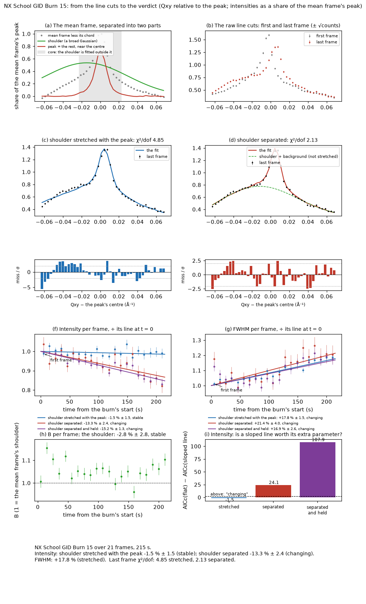

**NX School GID Burn 15**, for comparison: the case the study is about.
- (b) shows the peak broadening: the last cut is lower at the top and wider.
- (c) fits poorly (χ²/dof 4.85, residuals in waves); (d) fits better (2.13).
- (f) splits the readings: stretched holds the intensity flat; separated and separated & held fall 13–15 %.

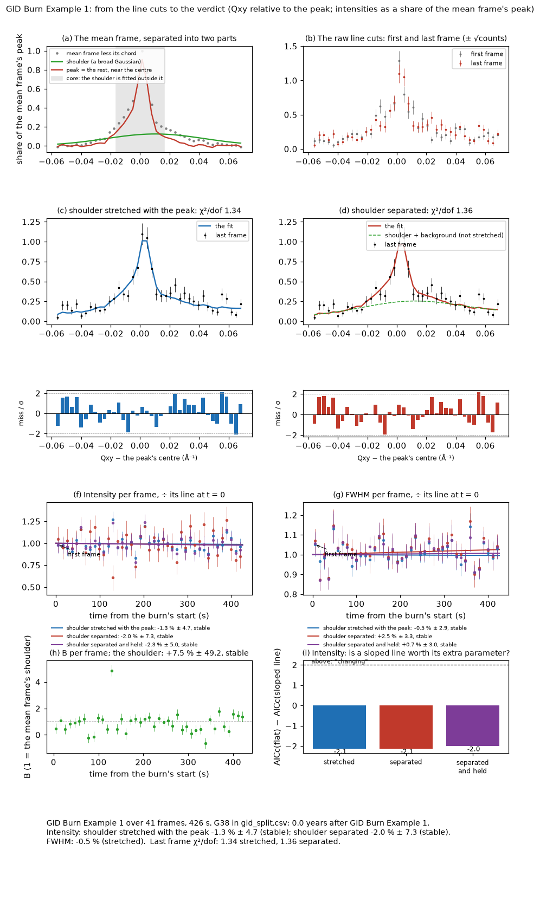

**GID Burn Example 1** (the earliest run).
- A weak peak (one frame's intensity error 7.6 %) on a low shoulder (0.7 × the peak's area).
- Both models fit to χ²/dof ≈ 1.3, and no reading changes.
- B scatters widely (± 49 % on the shoulder's change): with a low shoulder, B is poorly determined. That
  is not a sign of change.

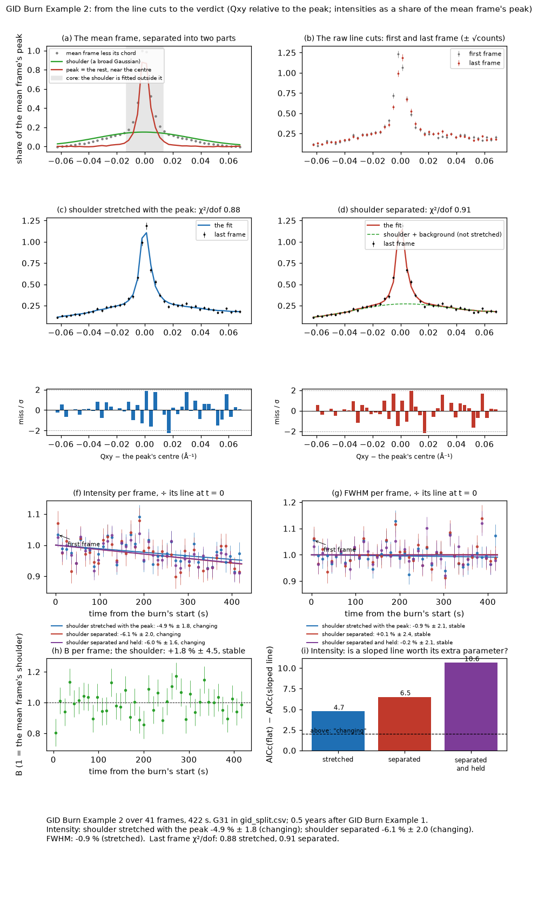

**GID Burn Example 2** (0.5 years later). A peak with a shoulder about its own size (1.2 × its area); one
frame's error is 3.3 %. All three readings agree on a fade of 5–6 % and call it "changing"; the width is
steady (−0.9 %), and so is the shoulder (+1.8 % ± 4.5). Both models fit to counting noise (χ²/dof 0.9).

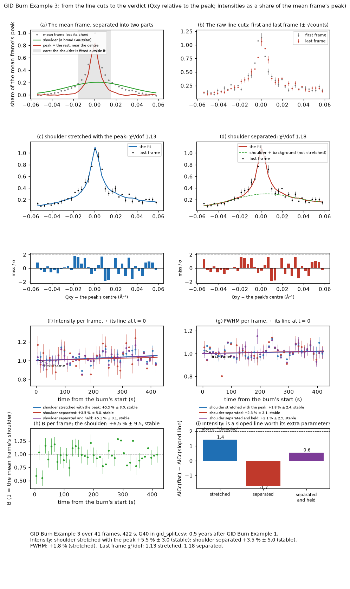

**GID Burn Example 3** (0.5 years later, another run). A slight rise under all three readings (+3.5 to
+5.5 %), each within 2σ and called "stable". The two models fit equally well (χ²/dof 1.13 and 1.18).

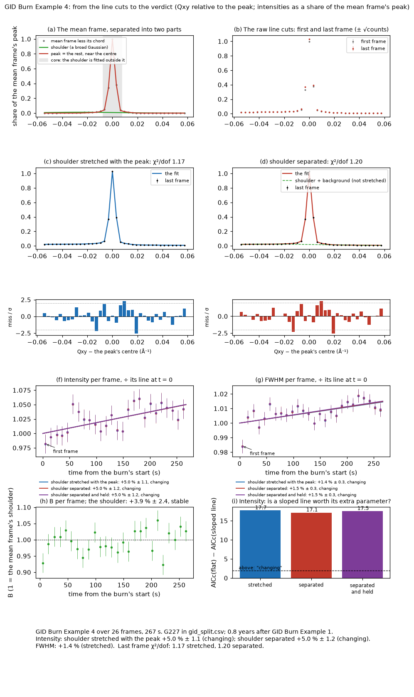

**GID Burn Example 4** (0.8 years later). A strong, sharp peak (one frame's error 0.2 %) with almost no
shoulder (0.12 × its area). The three readings coincide: +5.0 % ± 1.2, "changing", with a steady width.
With so little shoulder there is nothing for the estimators to disagree about.

### 8a″. The first and last frames, fitted four ways

The owner asked for this view (2026-11-27). For each burn, the first frame (left) and the last frame
(right) are fitted by each estimator in turn, top to bottom:
- shoulder stretched with the peak;
- shoulder separated (its two parts drawn: the stretched peak, and the shoulder that is not stretched);
- separated and held;
- the one-Gaussian fit.

Under each fit are its residuals, each point's miss in its own error bar. Both frames of a row share one
intensity scale, so a change between them shows by eye. The right column's titles give the last frame's
intensity and FWHM as multiples of the same estimator's first frame: the change that estimator sees
between these two frames.

**Two frames are not the burn.** A burn's change comes from a line through all its frames (8a, step 3).
Two single frames carry each frame's own noise. So read these figures for *how* each estimator treats the
same data, not for the burn's change.

| burn | shoulder stretched | shoulder separated | separated and held | one-Gaussian fit |
|---|---|---|---|---|
| NX School GID Burn 15 | 1.00 (FWHM 1.17) | 0.79 (FWHM 1.02) | 0.83 (FWHM 1.04) | 0.99 (FWHM 1.22) |
| GID Burn Example 1 | 0.98 (FWHM 0.98) | 0.81 (FWHM 0.97) | 0.95 (FWHM 0.98) | 0.70 (FWHM 0.57) |
| GID Burn Example 2 | 0.94 (FWHM 1.02) | 0.85 (FWHM 0.93) | 0.89 (FWHM 0.95) | 0.92 (FWHM 1.02) |
| GID Burn Example 3 | 0.96 (FWHM 0.97) | 0.82 (FWHM 0.96) | 0.93 (FWHM 1.01) | 1.08 (FWHM 1.31) |
| GID Burn Example 4 | 1.06 (FWHM 1.03) | 1.06 (FWHM 1.03) | 1.06 (FWHM 1.03) | 1.06 (FWHM 1.03) |

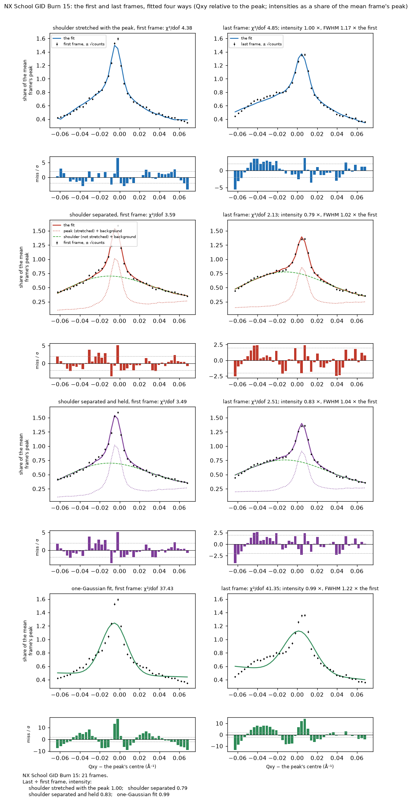

**NX School GID Burn 15.** This is the clearest picture of P44.
- The peak widens: FWHM 1.17 × under stretched.
- Stretched holds the intensity at 1.00, because the stretched shoulder grows with the peak and makes up
  for the fade.
- Separated (0.79) and separated & held (0.83) keep the shoulder unstretched and see the peak fade.
- The one-Gaussian fit misses the shape entirely (χ²/dof about 40): one Gaussian can't be both the sharp
  peak and the broad hump.

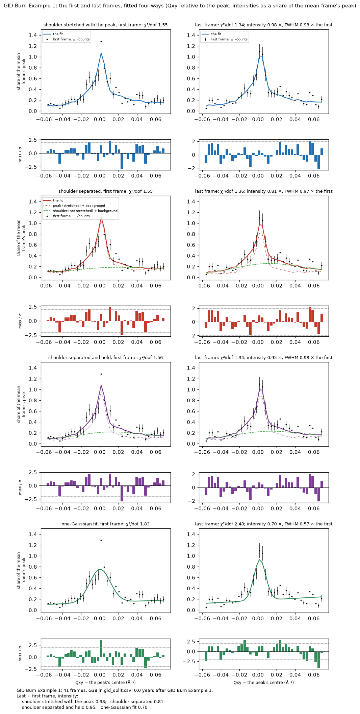

**GID Burn Example 1.**
- The first and last frames look alike, and stretched sees 0.98.
- Separated sees 0.81 between these two frames. With a weak peak, one frame's error is 7.6 %; the line
  through all 41 frames gives −2 % ± 7 %.
- The one-Gaussian fit's FWHM halves between the two frames (0.57 ×): on a weak peak it is unstable.

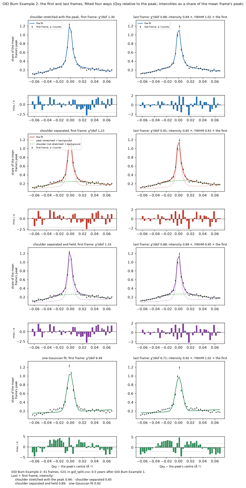

**GID Burn Example 2.** Every estimator sees the last frame weaker (0.85–0.94), in line with the 5–6 % fade
over the whole burn. Separated sees the most (0.85) between these two frames.

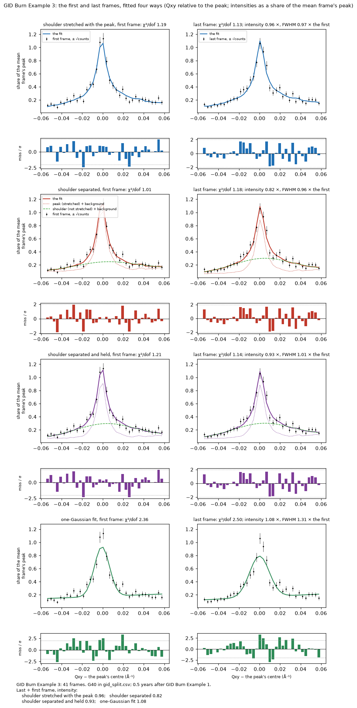

**GID Burn Example 3.** As Example 1: stretched sees 0.96, separated 0.82 between these two frames. Over all
41 frames both read a slight rise within 2σ. The one-Gaussian fit reads the width 1.31 × wider.

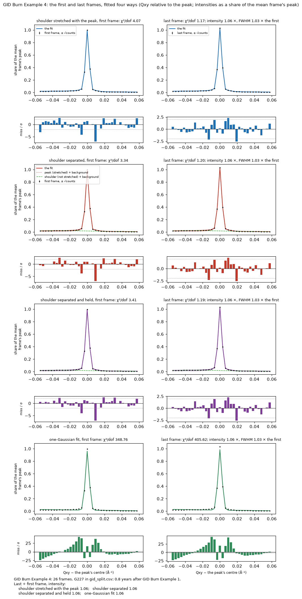

**GID Burn Example 4.** All four estimators see the same 1.06: a sharp peak with almost no shoulder is
read alike by every method, even one Gaussian.

### 8b. Which burns were used

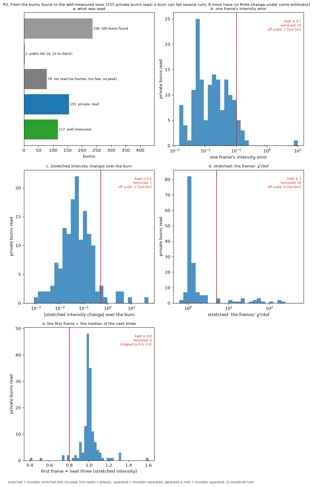

**R3, how to read it.**
- Panel a is the funnel.
- Panels b–e are the four cut quantities for the 155 private burns read (b–d on log axes). Each has its
  threshold in red and the number it removes.
- Most burns sit far inside each threshold. The removed ones are a separate tail, not the edge of the
  bulk:
  - (b) one frame's error above 10 %: weak peaks;
  - (c) intensity changes beyond ±50 %: the peak appears or vanishes during the "burn", so a relative change
    means nothing;
  - (d) stretched χ²/dof above 5: the frames aren't described by a stretched mean frame at all;
  - (e) a first frame weaker than 0.8 of the next three (owner, 2026-11-27: such burns are left out of
    the analysis). 6 of the 155 burns read; 2 of them would otherwise be well measured.
- 8 more burns have no finite change under some estimator.
- A burn can fail several cuts. 38 fail at least one.

**The data.**
- The tool's finder (`find_gid_burns`: an `ascan ih` that does not move, Det_Th above 2°) found 236 GID
  burns in 12 SPEC files.
- Two are the public NX burns 14 and 15. The runner reproduces section 5's numbers for them exactly
  (stretched −1.5 % ± 1.5 % stable, separated −13.3 % ± 2.4 % changing, separated & held −15.2 % ± 1.3 % changing).
- Of the 234 private burns, 79 were not read: 73 have no Pilatus frames, 4 have too few frames with
  images, and 2 have no peak 5σ above the background. Each is in the private key with its error.
- 155 private burns in 11 files were read under all three estimators. Their per-burn summary is
  `docs/studies/xr_burns/gid_split.csv` (labels G01…; no file, scan, Qxy, frame or image).
- **Well measured: 117 of the 155.** These have:
  - a finite intensity change under all three estimators;
  - an error on one frame's intensity of at most 10 %;
  - a stretched intensity change within ±50 % over the burn. A larger one means the peak comes or goes:
    these runs hold a few burns of +200 % to −800 %;
  - stretched frames fitted to χ²/dof ≤ 5;
  - a first frame not weaker than 0.8 × the median of the next three (owner, 2026-11-27).

  The cut is `well_measured` in the tool. The numbers below are for these 117 unless marked.
- **One file holds 76 of the 117.** Each question was also run without it (41 burns in 10 files). Where its
  answer differs, it is given.
- The well-measured burns have a median of 21 frames over 321 s.
  - One frame's intensity error has a median of 1.6 % (interquartile range 0.6–3.8 %).
  - The mean frame's noise has a median of 0.46 % of its peak (0.27–0.86 %). That lies between the synthetic
    monitors 6e4 and 1e4 (section 4) and near NX 14 (0.51 %).

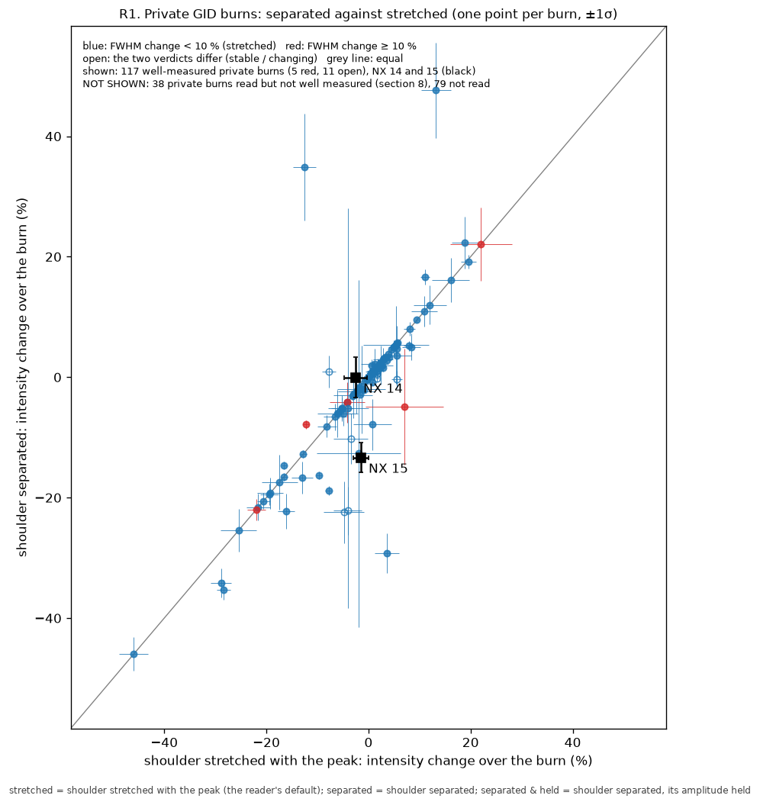

**1. How often does P44 change a real verdict?** Figure R1 shows the separated reading's intensity change against the
the stretched reading's, one point per burn.
- **Shoulders (#187).** The separated reading keeps a shoulder on 53 of the 117 burns. On 40 more, the fitted
  shoulder's height is not determined (± more than 50 %), so the guard refuses it. 24 have no shoulder at all.
  On those 64 the two readings are identical by construction.
- **The intensity verdicts differ on 11 of the 117 burns (9 %).** On 3, stretched says stable and
  separated says changing; on 8, the other way round.
- **The changes differ by more than 2 × the larger σ on 20 burns,** with the separated reading's σ widened by 25 % as the
  hand-off suggests. Counting either kind of disagreement, **25 of 117 (21 %)** disagree. Without the large
  file the share is about the same: 8 of 41 (20 %).
- The FWHM verdicts differ on 8, and the FWHM changes beyond 2σ on 9.
- **On real burns the disagreement doesn't come from P44's own mechanism.** P44's mechanism is a change of
  width that stretched carries into the intensity. But real widths are steady:
  - the median FWHM change over a burn is 1.4 %;
  - only 5 of the 117 burns broaden or narrow by 10 % or more;
  - on none of those 5 do the verdicts differ.

  The disagreements come from the shoulder instead. Among the 25 burns where the estimators disagree, the
  separated reading finds the shoulder changing on 19 (76 %). Among the 92 where they agree, it does on 13 (14 %).
- On the 53 burns with a shoulder, separated − stretched has a median of −0.8 pp, with a scatter (MAD) of
  1.7 pp. Separated shows no large overall bias: it differs burn by burn.
- NX 15 (a fade read as stable while the peak broadens by 18 %) is the clearest case of P44 among these
  burns. No private burn shows it as strongly.

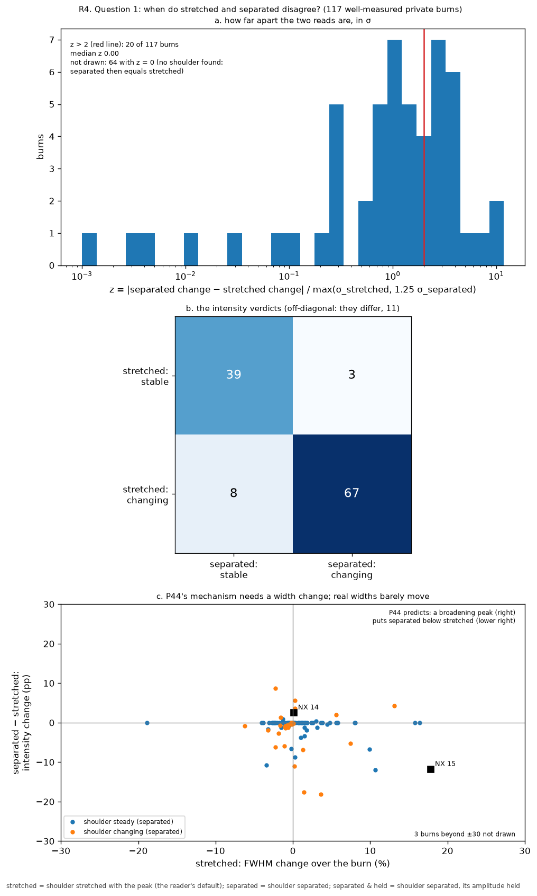

**R4, how the disagreement is measured.**
- **Panel a: the statistic.** For each burn, z is the gap between the two changes in units of the larger
  error:

      z = |change_split − change_template| / max(σ_stretched, 1.25 × σ_separated)

  - The separated reading's σ is widened by 25 %, because the synthetic study found its intervals that much too short
    (section 3).
  - z ≈ 1 is what two reads of the same truth give by chance; z > 2 happens by chance in only a few % of
    burns.
  - Here 20 of 117 burns pass 2, far more than chance: on about one burn in six the two estimators
    disagree for a reason.
  - The 64 burns at z = 0 have no shoulder kept (none found, or refused by #187's guard), so separated is
    stretched.
- **Panel b: the verdicts, cross-tabulated.** The diagonal (39 + 67) is where the verdicts agree; the 11
  off it are where they differ.
- **Panel c: the test of P44's mechanism.**
  - If the disagreement came from width changes, the points would fall along a line from upper left to lower
    right, and NX 15 lies on it.
  - They don't. The private burns cluster at a width change of 0 ± 5 %, and the spread in y is there anyway.
  - Orange marks a burn whose shoulder separated reads as changing. Orange points make up 19 of the 25
    burns that disagree, but only 13 of the 92 that agree (the counts in question 1). That difference, not
    any one point, is the evidence that the shoulder drives the disagreement.

**2. Do real shoulders change under the beam?** Yes, in a sizeable minority of burns.
- Separated keeps a shoulder on 53 of the 117 burns. #187's guard refused 40 more whose height the points
  did not determine; their B meant nothing, so they are left out here (before the guard, 94 shoulders).
- On 32 of the 53, separated calls the shoulder's own change "changing". The median change is +3.9 %, and
  the median size of the change, sign ignored, is 5.9 %.
- B per frame has a median mean of 0.99 and a median range (max − min) of 0.20 over a burn.
- Separated and separated & held disagree on the intensity by more than their combined σ on 24 burns.
- **All three signs together, the hand-off's test of a believable shoulder change, hold on 15 of 53 burns
  (28 %):** the shoulder called changing, B moving the same way, and the two readings disagreeing. Without
  the large file it is 8 of 24.
- The synthetic study warns that a broadening peak leaks into B when the shoulder is not a Gaussian
  (section 2). That cannot explain these: their widths are steady.
- **So `separated_held` (B = 1) is not safe on real burns:** about one shoulder in four changes.

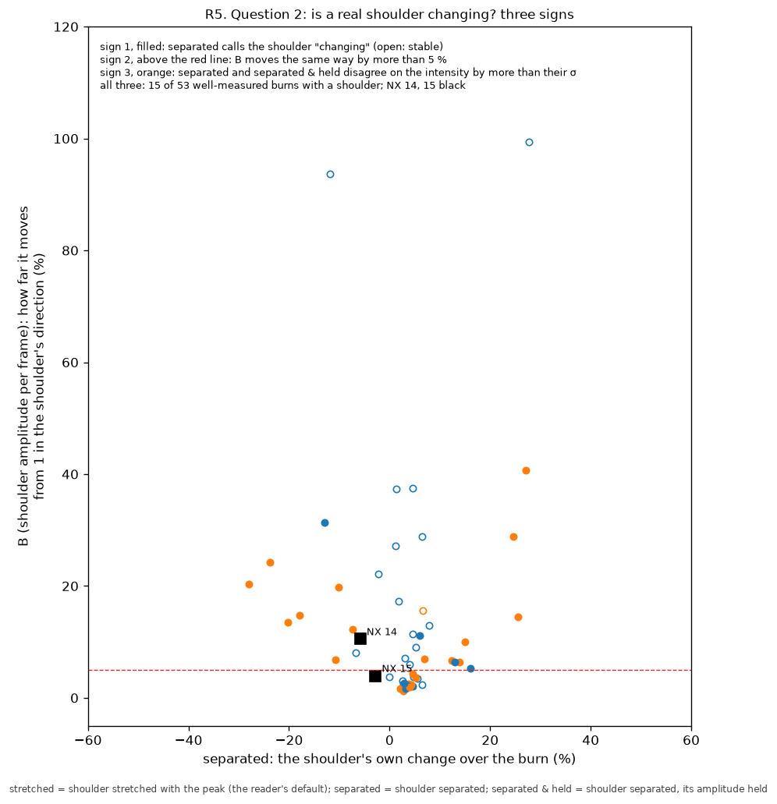

**R5, the three signs.** Each point is a burn with a shoulder.
- **Across:** the shoulder's own change over the burn, as separated reads it. It is the same kind of
  change as the intensity's: slope × duration over the start.
- **Up:** how far B moves from 1 in that direction over the burn. If the shoulder fades, how far B drops
  below 1; if it grows, how far B rises above 1.
- **Filled:** the separated reading's own verdict on the shoulder is "changing".
- **Orange:** separated and separated & held read the intensity differently by more than their combined σ. That is
  what a changing shoulder does: forcing B = 1 puts its change into the peak.
- A real shoulder change shows all three: filled, orange, and above the red line. Any one alone can be an
  accident. 15 of the 53 burns with a shoulder show all three.
- NX 14 and 15 sit near the bottom, as section 5 found: steady shoulders.

**3. Is a Gaussian a good enough shoulder?** At these counts the frames can't tell.
- On the 53 burns with a shoulder, the frames' χ²/dof has a median of 1.11 under stretched and 1.08
  under separated. Both describe the frames to counting noise.
- The separated reading's χ²/dof is the lower one on 38 burns, but the median ratio is 0.99. It is more than 10 %
  lower on 2 burns and more than 10 % higher on 5.
- Only 4 burns have a stretched χ²/dof above 2, and on none of them is separated lower. NX 15, at higher
  counts, shows the separated reading's gain: 2.17 against 4.24.
- **Separated is never much worse, so a Gaussian shoulder is not the weak point at real counts. It is not
  shown to be right either:** a shoulder of another shape would fit these frames as well.
- Shape against the synthetic shoulders:
  - shoulder ÷ peak area: median 2.0 (interquartile range 1.2–4.0);
  - shoulder ÷ peak FWHM: median 4.6 (3.6–7.3); NX 14 and 15 have 8.5 and 6.9.

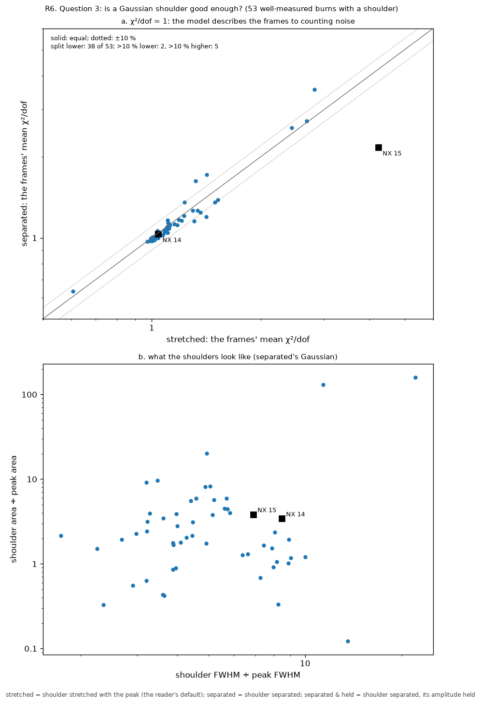

**R6, how to read it.**
- **Panel a:** each burn's mean frame χ²/dof, separated against stretched.
  - On the solid line the two describe the frames equally well; the dotted lines are ±10 %.
  - The private burns lie on the line and near 1: both models are as good as the counts allow. So the
    counts can't say whether the extra shoulder is a Gaussian, a Lorentzian, or something else.
  - NX 15, at higher counts, is far below the line. There stretched misses something and separated
    finds it.
- **Panel b:** what the fitted shoulders look like, as size against the peak.
  - They are 1.7–22 times wider than the peak (median 4.6). Their area ranges from a tenth of the peak's to
    160 times it. Before #187's guard the widest went to 40 times, all of them undetermined fits.
  - The two kept above 100 × the peak's area are well determined: small peaks on large real humps. NX 14
    and 15 are typical.

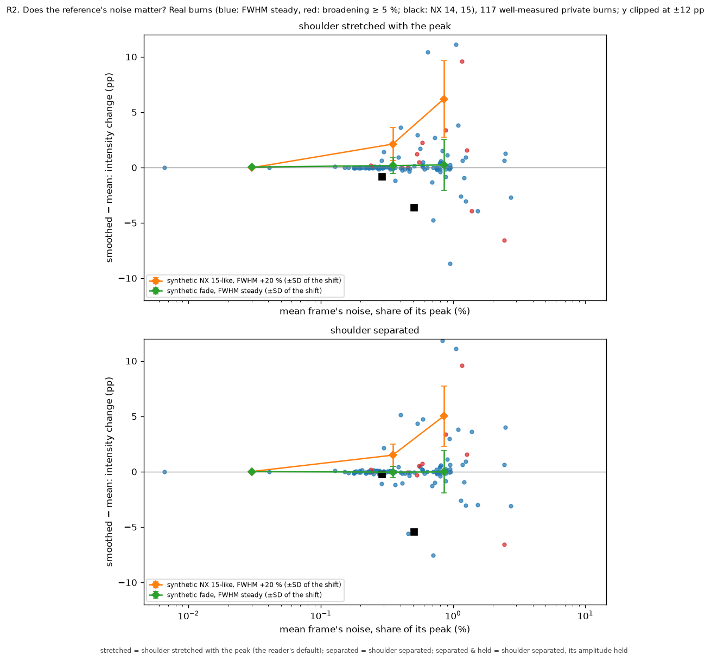

**4. Does the reference's noise matter at real counts?** For burns whose width is steady, no.
- Figure R2 shows the intensity change re-read against the smoothed mean frame, minus the reader's, against
  the mean frame's noise. The synthetic expectation is drawn over it.
- **How to read R2.**
  - Every frame is fitted against the mean frame, so the mean frame's own noise is in every fit (section 6).
  - Smoothing the mean frame removes that noise. If the noise biased the reader's numbers, the shift
    (smoothed − reader) would grow with the noise, along the orange synthetic line.
  - If it doesn't matter, the points scatter around 0 at every noise level, like the green line (a burn
    whose width doesn't change).
  - The x axis is the mean frame's noise as a share of its peak: the median σ of the mean frame in the
    fitted window, divided by the peak's height.
- **Burns with a steady FWHM** (a change below 5 %):
  - below 1 % noise, the shift has a median within ±0.06 pp under both estimators, with a scatter (MAD) of
    at most 0.6 pp;
  - above 1 % noise (13 burns under each), the median is +0.6 to +0.9 pp, with a scatter of about 5 pp;
  - the synthetic steady fade expects 0 ± 0.5 at 0.35 % noise and 0 ± 1.9 at 0.85 %.
- **The shift doesn't grow with the noise:** the rank correlation is 0.10 (stretched) and 0.14 (separated).
- **Burns that broaden by 5 % or more, the case the synthetic study flags,** are only 12 of the 117, 3 to 5
  per noise bin. Their medians under separated are −0.05 pp at 0.2–0.5 % noise and +0.7 pp at 0.5–1 %. The
  synthetic NX 15-like burns predict +1.5 ± 1.0 and +5.0 ± 2.7 pp, but they broaden by 20 %, and these
  burns mostly broaden by 5–10 %.
- NX 14 and 15 remain the two burns well below the synthetic rows.
- **Of the hand-off's three readings, the first fits the steady burns:** the shifts scatter around zero
  whatever the noise. Too few real burns broaden to decide between the other two. So the smoothed reference
  doesn't become a candidate option from these data.

**5. Does separated change F76's dose-or-time answer?**
- Series here means burns of one file at one Det_Th, each less than 3 h after the previous one, with a flux
  span of ×1.5 or more. There are **14 such series** of 2–6 burns, spanning ×2.0–×96 in flux
  (`docs/studies/xr_burns/gid_split_series.csv`).
- They were read with `lss_core.reciprocity.dose_or_time` on the intensity, as the reader does.
- **With strip scatter ρ = 0 (the reader's default), separated changes the verdict of 4 of the 14 series;
  with ρ = 0.5, of 3.** Burns with a weak first frame are left out of the series too (40 burns in all).
  - Stretched at ρ = 0: no change 4, opposite signs 3, neither 3, dose 2, time 1, cannot tell 1.
  - Separated at ρ = 0: no change 5, opposite signs 3, dose 3, time 1, neither 1, cannot tell 1.
- The changes are all among undecided classes: "neither" becomes "dose" (β 0.45 → 0.68), "no change" or
  "opposite signs", and one "opposite signs" becomes "neither".
- Where both call it "dose", β moves from 1.18 to 1.04 (GS08) or stays at 0.78 (GS13).
- On NX, the drift-per-dose ratio moves from 0.79 to 0.82 (section 5).
- **So separated changes F76's answer in a minority of series.** Few series are decided either way, and these
  are 2–6 burns each.

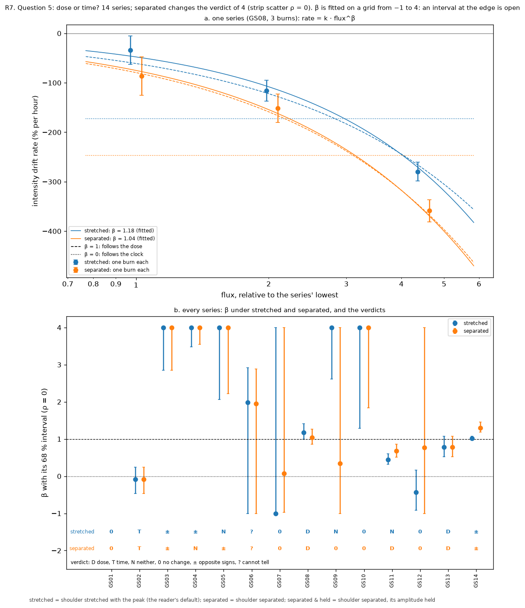

**R7, how the dose-or-time test works.**
- **Panel a: one series (GS08), three burns of one peak at fluxes ×1, ×2 and ×4.5.**
  - Each point is one burn's drift rate: the slope of ln(intensity) against time, in % per hour, with its σ
    (`gid_split_series_rates.csv`).
  - The test fits rate = k · flux^β:
    - β = 1 (dashed) means the damage follows the dose, flux × time: twice the flux, twice the rate;
    - β = 0 (dotted, flat) means the rate is the same at every flux: the sample changes by itself, on the
      clock.
  - Here both estimators give β near 1: 1.18 under stretched and 1.04 under separated. The dashed line
    runs through the points and the flat line misses them, so the verdict is **dose** under both.
  - The separated reading's rates are lower (a faster loss) on all three burns. The cause isn't shown here.
- **Panel b: β for every series with its 68 % interval, and the verdict letters under each.**
  - An interval reaching the grid's edge (−1 or 4) is open: the burns can't bound β there.
  - The verdict comes from comparing the fit at β = 1 and at β = 0 with the best β (`lss_core.reciprocity`):
    - **D** (dose): β = 1 fits and β = 0 doesn't;
    - **T** (time): the reverse;
    - **N** (neither): both fail;
    - **?** (cannot tell): both fit;
    - **0** (no change): no rate differs from zero;
    - **±** (opposite signs): the rates change sign between burns, which neither model allows.
  - Separated changes the letter on 4 series:
    - GS04: ± → N;
    - GS05: N → ±;
    - GS09: N → 0;
    - GS11: N → D.

    None of them turns a decided dose into a decided time or back.

**6. Is there a burn with an independent before-and-after measurement?** **No: in these data no burned
spot is measured before and after** (issue #173, 2026-11-27).
- **The candidates.** Each burn was matched with the GID series of the same file that covers its Det_Th
  and ended at most 2 h before it, and with the one that started at most 2 h after it ended. 29 burns have
  both, 18 of them well measured (burns with a weak first frame left out). (The earlier count of 47 used a looser match: any series in the 2 h
  windows, not the nearest one, and timed from the burn's start.)
- **The spot.** The comparison needs the GID scans to look at the spot that was burned. But the sample's
  horizontal position (`Sample_X`) differs between the burn and both scans in all 29 cases. Each burn was
  done on a fresh spot, 1–8 mm (median 4 mm) from the nearest scanned spot. The before and after scans
  are usually on different spots from each other too (median 14 mm apart; only 4 pairs share a spot).
- **So the scans measure other spots,** and their change says nothing about what the burn did to its own
  spot. That is the usual practice (a fresh strip for every exposure), and it is why these data can't
  settle the size of the separated reading's fade.
- **What would settle it:** a GID scan of the burned spot itself, just before and just after the burn,
  with the sample not moved and the absorber noted. One such burn per sample kind would turn "separated
  reads −13 %" into a measurement. This is now DATA_NEEDS row 22, for a future beamtime.
- Generators (private): `sample_data/private/burn_shoulder/q6_candidates.py` and `q6_positions.py`.

**The judgment on real data.**
- **P44's verdict change is real but less common on private burns than on NX 15.** The intensity verdicts
  differ on about 1 burn in 10, and the two estimators disagree in some way on 1 in 5.
- **The driver on these burns is the shoulder, not the width.** Real widths are steady. Of the shoulders
  the points determine (53 of 117 burns), about one in four changes. So separated with B free is the estimator to report beside the
  stretched, and `separated_held` is only a check.
- **At real counts the frames can't choose a shoulder shape,** and **the reference's noise doesn't bias
  steady burns.** Neither is a reason to hold separated back.
- **Separated changes F76's verdict in 3–4 of 14 series,** all among undecided ones.
- **How sure:**
  - **moderate** on the counts. 117 burns, but 76 from one file; the share of disagreements is the same
    without it. Question 2 rests on 53 shoulders after #187's guard; the 50 % height-error limit is an
    assumption.
  - **low** on question 4 for broadening burns: there are only 12.
  - **open** on question 6: no burned spot is measured before and after in these data (DATA_NEEDS row 22).
- **Recommendation unchanged** (section 7): report separated beside stretched, and leave the default
  to the owner (rule 12 paused; issue #143).

The private figures and generators are under `sample_data/private/burn_shoulder/`:
- `run_real.py` (the runner over every file);
- `analyse_final.py` (questions 1–4, the private `numbers.json`);
- `q5_q6.py`;
- frame-by-frame curves of single private burns, if wanted, are made there and never published (owner,
  2026-11-25).

## How to regenerate

    python tests/tools/burn_shoulder_study.py --out docs/studies/burn_shoulder               # S1-S5, about 90 min (4 CPUs)
    python tests/tools/burn_shoulder_study.py --out docs/studies/burn_shoulder --only R      # S6, about 10 min
    python tests/tools/burn_shoulder_study.py --out DIR --replicates 30                      # a quick look, about 9 min
    python tests/tools/burn_shoulder_study.py --out DIR --only S5                            # NX only, a minute
    python tests/tools/burn_shoulder_study.py --out docs/studies/burn_shoulder --only G      # R1-R7 from the xr_burns gid_split CSVs, seconds
    python tests/tools/burn_shoulder_study.py --out docs/studies/burn_shoulder --only redraw # S1-S6 from the committed CSVs, seconds
    python tests/tools/burn_shoulder_walkthrough.py --out docs/studies/burn_shoulder/chain --chain sample_data/NX_school/2026sep/20260923 15 "NX School GID Burn 15"   # BC_NX_School_GID_Burn_15
    # BC_/FL_GID_Burn_Example_1-4: only on the owner's PC, sample_data/private/burn_shoulder/run_four.py and
    # run_four_fl.py (pick_four.py chooses them)

Options: `--parts A` or `B`, `--cases`, `--shapes`, `--core` (the separated reading's core half-width in FWHM, 1.5:
the shoulder is fitted beyond it), `--workers`. The Tools menu has the variations (`docs/TOOLS.md`).
With 30 replicates the biases hold to about 0.05 pp at monitor 1e7; the coverages are good to about ±5 %.
Tests: `tests/test_burn_split.py` (the estimators), `tests/test_burn_shoulder_study.py` (the tool, and
the NX numbers of section 5, slow).
