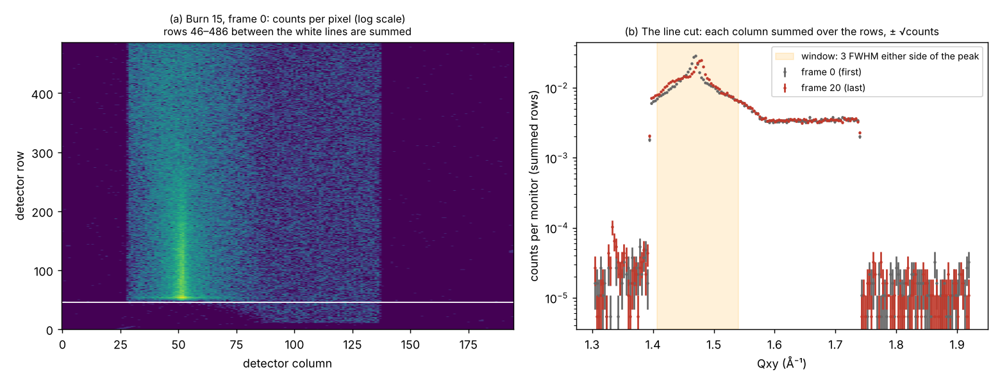
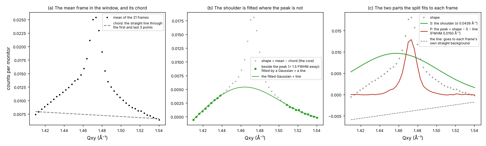
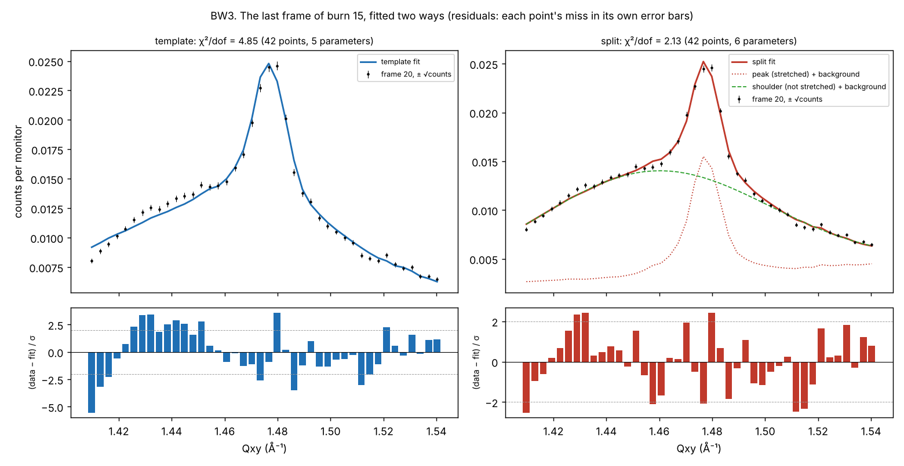
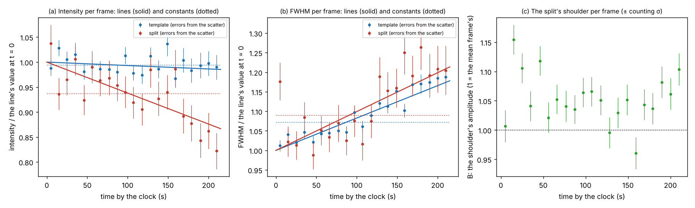
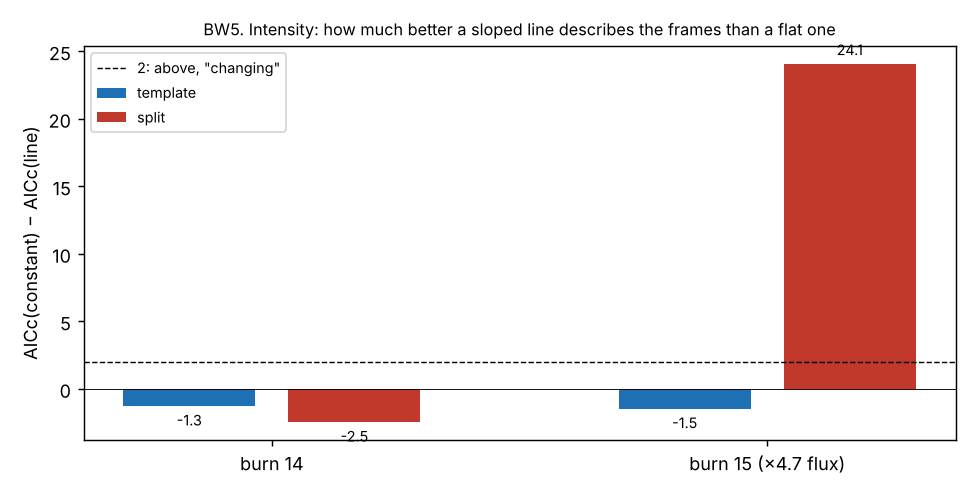
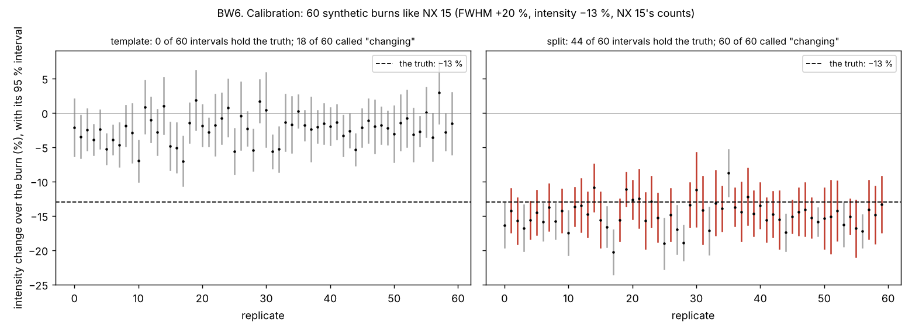

# Walkthrough: a GID burn from the raw frames to the verdict, with the shoulder split off (P44)

Tools man, 2026-11-27, for the owner's standing order (AGENTS.md rule 13): the whole chain, with the fits
and the statistics explained. Public data: NX school burn 15 (and burn 14 for the verdicts), and synthetic
burns with a known truth. Every figure and number comes from:

    python tests/tools/burn_shoulder_walkthrough.py --out docs/studies/burn_shoulder/walkthrough    # about 1 min

The numbers are in `walkthrough/numbers.json`. The full study, with known truth, is `summary.md`.
**Measured** throughout.

## The question, in one paragraph

A burn test measures the same spot 21 times in a row and asks whether the beam changes it. In a GID frame
the peak is sharp and sits on a broad hump, the **shoulder**. The reader measures each frame against the
average of all the frames (the **template**): it stretches and slides the average until it matches the
frame, and reads the intensity from how much it had to scale it. If the peak gets wider during the burn, the
stretch also widens the hump, and the reader counts the hump's extra width as extra intensity. So a peak
that fades *and* broadens can look steady. The **split** estimators separate the hump from the peak first,
and stretch only the peak.

## Step 1. The raw data (figure BW1)

- **(a) One frame as it comes in:** burn 15, frame 0. Colours are counts per pixel, on a log scale.
  - **The bright streak** near column 52 is the GID rod.
  - **The rows summed** are 46–486, between the white lines. That is where the mean frame's signal is
    (Q-BURN-6); the shadow below the horizon is left out.
- **(b) The line cut:** each column summed over those rows, against Qxy.
  - **The error bars** are √counts, divided by the monitor.
  - **The peak** is at 1.47 Å⁻¹, on the hump.
  - **The lit columns** run from 1.39 to 1.74. Outside them the pinhole's shadow is dark.
- **The window:** 1.407–1.540 Å⁻¹, 3 FWHM either side of the mean frame's peak, 42 points.
  - The tallest column of frame 0 holds 5 300 counts, so one point's counting error is 1.4 %.
  - The whole peak holds many such columns.

## Step 2. Splitting the average frame into a shoulder and a peak (figure BW2)

- **(a) The average of the 21 frames,** with its chord: the straight line through the first and last three
  points. That line was the legacy burn test's background.
- **(b) The shape is the average less the chord.** The points more than 1.5 FWHM from the peak (21 of the
  42, green) hold only the shoulder. A Gaussian plus a straight line is fitted to them alone
  (`burn.split_shoulder`).
- **(c) The two parts the split fits to every frame:**
  - **S**, the shoulder: the fitted Gaussian;
  - **P**, the peak: the shape less S and the line.
  - **The line** goes to each frame's own straight background.

| number | value | in words |
|---|---|---|
| shoulder centre, σ | 1.4577, 0.0439 Å⁻¹ | a hump about 7 × as wide as the peak (FWHM 0.103) |
| peak FWHM, centroid | 0.0150, 1.4722 Å⁻¹ | the peak alone |
| the whole shape's FWHM (what the template stretches) | 0.0207 Å⁻¹ | the peak plus the hump under it |

**Two things to know:**
- **The hump and the line trade off.** S's area is 1.44 × the shape's, because the fitted line is negative.
  Only S + line is fixed by the points beside the peak. The line goes to each frame's background, so the
  trade does not touch the peak.
- **The average frame's peak is wider than any one frame's.** The peak moves 0.0096 Å⁻¹ during burn 15,
  about two thirds of its width (step 4). So the average is smeared, and every frame's stretch w comes
  out below 1.

## Step 3. One frame, fitted two ways (figure BW3)

**The two models**, on the last frame of burn 15 (the most changed):
- **template:** A × the whole shape (stretched by w, slid by δ) + a line. 5 parameters.
- **split:** A × P (stretched, slid) + B × S (not stretched) + a line. 6 parameters.

| | template | split |
|---|---|---|
| **χ²/dof** | **4.85** | **2.13** |
| worst residual | 5.5 σ | 2.5 σ |
| points beyond ±2σ (of 42; honest errors give about 2) | 16 | 8 |
| mean χ²/dof over the 21 frames | 4.24 | 2.17 |

**Reading the residuals** (lower panels: each point's miss in its own error bars):
- **Template:**
  - a run of misses of +2 to +3.5σ from 1.42 to 1.45, and −5.5σ at the window's edge;
  - that is a pattern, not noise: the stretched hump is wider than the frame's hump. The hump did not widen
    with the peak.
- **Split:**
  - no long runs;
  - but χ²/dof is still 2.1, so something remains: the peak's own shape may change, or the hump is not quite
    a Gaussian (the study's section 2 measures what that costs).

**χ², ELI5:** each miss divided by its error bar, squared, added up; χ²/dof divides by the number of points
less the number of parameters. An honest model with honest errors gives about 1. 4.85 means the template's
misses are about 2.2 error bars typical, so it does not describe this frame.

## Step 4. One number per frame (figure BW4)

Each frame's fit gives one intensity (A·w × the peak's area) and one FWHM (w × the peak's FWHM). The panels
show them relative to the fitted line's value at t = 0.

| burn 15, change over the burn | template | split |
|---|---|---|
| **intensity** | **−1.5 % ± 1.5 %** | **−13.3 % ± 2.4 %** |
| FWHM | +17.8 % ± 1.5 % | +21.4 % ± 4.0 % |
| the shoulder (split's B × S's area) | — | −2.8 % ± 2.8 % |

- **(a) The intensity:**
  - the template's points lie flat;
  - the split's fall along their line.
- **(b) The FWHM:** both grow, about alike.
- **(c) The shoulder's amplitude B,** per frame:
  - it lies between 0.96 and 1.15 and has no trend;
  - it averages about 1.05, rather than exactly 1. The broadened peak's wings may be taken up by the shoulder
    in part.

**"Errors from the scatter", ELI5:**
- The frames' counting errors are used only as relative weights.
- Their size comes from how much the points actually scatter about the most flexible curve fitted (the
  reader's GID default, owner 2026-11-21).
- The factor is 0.93 for the template, 1.64 for the split. The split's per-frame numbers scatter 64 % more
  than counting alone predicts: six parameters per frame instead of five, and B trades with A.
- So the split pays for its accuracy with precision: ±2.4 % against ±1.5 % here.

## Step 5. The verdict: is there a change? (figure BW5)

**AICc, ELI5:**
- A score for a model: its misfit (χ²) plus a penalty for each parameter it uses, so that more freedom must
  earn its keep.
- A sloped line has one parameter more than a flat one. The reader calls a quantity **changing** when the
  line's score is lower by more than 2 (`trends.STABLE_DELTA`). Otherwise the quantity is **stable**.

| intensity, AICc(flat) − AICc(line) | template | split |
|---|---|---|
| burn 14 | −1.3: stable | −2.5: stable |
| burn 15 (×4.7 the flux) | −1.5: **stable** | **+24.1: changing** |

## Step 6. Calibration: do the intervals hold the truth? (figure BW6)

**The test:**
- 60 synthetic burns built like NX 15: FWHM +20 %, intensity −13 %, a Gaussian shoulder.
- They have NX 15's counts: one frame's intensity error is 2.1 %, NX 15's 2.0 % (monitor 6e4, the study's
  `NX_MONITORS`).
- Each estimator gives a change and a 95 % interval (±1.96σ).
- An honest 95 % interval holds the truth in about 57 of 60.

| | holds the truth | mean read | SD | pull SD | called "changing" |
|---|---|---|---|---|---|
| template | **0 of 60** | −2.3 % | 2.1 % | 1.71 | 18 of 60 |
| split | **44 of 60** | −14.9 % | 2.0 % | 1.28 | 60 of 60 |

**What it shows:**
- **The template** reads the −13 % fade as −2.3 %. Its intervals never hold the truth, and it calls the
  burn "stable" 42 times in 60. That is P44.
- **The split** calls every burn changing. But it reads −14.9 % on average, 1.9 points too far, and its
  intervals hold the truth in 44 of 60 (73 %).
  - Part of the miss is the bias: the study (`summary.md` section 6) traces it to the noise of the mean
    frame that every frame is fitted against.
  - The rest is σ about 28 % too small (pull SD 1.28).
- **At high counts** the split reads this burn to 0.03 pp (`summary.md` section 1). So the miss here is a
  low-count effect.
- **Whether real frames have it** is open: on NX 15, re-reading against a smoothed mean frame moves the
  split's −13.3 % to −13.6 %, not to −11.8 % as the synthetic burns predict.

**Pulls and coverage, ELI5:**
- A pull is (read − truth) / σ: how many of its own error bars an answer missed by.
- Honest errors give pulls of SD 1.
- Coverage is the share of intervals that hold the truth, and should match the promise (68 % for ±1σ, 95 %
  for ±1.96σ).

## Step 7. The judgment

- **NX burn 15's intensity falls, by about 13 %, while the peak broadens by about 20 %.** The template's
  "stable" is the artefact P44 describes.
  - **Confidence: moderately high that it falls.**
  - The evidence:
    - both splits read it (−13 %, −15 % with the shoulder fixed);
    - the one-Gaussian fit reads −6 % and calls it changing too;
    - the split describes the frames twice as well (χ²/dof 2.2 against 4.2);
    - on synthetic burns built like it, the template misses it every time.
  - **Confidence: low on the exact size,** about ±3 %:
    - the shoulder's true form is unknown, and on non-Gaussian shoulders the split's own bias is a few
      percent (`summary.md` section 2);
    - at NX 15's counts the split over-reads a synthetic burn like it by about 2 points (step 6). That
      over-read is not seen on NX 15 itself (`summary.md` section 6).
- **NX burn 14 is stable** under every estimator but the one-Gaussian fit, which misdescribes the frames
  (χ²/dof 9.6). **Confidence: high.**
- **The shoulder does not change** in either burn (−6 % ± 3 %, −3 % ± 3 %; B averages 1.00 on burn 14 and
  1.05 on 15). So on NX the free and fixed shoulders agree within their errors: burn 14 0 % and −4 %, burn 15
  −13 % and −15 %, each ± 1–3 %. The owner asked (2026-11-26) whether a shoulder changes under the beam.
  For NX it does not.
- **What would settle the size:**
  - the peak's area measured another way before and after the burn (a rod scan);
  - more burns at several fluxes, read by both splits.
  - Hand-off `docs/handoff_out/10-gid-burn-shoulder.md` asks the agent with the private burns for both.
- **For the reader:** the template stays the default. The split is available from scripts
  (`exp.burn(15, estimator='split')`). A switch of the default, or the dialog offering the split, is the
  owner's decision under rule 12, paused until 2.0 (`docs/RELEASE_PLAN.md`).

## Where each step lives in the code

| step | code |
|---|---|
| 1 frames, rows, line cut | `Experiment.burn` (`burn.signal_rows`, `Experiment.cut`) |
| 2 the window, the split | `burn.choose_window`, `burn.split_shoulder` |
| 3 one frame's fit | `burn._template` (the shoulder column with B free or 1), `burn.frame_model` draws it |
| 4 one number per frame | `burn.measure_gid(estimator='split')`: intensity A·w × the peak's area, FWHM w × the peak's FWHM |
| 5 the verdict | `burn.analyse` → `trends.compare(errors='scatter')`, `trends.STABLE_DELTA` |
| 6 calibration | `tests/tools/burn_shoulder_walkthrough.py` (`bw6`), `tests/synthetic/burn_profiles.py` |
