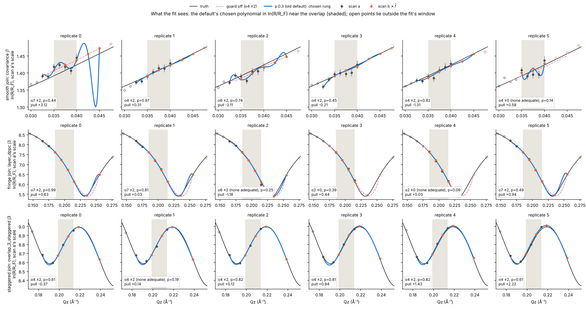
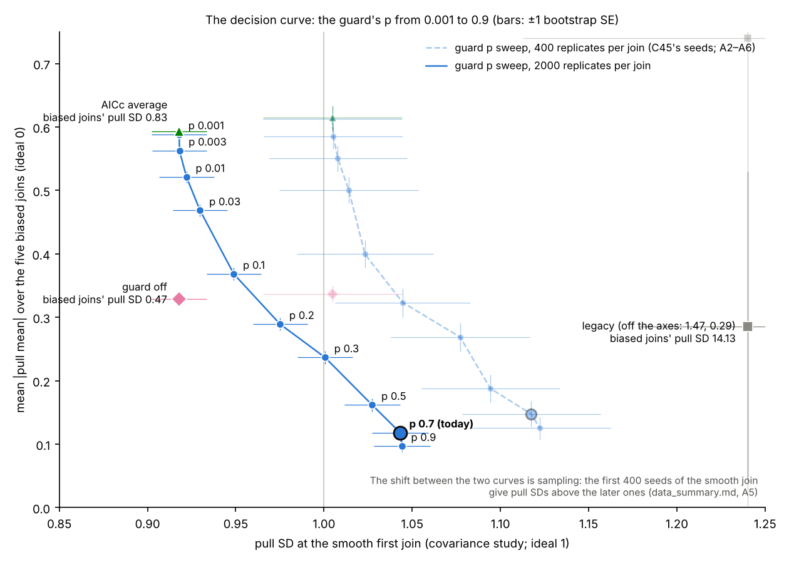
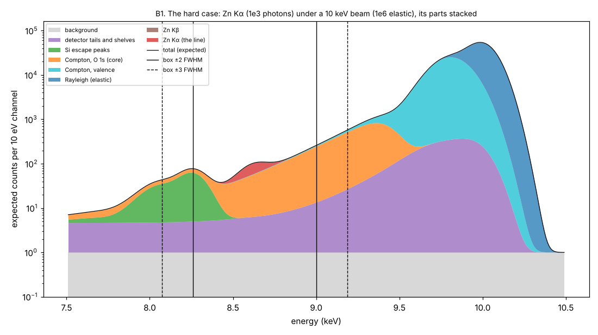
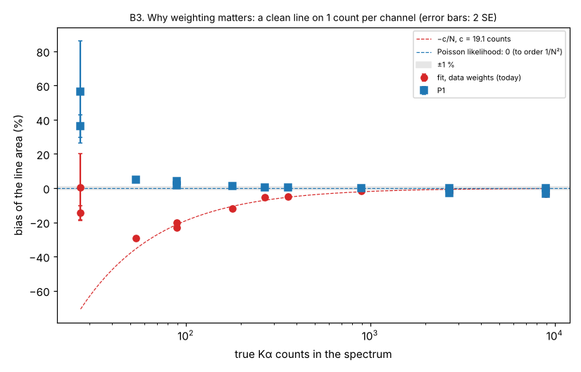

# Two decisions, explained simply

*2026-11-24. The figures and numbers come from the two studies,
`docs/studies/reflectivity_guard/summary.md` (A, C47) and
`docs/studies/mca_fit/summary.md` (B, C46). Everything measured is
synthetic data with the truth known, except where NX school data are
named. The citations were checked as far as this environment allows;
see References.*

This page explains two choices the reader makes when it turns detector
counts into numbers:

- **A.** How strictly the reflectivity patch checks the curve it fits
  where two scans join (the "guard").
- **B.** How a fluorescence line's intensity is measured from an MCA
  spectrum (window sum or fit, and how the fit weighs the channels).

Each part has five sections:
- the question, with a picture;
- the idea in everyday terms;
- the maths;
- what the study found;
- what we recommend, what it costs if we are wrong, and what would
  change it.

The detailed studies are `docs/studies/reflectivity_guard/summary.md`
(A) and `docs/studies/mca_fit/summary.md` (B).

---

## A. The guard on the reflectivity join

### The question

Two scans overlap in $Q_z$. They were measured with different absorbers,
so one must be scaled by a factor $f$ to meet the other. The reader
finds $f$ by fitting one smooth curve through both scans near the
overlap. The question is how good that curve must look before the
reader trusts it.



### The idea

Picture joining two photographs of a winding road, taken with different
exposures. You find the exposure ratio by drawing one smooth line along
the road across both photos.
- If the road bends where the photos overlap, a stiff ruler won't
  follow the bend, and your ratio comes out a little wrong. That is
  **model bias**.
- If you keep switching to bendier rulers until one fits, you have
  chosen the ruler *after* looking at the photo. The answer then looks
  more certain than it is. That is **post-selection**.

A strict guard does the second more often; a lenient guard leaves more
of the first. The study measures both and shows the trade-off.

### The maths

Near the join, with $y = \ln(R/R_F)$ and $\delta = \ln f$:
$$
y_a(Q_i) = p_m(Q_i) + \varepsilon_i, \qquad
y_b(Q_j) + \delta = p_m(Q_j) + \varepsilon_j,
\qquad p_m(Q) = \sum_{k=0}^{m} c_k Q^k .
$$
The coefficients $c_k$ and $\delta$ are fitted together by maximum
likelihood. The **guard** tries rungs $r = (m, e)$: polynomial order $m$,
and $e$ points either side of the overlap. It accepts the first rung
whose goodness of fit passes
$$
p_r = \Pr\!\left(\chi^2_{\nu_r} \ge \chi^2_{r,\text{obs}}\right) \ \ge\ p_0 ,
\qquad p_0 = 0.3 \text{ today.}
$$

**Why choosing after looking makes the error too small.** Let $\pi_r$ be
the chance that rung $r$ is chosen, $\mu_r$ the mean of $\hat\delta$ when
it is, and $\sigma_r$ its spread. By the law of total variance, the spread
of what we report is
$$
\operatorname{Var}(\hat\delta) = \sum_r \pi_r\,\sigma_r^2 \;+\; \sum_r \pi_r\,(\mu_r - \bar\mu)^2,
\qquad \bar\mu = \sum_r \pi_r \mu_r .
$$
The reported error is the chosen rung's own $\sigma_r$, which leaves out
the second term. So when the rungs disagree, the pulls
$(\hat\delta - \delta)/\sigma$ spread wider than 1. That is the measured
widening of +0.08 at a smooth join (it was first reported as 1.13; the
study shows most of that was sampling noise). Statisticians call this
post-selection inference: inference after a data-driven choice "enjoys
none of the guarantees" classical theory gives when the model is fixed
in advance (Berk et al. 2013).

**Why a lenient guard leaves bias.** If the true curve is not a
polynomial of order $m$ over the window (a Kiessig fringe, say), the fit
converges to the wrong $\delta$ even with no noise:
$$
b = \mathrm{E}[\hat\delta] - \delta \neq 0 \quad\text{as counts}\to\infty .
$$
Errors shrink as counts grow, but $b$ does not, so the pull mean
$b/\sigma$ grows.

**A third way, averaging.** Instead of choosing one rung, weight them all
by how well they fit, and keep the spread between them in the error:
$$
\bar\delta = \sum_r w_r \hat\delta_r, \qquad
\sigma^2 = \sum_r w_r\left[\sigma_r^2 + (\hat\delta_r - \bar\delta)^2\right].
$$
This is model averaging with weights $w_r \propto e^{-I_r/2}$ from an
information criterion $I_r$. The variance above is the revised form
(Burnham & Anderson 2002, eq. 6.12). Buckland, Burnham & Augustin (1997)
proposed the square-root form,
$\left[\sum_r w_r \sqrt{\sigma_r^2 + (\hat\delta_r - \bar\delta)^2}\right]^2$.
It is a candidate only.

### What the study found



There were 400–2000 synthetic replicates per join, with the truth known.
Each dot above is one setting of the guard:
- left and right is how honest the error bar is at a smooth join, where
  1.00 is ideal;
- up and down is how biased the factor is at the five joins where a
  fringe or a short overlap fools the curve, where 0 is ideal.

| Choice | Bias at the hard joins (mean \|pull mean\|) | Error-bar size at the hard joins (pull SD) | At a smooth join (pull SD) |
|---|---|---|---|
| today, p₀ 0.3 | 0.24 | 1.02 | 1.00 |
| **stricter, p₀ 0.7** | **0.12** | **0.98** | **1.04** |
| p₀ 0.01 | 0.52 | 0.92 | 0.92 |
| no guard | 0.33 | 0.47 (bars 3× too big) | 0.92 |
| averaging | 0.59 | 0.83 | 0.92 |
| old spline ratio | 0.29 | 14 (bars meaningless) | 1.47 |

- **A stricter guard leaves less bias, up to about p₀ 0.7.** From 0.3 to
  0.7 the bias at the hard joins halves. Beyond 0.7 almost nothing
  changes. No setting removes the bias at a fringe, because no
  polynomial fits a fringe exactly.
- **The price is small.** At a smooth join the error bars become about
  4 % too small (1.04 instead of 1.00).
- **Choosing after looking does widen the error a little** (+0.08 at
  p₀ 0.3). But without the guard the bars are already slightly too
  large at a smooth join (0.92), because they are only ever inflated,
  never shrunk. The two nearly cancel.
- **The robustness maps,** on two kinds of grid (scans sharing their Qz
  points or not): the strict settings, p₀ 0.5–0.9, are best in 23 of 24
  combinations of fringe sampling (3–10 points per fringe) and count
  level (1× to 0.01×).
- **Real data:** on the public NX school joins every setting gives the
  same factor. The first join agrees with the calibrated absorber ratio
  to within 0.34σ.

### Recommendation, cost of being wrong, what would change it

- **Raise p₀ from 0.3 to 0.7.** In the reader that is one constant, with
  its records and re-pinned tests. On the NX school joins nothing
  changes.
- **The cost of either choice is small where it counts.** A structural
  fit of the patched curve moves film thickness and roughness by about
  0.001 Å, because it uses every point and the full covariance. The
  choice matters for how honest each join's error bar looks: 0.7 is
  more honest at fringed joins, 0.3 at smooth ones.
- **Real data are not needed to decide.** The ranking holds across
  everything the synthetic data could not know.
- **What would change it:**
  - a design where the 4 % over-confidence grows;
  - the owner's long real series, if it showed joins where the fit and
    the absorber ratio disagree.
- **How this answer changed overnight.** A first map that stopped at
  p₀ 0.3 said "keep 0.3". Testing stricter settings showed the gain
  continues to about 0.7.

---

## B. Measuring a fluorescence line

### The question

An MCA spectrum has a fluorescence line (Zn Kα, say) sitting on
scattered X-rays: the elastic peak, Compton scattering and its tails,
and the detector's own artefacts. How do we get the line's photon count
honestly?



### The idea

- **The window sum** is like counting all the rain in a bucket placed
  under a leak, during a drizzle. You count the leak and the drizzle
  together.
- **A fit** models the drizzle, here the scatter under the line, and
  counts only the leak.

**How the fit weighs the channels also matters.**
- If you trust each channel by the count it happened to get, the
  channels that came out low look more precise, because their error
  $\sqrt n$ is smaller. Trusting them more drags the answer down.
- Trusting each channel by the count it *should* have got, the model,
  removes that pull. That is the Poisson ("P1") weighting.

### The maths

Channel $i$ records $n_i \sim \text{Poisson}(\mu_i)$. A line of area $A$
and shape $s_i$ (with $\sum_i s_i = 1$) sits on a background $B_i$:
$\mu_i = A s_i + B_i$.

**Window sum.** Over a box of channels:
$$
\hat A_{\text{win}} = \sum_{i\in\text{box}} n_i, \qquad
\mathrm{E}[\hat A_{\text{win}}] = A\,f_{\text{box}} + B_{\text{box}},
$$
where $f_{\text{box}}$ is the share of the line inside the box and
$B_{\text{box}}$ the scatter under it. The bias is $B_{\text{box}}$,
whatever the counts.

**Data-weighted fit (Neyman's $\chi^2$, today's default).** It minimises
$$
\chi^2_N = \sum_i \frac{(n_i - \mu_i)^2}{n_i} .
$$
For a line alone ($B_i = 0$), setting the derivative to zero gives
$$
\hat A_N = \frac{\sum_i s_i}{\sum_i s_i^2/n_i}.
$$
With $n_i = \mu_i(1+\epsilon_i)$, to first order in $1/\mu_i$,
$\mathrm{E}[1/n_i] \approx (1 + 1/\mu_i)/\mu_i$. Then
$$
\frac{\mathrm{E}[\hat A_N] - A}{A} \;\approx\; -\frac{m}{N},
$$
with $N$ the line's total counts and $m$ the number of channels that
carry it: about one count per channel, downward, as Baker & Cousins
(1984) state for Neyman's $\chi^2$. With Pearson's $\chi^2$ (weights from
the model, but not iterated to the likelihood) the bias goes the other
way, about half a count per channel. Mighell (1999) shows the same for
astronomical counts.

*Checked by simulation* (20 000 spectra per row; a Gaussian line on no
background; channels with mean > 0.5; zero counts clipped to 1; the code
is in the appendix):

| Line width σ (channels) | Counts $N$ | $m$ | Data-weighted bias | $-m/N$ | Poisson (P1) bias |
|---|---|---|---|---|---|
| 3 | 90 | 15 | −12.6 % | −16.7 % | +0.00 % |
| 3 | 270 | 17 | −5.5 % | −6.3 % | +0.01 % |
| 3 | 1000 | 21 | −1.8 % | −2.1 % | −0.01 % |
| 6 | 270 | 33 | −9.8 % | −12.2 % | −0.04 % |
| 6 | 1000 | 37 | −3.4 % | −3.7 % | −0.00 % |

The first-order rule is close from about 1000 counts. Below that it
overstates the bias, because the clipping of empty channels softens it.
The Poisson fit is unbiased throughout.

**Poisson maximum likelihood (P1).** It maximises
$$
\ln L = \sum_i \left[n_i \ln \mu_i - \mu_i\right],
\qquad
\frac{\partial \ln L}{\partial a_k} = \sum_i \left(\frac{n_i}{\mu_i} - 1\right)\frac{\partial \mu_i}{\partial a_k} = 0 .
$$
For a line alone this gives $\hat A = \sum_i n_i$, which is unbiased.
For a linear model, the condition is the weighted least-squares equation
with weights $1/\mu_i$ from the model. Iterating the weighted fit with
weights from the previous model (IRLS) reaches the maximum-likelihood
answer.
- Minimising Cash's statistic $C = 2\sum_i(\mu_i - n_i\ln\mu_i)$ is the
  same thing, and it is valid at any number of counts per channel
  (Cash 1979).
- With the normalisation free, it keeps the fitted total equal to the
  counts observed (Baker & Cousins 1984). It is not free of bias in
  every case at very low counts, which the study measures.

**Width fixed from the detector (P2).** For a silicon detector, the line
width follows from electronic noise and charge statistics:
$$
\text{FWHM}^2(E) = \text{FWHM}_{\text{noise}}^2 + (2.355)^2\,F\,\varepsilon\,E ,
$$
with Fano factor $F$ and pair energy $\varepsilon$ (for silicon
$F \approx 0.1$ and $\varepsilon \approx 3.6$ eV; textbook values, not
checked here). Fixing the width removes a free parameter that otherwise
trades off against a curved background.

**Escape stripping (P3).** A photon of energy $E$ that loses a Si Kα
photon (1.74 keV) is recorded at $E - 1.74$ keV with probability
$f_{\text{esc}}(E)$. This happens only above the Si K edge at
1.839 keV. Stripping subtracts that copy:
$$
y'(E) = y(E) - f_{\text{esc}}(E + 1.74)\, y(E + 1.74) .
$$
(The escape fraction against energy: Reed & Ware 1972.)

### What the study found



Tools man's study (`docs/studies/mca_fit/summary.md`, C46) used
synthetic spectra with the truth known. Zn Kα (8.6 keV) under a 10 keV
beam is the hard case: in the ±2 FWHM box the line has 887 counts,
against 5,681 from the oxygen 1s Compton wing, 570 from escape peaks and
471 from detector tails (B1).

**The weighting (B3, above).** Data weights read a weak line low, by
about $-c/N$ with $c = 19$ counts in that box: −23 % at 100 counts,
−5 % at 400, −1.5 % at 1000. That is the formula above, with the box's
background folded into $c$. The Poisson fit (P1) is within its errors
from about 60 counts up, and matches data weights to 0.2 % at 10 000.
Below about 50 counts every fit becomes unstable.

**The window sum** is wrong wherever scatter sits under the box. It
failed in all 20 cells of the robustness map, and is off by 2.7 % even
on smooth scatter.

**The XFNTR curve's shape** (the worst point's deviation from the true
curve):

| Curve | window | data weights | P1 | P1 + escape stripping |
|---|---|---|---|---|
| smooth, weak | 24 % | 13 % | **1.2 %** | 1.2 % |
| hard (Zn under 10 keV) | **68 %** | 4.7 % | 4.7 % | **1.4 %** |

**The Zn-under-10 keV case is not solved by any fit.** The best, P1 with
a fixed width and escape stripping, reads −7 % with 60 % of fits failing.
What decides it is the oxygen 1s Compton wing under the line (B7). The
synthetic data cannot pin its real size: the tabulated profiles could
not be installed here, so the generator uses a shell model with
constants from memory.

**A practical result:** with a 12 keV beam the same case passes with P1
alone, +0.5 % with no failures, because the scatter moves away from the
line. The line gets weaker: Zn K absorption falls about 40 % from 10 to
12 keV (from memory).

### Recommendation, cost of being wrong, what would change it

- **Make the Poisson fit (P1) the default** for "Fit lines". It removes
  a bias of −19/N and costs nothing at high counts. This needs no real
  data: it holds whatever the background.
- **Stop using the window sum** where beam scatter sits under the box.
  Keep it at most as a legacy option.
- **Keep fixed width (P2) and escape stripping (P3) as options** until a
  blank spectrum is in.
- **For Zn, consider the beam energy:** 11–12 keV instead of 10.
- **The cost of being wrong:**
  - with the window sum, an XFNTR curve can be distorted by tens of
    percent, misplacing surface against bulk;
  - with data weights, the weak high-Qz end reads low (13 % on the weak
    curve).
- **What would change it:** a blank spectrum (pure water or the
  subphase, the same energy and geometry) measuring the oxygen 1s wing
  and the escape fraction directly (DATA_NEEDS row 3). A wing well below
  the model's would make the full fit usable at 10 keV.

---

## References

**How far these were checked.** The bibliographic details were confirmed
from publisher, ADS and index records. The claims were checked against
abstracts and against secondary sources that restate the papers. **The
full texts were not read**: this environment's network policy blocks the
publishers and arXiv. Read every claim here as checked at that level.

- Baker, S. & Cousins, R. D. (1984). Clarification of the use of chi-square and likelihood functions in fits to histograms. *Nucl. Instrum. Methods Phys. Res.* 221(2), 437–442. https://doi.org/10.1016/0167-5087(84)90016-4
- Berk, R., Brown, L., Buja, A., Zhang, K. & Zhao, L. (2013). Valid post-selection inference. *Ann. Statist.* 41(2), 802–837. https://doi.org/10.1214/12-AOS1077 (open copy: arXiv:1306.1059)
- Buckland, S. T., Burnham, K. P. & Augustin, N. H. (1997). Model selection: an integral part of inference. *Biometrics* 53(2), 603–618. https://doi.org/10.2307/2533961
- Burnham, K. P. & Anderson, D. R. (2002). *Model Selection and Multimodel Inference*, 2nd ed. Springer, New York (eq. 6.12, p. 345). https://doi.org/10.1007/b97636
- Cash, W. (1979). Parameter estimation in astronomy through application of the likelihood ratio. *Astrophys. J.* 228, 939–947. https://doi.org/10.1086/156922
- Mighell, K. J. (1999). Parameter estimation in astronomy with Poisson-distributed data. I. The χ²_γ statistic. *Astrophys. J.* 518, 380. https://doi.org/10.1086/307253
- Névot, L. & Croce, P. (1980). Caractérisation des surfaces par réflexion rasante de rayons X. *Rev. Phys. Appl.* 15(3), 761–779. https://doi.org/10.1051/rphysap:01980001503076100. Derived for one rough surface; applied interface by interface in the recursion, a later generalisation.
- Parratt, L. G. (1954). Surface studies of solids by total reflection of X-rays. *Phys. Rev.* 95(2), 359–369. https://doi.org/10.1103/PhysRev.95.359
- Biggs, F., Mendelsohn, L. B. & Mann, J. B. (1975). Hartree-Fock Compton profiles for the elements. *At. Data Nucl. Data Tables* 16(3), 201–309. https://doi.org/10.1016/0092-640X(75)90030-3. Free-atom, per-shell profiles; using the O 1s profile for water is our inference. The impulse approximation behind them is poor when the energy transfer nears the 1s binding energy (about 0.54 keV).
- Reed, S. J. B. & Ware, N. G. (1972). Escape peaks and internal fluorescence in X-ray spectra recorded with lithium drifted silicon detectors. *J. Phys. E: Sci. Instrum.* 5(6), 582–583. https://doi.org/10.1088/0022-3735/5/6/029

---

## Appendix: the simulation of the weighting bias

```python
import numpy as np
rng = np.random.default_rng(1)
x = np.arange(-40, 41)
for sig in (3.0, 6.0):
    s = np.exp(-x**2 / 2 / sig**2); s /= s.sum()
    for N in (90, 270, 1000):
        mu = N * s
        n = rng.poisson(mu, size=(20000, len(x))).astype(float)
        keep = mu > 0.5
        A_N = s[keep].sum() / np.sum(s[keep]**2 / np.maximum(n[:, keep], 1.0), axis=1)   # data-weighted
        A_P = n[:, keep].sum(axis=1) / s[keep].sum()                                    # Poisson ML
        print(sig, N, keep.sum(), A_N.mean() / N - 1, -keep.sum() / N, A_P.mean() / N - 1)
```
