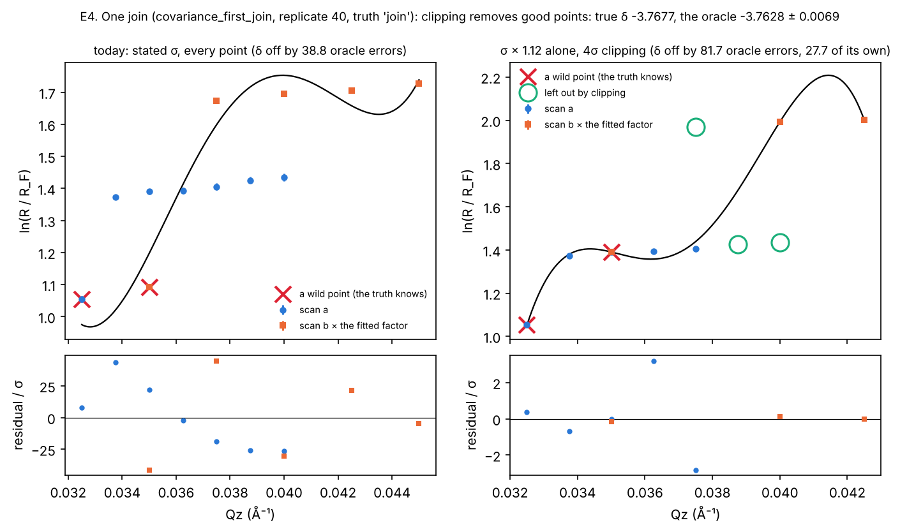
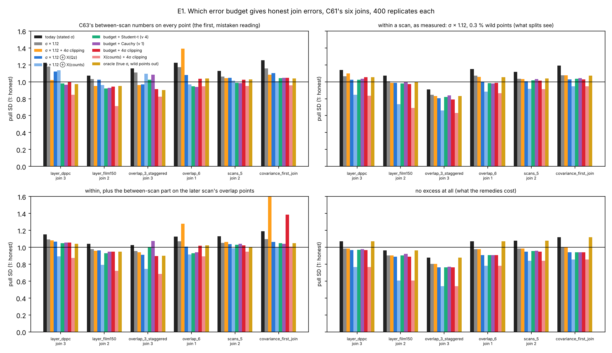

# The join's error budget with the measured excess (C64): from one join to the verdict

*main man, 2026-11-25; **corrected the same evening.** C63 (`docs/studies/excess_scatter/`) measured how much
real reflectivity points scatter beyond their counting errors. This study asks which error budget, in
today's joint fit, gives honest join errors. Known truth first (rule 12). The steps a join shares with C61,
from the two scans to the pulls, are explained in C61's walkthrough
(`docs/studies/guard_error/walkthrough.md`, steps 1–4).*

**The correction.** The first version (#99) put C63's between-scan numbers on every point of both scans as
independent noise: the 2.65 % at Qz ≥ 0.25 and the 3 % wild points. They don't describe that, as step 1
shows, so its headline ("16 % of today's joins miss catastrophically; 4σ clipping fixes it") was not
supported. That reading is kept below as the truth `c63`, labelled as the mistake it was. The verdict is
the one in step 7.

Every figure and number comes from:

    python tests/tools/excess_remedy_study.py --out docs/studies/excess_remedy     # about 90 s on 4 CPUs

The numbers are in `numbers.json`, `stats.csv` (per truth, join and arm) and `nx_split.csv`. **Measured**
throughout: synthetic data with known truth, and the public NX school split.

## Step 1. What C63 measured, read carefully

C63 has two estimators. They measure different things:
- **within a scan:** six neighbouring points at a time, any smooth curve removed. It sees every point.
- **between scans:** the two scans' ratio at the Qz both measured. It sees only the shared points, which are
  the last points of one scan and the first points of the next, measured minutes apart.

| | within a scan | between scans (shared points) |
|---|---|---|
| core excess, Qz 0.04–0.1 | 0.19 % of R | 0.20 % |
| Qz 0.1–0.25 | 0.12 % | 0.40 % |
| Qz ≥ 0.25 | 0.16 % | **2.65 %** |
| wild | 0.7–1.7 % of six-point windows, so about 0.1–0.3 % of points | 2–4 % of pairs |

**What the gap means:**
- Scatter that hit each point independently would show in both estimators alike. 0.16 % within a scan and
  2.65 % between scans, at the same Qz, cannot be the same thing.
- The between-scan excess grows with the time between the two measurements. At low Qz it is 0.08 % for pairs
  under a minute apart and 0.33 % for pairs 1–2 minutes apart. The 2.65 % comes from pairs 2–4 minutes apart.
- **So within a scan the points are nearly honest:** the counting σ is about 12 % small, with a few wild
  points.
- **Between scans something changes** in the minutes between the end of one scan and the start of the next,
  or at the next scan's first points: the sample drifting, the absorber settling, or a first-point effect.
  It sits exactly where a join gets its factor.
- **The split tests** (C56: one scan cut into two halves) never leave their scan, so they can see only the
  within-scan part.

## Step 2. The truths and the budgets

**Four truths are drawn into C61's six synthetic joins,** 400 replicates each:

| truth | what is drawn into the points |
|---|---|
| `c63` | the first, mistaken reading: the between-scan X(Qz) and 3 % wild points on every point of both scans |
| **`within`** | what the within-scan estimator measured: σ × 1.12 and 0.3 % wild points (× exp(0.46 z)), on every point |
| **`join`** | `within`, plus the between-scan part on the later scan's overlap points only: √2 X(Qz), a pair's 2X² put on one side, and 5 % wild (× exp(0.73 z)) |
| `none` | no excess at all: what the remedies cost |

**The budgets:**

| arm | each point's σ given to today's joint fit (guard p 0.7, inflation by its own χ²) |
|---|---|
| **today** | the stated σ |
| scale | σ × 1.12 |
| scaleclip | σ × 1.12, then 4σ clipping (the window point furthest from the curve left out while beyond 4σ, at most 6) |
| budget | √((1.12 σ)² + (X(Qz) · y)²) on every point |
| budgetN | the same with X keyed to counts |
| robust, cauchy | budget, then Student-t re-weighting (ν 4; ν 1) |
| clip, clipN | budget (or budgetN), then 4σ clipping |
| oracle | each point's true σ, the wild points left out |

## Step 3. One join rescued by clipping (figure E3)

- **The join:** C61's smooth join, under the `join` truth. A point of the later scan in the overlap is
  wild.
- **Left, today.** The fit cannot pass through the wild point. Its χ²/dof is enormous, and its error is
  inflated by √(χ²/dof). The factor misses by 38 oracle errors, with a pull of −0.3: the miss is
  hidden.
- **Right, the budget with clipping.** The wild point is left out, the first curve of the ladder passes, and
  the factor lands within about one oracle error.
- **The residuals, ELI5:** (point − curve) / σ. Honest points lie within about ±2, and a wild one stands far
  out.

## Step 4. One join ruined by clipping (figure E4)

- **The join:** the same join, a different replicate. **Two** points near the low-Qz end of the window are
  wild.
- **The failure.** The first fit bends towards them, so the points furthest from that bent curve are good
  ones. Clipping removes three good points (circled) and keeps both wild ones.
- **The result:** a curve that fits what is left, at the wrong factor. It misses by 82 oracle errors, **27.7
  of its own errors**.
- **Why this is the worst kind of miss.** Today's fit at least inflates its error to match its miss. This
  one reports a small error.
- **Pitfall 5** of `.claude/skills/fit-statistics-pitfalls` says it: robust steps have false minima, and
  removing "the worst point" of a fit already distorted by the bad ones can remove the good ones.

## Step 5. The pulls (figure E1)

**The statistic, ELI5.** The pull SD is 1 when the errors are honest (C61's walkthrough, step 4).

| truth | today | σ × 1.12 | σ × 1.12 + clipping | budget | budget + clipping | oracle |
|---|---|---|---|---|---|---|
| **within** (smooth / hard) | 1.19 / 1.08 | **1.08 / 1.01** | 1.08 / 1.00 | 1.03 / 0.97 | 1.03 / 0.96 | 1.07 / 0.99 |
| **join** | 1.19 / 1.10 | 1.10 / 1.03 | **3.49** / 1.06 | 1.06 / 1.00 | **1.39** / 0.99 | 1.05 / 0.98 |
| none | 1.12 / 1.01 | 1.00 / 0.93 | 1.00 / 0.93 | 0.94 / 0.89 | 0.94 / 0.89 | 1.12 / 1.01 |

- **`within` reproduces the real splits.** Today's 1.19 / 1.08 is close to C56's 1.24 on 1091 real splits.
  So the split test's under-coverage is the within-scan σ × 1.12, not the 1 % per-point scatter C61 assumed.
  **σ × 1.12 alone** brings it to 1.08 / 1.01.
- **Clipping's 3.49 and 1.39 on the smooth join come from two replicates of 400,** with pulls of 28 and 59:
  E4 is one of them. Coverage within ±2 is still 91–92 %. The pull SD is a statistic that a few confident
  misses dominate, which is its point here.

## Step 6. The misses the pull SD hides (figure E2)

**The statistic, ELI5.** A catastrophic miss is a factor off by more than 5 oracle errors, whatever error it
reports.

| truth | today | σ × 1.12 | σ × 1.12 + clipping | budget | budget + Student-t | budget + clipping |
|---|---|---|---|---|---|---|
| **within** | 1.7 % | 1.7 % | 0.2 % | 1.7 % | 1.0 % | 0.0 % |
| **join** | **13 %** | 13 % | 1.1 % | 14 % | 8.5 % | 0.5 % |
| none | 0 | 0 | 0 | 0 | 0 | 0 |

- **Within a scan,** wild points are rare enough (0.3 % of points) that today misses catastrophically on
  1.7 % of joins.
- **At the overlap,** if C63's wild pairs are real and sit on the later scan's first points, today misses on
  13 % of joins.
- **Clipping removes most catastrophic misses,** but adds the confident ones of step 4: 2 in 400 on the smooth
  join.

**The NX split** (three public scans; truth ln 1.25):

| arm | RMS pull |
|---|---|
| today | 1.40 |
| σ × 1.12 | 1.25 |
| budget, X by Qz | 0.74, by quadrupling scan 9's error |
| budget, X by counts | 1.21 |

A split is within one scan, so the between-scan X does not belong there at all: σ × 1.12 is the right
budget for it.

## Step 7. The judgment

**Measured, synthetic, with truths built from what C63 measured.** High confidence on the mechanisms; the
sizes are C63's.
- **Within a scan, σ × 1.12 is the remedy.** It explains the real splits' under-coverage (C56) and fixes it
  (pull SD 1.08 / 1.01), at 10–12 % wider errors. With no excess it overstates the errors by 12 %.
- **Between scans, the threat is at the overlap.** C63's pair numbers (a drift that grows with the minutes
  between scans, and wild pairs) placed on the later scan's overlap points make today miss on 13 % of joins.
  That is *if* those numbers describe the overlap points, which the split tests cannot check.
- **4σ clipping as built is not safe.** It removes most catastrophic misses, but where two wild points sit
  together it removes good points and reports a confidently wrong factor (step 4). It needs a guard before
  any use. For example:
  - at most one point out;
  - the point chosen by the best leave-one-out χ², not by the largest residual of a distorted fit;
  - the clipped factor required to agree with the unclipped one within its inflated error.
- **An X term on every point (the budget)** is the wrong model for the between-scan part, because it widens
  points that are honest.

**The verdict:**
1. **Candidate default: σ × 1.12 in the joint fit,** after the real-split check (DATA_NEEDS row 17) and the
   owner's word.
2. **The between-scan part needs real joins,** not splits: C56's 906 clean joins against the calibrated foils.
   And it needs where C63's wild pairs sit: the first point after an absorber change, or minutes apart.
3. **A guarded clipping,** studied again, once the wild points' position is known.

## Where each step lives in the code

| step | code |
|---|---|
| the joins | `ref_guard_study.draw_join` (study A's six) |
| the truths | `excess_remedy_study.corrupt` (`c63`), `corrupt_pair` (`within`, `join`) |
| the budgets | `budget_sigma(scan, key='qz' or 'counts')`, `x_of`, `x_of_counts` |
| the joint fit | `lss_core.patching.joint_factor(guard_p=0.7)`, `rung_fit` |
| Student-t, clipping | `robust_fit`, `clip_fit` (residuals from the kept rung's curve, `_residuals`) |
| pulls, tails | `stats` (pull SD, coverage, RMS and catastrophic share against the oracle) |
| the examples | `example(mode='rescue' or 'failure')` (E3, E4) |
| the NX split | `run_nx` |
