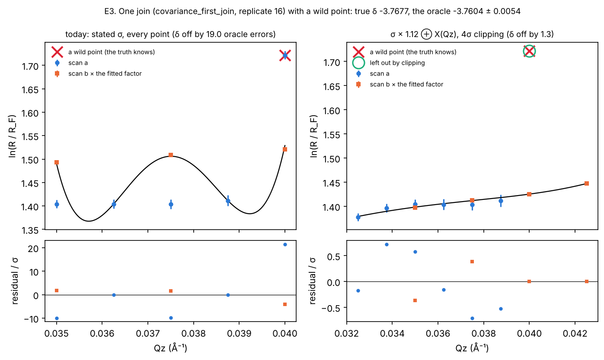
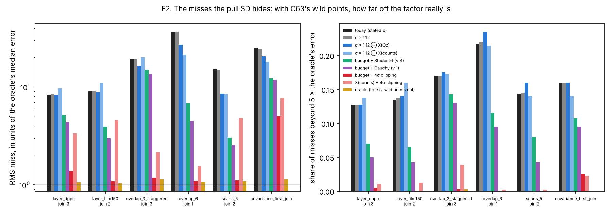

# The join's error budget with the measured excess (C64): from one join to the verdict

*main man, 2026-11-25. C63 (`docs/studies/excess_scatter/`) measured how much real reflectivity points
scatter beyond their counting errors. This study asks which error budget, in today's joint fit, gives
honest join errors once that scatter is in the data. Known truth first (rule 12). The steps a join shares
with C61, from the two scans to the pulls, are explained in C61's walkthrough
(`docs/studies/guard_error/walkthrough.md`, steps 1–4). This one adds what is new.*

Every figure and number comes from:

    python tests/tools/excess_remedy_study.py --out docs/studies/excess_remedy     # about 45 s on 4 CPUs

The numbers are in `numbers.json`, `stats.csv` (per truth, join and arm) and `nx_split.csv`. **Measured**
throughout: synthetic data with known truth, and the public NX school split.

## The question, in one paragraph

**What C63 found on 384 real series.** Each point scatters more than its error bar says, in three ways:
- **within a scan,** the counting σ is about 12 % too small;
- **between scans,** each point carries an extra spread of about 0.2–0.4 % of R, and about 2.65 % at
  Qz ≥ 0.25;
- **wild points:** about 3 % of points are tens of % off.

**What the joint fit does today.** It knows none of this: it weighs each point by its counting σ and
inflates the join's error by its own χ² afterwards (C61).

**The question:** which budget would make the join errors honest?
- σ × 1.12;
- plus the extra spread;
- plus a step that recognises wild points.

**And what does that cost** where there is no excess at all?

## Step 1. The data: C61's six joins with C63's excess drawn in

- **The joins:** study A's six synthetic joins (`ref_guard_study`): one smooth, five where a fringe or a
  short overlap makes the fit hard. Each is drawn 400 times (replicates).
- **Into each point** the study draws what C63 measured: extra counting-like noise (× 1.12), a spread X(Qz)
  (0.2 % below Qz 0.1, 0.4 % to 0.25, 2.65 % above), and, for 3 % of points, a factor exp(0.7 z), the wild
  points.
- **The error bars given to the reader are left as stated:** the truth is hidden from it, as on a
  beamline.
- **A second truth, with no excess at all,** shows what each remedy costs when it isn't needed.

## Step 2. The budgets compared

| arm | each point's σ given to the joint fit |
|---|---|
| **today** | the stated σ |
| scale | σ × 1.12 |
| budget | √((1.12 σ)² + (X(Qz) · y)²) |
| budgetN | the same, with X keyed to the point's counts (C63's table by counts) instead of its Qz |
| robust | budget, then each point re-weighted by its residual (Student-t, ν = 4), 4 refits |
| cauchy | the same with ν = 1, 8 refits |
| **clip** | budget, then the point furthest from the curve left out while it is beyond 4 σ (at most 6) |
| clipN | clip on budgetN |
| oracle | each point's true σ, the wild points left out: the best possible, unknowable on real data |

Every arm uses today's joint fit unchanged: the guard at p 0.7, and the inflation by its own χ².

## Step 3. One join with a wild point, fitted two ways (figure E3)

- **The join:** C61's smooth join, replicate 16. Scan a's point at Qz 0.040 is wild: 34 % high (red
  cross).
- **Left, today.** The wild point sits in the overlap.
  - The order-4 curve over ±2 points cannot pass through it, and every curve of the guard's ladder fails.
  - The guard keeps the best of them: order 4 on the overlap alone. That curve bends to reach the wild
    point (χ²/dof 341).
  - **The factor misses by 19 oracle errors.** But its error is inflated by √341 = 18 ×, so the reported
    error (0.10) covers the miss.
  - **The pull is about 1: honest-looking, and useless.** The join's error is 19 times what the data could
    give.
- **Right, the budget with clipping.**
  - The first fit leaves the wild point 20 σ from the curve, so it is left out and the join refitted.
  - Now the first curve of the ladder passes: order 4, ±2, χ²/dof 0.49.
  - **The factor misses by 1.3 oracle errors,** with the oracle's own error (0.0054).
- **The residuals, ELI5:** (point − curve) / its σ. On the left one point is 20 σ out and the others are
  dragged to ±10. On the right all lie within ±0.7, as honest points should.

## Step 4. The pulls: which budget gives honest errors? (figure E1)

**The statistic, ELI5.** The pull is (fitted δ − true δ) / its reported error, and its SD is 1 when errors
are honest. C61's walkthrough, step 4, explains it in full.

**With C63's excess** (left; smooth join / the mean of the five hard ones):

| arm | pull SD | within ±1 error | median error vs today |
|---|---|---|---|
| today | 1.26 / 1.16 | 56 % / 62 % | 1 |
| σ × 1.12 | 1.16 / 1.11 | 59 % / 64 % | 1.05 / 1.03 |
| budget | 1.10 / 1.05 | 61 % / 66 % | 1.09 / 1.06 |
| budget + Student-t | 1.04 / 0.97 | 67 % / 71 % | 1.09 / 1.07 |
| **budget + clipping** | **1.05 / 0.98** | 65 % / 69 % | 1.09 / 1.06 |
| oracle | 1.04 / 0.98 | 66 % / 69 % | 1.09 / 1.06 |

**With no excess** (right), every remedy overstates the errors. The pull SD is 0.94 / 0.89 for the budget
and clipping, with errors 1.14–1.17 × today's. That is the price of the budget where its terms are not
needed. Clipping itself costs nothing there: with no wild points, nothing is clipped.

## Step 5. The misses the pull SD hides (figure E2)

**Why another statistic.** Step 3 showed that a join can miss by 19 errors and still have a pull of 1,
because its error was inflated as much as it missed. The pull SD cannot see that, so here are two
statistics that can:
- **the RMS miss** in units of the oracle's median error. The oracle is the best possible, so 1 means
  "as good as it gets";
- **the share of catastrophic misses:** joins off by more than 5 oracle errors.

**With C63's excess:**
- **Today:** RMS 8–37 × the oracle's error, and 16 % of joins catastrophic. Wild points wreck about one
  join in six, and today's error bars are so wide there that nobody notices.
- **σ × 1.12 and the budget alone** change almost nothing (16–17 %): widening every point doesn't remove a
  wild one.
- **Student-t and Cauchy re-weighting** halve it (7.6–9.7 %).
- **Clipping at 4 σ** cuts it to **0.6 %**, with an RMS of 1.1–1.4 × the oracle's on five joins and 5.0 on
  the smooth one.
- **The counts-keyed budget with clipping** (clipN): 1.5 %.

**With no excess:** no arm has a catastrophic miss. Clipping doesn't hurt clean joins.

## Step 6. A real check: the NX school split

The interleaved split of C56 and C61 (one public scan cut into two halves, the second × 0.8, the truth
ln 1.25), on the three NX scans long enough:

| scan | today: pull (error) | budget (X by Qz) | budgetN (X by counts) |
|---|---|---|---|
| 7 | −0.73 (0.0041) | −0.64 (0.0049) | −0.60 (0.0056) |
| 8 | 0.71 (0.0032) | 0.98 (0.0044) | 1.05 (0.0042) |
| 9 | 2.19 (0.0050) | 0.51 (0.0208) | 1.71 (0.0064) |

**Scan 9** is the zig-zag of C61's walkthrough, at Qz 0.26–0.35. The Qz-keyed budget gives it C63's 2.65 %
and quadruples its error. Yet that scan is bright: its unsplit χ²/dof is 1.03, and its points scatter by
about 0.5 %. C63's 2.65 % comes from weak, high-background frames at those Qz. **Keyed to counts** (0.40 %
for this scan's counts), the error grows by 1.3 × and the pull is 1.7. Three scans decide nothing, but they
show the key matters: the excess probably follows the counts and the background, not Qz itself (C63 found
the covariates move together on the owner's data).

## Step 7. The judgment

**Measured, synthetic, with C63's excess as the truth.** High confidence on the mechanism; the sizes are
C63's.
- **Wild points are the main harm, not the core excess.** Today 16 % of joins miss by more than 5 oracle
  errors, behind error bars wide enough to hide it.
- **Clipping at 4 σ** (on the budget's σ) brings that to 0.6 %, and the pull SD to the oracle's
  (1.05 / 0.98).
- **σ × 1.12 ⊕ X** fixes the core under-coverage (pull 1.26 → 1.10 on the smooth join). It costs 14–17 %
  wider errors where there is no excess.

**Not yet known:**
- whether X should follow Qz or the counts. NX suggests counts; real data decide;
- whether real joins really have one catastrophic miss in six today. C56's 1091 real splits can say.

**The candidate** for the joint fit's budget, through rule 12:
- **4σ clipping, first and alone.** It is the big win, it costs nothing on clean joins, and needs no X.
- **σ × 1.12 ⊕ X(counts)**, if the real splits confirm it.

**Before any default changes:**
1. the local agent runs `excess_remedy_study.estimate(a, b, arm)` for today, clip, budget, budgetN, clipN
   on C56's 1091 real splits: pull SD, coverage, the catastrophic share, and where the clipped points sit
   (DATA_NEEDS row 17);
2. the core option in `lss_core.patching` with tests;
3. the owner's word (MQ-3: "no excess term before a measurement and the owner's word").

## Where each step lives in the code

| step | code |
|---|---|
| the joins | `ref_guard_study.draw_join` (study A's six) |
| C63's excess drawn in | `excess_remedy_study.corrupt` |
| the budgets | `budget_sigma(scan, key='qz' or 'counts')`, `x_of`, `x_of_counts` |
| the joint fit | `lss_core.patching.joint_factor(guard_p=0.7)`, `rung_fit` |
| Student-t, clipping | `robust_fit`, `clip_fit` (residuals from the kept rung's curve, `_residuals`) |
| pulls, tails | `stats` (pull SD, coverage, RMS and catastrophic share against the oracle) |
| the NX split | `run_nx` (as `guard_error_study.run_nx`) |
