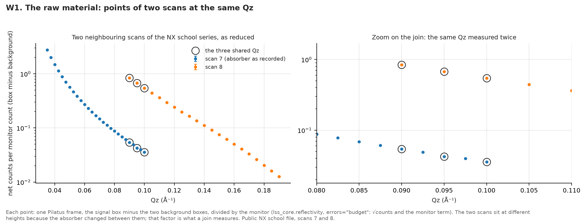
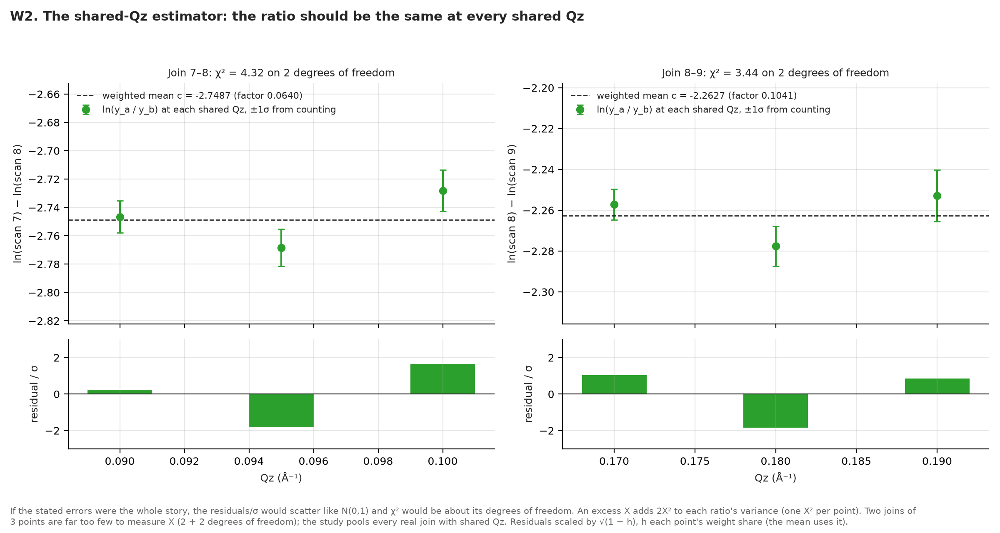
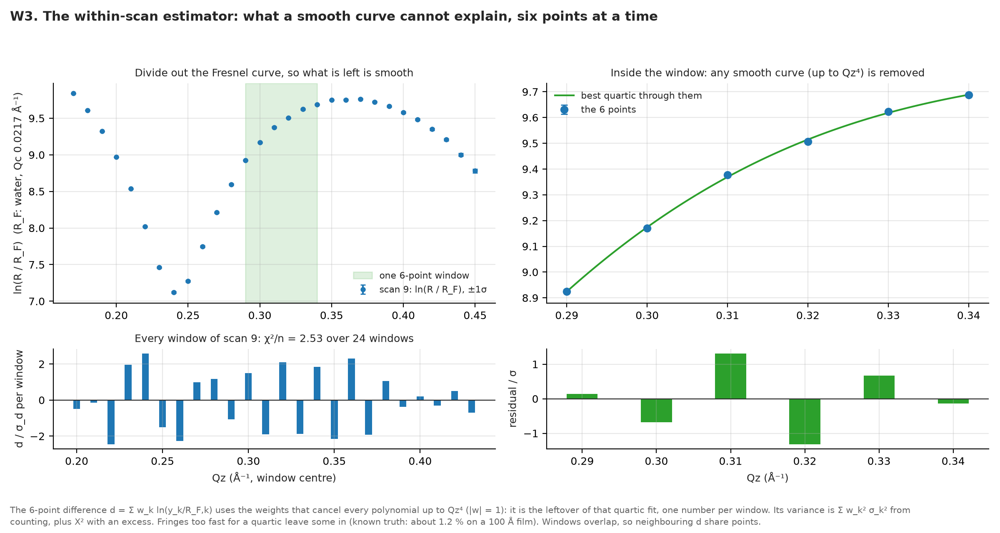
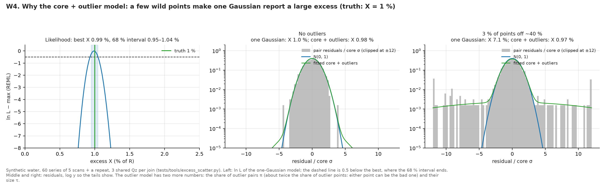

# Walkthrough: do reflectivity points scatter more than their error bars say?

*The whole chain for DATA_NEEDS row 15 (AGENTS.md rule 13), one step at a time. Figures W1–W5:
`python tests/tools/excess_scatter_walkthrough.py`. Known truth (X1, `pulls.csv`):
`python tests/tools/excess_scatter.py`. The real numbers are in `summary.md`.*

## The question in one paragraph

Every reflectivity point comes with an error bar from counting statistics: count N photons and you are
uncertain by about √N. If that were the whole story, two measurements of the same thing would disagree by
about their error bars, never by much more. C56 found that real joins between scans disagree a bit more
than their error bars allow, about 24 % more. C61 showed that a hidden extra scatter of about 1 % of R on
every point would explain it. The owner asked: **how big is that extra scatter really, and what does it
follow?** If the error bars were honest, we would see residuals that scatter like a bell curve of width 1.
If something adds scatter, the bell is wider. If a few points are simply wrong, the bell grows long tails.

## 1. The raw data (W1)

The public NX school series, scans 7 and 8. Each point is one detector frame:
- the counts in a box around the reflected beam, minus the average of two background boxes beside it;
- divided by the monitor (a count proportional to the beam's intensity).

The error bar is √counts, propagated through that sum and division, plus a small monitor term (the
"budget" model). The two scans sit at different heights because the absorber changed between them. That
factor is what a join measures. Three Qz values were measured in both scans: those are the points that
tell us something here.

## 2. Step one: the ratio at the shared Qz (W2)

- **What is done:** at each shared Qz, take ln(scan a) − ln(scan b). If both scans measured the same
  surface, this is the same number at every shared Qz (the log of the absorber factor), up to noise. Its
  error bar is √(σ_a²/y_a² + σ_b²/y_b²), from counting.
- **The fit:** a weighted mean c, the dashed line, is the simplest fit there is. The bars below are the
  residuals, each divided by its own error. They are corrected by √(1 − h), because the mean was fitted to
  the same points (h is each point's share of the weight).
- **Reading the residuals:**
  - join 7–8 gives χ² 4.32 on 2 degrees of freedom, and join 8–9 χ² 3.44 on 2;
  - with honest errors, χ² would be about 2 on average for each;
  - two joins of three points cannot tell 4.3 from 2, though: a χ² of 4.32 on 2 degrees of freedom happens
    by chance about once in 9. That is why the study pools every real join: 2812 residuals in 706 pairs of
    scans.
- **What an excess does:** a hidden scatter X (a fraction of R) on each point adds X² to each point's
  variance of ln y, so 2X² to the ratio's.

## 3. Step two: within a scan, six points at a time (W3)

- **What is done:** divide the scan by the Fresnel curve R_F (a bare, perfectly sharp interface), so what
  is left changes slowly. Take six neighbouring points, and remove the best smooth curve through them, a
  polynomial up to Qz⁴. One number d is left per window. It is zero for any curve that smooth, and only
  noise remains.
- **Why six points:** with three points a curve's own bend leaks in. On known truth, 3–5 points left
  0.3–1.9 % of fake excess on a DPPC monolayer; 6 points leave about 0.1 %. A film's fast fringes still leak
  in at six (about 1.2 % on a 100 Å film), which is why this estimator is the second one, not the first.
- **Reading it:** NX scan 9 gives χ²/n = 2.53 over 24 windows. That is more than 1, but NX scan 9 has
  strong structure (the deep minimum near 0.24 Å⁻¹), which is exactly the leak. Real numbers come from
  26,182 windows over many samples.
- **What it sees and misses:** a slow drift over a scan looks smooth, so this estimator does not see it.
  The shared-Qz ratio does, because the two scans were measured minutes apart. Comparing the two tells
  point-to-point scatter from slow change.

## 4. Step three: combine many residuals, and allow for wild points (W4)

- **Likelihood, left panel:** for each trial value of X, how probable are all the residuals together?
  - The curve peaks at the best X. Where it has dropped by 0.5, the 68 % interval ends.
  - The c of each pair is removed first, by REML: each pair loses one degree of freedom for its mean.
  - On 60 synthetic series with X = 1 %, the best X is 0.99 %, interval 0.95–1.04 %.
- **Why that is not enough, right panel:** real data have a few points that are far off. A frame catches a
  stray reflection, or the beam moves off the box. Three in a hundred such points, each off by about 40 %,
  make a single bell curve report 7 %, whatever the true X.
- **The fix: a core and an outlier part.** Each residual comes either from the core bell curve (width from
  counting plus X), with probability 1 − π, or from a much wider outlier curve (width τ), with probability
  π.
  - All three numbers are fitted together.
  - τ must be at least 10 % of R. Without that floor, the outlier part can take over the core: it
    did, on known truth, until the floor was added.
  - With and without outliers, the core comes back within 0.09 % of R of the truth (figure X1, below).

## 5. Every statistic used, in words

| statistic | what it is, here |
|---|---|
| σ (error bar) | the stated uncertainty of a point, from √counts and the monitor ("budget" model) |
| residual / σ (pull) | how far a point is from its fit, in units of its own error. Honest errors give a bell curve of width 1: 68 % within ±1, 0.27 % beyond ±3 |
| χ², χ²/dof | the sum of squared pulls; divided by the degrees of freedom (points minus fitted numbers) it should be about 1. Much more means the errors are too small or the model is wrong |
| median \|pull\| | the middle value of the pulls' sizes: 0.674 for honest errors. Real data: 0.90 between scans, 0.76 within, so the core is wider than the errors say |
| tail share | the share of pulls beyond 3, 5, 10σ. Real: 9.0 %, 4.4 %, 2.4 % between scans, against 0.27 % and practically 0 for a bell curve, so there are wild points |
| X (core excess) | the extra scatter of a typical point, as a fraction of R, added in quadrature to σ |
| s (error scale) | the same idea as a multiplier: the real error is s × σ. Within a scan s ≈ 1.12, so the errors are 12 % too small |
| π, τ | the share of residuals that are wild, and how wild (a fraction of R) |
| likelihood, REML | how probable the data are for given numbers; the best numbers maximise it. REML removes each pair's mean first, so the excess is not underestimated |
| Δln L | how much better one model explains the data than another. 2 is a hint, 10 or more is decisive |
| 68 % interval (bootstrap) | redo the whole estimate on 100 resamples of the runs (whole files drawn with replacement) and keep the middle 68 %. Used for the real numbers, because the likelihood interval was checked and found too narrow (below) |
| pull SD of the joint fit | over many synthetic joins with a known factor: the spread of (fitted − true) / stated error. 1 means the join's error bar is honest |

## 6. Calibration: are these promises kept? (X1, `pulls.csv`)

- **The recommended estimator** (shared Qz, core + outliers, top-left and bottom-left panels): the median
  of 40 estimates is within 0.09 % of R of the truth for every X from 0 to 3 %, on water, DPPC and a film,
  with or without outliers. Its spread is ±0.05 % at X = 1 %.
- **The one-Gaussian likelihood interval undercovers.** It should contain the truth 68 % of the time, but
  does so 23–63 % of the time at X > 0 (`known_truth.csv`, `pairs_coverage68`). So the real intervals are
  bootstrapped over runs instead. That also covers the real data's run-to-run differences.
- **A slow drift** (middle row) adds about 1.2 % to the shared-Qz estimate and nothing within a scan. On
  real data this is the reading for "between scans larger than within".
- **Does the measured excess explain the real joins?** Today's joint fit on C61's six synthetic joins
  (pull SD, smooth / fringed):
  - 1.14 / 0.98 with no excess;
  - **1.36 / 1.05 with a 0.4 % core**, and **1.24 / 1.12 with 3 % outliers added**;
  - the real joins measured 1.24 [1.09, 1.40] (C56).

  The measured size is enough.

## 7. The judgment

- **High confidence:**
  - real points scatter more than their counting errors, but only a little for a typical point: 0.14 % of
    R within a scan and 0.39 % between scans [0.30, 0.48];
  - a few percent of points are wild (tens of % off);
  - a single bell curve fitted to everything would say 6–12 %, and would be wrong.
- **High confidence:** within a scan the extra scatter follows the counts, like an error bar about 12 %
  too small (s 1.10–1.12), not like a fixed percentage of R.
- **Medium confidence:** between scans the excess is about 0.4 % below Qz 0.25 and about 2.5 % above,
  where counts are low and the background large. Which of these, or the time between the points, causes
  it cannot be told apart in these data.
- **Low confidence:** whether a slow drift (sample height, evaporation) is part of it. The time hint rests
  on 2–3 runs, and the height scans were not paired with the points yet.
- **What would settle it:**
  - a repeat of one Qz point, 20 frames with the sample still (the counting part);
  - repeated high-Qz scans minutes apart (drift against background);
  - the height scans paired with the points.
- **For the reader:** no number changes until a rule-12 study of the joint fit with σ × 1.12, a
  Qz-dependent between-scan term and a robust likelihood, and the owner's word.
