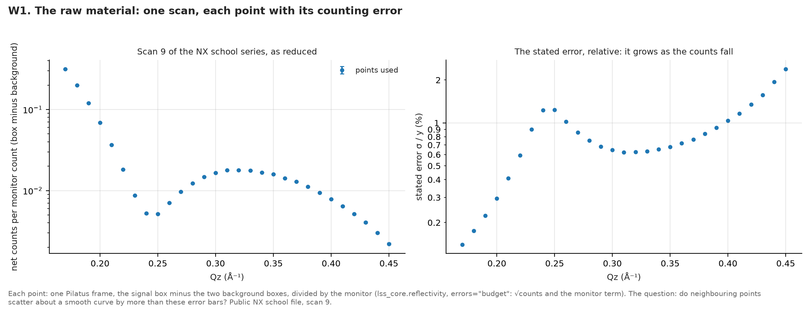
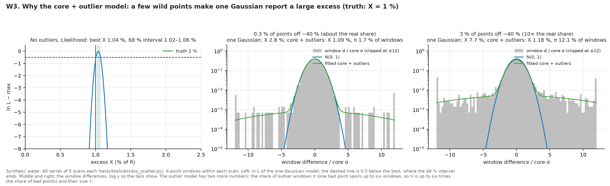
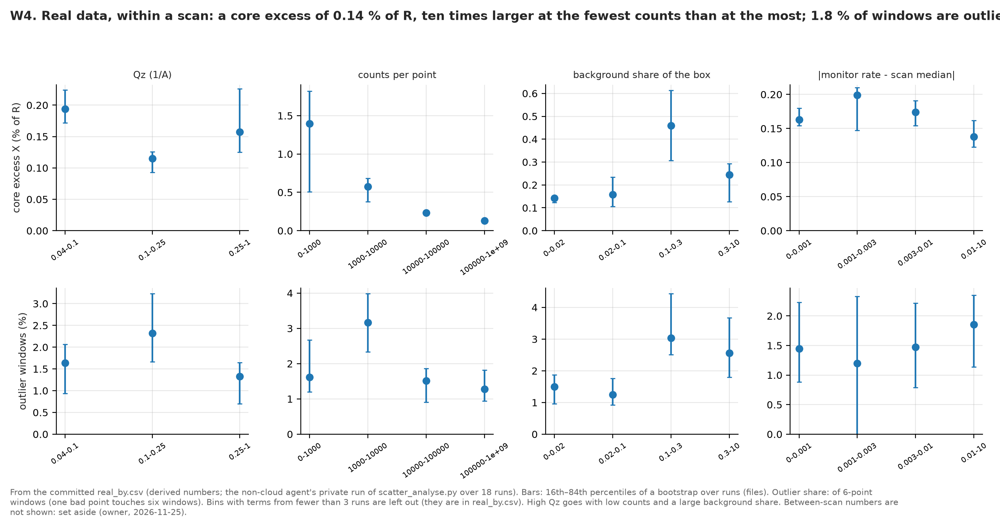
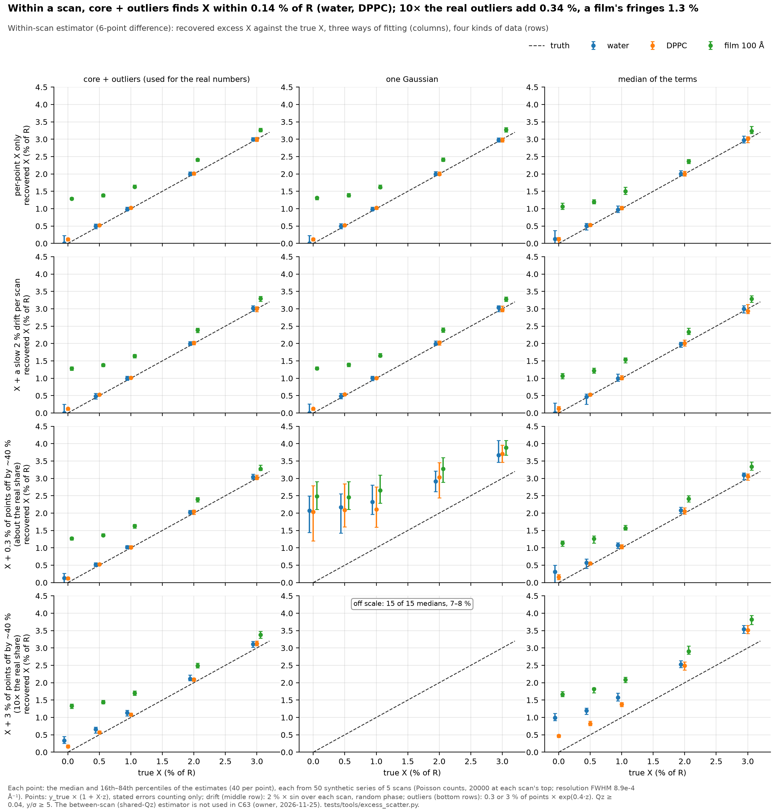
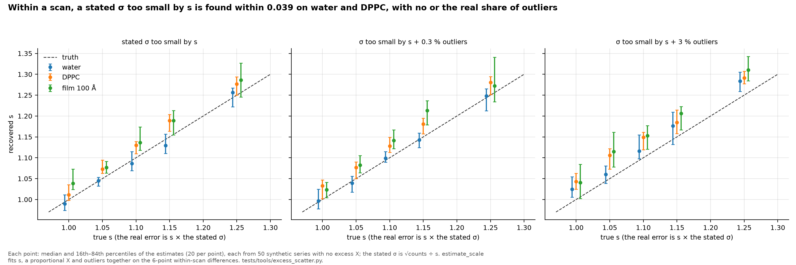

# Walkthrough: do reflectivity points scatter more than their error bars say?

*The whole chain for DATA_NEEDS row 15 (AGENTS.md rule 13), one step at a time. Figures W1–W4:
`python tests/tools/excess_scatter_walkthrough.py`. Known truth (X1, X2, `pulls.csv`):
`python tests/tools/excess_scatter.py`. The real numbers are in `summary.md`.*

## The question in one paragraph

Every reflectivity point comes with an error bar from counting statistics: count N photons and you are
uncertain by about √N. If that were the whole story, neighbouring points would scatter about a smooth curve
by about their error bars, never by much more. C56 found that real joins between scans disagree a bit more
than their error bars allow, about 24 % more. C61 showed that a hidden extra scatter of about 1 % of R on
every point would explain it. The owner asked: **how big is that extra scatter really, and what does it
follow?** If the error bars were honest, the leftovers would scatter like a bell curve of width 1. If
something adds scatter, the bell is wider. If a few points are simply wrong, the bell grows long tails.

**Only scatter within a scan is measured** (owner, 2026-11-25). Comparing two scans at the same Qz would
also pick up whatever changed between them (sample height, footprint, background at another absorber, time),
and the data do not record those. So that comparison was set aside, knowing it may leave part of the
uncertainty unmeasured.

## 1. The raw data (W1)

The public NX school series, scan 9. Each point is one detector frame:
- the counts in a box around the reflected beam, minus the average of two background boxes beside it;
- divided by the monitor (a count proportional to the beam's intensity).

The error bar is √counts, propagated through that sum and division, plus a small monitor term (the
"budget" model). On the left the error bars are smaller than the dots. On the right they are drawn as a
share of each point: 0.15 % where the counts are high, over 2 % where they are low. The question is
whether neighbouring points scatter about a smooth curve by more than these error bars.

## 2. Step one: six points at a time (W2)

- **What is done:** divide the scan by the Fresnel curve R_F (a bare, perfectly sharp interface), so what is
  left changes slowly. Take six neighbouring points, and remove the best smooth curve through them, a
  polynomial up to Qz⁴. One number d is left per window. It is zero for any curve that smooth, and only noise
  remains.
- **The fit drawn:** top right, the six points of one window and the quartic through them. Bottom right,
  their residuals, each divided by its own error.
- **Why six points:** with three points a curve's own bend leaks in. On known truth, 3–5 points left
  0.3–1.9 % of fake excess on a DPPC monolayer; 6 points leave about 0.1 %. A film's fast fringes still leak
  in at six (about 1.3 % on a 100 Å film).
- **Reading it:** NX scan 9 gives χ²/n = 2.53 over 24 windows. That is more than 1, but scan 9 has strong
  structure (the deep minimum near 0.24 Å⁻¹), which is exactly the leak. One scan of 24 overlapping windows
  cannot measure the excess. The real numbers come from 26,182 windows over many samples.
- **What an excess does:** a hidden scatter X (a fraction of R) on each point adds X² to each point's
  variance of ln y, and so X² to the variance of d (the weights have length 1).
- **What it sees and misses:** a slow drift over a scan looks smooth, so this estimator does not see it.
  Neither does it see a change between two scans. Those are the parts of the uncertainty this study leaves
  unmeasured.

## 3. Step two: combine many windows, and allow for wild points (W3)

- **Likelihood, left panel:** for each trial value of X, how probable are all the window differences
  together? The curve peaks at the best X. Where it has dropped by 0.5, the 68 % interval ends. On 60
  synthetic series with X = 1 % and no outliers, the best X is 1.04 %.
- **Why that is not enough, middle and right:** real data have a few points that are far off. A frame catches
  a stray reflection, or the beam moves off the box. With 0.3 % of points off by about 40 % (about the real
  share), a single bell curve reports 2.8 %. With 3 % of points it reports 7.7 %.
- **The fix: a core and an outlier part.** Each window comes either from the core bell curve (width from
  counting plus X), with probability 1 − π, or from a much wider outlier curve (width τ), with probability π.
  - All three numbers are fitted together.
  - τ must be at least 10 % of R. Without that floor, the outlier part can take over the core.
  - With the real share of outliers the core comes back at 1.09 % here. In figure X1 (40 estimates per
    point) it is within 0.14 % of R of the truth.
  - One bad point spoils up to six windows, so π (of windows) is up to six times the share of bad points.

## 4. The real data, by what it might follow (W4)

The real within-scan results, from the committed `real_by.csv`. Top row: the core excess X. Bottom row: the
share of outlier windows. The bars are bootstrap intervals over runs (below). The clearest pattern is in
the counts: X falls from about 1.4 % of R below 10³ counts to 0.13 % above 10⁵. That is what an error bar
that is too small by a fixed factor does. The same data fitted as a scale on σ give s ≈ 1.12 in every counts
bin (`real_scale.csv`).

## 5. Every statistic used, in words

| statistic | what it is, here |
|---|---|
| σ (error bar) | the stated uncertainty of a point, from √counts and the monitor ("budget" model) |
| residual / σ (pull) | how far a point is from its fit, in units of its own error. Honest errors give a bell curve of width 1: 68 % within ±1, 0.27 % beyond ±3 |
| χ², χ²/n | the sum of squared pulls; divided by their number it should be about 1. Much more means the errors are too small or the model is wrong |
| median \|d / σ_d\| | the middle value of the windows' pull sizes: 0.674 for honest errors. Real data: 0.76, so the core is wider than the errors say |
| tail share | the share of windows beyond 3, 5, 10σ. Real: 3.1 %, 1.4 %, 0.84 %, against 0.27 % and practically 0 for a bell curve, so there are wild points |
| X (core excess) | the extra scatter of a typical point, as a fraction of R, added in quadrature to σ |
| s (error scale) | the same idea as a multiplier: the real error is s × σ. Real: s ≈ 1.12, so the errors are about 10 % too small |
| π, τ | the share of windows that are wild, and how wild (a fraction of R) |
| likelihood | how probable the data are for given numbers; the best numbers maximise it |
| Δln L | how much better one model explains the data than another. 2 is a hint, 10 or more is decisive. Real: 166 for adding s, 96 for adding X, so both are needed |
| 68 % interval (bootstrap) | redo the whole estimate on 100 resamples of the runs (whole files drawn with replacement) and keep the middle 68 %. Used for the real numbers, because the likelihood interval was checked and found too narrow (below) |
| pull SD of the joint fit | over many synthetic joins with a known factor: the spread of (fitted − true) / stated error. 1 means the join's error bar is honest |

## 6. Calibration: are these promises kept? (X1, X2, `pulls.csv`)

- **The estimator used** (core + outliers, left column): the median of 40 estimates is within 0.14 % of R of
  the truth for every X from 0 to 3 %, on water and DPPC, with no outliers or the real share. With ten times
  the real share it reads up to 0.34 % high.
- **One Gaussian** (middle column) is right only when there are no wild points.
- **A film's fringes** (green) add about 1.3 % at every X. A real sample with fringes reads high.
- **A slow drift** (second row) changes nothing: the estimator does not see it. That is the blind spot.
- **The likelihood interval undercovers.** It should contain the truth 68 % of the time, but does so 15–45 %
  of the time at X > 0 (`known_truth.csv`, `curv_coverage68`). So the real intervals are bootstrapped over
  runs instead. That also covers the real data's run-to-run differences.

- **The scale s** is found within 0.04 on water and DPPC. DPPC reads 0.01–0.04 high, because a little of its
  curve's shape leaks in. So the real s of 1.12 means a true scale of about 1.08–1.12.

**Does the within-scan excess explain the real joins?** Today's joint fit on C61's six synthetic joins,
400 replicates each (pull SD on the smooth join, ± from a bootstrap):
- 1.12 ± 0.04 with honest errors;
- **1.19 ± 0.05 with the within-scan findings** (σ × 1.12, a 0.14 % core, 0.3 % wild points);
- 1.67 ± 0.06 with C61's 1 % on every point;
- the real joins measured 1.24 [1.09, 1.40] (C56).

The within-scan excess is consistent with the real joins. C56's interval is too wide to tell whether
something between scans adds more.

## 7. The judgment

- **High confidence:**
  - within a scan, real points scatter more than their counting errors, by a scale of about 1.1 on σ;
  - as a share of R that is small for well-counted points (0.14 % overall, 0.13 % above 10⁵ counts) and large
    for poorly counted ones (about 1.4 % below 10³);
  - about 0.3 % of points are wild (tens of % off);
  - a single bell curve fitted to everything would say 6 %, and would be wrong.
- **Medium confidence:** the exact scale. The fit says 1.12 [1.10, 1.12]. The curve-shape leak seen on DPPC
  could account for up to 0.04 of that.
- **Not measured:** anything that changes slowly during a scan or between scans. The set-aside between-scan
  comparison would have been needed for that, with the confounders recorded. So the total uncertainty of a
  joined curve may be larger than this study says.
- **What would settle the rest:**
  - a repeat of one Qz point, 20 frames with the sample still (the counting part);
  - the height scans paired with the points;
  - repeated scans with the sample height, footprint and absorber recorded.
- **For the reader:** no number changes until a rule-12 study of the joint fit with σ × 1.1 and a robust
  likelihood, and the owner's word.
