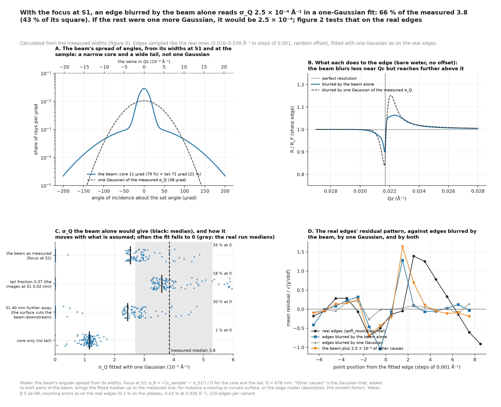
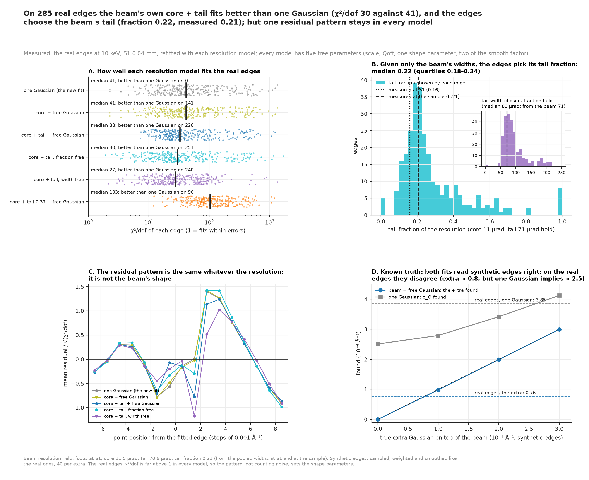

# Focus at S1 or at the sample, and how much of the edge's width σ_Q the beam explains

The owner (2026-11-27): "if we could constrain the critical edge fit then it would make a good default
calculation. We do optimize focus with a measurement by the s1 slits … Show me how the two cases influence
what the qz-sigma is and how it has other causes or not. The two cases are focusing at s1 slits and focusing
at sample. I want to know what part of the qz-sigma is explainable."

This follows [`docs/studies/beam_size_vs_resolution/`](../beam_size_vs_resolution/summary.md), which found that
the beam's size alone does not predict σ_Q. Here the beam is measured in two places, so its angles can be
worked out.

**Data used: the later beamtimes only.** The owner asked (2026-11-27) to remove the earlier beamtimes from the
dataset. The four earliest beamtimes of the edge set were removed (93 of its 378 edges), and with them the
S1 slit scans and height-scan images taken before that date. Every number and figure here is from the 285
edges, 12 runs (13 with a run of a single edge) and beam profiles that remain. Runs keep their labels E01…
from the edge studies, so the labels that are missing belong to removed runs.

## The answer

1. **The data fit a focus at S1, not at the sample** (Figure 0).
   - Both parts of the beam are wider at the sample than at S1: the core by × 1.23, the tail by × 1.97.
   - σ_Q did not change when S1 was opened from 0.04 to 0.2 mm.
   - A focus at the sample would make the beam shrink from S1 to the sample. It would also let S1 cut angles,
     so the edge would widen 1.8 × between those two slits.
2. **With the focus at S1, the beam's own spread of angles follows from its two widths.** It has a narrow
   core of 11.5 µrad (79 % of the beam) and a wide tail of 71 µrad (21 %). It is not one Gaussian.
3. **How much of σ_Q that explains depends on which edge shape you trust.** The answer lies between about
   two thirds and almost all of it:
   - **Lower reading, about two thirds** (Figure 1, calculated). An edge blurred by the beam alone, fitted
     with one Gaussian like the real edges, reads σ_Q = 2.5 × 10⁻⁴ Å⁻¹. That is 66 % of the measured
     3.85 × 10⁻⁴ (43 % of its square). If the rest were one more Gaussian, it would be 2.5 × 10⁻⁴.
   - **Upper reading, most of it** (Figure 2, measured). Fit the real edges with the beam's own core and
     tail, each widened by a free extra Gaussian. The median extra is 0.8 × 10⁻⁴, and it is exactly 0 on 127
     of 285 edges and in 6 of 12 runs. Given the beam's two widths and nothing else, the edges choose the
     beam's tail fraction (median 0.22; measured 0.16 at S1 and 0.21 at the sample). With the fraction held,
     they choose a tail width of 83 µrad (from the beam: 71).
   - **Why the two readings differ.** The real edges carry one residual pattern that no resolution model
     removes (Figure 2 C; χ²/dof 27–41 in every model). The pattern, not the counting noise, decides the shape
     parameters. Both fits read synthetic edges correctly (Figure 2 D), so the gap is in the real edges' shape,
     not in the fits.
4. **For a default (constraining the edge fit).**
   - Hold the beam's core and tail widths, measured by the S1 slit scans and the height scans, and fit only
     the tail fraction. This fits better than one Gaussian on 251 of 285 edges (χ²/dof 30 against 41).
   - It changes Qoff by a median of 8 × 10⁻⁶ Å⁻¹ (90 % within 6 × 10⁻⁵). For the Propose button, the choice of
     resolution model hardly matters.
   - What would change is the resolution handed on to R/R_F: a core and a tail instead of one width.
   - Nothing was changed here. A default needs the owner's choice (rule 12).

**What removing the early beamtimes changed.** Little. With all 378 edges the study found: S1 widths core
11.0 µm, tail 26.9 µm, fraction 0.17; angles 11.3 and 72 µrad; the beam alone 67 % of 3.8 × 10⁻⁴; extra 0.4 ×
10⁻⁴ (none in 9 of 16 runs); tail fraction 0.21; χ²/dof 30 against 42. The widths at the sample did not
change, because all 30 images at S1 0.04 mm are from the later beamtimes. The run with both slits is also a
later one.

## Terms used here

- **S1**: the incident slit, 678 mm before the sample centre. That is the scan headers' geometry, g_l2 − g_l1
  = 1238 − 560 mm. The `ih` motor raises the input arm that carries it.
- **S1 slit scan**: an `ascan ih` with S1 closed to a few µm. It sweeps the slit through the beam and records
  the beam's height profile at S1, the "focus measurement". These were fitted in the owner's spec
  reference repository: 113 accepted at 10 keV in the later beamtimes, 91 of them with a slit of 5 µm or less.
- **Height-scan images**: the Pilatus images of the sample-height scans. They record the beam's profile where
  it meets the surface (`docs/studies/sh_beam_size/`).
- **Core and tail**: the beam's profile is two Gaussians with one centre, a narrow core and a wide, weaker
  tail. That holds both at S1 and at the sample.
- **Focus at S1 / at the sample**: where the rays cross, so where the beam is narrowest.
- **σ_Q**: the width of the critical edge in Qz from one-Gaussian fits; the median of the real edges is
  3.85 × 10⁻⁴ Å⁻¹. It equals (4π/λ) σ_θ, with 4π/λ = 10.14 Å⁻¹ at 10 keV.
- **Other causes**: anything that spreads the angles of incidence and is not in the beam's height profiles,
  for example:
  - a moving or tilted surface;
  - the tail's long footprint reaching the curved ends of the trough;
  - the edge model itself: absorption, the smooth factor, the pattern of item 3.

## 1. The two cases (Figure 0)

Rays travel in straight lines. Where they cross, height and angle are independent. Away from that point, a
ray's height tells you its angle.

| | focus at S1 | focus at the sample |
|---|---|---|
| what S1 cuts | heights (at the waist); every angle passes | angles (upstream of the waist, height and angle are tied) |
| the beam from S1 to the sample | grows: σ_sample² = σ_S1² + (σ_θ · 678 mm)² | shrinks |
| σ_Q against the S1 gap | does not change | grows with the gap: 1.8 × from 0.04 to 0.2 mm for a 37 µrad beam |
| **measured** | core 10.9 → 13.4 µm, tail 28.3 → 55.8 µm: **grows** | |
| **measured** (qz_resolution, one run with both slits) | σ_Q 3.38 ± 0.08 at 0.04 mm, 3.41 ± 0.75 at 0.2 mm: **does not change** | |

Both facts point to the focus at S1, which is where the focus measurement puts it.

The widths in the table are pooled medians at 10 keV, from two sources:
- the S1 slit scans with a slit of 5 µm or less: core 10.9 µm, tail 28.3 µm, tail fraction 0.16;
- the height-scan images with S1 at 0.04 mm, the edges' slit (30 scans): core 13.4 µm, tail 55.8 µm, tail
  fraction 0.21.

With S1 at 0.02 mm, the images give core 12.1 µm, tail 55.3 µm and tail fraction 0.36 (72 scans).

**The beam's angles, with the focus at S1:** σ_θ = √(σ_sample² − σ_S1²) / 678 mm. That gives 11.5 µrad for
the core and 70.9 µrad for the tail. The tail grows twice as fast as the core, so the wide angles are in the
tail.

## 2. What the beam alone would do to the edge (Figure 1, calculated)

I simulated bare-water edges blurred by that core and tail. They are sampled like the real ones: 0.016–0.030
Å⁻¹ in steps of 0.001, with a random offset. The counting errors are like the real edges' median, 0.1 % on
the plateau and 0.43 % at 0.030 Å⁻¹. Each edge is fitted with one Gaussian (`fresnel.fit_edge_resolution`).

| assumed beam | one-Gaussian σ_Q, median (10–90 %) | χ²/dof | fits at 0 |
|---|---|---|---|
| as measured, focus at S1 | 2.5 (0.0–3.4) × 10⁻⁴ | 26 | 33 % |
| tail fraction 0.37 (about the images at S1 0.02 mm, 0.36) | 3.6 (0.0–5.0) × 10⁻⁴ | 64 | 18 % |
| S1 40 mm further away (the surface cuts the beam downstream) | 2.4 (0.0–3.2) × 10⁻⁴ | 18 | 30 % |
| core only | 1.2 (0.9–1.3) × 10⁻⁴ | 0.9 | 1 % |

Two things stand out:
- **The tail fraction is the input that matters most.** At 0.37 instead of 0.21, the beam alone reaches 93 %
  of the measured width.
- **One Gaussian is the wrong shape for the beam.** A third of these fits fall to 0, and χ²/dof is 26 where
  noise alone would give 1.

## 3. The real edges refitted with the beam's resolution (Figure 2, measured)

These are 285 real edges at 10 keV with S1 at 0.04 mm, the edges of `qoff_resolution_real` from the later
beamtimes. Every model uses the same points, loss and smooth factor, and five free parameters: scale, Qoff,
one shape parameter, and the smooth factor's two. So their χ² compare directly.

| model | χ²/dof median | shape parameter, median (quartiles) | better than one Gaussian |
|---|---|---|---|
| one Gaussian (the new fit) | 41 | σ_Q 3.85 (3.36–4.52) × 10⁻⁴ | |
| beam core + free Gaussian | 41 | 3.7 × 10⁻⁴ | 141 |
| beam core + tail + free Gaussian | 33 | extra 0.8 (0.0–2.6) × 10⁻⁴; 0 on 127 edges | 226 |
| beam core + tail, tail fraction free | 30 | 0.22 (0.18–0.34) | 251 |
| beam core + tail, tail width free | 27 | 83 (67–110) µrad | 240 |
| beam core + tail at fraction 0.37 + free Gaussian | 103 | | 96 |

**By run** (`refit_by_run.csv`, 12 runs with at least 4 edges):
- In 6 of 12 runs, the beam's core and tail need no extra width.
- In 5 runs (E03, E10, E12, E13, E17) the extra is 0.5–2.5 × 10⁻⁴. E11, the widest run (one-Gaussian σ_Q
  5.3 × 10⁻⁴), needs 4.3 × 10⁻⁴ and picks a tail fraction of 0.46.
- Per run, the tail fraction the edges choose follows the run's own height-scan images only weakly (Spearman
  0.48, p = 0.11, 12 runs, 5–15 images per run, at any S1). So the run-to-run differences in σ_Q are not yet
  traced to the beam.

**Known truth** (Figure 2 D). I made synthetic edges with the beam's core and tail plus a known extra
Gaussian, sampled, weighted and smoothed like the real ones (40 per value).

| true extra (10⁻⁴ Å⁻¹) | 0 | 1 | 2 | 3 |
|---|---|---|---|---|
| beam + free Gaussian finds | 0.00 | 0.98 | 1.99 | 2.99 |
| one Gaussian finds σ_Q | 2.51 | 2.79 | 3.42 | 4.12 |
| χ²/dof, beam model / one Gaussian | 1.0 / 5.2 | 0.9 / 5.3 | 0.9 / 5.6 | 0.9 / 7.8 |

A tail fraction set to 0.10 or 0.30 comes back as 0.10 or 0.30.

**Both fits work on edges that are the beam plus a Gaussian. The real edges are not that.**
- On the real edges, the one-Gaussian width (3.85) implies an extra of about 2.5 on top of the beam.
- The beam + Gaussian fit finds 0.8.
- The improvement in χ² is small: 41 → 30. On beam-shaped edges it would be about 5 → 1.

So the real edges contain the beam's core-and-tail shape, but also something else that sets their χ²: the
residual pattern. Its largest feature is an excess 2–5 steps above the edge.

## 4. What is explainable, and what is not

| part of σ_Q | size | how known |
|---|---|---|
| the beam's core (focus at S1) | 11.5 µrad, 1.2 × 10⁻⁴ Å⁻¹ | measured widths at S1 and at the sample |
| the beam's tail | 71 µrad at 21 %; the edges choose 83 µrad and 22 % | measured widths; the edges' own fit agrees |
| one-Gaussian σ_Q from the beam alone | 2.5 × 10⁻⁴: 66 % of the median width | calculated (Figure 1) |
| left over, as one more Gaussian | 0 to 2.5 × 10⁻⁴ (0.8 from the refit, 2.5 from the widths) | measured against calculated; the residual pattern decides |
| run to run | 6 of 12 runs need nothing more than the beam; E11 needs 4.3 × 10⁻⁴ | measured |
| the residual pattern | χ²/dof 27–41 in every model | not explained by any resolution |

## Not shown, and why

- **The early beamtimes**: removed at the owner's request (see "Data used").
- **Per-run S1 slit scans**: only 5 of the 14 edge files have S1 slit scans, with 1–28 per file. The study
  uses the pooled widths.
- **The released runs before 2019**: no S1 slit scans or height-scan images in this set.
- **Curves, per-edge values, times, names, files and scan numbers**: not published. The numbers here are
  pooled medians and run medians, with the anonymous labels E01… of the edge studies.
- **Diffraction at a 16–20 µm slit**: λ/g ≈ 7 µrad, smaller than the core. Not modelled.

## Open, for the owner

- Is the focus optimised to the smallest profile at S1 every beamtime? The model assumes the waist is at S1.
- What is the residual pattern? It is the same in every model and largest 2–5 steps above the edge. It limits
  every fit of the edge.
- A default would hold the beam's core and tail widths and fit the tail fraction. Should those widths come
  from each beamtime's S1 slit scan and height scans, or from the pooled values?

## Files

| file | what |
|---|---|
| `F0_two_focus_cases.png`, `F1_how_much_the_beam_explains.png`, `calculated.json` | calculated, public, from `tests/tools/focus_cases_resolution.py` |
| `F2_real_edges_refit.png`, `refit_by_run.csv`, `numbers.json` | measured, from the private generator |

The columns of `refit_by_run.csv` are run medians:
- `sigma_q_gauss`: one Gaussian;
- `extra_beam`: the extra Gaussian on top of the beam;
- `tail_fraction_free`, `tail_width_free_urad`;
- the χ²/dof of each model.

**Regenerate:**
- The calculated figures are public:
  `python tests/tools/focus_cases_resolution.py --out docs/studies/focus_and_resolution`.
- Figure 2 and its numbers come from the private generator on the owner's PC. It runs
  `sample_data/private/xr/scripts/beamres_refit.py` (which applies the date cut), `beamres_truth.py` and then
  `beamres_publish.py`. It is not regenerable here.
