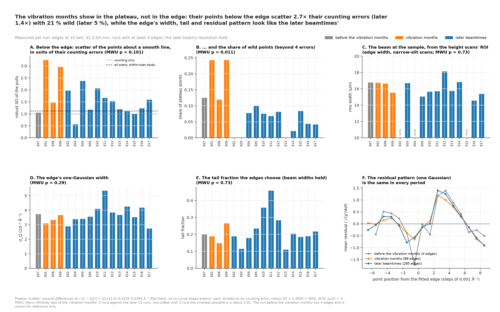
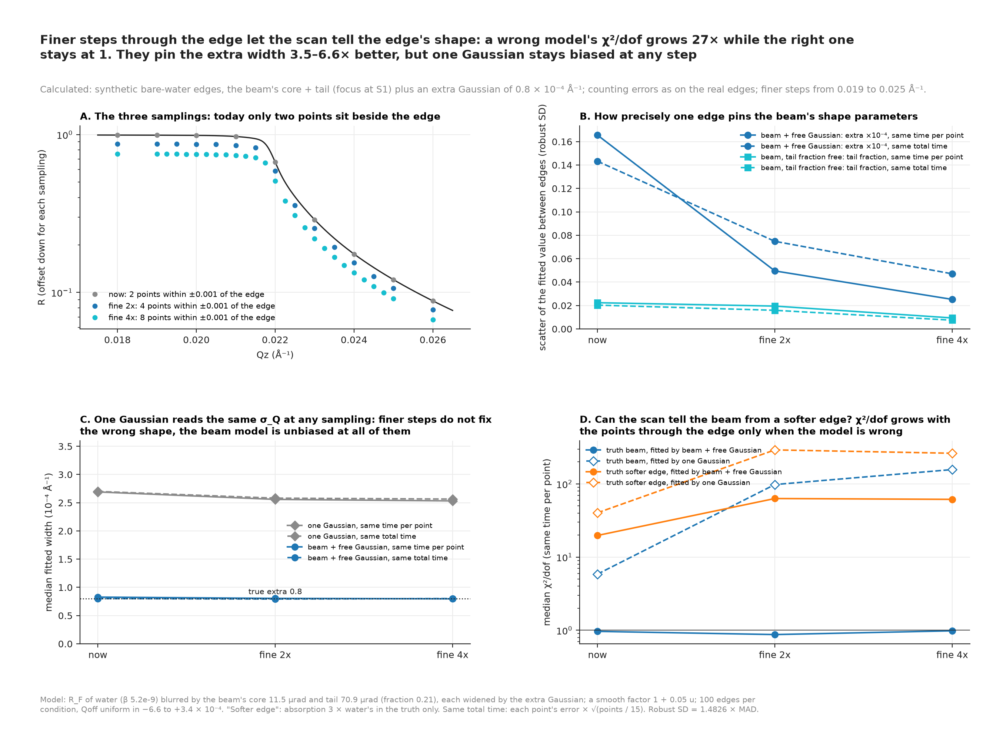

# Focus at S1 or at the sample, and how much of the edge's width σ_Q the beam explains

The owner (2026-11-27): "if we could constrain the critical edge fit then it would make a good default
calculation. We do optimize focus with a measurement by the s1 slits … Show me how the two cases influence
what the qz-sigma is and how it has other causes or not. The two cases are focusing at s1 slits and focusing
at sample. I want to know what part of the qz-sigma is explainable."

This follows [`docs/studies/beam_size_vs_resolution/`](../beam_size_vs_resolution/summary.md), which found that
the beam's size alone does not predict σ_Q. Here the beam is measured in two places, so its angles can be
worked out.

**Data used: the later beamtimes only.** The owner asked (2026-11-27) to remove the earlier beamtimes from the
dataset. The four earliest beamtimes of the edge set were removed (93 of its 378 edges), and with them the
S1 slit scans and height-scan images taken before that date. Every number and figure here is from the 285
edges, 12 runs (13 with a run of a single edge) and beam profiles that remain. Runs keep their labels E01…
from the edge studies, so the labels that are missing belong to removed runs.

The owner then explained why: three of those beamtimes fall in months when the beam had a vibration problem
that made the spot at the sample much larger. Such data may stay in an analysis of beam qualities only if they
are kept apart or shown to behave like the later ones. Section 5 tests that. The main numbers stay on the later
beamtimes. Section 6 asks whether the edge should be scanned in finer steps, and section 7 how honest the error
bars are.

## The answer

1. **The data fit a focus at S1, not at the sample** (Figure 0).
   - Both parts of the beam are wider at the sample than at S1: the core by × 1.23, the tail by × 1.97.
   - σ_Q did not change when S1 was opened from 0.04 to 0.2 mm.
   - A focus at the sample would make the beam shrink from S1 to the sample. It would also let S1 cut angles,
     so the edge would widen 1.8 × between those two slits.
2. **With the focus at S1, the beam's own spread of angles follows from its two widths.** It has a narrow
   core of 11.5 µrad (79 % of the beam) and a wide tail of 71 µrad (21 %). It is not one Gaussian.
3. **How much of σ_Q that explains depends on which edge shape you trust.** The answer lies between about
   two thirds and almost all of it:
   - **Lower reading, about two thirds** (Figure 1, calculated). An edge blurred by the beam alone, fitted
     with one Gaussian like the real edges, reads σ_Q = 2.5 × 10⁻⁴ Å⁻¹. That is 66 % of the measured
     3.85 × 10⁻⁴ (43 % of its square). If the rest were one more Gaussian, it would be 2.5 × 10⁻⁴.
   - **Upper reading, most of it** (Figure 2, measured). Fit the real edges with the beam's own core and
     tail, each widened by a free extra Gaussian. The median extra is 0.8 × 10⁻⁴, and it is exactly 0 on 127
     of 285 edges and in 6 of 12 runs. Given the beam's two widths and nothing else, the edges choose the
     beam's tail fraction (median 0.22; measured 0.16 at S1 and 0.21 at the sample). With the fraction held,
     they choose a tail width of 83 µrad (from the beam: 71).
   - **Why the two readings differ.** The real edges carry one residual pattern that no resolution model
     removes (Figure 2 C; χ²/dof 27–41 in every model). The pattern, not the counting noise, decides the shape
     parameters. Both fits read synthetic edges correctly (Figure 2 D), so the gap is in the real edges' shape,
     not in the fits.
4. **For a default (constraining the edge fit).**
   - Hold the beam's core and tail widths, measured by the S1 slit scans and the height scans, and fit only
     the tail fraction. This fits better than one Gaussian on 251 of 285 edges (χ²/dof 30 against 41).
   - It changes Qoff by a median of 8 × 10⁻⁶ Å⁻¹ (90 % within 6 × 10⁻⁵). For the Propose button, the choice of
     resolution model hardly matters.
   - What would change is the resolution handed on to R/R_F: a core and a tail instead of one width.
   - Nothing was changed here. A default needs the owner's choice (rule 12).
5. **The vibration months differ in the plateau, not in the edge** (Figure 3).
   - Below the edge, their points scatter 2.7 × their counting errors (later beamtimes: 1.4 ×). 21 % of them
     are wild, beyond 4 errors (later: 5 %). All three of their runs have more wild points than any later run.
   - Their edge width, tail fraction, χ² and residual pattern fall inside the later runs' range. So do their
     beam widths in the height scans.
   - So their edges could join a beam-shape analysis, but their error bars cannot be treated like the later
     ones (item 7).
6. **Finer steps through the edge would answer which shape is right** (Figure 4, calculated).
   - With steps of 0.00025–0.0005 Å⁻¹ from 0.019 to 0.025, a wrong model shows itself: one Gaussian's χ²/dof
     goes from 6 to 100–160 on beam-shaped edges, while the right model stays at 1.
   - Today's steps cannot tell the beam + extra Gaussian from the beam with a free tail fraction (χ²/dof 1.0
     against 1.1). At 4 × finer steps they can (1.0 against 6.0).
   - The beam's extra width is pinned 3.5–6.6 × better. Qoff was already pinned far better than it moves from
     series to series, so it gains nothing that matters.
   - The cost: 6 more points per edge scan (2 × finer) or 18 (4 × finer).
7. **Error bars: the points' errors are nearly honest; the edge fit's χ² is not about them** (section 7).
   - Within a scan, the points scatter 1.12 × their counting errors (the within-scan study); on the plateau of
     the later edges, 1.4 ×. The edge's χ²/dof of 30–41 is the model's shape, not noise. Inflating the errors
     to bring it to 1 would make them about 6 × too large.
   - For Qoff and σ_Q, quote the spread between series in a run, not the fit's ±.
   - The scale σ × 1.12 is built as an option, but the default is unchanged. It waits for the real-split check
     (DATA_NEEDS row 17a) and the owner's word.

**What removing the early beamtimes changed.** Little. With all 378 edges the study found: S1 widths core
11.0 µm, tail 26.9 µm, fraction 0.17; angles 11.3 and 72 µrad; the beam alone 67 % of 3.8 × 10⁻⁴; extra 0.4 ×
10⁻⁴ (none in 9 of 16 runs); tail fraction 0.21; χ²/dof 30 against 42. The widths at the sample did not
change, because all 30 images at S1 0.04 mm are from the later beamtimes. The run with both slits is also a
later one.

## Terms used here

- **S1**: the incident slit, 678 mm before the sample centre. That is the scan headers' geometry, g_l2 − g_l1
  = 1238 − 560 mm. The `ih` motor raises the input arm that carries it.
- **S1 slit scan**: an `ascan ih` with S1 closed to a few µm. It sweeps the slit through the beam and records
  the beam's height profile at S1, the "focus measurement". These were fitted in the owner's spec
  reference repository: 113 accepted at 10 keV in the later beamtimes, 91 of them with a slit of 5 µm or less.
- **Height-scan images**: the Pilatus images of the sample-height scans. They record the beam's profile where
  it meets the surface (`docs/studies/sh_beam_size/`).
- **Core and tail**: the beam's profile is two Gaussians with one centre, a narrow core and a wide, weaker
  tail. That holds both at S1 and at the sample.
- **Focus at S1 / at the sample**: where the rays cross, so where the beam is narrowest.
- **σ_Q**: the width of the critical edge in Qz from one-Gaussian fits; the median of the real edges is
  3.85 × 10⁻⁴ Å⁻¹. It equals (4π/λ) σ_θ, with 4π/λ = 10.14 Å⁻¹ at 10 keV.
- **Other causes**: anything that spreads the angles of incidence and is not in the beam's height profiles,
  for example:
  - a moving or tilted surface;
  - the tail's long footprint reaching the curved ends of the trough;
  - the edge model itself: absorption, the smooth factor, the pattern of item 3.

## 1. The two cases (Figure 0)

Rays travel in straight lines. Where they cross, height and angle are independent. Away from that point, a
ray's height tells you its angle.

| | focus at S1 | focus at the sample |
|---|---|---|
| what S1 cuts | heights (at the waist); every angle passes | angles (upstream of the waist, height and angle are tied) |
| the beam from S1 to the sample | grows: σ_sample² = σ_S1² + (σ_θ · 678 mm)² | shrinks |
| σ_Q against the S1 gap | does not change | grows with the gap: 1.8 × from 0.04 to 0.2 mm for a 37 µrad beam |
| **measured** | core 10.9 → 13.4 µm, tail 28.3 → 55.8 µm: **grows** | |
| **measured** (qz_resolution, one run with both slits) | σ_Q 3.38 ± 0.08 at 0.04 mm, 3.41 ± 0.75 at 0.2 mm: **does not change** | |

Both facts point to the focus at S1, which is where the focus measurement puts it.

The widths in the table are pooled medians at 10 keV, from two sources:
- the S1 slit scans with a slit of 5 µm or less: core 10.9 µm, tail 28.3 µm, tail fraction 0.16;
- the height-scan images with S1 at 0.04 mm, the edges' slit (30 scans): core 13.4 µm, tail 55.8 µm, tail
  fraction 0.21.

With S1 at 0.02 mm, the images give core 12.1 µm, tail 55.3 µm and tail fraction 0.36 (72 scans).

**The beam's angles, with the focus at S1:** σ_θ = √(σ_sample² − σ_S1²) / 678 mm. That gives 11.5 µrad for
the core and 70.9 µrad for the tail. The tail grows twice as fast as the core, so the wide angles are in the
tail.

## 2. What the beam alone would do to the edge (Figure 1, calculated)

I simulated bare-water edges blurred by that core and tail. They are sampled like the real ones: 0.016–0.030
Å⁻¹ in steps of 0.001, with a random offset. The counting errors are like the real edges' median, 0.1 % on
the plateau and 0.43 % at 0.030 Å⁻¹. Each edge is fitted with one Gaussian (`fresnel.fit_edge_resolution`).

| assumed beam | one-Gaussian σ_Q, median (10–90 %) | χ²/dof | fits at 0 |
|---|---|---|---|
| as measured, focus at S1 | 2.5 (0.0–3.4) × 10⁻⁴ | 26 | 33 % |
| tail fraction 0.37 (about the images at S1 0.02 mm, 0.36) | 3.6 (0.0–5.0) × 10⁻⁴ | 64 | 18 % |
| S1 40 mm further away (the surface cuts the beam downstream) | 2.4 (0.0–3.2) × 10⁻⁴ | 18 | 30 % |
| core only | 1.2 (0.9–1.3) × 10⁻⁴ | 0.9 | 1 % |

Two things stand out:
- **The tail fraction is the input that matters most.** At 0.37 instead of 0.21, the beam alone reaches 93 %
  of the measured width.
- **One Gaussian is the wrong shape for the beam.** A third of these fits fall to 0, and χ²/dof is 26 where
  noise alone would give 1.

## 3. The real edges refitted with the beam's resolution (Figure 2, measured)

These are 285 real edges at 10 keV with S1 at 0.04 mm, the edges of `qoff_resolution_real` from the later
beamtimes. Every model uses the same points, loss and smooth factor, and five free parameters: scale, Qoff,
one shape parameter, and the smooth factor's two. So their χ² compare directly.

| model | χ²/dof median | shape parameter, median (quartiles) | better than one Gaussian |
|---|---|---|---|
| one Gaussian (the new fit) | 41 | σ_Q 3.85 (3.36–4.52) × 10⁻⁴ | |
| beam core + free Gaussian | 41 | 3.7 × 10⁻⁴ | 141 |
| beam core + tail + free Gaussian | 33 | extra 0.8 (0.0–2.6) × 10⁻⁴; 0 on 127 edges | 226 |
| beam core + tail, tail fraction free | 30 | 0.22 (0.18–0.34) | 251 |
| beam core + tail, tail width free | 27 | 83 (67–110) µrad | 240 |
| beam core + tail at fraction 0.37 + free Gaussian | 103 | | 96 |

**By run** (`refit_by_run.csv`, 12 runs with at least 4 edges):
- In 6 of 12 runs, the beam's core and tail need no extra width.
- In 5 runs (E03, E10, E12, E13, E17) the extra is 0.5–2.5 × 10⁻⁴. E11, the widest run (one-Gaussian σ_Q
  5.3 × 10⁻⁴), needs 4.3 × 10⁻⁴ and picks a tail fraction of 0.46.
- Per run, the tail fraction the edges choose follows the run's own height-scan images only weakly (Spearman
  0.48, p = 0.11, 12 runs, 5–15 images per run, at any S1). So the run-to-run differences in σ_Q are not yet
  traced to the beam.

**Known truth** (Figure 2 D). I made synthetic edges with the beam's core and tail plus a known extra
Gaussian, sampled, weighted and smoothed like the real ones (40 per value).

| true extra (10⁻⁴ Å⁻¹) | 0 | 1 | 2 | 3 |
|---|---|---|---|---|
| beam + free Gaussian finds | 0.00 | 0.98 | 1.99 | 2.99 |
| one Gaussian finds σ_Q | 2.51 | 2.79 | 3.42 | 4.12 |
| χ²/dof, beam model / one Gaussian | 1.0 / 5.2 | 0.9 / 5.3 | 0.9 / 5.6 | 0.9 / 7.8 |

A tail fraction set to 0.10 or 0.30 comes back as 0.10 or 0.30.

**Both fits work on edges that are the beam plus a Gaussian. The real edges are not that.**
- On the real edges, the one-Gaussian width (3.85) implies an extra of about 2.5 on top of the beam.
- The beam + Gaussian fit finds 0.8.
- The improvement in χ² is small: 41 → 30. On beam-shaped edges it would be about 5 → 1.

So the real edges contain the beam's core-and-tail shape, but also something else that sets their χ²: the
residual pattern. Its largest feature is an excess 2–5 steps above the edge.

## 4. What is explainable, and what is not

| part of σ_Q | size | how known |
|---|---|---|
| the beam's core (focus at S1) | 11.5 µrad, 1.2 × 10⁻⁴ Å⁻¹ | measured widths at S1 and at the sample |
| the beam's tail | 71 µrad at 21 %; the edges choose 83 µrad and 22 % | measured widths; the edges' own fit agrees |
| one-Gaussian σ_Q from the beam alone | 2.5 × 10⁻⁴: 66 % of the median width | calculated (Figure 1) |
| left over, as one more Gaussian | 0 to 2.5 × 10⁻⁴ (0.8 from the refit, 2.5 from the widths) | measured against calculated; the residual pattern decides |
| run to run | 6 of 12 runs need nothing more than the beam; E11 needs 4.3 × 10⁻⁴ | measured |
| the residual pattern | χ²/dof 27–41 in every model | not explained by any resolution |

## 5. The vibration months against the later beamtimes (Figure 3, measured)

The owner (2026-11-27): the beam had a vibration problem in those months that "caused the measured spot size at
the sample to increase a lot"; such data may stay only if they are kept apart or shown to behave the same. All
edges of every period were refitted with the later beam's resolution held, and compared run by run
(`periods_by_run.csv`, `periods.json`). The vibration months have 3 runs (89 edges) and the later beamtimes 12
(285). One run before the vibration months has 4 edges and is shown for reference only.

| per run | vibration months | later beamtimes (range) | Mann–Whitney p |
|---|---|---|---|
| plateau scatter, in counting errors | 3.25, 1.47, 2.96 | 0.56–2.37 (median 1.4) | 0.10 |
| plateau wild share (beyond 4 errors) | 0.24, 0.12, 0.24 | 0.00–0.10 | **0.011** (all 3 above every later run) |
| edge σ_Q, one Gaussian (10⁻⁴ Å⁻¹) | 3.09, 3.33, 3.66 | 2.73–5.35 | 0.29 |
| tail fraction the edges choose | 0.19, 0.15, 0.26 | 0.11–0.46 | 0.73 |
| edge χ²/dof, one Gaussian | 24, 22, 138 | 10–283 | 0.95 |
| beam width at the sample, height scans (µm) | 16.7, 16.6, 15.5 | 14.6–18.1 | 0.73 |

- **The plateau** is the flat part below the edge, 0.0125–0.0195 Å⁻¹. There each point's second difference
  y[i−1] − 2y[i] + y[i+1] should be zero within its counting error. No curve shape enters. Pooled, the
  vibration months scatter 2.7 × their errors with 21 % wild points. The later beamtimes scatter 1.4 × with 5 %
  wild points.
- **This is what a vibrating beam would do:** each point's intensity jumps as the beam moves on the surface,
  and the counting errors do not include it.
- **The edge itself does not differ.** Its width, tail fraction, χ² and residual pattern (Figure 3 F) are
  inside the later runs' spread.
- **The beam width in these height scans does not differ either.** I could not see the larger spot the owner
  describes in this record. Possible reasons: these are ROI edge widths of quick scans at the narrow slit, and
  a vibration slower than a scan point moves the beam without widening it.
- **With 3 runs, only a large difference can show.** The smallest possible p is about 0.01. The wild share
  reaches it. The other quantities do not differ by more than the later runs differ among themselves.

**What follows:** the vibration months' edges can join a study of the edge's shape. Their error bars are about
2–3 × too small and carry a fifth of wild points, so any fit weighted by those errors must use a robust loss or
a larger error.

## 6. Should the edge be scanned in finer steps? (Figure 4, calculated)

The run: `python tests/tools/edge_sampling_study.py --out docs/studies/focus_and_resolution` (about 1 min,
`sampling.json`). Synthetic bare-water edges have the beam's core and tail plus an extra Gaussian of
0.8 × 10⁻⁴, the later beamtimes' median. They are sampled three ways:
- **now:** steps of 0.001;
- **2 × finer:** 0.0005 between 0.019 and 0.025 Å⁻¹;
- **4 × finer:** 0.00025 between 0.019 and 0.025 Å⁻¹.

There are two time budgets: the same counting time per point (the scan gets longer), or the same total time.
A second truth, the "softer edge", gives the edge three times water's absorption. It stands in for the real
edges' unexplained rounding.

| beam truth, same time per point | now | 2 × finer | 4 × finer |
|---|---|---|---|
| points per edge scan (0.016–0.030) | 15 | 21 | 33 |
| points within ±0.001 of the edge | 2 | 4 | 8 |
| scatter of the extra found (robust SD, 10⁻⁴) | 0.17 | 0.05 | 0.025 |
| the same, same total time | 0.14 | 0.075 | 0.047 |
| scatter of the tail fraction found | 0.022 | 0.019 | 0.009 |
| scatter of Qoff (10⁻⁶ Å⁻¹) | 3.5 | 1.6 | 0.7 |
| χ²/dof: beam + Gaussian / beam, fraction free / one Gaussian | 1.0 / 1.1 / 6 | 0.9 / 2.6 / 98 | 1.0 / 6.0 / 157 |
| softer edge, χ²/dof: beam + Gaussian / one Gaussian | 20 / 40 | 63 / 292 | 62 / 262 |

- **The gain is in telling shapes apart, not in precision.** Today's sampling already pins the right model's
  parameters well (an extra of 0.8 ± 0.17). It cannot say which model is right: two models that differ in the
  edge's shape give χ²/dof 1.0 and 1.1. With 8 points through the edge instead of 2, a wrong shape costs 6 to
  160 in χ²/dof.
- **One Gaussian stays wrong at any step.** It reads 2.5–2.7 × 10⁻⁴ for an edge whose beam is unchanged
  (Figure 4 C). More points make its misfit plainer, not smaller.
- **The softer edge, sampled today, looks like the real edges.** It gives χ²/dof 20 for the beam model and 40
  for one Gaussian, against 33 and 41 measured. The beam model then reads an extra of 2.3 × 10⁻⁴, three times
  the truth. That is one candidate for the residual pattern, and finer steps would tell it from the beam.
- **Qoff gains nothing that matters.** It moves 7.8 × 10⁻⁵ from series to series (qoff_resolution_real),
  20–100 × its scatter here.

**Suggestion for future experiments:** scan 0.019–0.025 Å⁻¹ in steps of 0.0005, or 0.00025 when time allows,
on at least a few edges per beamtime. That adds 6 (or 18) points to a 15-point edge scan. Even at the same
total time, 2 × finer steps separate the models (one Gaussian 67, the fraction-free model 1.9).

## 7. The extra-error analysis, and how honest the error bars are

The extra-error work is in `docs/studies/excess_scatter/` (C63) and `docs/studies/excess_remedy/` (C64). In
short:
- **Within a scan, the points scatter 1.12 × their counting errors** (384 real series), with about 0.3 % wild
  points.
- **The remedy is built but not the default.** `errors={'mode': 'budget', 'counting_scale': 1.12}` scales the
  counting part of each point's error (OUTPUT_DECISIONS, 2026-11-25). On synthetic joins with that truth it
  brings the pull SD from 1.19 to 1.08.
- **Two steps remain before the switch:**
  - the check on the real split tests (DATA_NEEDS row 17a, not yet run);
  - the owner's word (MQ-3).
- **The between-scan part is open.** Points of two scans at the same Qz differ by more than their errors, but
  the cause sits in what changed between the scans, not in each point (row 17 b, c).

**What the edges add:**
- **The plateau of the later edges scatters 1.4 ×** its counting errors, a little above 1.12. The plateau is
  the brightest part of a scan.
- **The vibration months scatter 2.7 ×,** with 21 % wild points.
- **The edge fit's χ²/dof (30–41) is not a measure of the errors.** On the plateau, where the local scatter
  is 1.4 ×, the fit's robust χ² is about 5. At the edge it is 26–35. Both are far above what the points'
  scatter gives, so the excess is the model missing the curve's shape.
- **So the errors should not be inflated until the edge fits.** That would make them about 6 × too large
  everywhere else.

**Honest error bars, then:**

| quantity | honest ± | status |
|---|---|---|
| a reflectivity point, later beamtimes | counting error × 1.12 (within a scan; 1.4 on the plateau) | option built; default waits for row 17a and the owner |
| a reflectivity point, vibration months | counting error × 2–3, and a robust loss for the 21 % wild points | measured here; nothing built |
| Qoff of an edge | the spread between series in the run (median 7.8 × 10⁻⁵ Å⁻¹), not the fit's ± | qoff_resolution_real |
| σ_Q of an edge | the model's own spread: 2.5–3.85 × 10⁻⁴ depending on the shape assumed; ±30 % at best | this study and qoff_resolution_real |
| the beam's tail fraction from one edge | the run-to-run spread, 0.11–0.46 | this study |

## Not shown, and why

- **The early beamtimes** in the main numbers: removed at the owner's request (see "Data used"); compared in
  section 5.
- **Per-run S1 slit scans**: only 5 of the 14 edge files have S1 slit scans, with 1–28 per file. The study
  uses the pooled widths.
- **The released runs before 2019**: no S1 slit scans or height-scan images in this set.
- **Curves, per-edge values, times, names, files and scan numbers**: not published. The numbers here are
  pooled medians and run medians, with the anonymous labels E01… of the edge studies.
- **Diffraction at a 16–20 µm slit**: λ/g ≈ 7 µrad, smaller than the core. Not modelled.

## Open, for the owner

- Is the focus optimised to the smallest profile at S1 every beamtime? The model assumes the waist is at S1.
- What is the residual pattern? It is the same in every model and largest 2–5 steps above the edge. It limits
  every fit of the edge.
- A default would hold the beam's core and tail widths and fit the tail fraction. Should those widths come
  from each beamtime's S1 slit scan and height scans, or from the pooled values?

## Files

| file | what |
|---|---|
| `F0_two_focus_cases.png`, `F1_how_much_the_beam_explains.png`, `calculated.json` | calculated, public, from `tests/tools/focus_cases_resolution.py` |
| `F2_real_edges_refit.png`, `refit_by_run.csv`, `numbers.json` | measured, from the private generator |
| `F3_vibration_months.png`, `periods_by_run.csv`, `periods.json` | measured, from the private generator |
| `F4_finer_edge_sampling.png`, `sampling.json` | calculated, public, from `tests/tools/edge_sampling_study.py` |

The columns of `refit_by_run.csv` are run medians:
- `sigma_q_gauss`: one Gaussian;
- `extra_beam`: the extra Gaussian on top of the beam;
- `tail_fraction_free`, `tail_width_free_urad`;
- the χ²/dof of each model.

**Regenerate:**
- The calculated figures are public:
  `python tests/tools/focus_cases_resolution.py --out docs/studies/focus_and_resolution`.
  `python tests/tools/edge_sampling_study.py --out docs/studies/focus_and_resolution` (Figure 4).
- Figure 2 and its numbers come from the private generator on the owner's PC. It runs
  `sample_data/private/xr/scripts/beamres_refit.py` (which applies the date cut), `beamres_truth.py` and then
  `beamres_publish.py`. Figure 3 needs `beamres_refit.py` again with `BEAMRES_ALL_DATES=1`, then
  `beamres_periods.py`. Neither is regenerable here.
