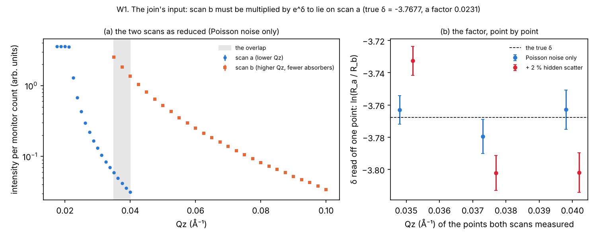
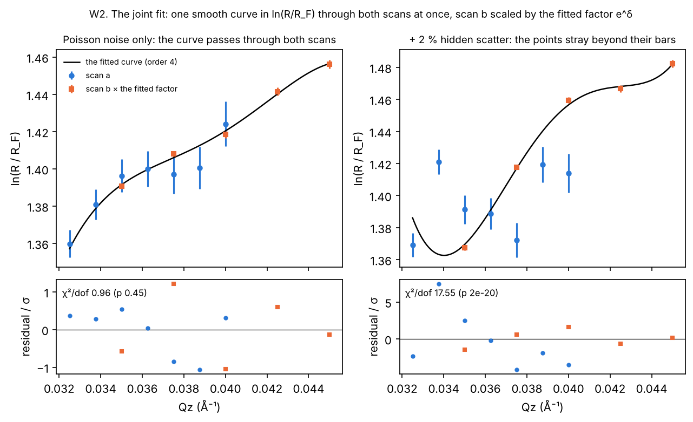
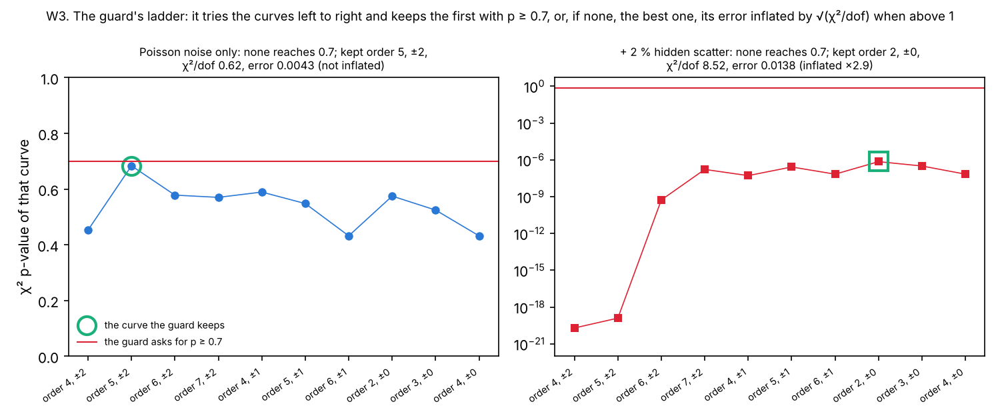
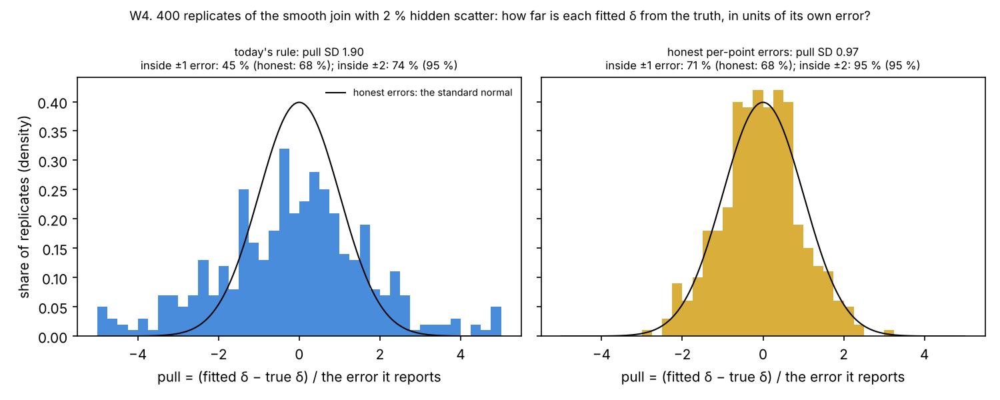
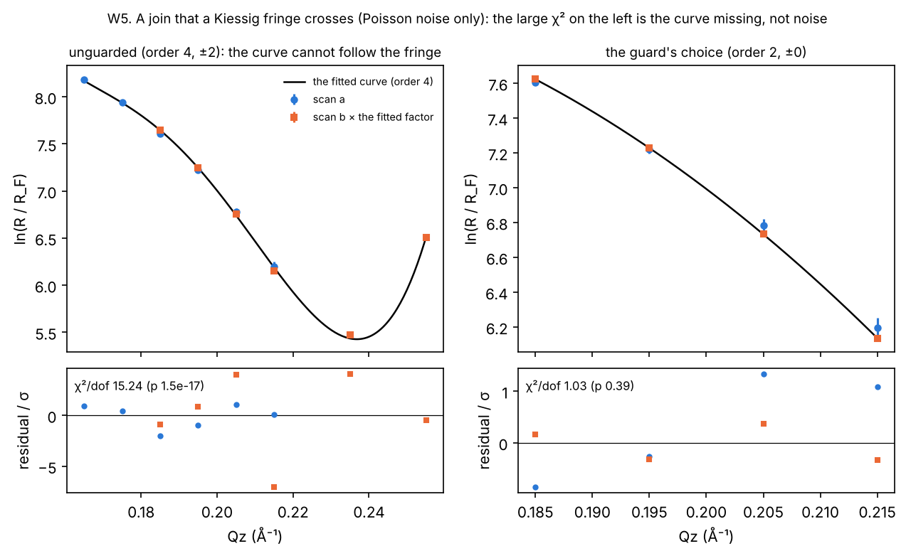
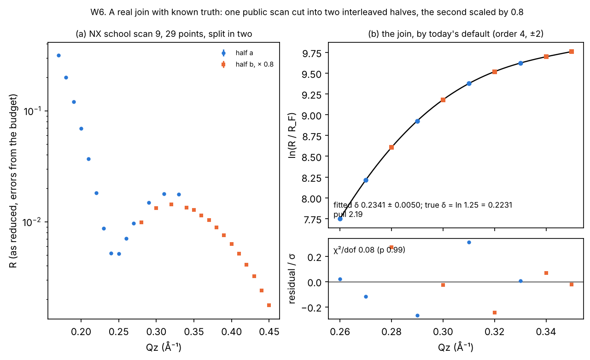

# Walkthrough: why the join error bars are too small, from two scans to the verdict (C61)

main man, 2026-11-25, for the owner's standing order (AGENTS.md rule 13): "I always need to see the entire
chain of data processing, ending with the statistics and judgment. That means data fit examples,
explanations of statistics, all ELI5." This walkthrough follows the guard's-error study
(`summary.md` beside this file, C61 in `docs/COMPARISONS.md`) one example at a time. It starts from two
reflectivity scans that overlap and ends at the verdict and how far to trust it. Steps 1–5 use synthetic
data, because there the truth is known. Step 6 uses a real, public NX school scan, cut so that its truth is
known too.

Every figure and number comes from:

    python tests/tools/guard_error_walkthrough.py --out docs/studies/guard_error/walkthrough    # about 5 s

The numbers are in `walkthrough/numbers.json`. **Measured** throughout, on the data named.

## The question, in one paragraph

A reflectivity curve falls by eight or more decades, more than a detector can count in one go. It is
measured in several scans: each scan at higher Qz has fewer absorbers in the beam, so it reads higher by a
factor nobody knows well enough. **The join** finds that factor where two scans overlap and multiplies the
later scan by it. Every factor comes with an error bar, and the error bars of the final curve are built
from them. The owner's survey of 1832 real joins (C56, `docs/studies/ref_patch_real/`) found these error
bars about **24 % too small**. Why, and where does the fix belong?

## Step 1. The input: two scans and the factor between them (figure W1)

- **(a) Two scans as the reader reduces them:** counts divided by the monitor, for a smooth synthetic film
  measured like the NX school plan.
  - Each point's error bar comes from counting (Poisson) and the monitor. The bars are smaller than the
    dots here.
  - **The grey band is the overlap:** both scans measured there.
  - Scan b reads about 43 × higher, because it had fewer absorbers. The factor that brings it onto scan a is
    e^δ with **δ = −3.7677** (e^δ = 0.0231). We know δ because we made the data.
- **(b) The simplest estimate of δ.** At the three Qz values both scans measured, ln(R_a/R_b) is one
  reading of δ.
  - **Blue, Poisson noise only:** −3.7630 ± 0.0089, −3.7795 ± 0.0106, −3.7629 ± 0.0122. They miss the truth
    (dashed) by 0.4 to 1.1 of their error bars, as honest error bars should.
  - **Red, the same data with 2 % hidden scatter:** each point multiplied by (1 + 0.02 z), where z is a
    random number from the standard normal distribution, **with the error bars left as they were.** That is
    what "hidden" means: the error bars do not know about it. The readings now miss by 2.8 to 3.9 of their
    error bars.
- **Where hidden scatter could come from on a real beamline** (candidates, none measured here):
  - anything that changes one point and not the next: the beam moving on a small footprint, the liquid
    surface moving (vibration, waves), a region of interest that clips the spot;
  - monitor noise beyond counting, which the owner's MCA spectra are being used to size (MQ-3, DATA_NEEDS).

## Step 2. The joint fit, drawn over its data (figure W2)

**What the reader does** (`lss_core.patching`, the default since 2026-11-22):
- **It divides by the Fresnel reflectivity R_F and takes the log.**
  - R_F is what a perfectly sharp surface would reflect. It falls as Qz⁻⁴ ([Als-Nielsen & McMorrow, *Elements
    of Modern X-ray Physics*, 2nd ed., ch. 3](https://onlinelibrary.wiley.com/doi/book/10.1002/9781119998365)).
  - ln(R/R_F) changes slowly, so over a short window a low-order polynomial describes it well.
- **It fits one curve through both scans at once:** a polynomial of order 4 through scan a's points and scan
  b's points × e^δ, over the overlap and 2 points either side ("order 4, ±2"). δ is one of the fitted
  numbers.
- **"Fitting" means:** choose the curve and δ that make χ² = Σ ((point − curve) / error bar)² as small as
  possible.
  - Each point's error bar is taken at the curve's value rather than at the point's own (the 'poisson'
    likelihood, the default). This keeps a point that fell low by chance from pulling the curve down.
  - The error of δ comes from how fast χ² rises when δ moves away from its best value.
  - The residual panels show (ln point − curve) / (σ / point), which is the same to first order.

**The two panels.** The top shows the curve over the points; the bottom shows the **residuals**, each
point's distance from the curve in units of its own error bar.
- **Left, Poisson noise only.**
  - The residuals stay within ±1.2, with no pattern.
  - χ²/dof = 0.96, p = 0.45.
  - δ = −3.7686 ± 0.0043: 0.2 errors from the truth.
- **Right, with 2 % hidden scatter.**
  - The curve bends to chase the points, and the residuals still reach 7.
  - χ²/dof = 17.5, p = 2 × 10⁻²⁰.
  - δ = −3.7565 ± 0.0043: 2.6 errors from the truth.
  - Note that the error is unchanged (0.0043). The counting error cannot know about scatter that the points'
    error bars leave out.

**The statistics, ELI5:**
- **χ² (chi-squared)** adds up the squared residuals.
- **dof (degrees of freedom)** is the number of points minus the number of fitted numbers: here 12 − 6 = 6.
- **χ²/dof**: if the error bars are honest and the curve is right, each residual is typically about ±1, so
  χ²/dof is about 1. With 6 dof, anything from about 0.4 to 1.6 is ordinary. 17.5 says that either the error
  bars are too small or the curve is wrong.
- **The p-value:** the chance that an honest fit would give a χ² at least this large.
  - p = 0.45 is unremarkable.
  - p = 2 × 10⁻²⁰ means "not chance".
  - The p-value alone cannot say *which* of the two went wrong, the error bars or the curve. Steps 3 and 5
    are about exactly that.
  - Reference: the [Particle Data Group's review of statistics](https://pdg.lbl.gov/2024/reviews/rpp2024-rev-statistics.pdf),
    its section on goodness-of-fit tests.

## Step 3. The guard's ladder (figure W3)

**What the guard does** (the default at p 0.7 since #47, study A, `docs/studies/reflectivity_guard/`):
- **Why it is there:** a single order-4 curve can be fooled where a Kiessig fringe crosses the join or the
  overlap is short (step 5).
- **The ladder:** it tries a series of curves, from left to right in W3:
  - orders 4 to 7 with 2 extra points either side;
  - orders 4 to 6 with 1;
  - orders 2 to 4 on the overlap alone.
- **What it keeps:** the first curve with p ≥ 0.7. If none reaches 0.7, it keeps the curve with the largest
  p, and inflates its error by √(χ²/dof) when that is above 1. Errors are never shrunk.
  - That inflation is the Birge ratio ([Birge 1932, Phys. Rev. 40, 207](https://doi.org/10.1103/PhysRev.40.207)).
  - It is the standard repair when a fit's scatter exceeds its error bars.

**Blue, Poisson noise only:** every curve fits.
- The p-values run from 0.43 to 0.68, but none reaches 0.7.
- So the guard keeps the best: order 5, ±2, p 0.68.
- Its χ²/dof is 0.62, so nothing is inflated. The error is 0.0043.
- p ≥ 0.7 is a demanding test: an honest fit falls below it 70 % of the time. So climbing the ladder on clean
  data is ordinary; the study found it on 49 % of clean smooth joins.

**Red, with 2 % hidden scatter:** every curve fails.
- The p-values run from 10⁻²⁰ to 10⁻⁶.
- The guard keeps the least bad: order 2 on the overlap alone, χ²/dof 8.5.
- It inflates its error by √8.5 = 2.9, to 0.0138.

**The catch:** of ten curves, the one that fits best is the one that has **partly fitted the noise**.
- Here it is the curve with the fewest points, whose χ²/dof is half the order-4 curve's.
- So its inflation is too small for the scatter that is really there.
- Over 400 replicates of this join (step 4), the guard's median error is 0.0101. The true spread of its δ is
  0.0171.

## Step 4. Many replicates: pulls and coverage (figure W4)

One join says little: the truth might just be unlucky. So the same join is made 400 times, each time with
new noise (a **replicate**), and fitted each time.

**The statistics, ELI5:**
- **The pull** of one replicate is (fitted δ − true δ) / the error it reported: how many of its own error
  bars it missed by.
- **If the error bars are honest,** the pulls follow the standard normal distribution (the black curve).
  - Their standard deviation, the **pull SD**, is 1.
  - 68 % of them lie within ±1, and 95 % within ±2. These shares are the **coverage**.
- **Pull SD above 1** means the error bars are too small: 1.90 means the misses are typically 1.9 × the
  reported error.
- **The uncertainty of a pull SD** from 400 replicates is about ±3.5 % (1/√(2 × 400)). So 0.97 is "1 within
  its uncertainty", and 1.90 is not.
- Reference: the same [PDG review](https://pdg.lbl.gov/2024/reviews/rpp2024-rev-statistics.pdf), its section
  on intervals and their coverage.

**Left, today's rule:** the guard's choice, with its error inflated by its own χ².
- Pull SD 1.90.
- 45 % of replicates within ±1, 74 % within ±2: far short of 68 % and 95 %.
- The guard climbed on 99.5 % of the replicates.

**Right, honest per-point errors:** the same guard and the same rule, but each point's error bar widened by
the scatter that is really there, √(σ² + (0.02 · y)²).
- Pull SD 0.97.
- 71 % within ±1, 95 % within ±2.
- The median error is 0.0153, against a true spread of 0.0157.
- This is an **oracle**: we know the 2 % because we put it in. A real reader would have to estimate it from
  the data, which is the next study.

## Step 5. Why not just inflate by the unguarded fit's χ²? A fringed join (figure W5)

**The idea.** The survey (C56) proposed to inflate the guard's error by the order-4 fit's χ², as in step 2:
there √17.5 = 4.2. On the smooth join this works (study table: pull SD 1.06 at 2 %). W5 shows where it goes
wrong.

**The join.** Study A's thin film (DPPC-like layer), join 3, where a Kiessig fringe minimum sits next to the
overlap. Poisson noise only: no hidden scatter at all.
- **Left, the order-4 curve over ±2 points.**
  - It cannot follow the fringe: χ²/dof 15.2.
  - Its residuals reach −7 and +4, largest near the fringe's minimum.
  - Its δ is off by 0.027.
- **Right, the guard's choice: order 2 on the overlap alone.**
  - χ²/dof 1.03.
  - δ = −4.9925 ± 0.0143, against the truth −4.9988: 0.44 errors.
  - This error is honest.
- **Inflating that error by the order-4 curve's √15.2 = 3.9 gives 0.055,** nearly four times too large, on a
  join that was already right. The order-4 curve's large χ² was the **curve missing**, not noise.
- **Across study A's five fringed or short joins,** the join-level fixes leave pull SDs of 0.50–0.84, with
  errors 3.1–4.6 × today's (`summary.md`, G2).

**Why one χ² cannot do both jobs:**
- χ² sees only the size of the residuals, not their cause. A curve that misses (W5, left) and points that
  scatter (W2, right) give the same large χ².
- The guard uses χ² to choose the curve. So the χ² of the curve it rejected measures that curve's misfit,
  not the noise, and it cannot size the noise.

## Step 6. A real join with known truth (figure W6)

**The split test.** C56 tested real joins in a way that gives a known truth:
- take one measured scan;
- put its first half and the even points of the middle in half a, and the odd middle points and the second
  half in half b;
- multiply half b by 0.8.
- The true δ is then exactly ln 1.25 = 0.2231.

The survey did this on 1091 private curves. W6 does it on the public NX school file, scan 9 (29 points, Qz
0.17–0.45), with its budget errors.

- **(a) The two halves.** Half b sits 20 % below half a.
- **(b) The join by today's default.**
  - The first curve passes the guard at once: order 4, ±2, p 0.99.
  - Every point lies within about 0.3 error bars of the curve (χ²/dof 0.08, smaller than usual).
  - Yet δ = 0.2341 ± 0.0050: **0.0110 too large, a pull of 2.19.**

**What happened.** The unsplit scan, fitted over the same window, zig-zags.
- **The even points (half a) sit above a smooth curve** by +0.24, +0.41, +0.70, +0.57 %.
- **The odd ones (half b) sit below it** by −0.35, −0.55, −0.76, −0.27 %.
- **The unsplit fit is normal:** χ²/dof 1.03 there.
- **The split turns the zig-zag into a factor.** It sends the even points to a and the odd points to b, so the
  zig-zag looks exactly like a factor between the halves. The fit moves it into δ, and what is left is tiny.

**Point-to-point scatter moved the factor, and χ² could not see it**, because the factor had absorbed it.
That is C61's mechanism at its plainest. No inflation by any χ² could have caught this miss. Only error bars
that are honest about the points' scatter could have covered it.

**How sure:**
- **It may be chance.** A pull of 2.19 or more happens 2.9 % of the time with honest error bars.
- **It is not in the monitor.** The monitor (Monc) falls smoothly through the window, so it is not the source
  (measured, from the SPEC columns).
- **Its cause is not known.**
- **One join decides nothing.** The other two NX scans long enough to split give pulls of −0.73 and 0.71
  (`nx_split.csv`). The evidence is C56's 1091 splits: pull SD 1.24 [1.09, 1.40].

## Step 7. The judgment

**Measured, synthetic data with known truth (high confidence):**
- **Hidden scatter reproduces the real failure in size and in mechanism.** Per-point scatter that the error
  bars miss makes today's join errors too small, and makes the guard climb:
  - at 1 %: pull SD 1.64 on the smooth join and 1.24 on the mean of the fringed ones, with a climb on 94 % of
    smooth joins against 49 % without;
  - at 2 %: 1.90 (W4).
  - The real survey's 1.24, with its median kept order of 5, sits in that range.
  - The effects are 0.2 to 1.3 in pull SD. The noise of a pull SD at 400 replicates is about 0.04.
- **Honest per-point errors repair every join tried** (0.94–1.07), with today's guard unchanged.
- **Join-level inflations repair only the smooth joins.** Where a fringe crosses, they make the errors
  3–5 × today's, far too large (pull SD 0.50–0.84; step 5).

**Measured, one real public scan (low confidence alone):**
- the split's miss came from point-to-point structure that χ² could not see (step 6), as the mechanism
  predicts.

**The verdict:**
- **The fix belongs in each point's error, not in the join's.**
- **No default was changed.**
- **The remedy** is an excess term in the per-point error budget (`lss_core.errors`, budget mode). Before it
  can become the default (rule 12), it needs:
  - an estimator of the excess from the data, tested with known truth;
  - its size on real data, by Qz class. Local yokel has been asked for this on #55, and the owner in MQ-3.

## Where each step lives in the code

| step | code |
|---|---|
| 1 the scans, the synthetic film and plan | `tests/synthetic/xrr_scans.measure`, `nx_like_plan`; study A's joins `ref_guard_study.draw_join` |
| 1 hidden scatter, the oracle budget | `guard_error_study.scatter(scan, x, seed, budget=False)` |
| 2 the joint fit | `lss_core.patching.rung_fit` (`RungFit`: δ, counting error, χ², dof, the polynomial; `likelihood='poisson'`) |
| 3 the ladder and the guard | `patching.guard_ladder`, `patching.joint_factor(guard_p=0.7)`; `uncertainty.inflate` (√(χ²/dof) when above 1) |
| 4 pulls and coverage | `guard_error_study.rule_estimate`, `ref_guard_study.stats` |
| 5 the fringed join | study A's `layer_dppc`, join 3 (`ref_guard_study.designed`) |
| 6 the split | `guard_error_walkthrough.nx_split` (the survey's split, as `guard_error_study.run_nx`) |
