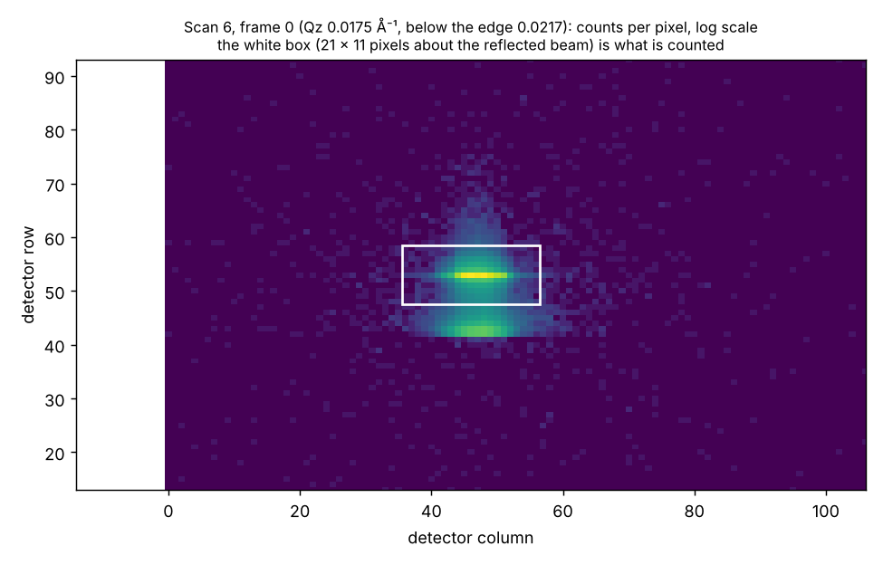
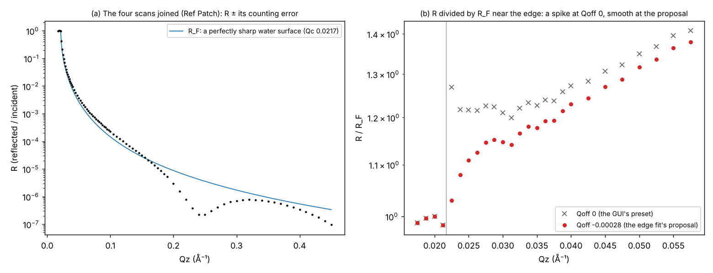
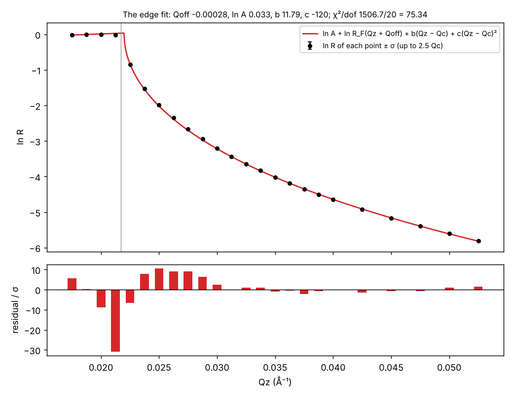
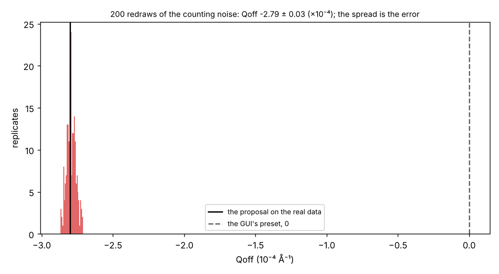
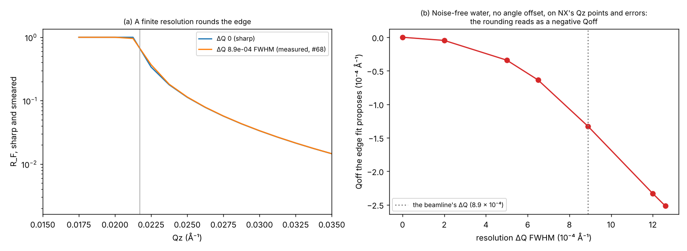

# Walkthrough: the Qz offset (Qoff) from the raw frames to the judgment (F79)

Tools man, 2026-11-25, for the owner's standing order (AGENTS.md rule 13): the whole chain, with the fits
and the statistics explained. Public data: NX school scans 6–9 (DPPC on water, 10 keV). Every figure and
number comes from:

    python tests/tools/qoff_walkthrough.py --out docs/studies/qoff/walkthrough    # about 1 min

The numbers are in `walkthrough/numbers.json`. The full study, with known truth, is `summary.md`.
**Measured** throughout.

## The question, in one paragraph

Reflectivity is plotted against Qz = (4π/λ) sin α, where α is the angle of the beam on the surface. If the
angle the instrument reports is off by a tiny δα, every Qz is off by about the same amount, Qoff =
(4π/λ) δα. Below the critical edge Qc, water reflects everything (R = 1); above it, R falls steeply. So a
wrong Qz shows up at the edge, as a step when R is divided by the ideal curve R_F. The owner's criterion:
choose Qoff so that R/R_F runs smoothly through the edge.

## Step 1. The raw data: a frame below the edge (figure QW1)

- **What it shows:** scan 6, frame 0, at Qz 0.0175 Å⁻¹, below the edge (0.0217). The reflected beam is the
  bright spot. Colours are counts per pixel, on a log scale.
- **What is counted:** the white box, 21 × 11 pixels about the spot (the Ref Patch's default slit). Here it
  holds 790 000 counts, for a monitor of 224 000.
- **The background:** it is subtracted from boxes beside the beam (`Experiment.reflectivity`); not shown.
- **The error:** √counts, combined with the monitor's (Poisson).

## Step 2. From counts to R, and R/R_F at the edge (figure QW2)

- **(a) R(Qz).** Each frame's counts, less the background, are divided by the monitor and by the absorber
  attenuation, giving one point of R. The four scans are joined by their overlaps (the Ref Patch), 87
  points in all. The blue line is R_F, the reflectivity of a perfectly sharp water surface.
- **(b) R/R_F near the edge.**
  - **At Qoff 0** (grey), the first point above Qc (0.0225) is 4 % above its neighbour: a step that no
    surface produces.
  - **At the proposal** (red, −0.00028), R/R_F runs smoothly into the monolayer's shape.

## Step 3. The edge fit, drawn over its data (figure QW3)

**The model:** ln R = ln A + ln R_F(Qz + Qoff) + b(Qz − Qc) + c(Qz − Qc)², fitted to the 24 points up to
2.5 Qc, weighted by their errors.
- R_F carries the edge. Qoff slides the curve left or right.
- ln A is the level (the plateau should be 1).
- b and c let the film's own slow shape bend the curve above the edge without moving it.

| fitted number | value | meaning |
|---|---|---|
| **Qoff** | **−0.00028 Å⁻¹** | the edge sits 0.00028 lower in Qz than the reported angles say: δα = −0.0016° |
| ln A | 0.033 | the plateau is 3 % above 1 (a 3 % normalisation) |
| b, c | 11.8, −120 | the film's shape above the edge |
| χ²/dof | **1507/20 = 75** | far from 1: the model does not follow the data within its counting errors |

**Reading the residuals** (lower panel: each point's miss in units of its own error bar):
- the last point below the edge is **31σ low**;
- the points just above the edge are **6–10σ high**;
- far from the edge the misses are about ±1σ.

That pattern is a **rounded edge**: the data come down more gradually than a perfectly sharp R_F. Step 5
shows the beamline's resolution does exactly this. The fit uses a robust loss (soft-L1), which
down-weights the 7 worst points so that they do not drag Qoff.

**χ², ELI5:** each miss divided by its error bar, squared, added up. An honest model with honest errors
gives about one per point (χ²/dof ≈ 1). 75 means the misses are about 8.7 error bars typical: the model is
missing something real.

## Step 4. How uncertain is Qoff? The bootstrap (figure QW4)

**The bootstrap, ELI5:** we can't repeat the experiment, so we let the computer do it. Each point is moved
at random within its own error bar, and the fit is done again; then again, 200 times. The spread of the 200
answers is the error.
- **Result:** Qoff −2.79 × 10⁻⁴, spread ± 0.03 × 10⁻⁴. The proposer reports ± 0.07 × 10⁻⁴.
- **The catch:** this redraws only the counting noise. With χ²/dof = 75 the misfit dominates. Scaled by
  √75 ≈ 8.7, as the reader does for drift fits, the error is about **± 0.6 × 10⁻⁴**.
- So the proposal's stated σ is **too small by about ×9 on NX**: it measures the noise, not the model's
  misfit. Even so, −2.8 ± 0.6 × 10⁻⁴ is clearly not 0.

## Step 5. What the resolution does (figure QW5)

- **(a)** A real beam has a spread of angles, so every point averages R over a small range of Qz: the
  resolution ΔQ. The sharp edge (blue) becomes rounded (orange). This is the shape of NX's residuals in
  step 3.
- **(b)** The edge fit, given noise-free water with no angle offset but a rounded edge, on NX's own Qz
  points and errors, proposes a negative Qoff that grows with ΔQ:

| ΔQ FWHM (Å⁻¹) | proposed Qoff (Å⁻¹) | share of NX's −2.8 × 10⁻⁴ |
|---|---|---|
| 6.5 × 10⁻⁴ (sharpest run) | −0.64 × 10⁻⁴ | 23 % |
| **8.9 × 10⁻⁴ (the median, #68)** | **−1.33 × 10⁻⁴** | **48 %** |
| 12.6 × 10⁻⁴ (broadest run) | −2.52 × 10⁻⁴ | 90 % |

The beamline's ΔQ was measured by the non-cloud agent, from the edge widths of 378 real scans
(`docs/studies/qz_resolution/summary.md`). NX's own ΔQ was not measured: its scans are from the same
station.

## Step 6. The judgment

- **Qoff 0 is wrong for NX.** The step at the edge (4 %) and the edge fit, −2.8 ± 0.6 × 10⁻⁴ with an honest
  error, agree. The proposal makes R/R_F smooth, which is the owner's criterion. **Confidence: high.**
- **How much of it is the angle?** Somewhere between a quarter and nine tenths is resolution, about half at
  the beamline's median ΔQ. The rest is a true angle (or height) offset of up to about −0.0016° (−0.0009° at
  the median). **Not a Qc shift:** the owner (2026-11-25, `docs/physics_notes.md`) says NX's subphase is
  pure water, so Qc is water's 0.0217 Å⁻¹. (A wrong Qc would have moved Qoff one for one, `summary.md` §4,
  and a salt or buffer could not have been told apart from an angle offset.) **Confidence: low on the
  split between resolution and angle; high that it is not the subphase.**
- **What would settle it:** an edge fit with R_F convolved with the measured resolution, which would read
  the angle offset itself and fit the edge far better (χ²/dof towards 1).
- **For the proposer's users:** its ± is the counting part only. Where χ²/dof is far above 1 (here 75), the
  real uncertainty is larger, about ×√(χ²/dof).

## Where each step lives in the code

| step | code |
|---|---|
| 1 frames, ROI | `Experiment.frames`, `lss_core.images.read_pilatus`; the ROI and background in `Experiment.reflectivity` |
| 2 R, joining, R/R_F | `Experiment.reflectivity` (Ref Patch), `lss_core.fresnel.fresnel`, `rrf` |
| 3 the edge fit | `fresnel.propose_qoff(method='edge')`, `_edge_model`, `_edge_estimate` |
| 4 the bootstrap | `propose_qoff(bootstrap=200)` |
| 5 resolution | `tests/tools/qoff_walkthrough.py` (`smeared`); the study's section 3 |
