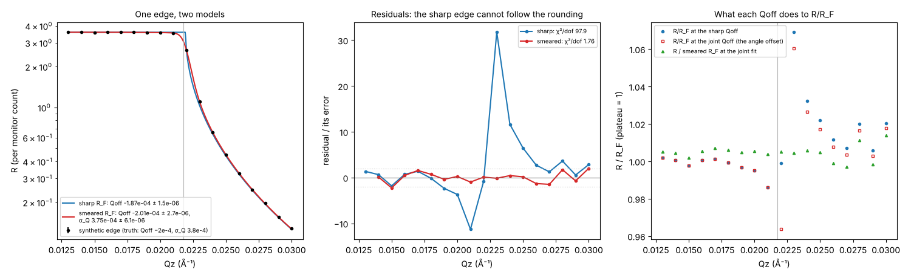
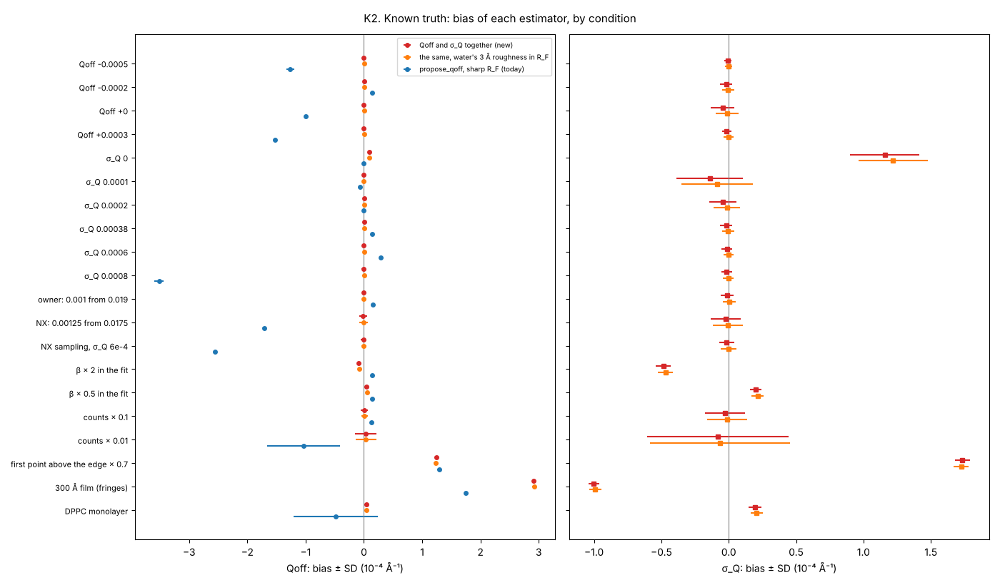
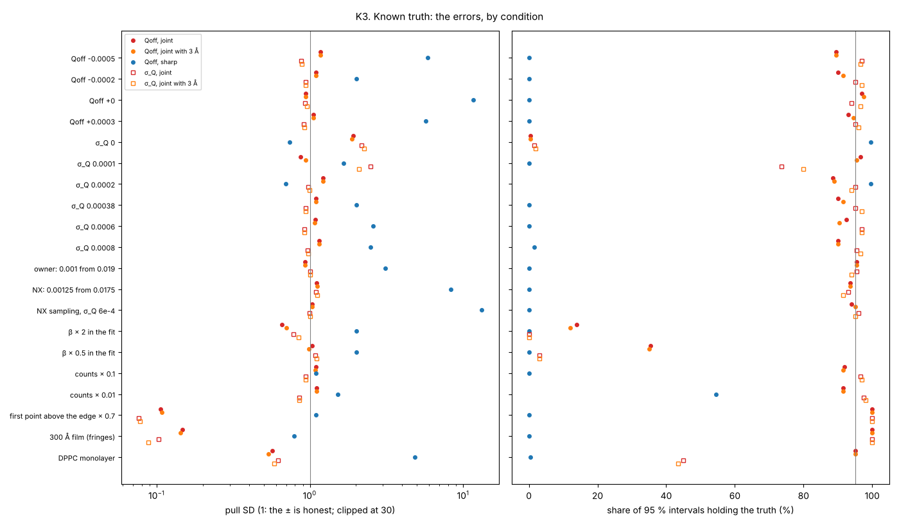
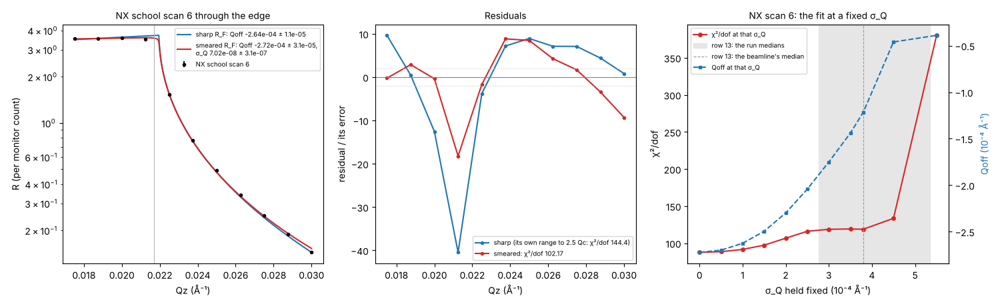

# Qoff and the Qz resolution fitted together at the critical edge (hand-off 09)

Tools man, 2026-11-27, issue #154. The owner, 2026-11-26: "Qoffset also has to be fit, and this could be a
useful ability to have in reader". The plan is xr-data-needs' hand-off `09-qoff-resolution-fit.md`. **Measured**
throughout: every number is from one run of `tests/tools/qoff_resolution_study.py` (`results.csv`,
`replicates.csv`, `nx.csv`, `numbers.json` beside this file). Section 4 uses the public NX school file; the rest
is synthetic, with a known truth. **No default changes.** Nothing applies the value, and the Propose button is
unchanged (rule 12, paused).

## The question

`fresnel.propose_qoff` (C50) fits the edge with a sharp R_F. When the beam's angles spread (the resolution,
σ_Q), the edge is rounded, and a sharp model can only follow it by moving: it reads part of the resolution as
an offset. Its ± holds the counting noise only (C50's walkthrough: about ×9 too small on NX).

Can Qoff and σ_Q be fitted together, with Qc and β taken from the subphase? Specifically:
- Does the fit find both?
- Are its errors honest?
- What moves it?
- What does it say about the NX school edge?

## The method

`lss_core.fresnel.fit_edge_resolution` fits

    R(q) = N · [R_F(q + Qoff; Qc, β) ⊗ Gauss(σ_Q)](q) · (1 + a u + b u²),   u = (q − Qc)/Qc

This is the model of DATA_NEEDS row 13 (`docs/studies/qz_resolution/summary.md`, 378 real edges).

- **R_F with absorption:** r = (Q − Q′)/(Q + Q′), with Q′² = Q² − Qc² + i 32π²β/λ² (`fresnel_absorbing`).
- **The smearing:** the trapezoid rule on 241 points over ±6σ (`fresnel_smeared`).
- **Held fixed:** Qc and β. β = μλ/4π (`subphase_beta`), with μ/ρ from xraylib 4.3.0; water at 10 keV gives
  5.24 × 10⁻⁹.
- **Free:** N, Qoff, σ_Q, a, b.
- **The fit:** over 0.6 Qc to 0.030 Å⁻¹, by soft L1, started from today's sharp proposal shifted by 0.15 FWHM,
  at three σ_Q.
- **Errors:** a parametric bootstrap, every point redrawn with its error. Both the Qoff and σ_Q errors are
  scaled by √(χ²/dof) when that is above 1. Their correlation comes from the same bootstrap.
- **Flags:** 'sigma_q at its bound', 'few points below the edge' (fewer than 3 below Qc − Qoff), 'few points
  above the edge', 'ill-conditioned', 'bootstrap failures'.

Three estimators are compared on every edge:

| name | what it is |
|---|---|
| `joint` | `fit_edge_resolution`, the hand-off's model |
| `joint_r3` | the same with a fixed 3 Å Névot–Croce roughness in R_F (`roughness=3.0`). The generator's water has it |
| `sharp` | today's `propose_qoff` (sharp R_F without absorption, up to 2.5 Qc) |

## The design

- **The edges** (`edge_scan`): one scan through the edge, drawn by `tests/synthetic/xrr_scans`.
  - Bare water: Parratt, with water's absorption at 10 keV and 3 Å roughness.
  - The beamline of NX school scan 6: 2 s per point, the absorber chosen automatically, the monitor with
    0.05 % noise. This gives errors of 0.1–0.6 % per point, as on NX.
  - An angle offset makes the true Qz differ from the recorded one by Qoff.
  - The resolution is a Gaussian of σ_Q, smeared with the generator's accurate rule. The default
    Gauss–Hermite rule is off by about 1 % at the edge (`docs/SYNTHETIC_DATA.md`, "Smearing at the
    critical edge").
- **The conditions:**
  - the true Qoff: −5, −2, 0, +3 × 10⁻⁴;
  - the true σ_Q: 0 to 8 × 10⁻⁴ (the beamline's median is 3.8);
  - the sampling: the owner's steps of 0.001 from 0.013 or from 0.019, and NX's 0.00125 from 0.0175;
  - β wrong by × 2 and × 0.5;
  - counts × 0.1 and × 0.01;
  - the first point above the edge × 0.7;
  - a 300 Å film lighter than water (a Kiessig fringe across the range);
  - a DPPC monolayer.

  Unless stated: Qoff −2 × 10⁻⁴, σ_Q 3.8 × 10⁻⁴, the owner's sampling from 0.013.
- **200 replicates per condition, 50 bootstrap draws per fit.**
- **Per condition:**
  - the bias (mean − truth) and the SD;
  - the pull SD ((estimate − truth)/error: 1 when the errors are honest);
  - the share of 95 % intervals that hold the truth;
  - for σ_Q, also the median χ²/dof and the share flagged.

## 1. Known truth: the offset and the resolution (K1, K2)

**K1, one edge** (Qoff −2 × 10⁻⁴, σ_Q 3.8 × 10⁻⁴, the owner's sampling):
- The sharp model cannot follow the rounded edge: residuals of −11 and +32 σ around Qc, χ²/dof 98.
- The joint fit reads Qoff −2.01 × 10⁻⁴ and σ_Q 3.75 × 10⁻⁴, with χ²/dof 1.8.
- The right panel shows what that means for R/R_F.
  - At the true angle offset, R/R_F with a sharp R_F still has a dip and a spike at the edge: that is the
    resolution.
  - Only R divided by the smeared R_F is flat.
  - The sharp proposal makes R/R_F look continuous by moving the edge, which is the owner's aim but not the
    angle offset.

**Bias ± SD, in 10⁻⁵ Å⁻¹** (200 edges per row). For scale, the beamline's σ_Q is 38.

| condition | Qoff: joint | joint_r3 | sharp (today) | σ_Q: joint | joint_r3 |
|---|---|---|---|---|---|
| Qoff −5 × 10⁻⁴ | −0.00 ± 0.23 | +0.04 ± 0.23 | **−12.7** ± 0.7 | −0.09 ± 0.27 | +0.01 ± 0.27 |
| Qoff −2 × 10⁻⁴ (the reference) | +0.02 ± 0.19 | +0.04 ± 0.19 | +1.35 ± 0.07 | −0.19 ± 0.47 | −0.04 ± 0.47 |
| Qoff 0 | −0.08 ± 0.27 | +0.01 ± 0.27 | **−9.9** ± 0.1 | −0.45 ± 0.87 | −0.10 ± 0.85 |
| Qoff +3 × 10⁻⁴ | −0.05 ± 0.31 | +0.01 ± 0.31 | **−15.3** ± 0.2 | −0.15 ± 0.36 | −0.03 ± 0.36 |
| σ_Q 0 | +0.92 ± 0.13 | +0.92 ± 0.14 | −0.02 ± 0.06 | **+11.6** ± 2.6 | +12.2 ± 2.6 |
| σ_Q 1 × 10⁻⁴ | −0.04 ± 0.12 | −0.05 ± 0.14 | −0.63 ± 0.06 | −1.4 ± 2.5 | −0.9 ± 2.6 |
| σ_Q 2 × 10⁻⁴ | +0.05 ± 0.20 | +0.04 ± 0.20 | −0.02 ± 0.06 | −0.45 ± 1.01 | −0.14 ± 0.99 |
| σ_Q 6 × 10⁻⁴ | −0.03 ± 0.26 | +0.04 ± 0.26 | +2.9 ± 0.1 | −0.14 ± 0.38 | −0.02 ± 0.38 |
| σ_Q 8 × 10⁻⁴ | −0.05 ± 0.32 | +0.04 ± 0.32 | **−35.2** ± 0.8 | −0.15 ± 0.40 | −0.02 ± 0.40 |
| the owner's steps from 0.019 | −0.03 ± 0.26 | −0.02 ± 0.26 | +1.57 ± 0.08 | −0.11 ± 0.47 | +0.04 ± 0.46 |
| NX's sampling | −0.13 ± 0.72 | −0.05 ± 0.73 | **−17.2** ± 0.3 | −0.24 ± 1.11 | −0.07 ± 1.11 |
| NX's sampling, σ_Q 6 × 10⁻⁴ | −0.09 ± 0.41 | −0.02 ± 0.41 | **−25.6** ± 0.3 | −0.16 ± 0.56 | −0.01 ± 0.56 |

**What it shows:**
- **The joint fit finds the offset.** Its Qoff is unbiased to 1.3 × 10⁻⁶ Å⁻¹ or better wherever the model
  holds and σ_Q is at least 1 × 10⁻⁴.
  - At a hundredth of the counts the bias is 3 × 10⁻⁶ (SD 1.8 × 10⁻⁵).
  - At a true σ_Q of 0 it is 9 × 10⁻⁶: σ_Q reads high there and drags Qoff with it.
  - Its SD is 1–7 × 10⁻⁶ Å⁻¹, which is 0.6–4 × 10⁻⁵ degrees of angle.
- **It finds the resolution.** σ_Q comes back within 0.5 % at the beamline's 3.8 × 10⁻⁴ (SD 1.2 %), and
  within 2.5 % from 2 × 10⁻⁴ up.
  - **Below about 1 × 10⁻⁴ it cannot tell the width from 0,** as row 13 found. A true σ_Q of 0 reads
    1.2 × 10⁻⁴ ± 0.3. A true 1 × 10⁻⁴ reads 0.9 ± 0.3 × 10⁻⁴.
- **Today's sharp proposal is not the angle offset.** Its error is −35 to +3 × 10⁻⁵ and depends on more
  than the resolution: on where the edge falls between the Qz points, on the sampling (NX's: −17), and on
  the size of σ_Q. Its SD is tiny (0.1–0.8), so its bias is many times its spread. C50's "−0.15 ΔQ" was
  one sampling's value, not a rule.
- **Water's roughness in R_F (`joint_r3`) changes little with noise.** It removes the 0.1–0.5 × 10⁻⁵ left in
  σ_Q, and on noiseless edges it makes the fit exact (`tests/test_qoff_resolution.py`). Without it the
  smooth factor misses a small kink the roughness puts at Qc, worth −8 % to +18 % of σ_Q at 1 × 10⁻⁴.
- **Qoff and σ_Q are correlated** where few points cross the edge. The bootstrap correlation is +0.92 at
  NX's sampling and +0.13 at the owner's.

## 2. Are the errors honest? (K3)

**The joint fit's errors are honest wherever the model holds and σ_Q ≥ 2 × 10⁻⁴.**
- The pull SD is 0.93–1.22 for Qoff and 0.85–1.10 for σ_Q.
- 88–98 % of the 95 % intervals hold the truth.
- The median χ²/dof is 0.93–1.00.
- At σ_Q of 0 and 1 × 10⁻⁴ the σ_Q intervals hold the truth in only 2 % and 74 % of the edges. The
  parameter sits at its bound there.

**The sharp proposal's ± is not honest.** Its pull SD reaches 13. Its intervals hold the truth only in a few
cases:
- where its bias happens to be near 0 (σ_Q 0 and 2 × 10⁻⁴);
- where its SD is large (a hundredth of the counts: 55 %).

Elsewhere they hold it in 0–2 % of the edges.

## 3. What moves it

| condition | Qoff: joint | sharp | σ_Q: joint | median χ²/dof (joint) |
|---|---|---|---|---|
| β × 2 in the fit | −0.87 ± 0.22 | +1.35 ± 0.07 | **−4.9** ± 0.6 (−13 %) | 4.4 |
| β × 0.5 in the fit | +0.49 ± 0.20 | +1.35 ± 0.07 | +2.0 ± 0.4 (+5 %) | 1.5 |
| counts × 0.1 | +0.08 ± 0.58 | +1.32 ± 0.19 | −0.3 ± 1.5 | 0.94 |
| counts × 0.01 | +0.31 ± 1.80 | −10.3 ± 6.2 | −0.8 ± 5.2 | 0.94 |
| the first point above the edge × 0.7 | **+12.4** ± 0.4 | +13.0 ± 0.4 | **+17.3** ± 0.6 | **1390** |
| a 300 Å film (a fringe across the range) | **+29.2** ± 0.3 | +17.5 ± 0.1 | **−10.0** ± 0.4 | **12585** |
| a DPPC monolayer | +0.38 ± 0.22 | −4.8 ± 7.2 | +2.0 ± 0.5 (+5 %) | 4.4 |

(10⁻⁵ Å⁻¹, bias ± SD, 200 edges per row.)

**What it shows:**
- **β is the largest input** for σ_Q, as row 13 found (±15 % for × 2). A wrong β moves σ_Q by −13 % or +5 %,
  and Qoff by under 10⁻⁵, and it shows in χ²/dof (4.4 for × 2).
  - A salt subphase given water's β reads its resolution too wide. Its Qc must be its own too (C50).
- **Counts down to a hundredth do not bias it,** and its errors grow honestly.
- **What breaks it is a point or a structure the model lacks:** a single bad point at the first point above
  the edge, or a fringe across the range. These move both fits by 10⁻⁴ or more, and the soft-L1 loss does
  not save the joint fit.
  - **They show.** χ²/dof is in the thousands, and the √(χ²/dof) scaling widens the errors by ×37 and ×112.
    So the intervals still hold the truth, but say nothing.
  - A χ²/dof far above what a run's other edges give means: look at the residuals before using the numbers.
- **A DPPC monolayer** reads σ_Q 5 % wide: its R/R_F near the edge is not quite the smooth factor's
  quadratic.

## 4. NX school scan 6 (K4)

NX school scan 6 crosses the edge in steps of 0.00125 from 0.0175 Å⁻¹: 4 points below the edge and 7 above in
the fit's range, with errors of 0.12–0.57 % (`nx.csv`). At Qc 0.0217 (the reader's preset) and water's β:

| | Qoff (10⁻⁴ Å⁻¹) | σ_Q | χ²/dof | flags |
|---|---|---|---|---|
| joint | −2.72 ± 0.31 (counting alone 0.03) | 0 (at its bound) | 102 | sigma_q at its bound; ill-conditioned |
| sharp (its own range, to 0.040) | −2.64 ± 0.11 | — | 144 | |
| sharp, scans 6–9 (C50's) | −2.77 ± 0.06 | — | 95 | |

**The fit at a fixed σ_Q** (K4, right):
- χ²/dof is lowest at σ_Q = 0 (88) and rises with σ_Q: 107 at 2 × 10⁻⁴, 119 at 3.8 × 10⁻⁴.
- Qoff follows the assumed σ_Q: −2.72 at 0, −2.30 at 2 × 10⁻⁴, and −1.22 at row 13's median 3.8 × 10⁻⁴.

**What it shows:**
- **NX scan 6 is not described by this model at its errors.**
  - The last point below the edge (Qz 0.02125) lies 1.1–1.6 % under the other plateau points, at −18 σ.
  - Above the edge the residuals curve: +9 σ, then −9 σ.
  - A Gaussian resolution cannot lower the point below the edge without raising the first point above it,
    so the fit takes σ_Q to 0.
  - Without that point, χ²/dof is still 45 and σ_Q still 0.
  - Row 13 refused this scan too.
- **So NX alone cannot say how much of its offset is resolution.** If NX's resolution is the beamline's
  median, the angle offset is −1.2 × 10⁻⁴, close to C50's estimate (−2.8 − (−1.3) ≈ −1.5). If it is less,
  the offset is up to −2.7 × 10⁻⁴.
- **The ± is now honest about the misfit.** It is scaled by √(χ²/dof) ≈ 10: ±0.31 × 10⁻⁴ against counting's
  ±0.03.
- **The hand-off expected χ²/dof near 1 on NX.** It is not, so NX's misfit is not the resolution. Its source
  is open: the beam's footprint or the meniscus at the lowest angles, or a per-point angle error.
- **Qoff depends on the Qc used.** At water's own Qc (0.021728, `fresnel.subphase('water')`; the survey's
  default) the same scan gives −2.44 × 10⁻⁴: the 2.8 × 10⁻⁵ difference, one for one (C50 §4).

## 5. The judgment

- **The method works where its model holds.** On synthetic edges it reads both the angle offset (to about
  10⁻⁶ Å⁻¹) and the resolution (to 1–2 % above 2 × 10⁻⁴), with honest errors, at the owner's sampling, at
  NX's, and at a hundredth of the counts.
- **Today's sharp proposal is biased by up to 3.5 × 10⁻⁴,** with errors 2–13 × too small. Its bias depends on
  the sampling and on where the edge falls, so no single correction (C50's −0.15 ΔQ) undoes it.
- **Its weak points are known and they show:**
  - a wrong β (σ_Q −13 % for × 2);
  - a bad point at the edge or a fringe across it (χ²/dof in the thousands);
  - widths below 1 × 10⁻⁴, flagged at the bound.
- **On the one public edge it refuses.** NX scan 6 is not a smeared Fresnel edge at its 0.1–0.6 % errors, and
  σ_Q goes to 0. Whether real edges generally fit is the local data agent's question, on row 13's 378 edges:
  "is the new method the same estimator?".
- **How sure:**
  - **High** that the method is right on edges that follow the model.
  - **High** that the sharp proposal is not the angle offset.
  - **Unknown** how often real edges follow the model: the one public edge does not.
- **What changes in the reader:** nothing yet. The Propose button still offers the sharp proposal. Offering
  the joint fit, and R/R_F divided by the smeared R_F (K1, right), are the owner's choices once the real
  edges are read (rule 12, paused).

## For the local data agent

What hand-off 09 asked for, and where it is:

1. **The method:** `fresnel.fit_edge_resolution(qz, r, sigma, qc=, beta=, energy_kev=)`, on plain arrays. It
   returns an `EdgeFit`:
   - `qoff`, `qoff_err`, `sigma_q`, `sigma_q_err`, `corr`, `chi2_dof`, `flags`, `n_below`, `n_above`;
   - `*_err_counting` before the scaling;
   - `fwhm`, `sigma_alpha_urad`, `qoff_deg`, `note`;
   - `model(q)`.

   β comes from `fresnel.subphase_beta(subphase, energy_kev)`.
2. **The survey:** `python tests/tools/qoff_resolution_survey.py --spec FILE ... --out sample_data/private/xr/qoff_resolution`
   (or `--list scans.csv` with lines `spec,scan[,label]`).
   - It finds every reflectivity scan from below 0.875 Qc to above 1.2 Qc (`--below`, `--above`). That is
     row 13's selection; the hand-off's 0.8 Qc would miss NX scan 6, which starts at 0.806 Qc.
   - It reduces each scan alone, with `errors='budget'`.
   - It refuses an `--out` inside the repository that is not under `sample_data/private/`.
   - Options: `--subphase`, `--qc`, `--beta-scale` (row 13's absorption check), `--roughness 3` (water's
     roughness in R_F), `--bootstrap`.
3. **The columns** of `edges.csv`:
   - the hand-off's: spec, scan, energy_kev, qc, beta, n_below, n_above (about the fitted edge Qc − Qoff,
     inside the fit's range), qoff, qoff_err, sigma_q, sigma_q_err, corr, chi2_dof, flags, qoff_sharp,
     qoff_sharp_err;
   - plus: roughness, n_points, qoff_err_counting, sigma_q_err_counting, fwhm, sigma_alpha_urad, qoff_deg,
     q_lo, q_hi, step, n_scan, seconds, error.

   A scan with too few points in the range has empty Qoff and `flags` starting "not fitted".
4. **Known truth at your sampling:**

       python tests/tools/qoff_resolution_study.py --out DIR --truth --qoff -2e-4 --sigma-q 3.8e-4 --counts 1 --step 0.001 --start 0.015 [--replicates 50] [--beta-scale 2]

   It writes `truth.csv` (one row per edge) and `truth_summary.csv`, and prints the bias, SD, pull SD and
   coverage of each estimator. `qoff_resolution_study.known_truth(...)` is the same in Python.

**Things that will bite:**
- **Qc moves Qoff one for one.** Use the subphase's Qc, the same for every scan of a run, and say which.
- **σ_Q at its bound** (flag) means "not measured", not "0".
- **A χ²/dof far above the run's others** means look at the residuals. A bad point at the edge moves both
  numbers by 10⁻⁴.
- **Quote the scatter between scans**, as row 13 did (3.5 × the fit errors there), until the new errors are
  checked against it on real edges.
- **Between runs at other energies,** a fixed angle spread gives σ_Q ∝ E.

## How to regenerate

    python tests/tools/qoff_resolution_study.py --out docs/studies/qoff_resolution                # K1-K4, about 30 min (4 CPUs)
    python tests/tools/qoff_resolution_study.py --out DIR --replicates 20                         # a quick look, about 3 min
    python tests/tools/qoff_resolution_study.py --out DIR --only nx                               # K4 and nx.csv, a minute
    python tests/tools/qoff_resolution_study.py --out DIR --designs beta,counts                   # some conditions only

Outputs: `results.csv` (condition × estimator × quantity), `replicates.csv.gz` (every edge), `nx.csv`,
`numbers.json`, K1–K4. Tests: `tests/test_qoff_resolution.py`. The Tools menu has the variations
(Reflectivity patching).
