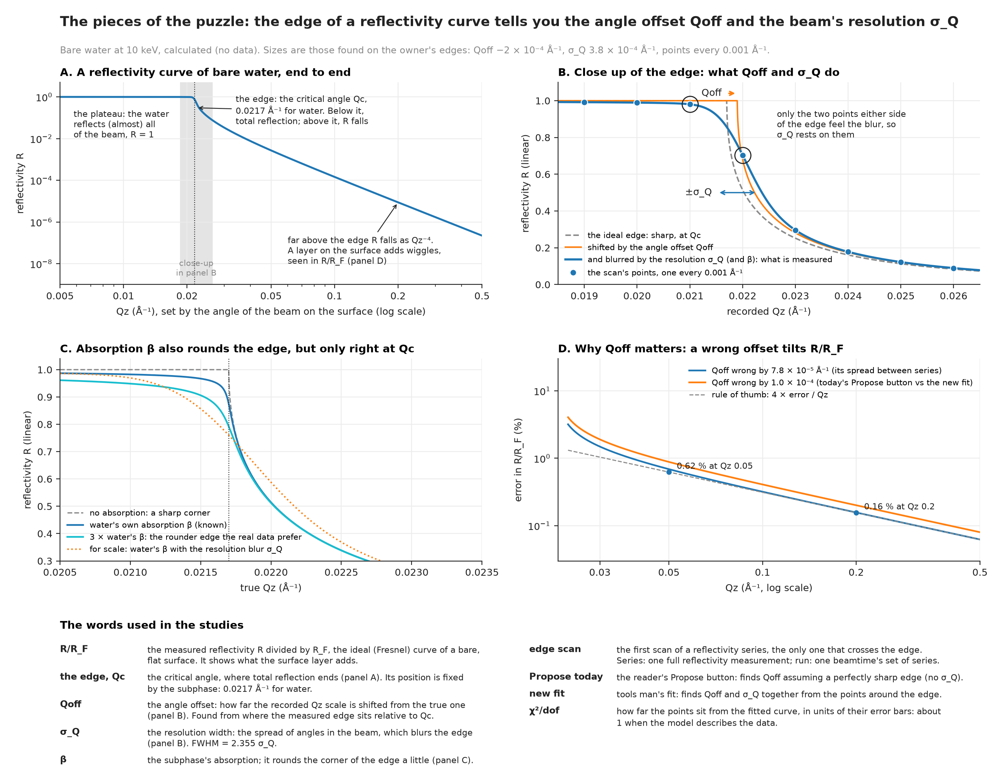
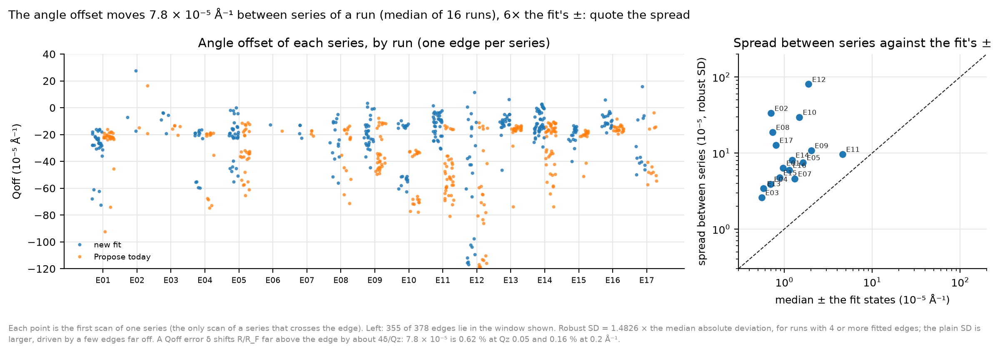

# Angle offset and Qz resolution, fitted together on real edges

Written 2026-11-27 by the data session on the owner's PC. Tools man wrote a new fit that finds the angle offset
and the resolution width of a reflectivity scan's critical edge together (`fresnel.fit_edge_resolution`; his
synthetic study is `docs/studies/qoff_resolution/summary.md`). He asked for it to be tried on real data that
only the owner's PC holds (`docs/handoff_out/09-qoff-resolution-fit.md`). This study does that, on the owner's
private edge scans and on the released ones. It answers the item "Qoff and the Qz resolution on real edges" in
`docs/DATA_NEEDS.md`. The owner, 2026-11-26: "Qoffset also has to be fit, and this could be a useful ability
to have in reader".

**Measured** throughout. Every number comes from one run of the private scripts
(`sample_data/private/xr/scripts/qres_*.py`); `numbers.json` and the CSVs beside this file hold them.

**The pieces of the puzzle** (calculated, no data; `python tests/tools/qoff_edge_explainer.py`):

**Terms used here:**
- **The edge** is the critical angle: below it the subphase reflects almost everything (the plateau), above
  it the reflectivity falls steeply. Qc is where it lies (water: 0.021728 Å⁻¹).
- **Qoff, the angle offset,** is how far the scan's Qz scale is shifted. A wrong Qoff moves the measured edge
  away from Qc and tilts R/R_F, the reflectivity divided by the ideal Fresnel curve R_F.
- **σ_Q, the resolution width,** is how much the beam's spread of angles blurs the edge (a Gaussian width;
  FWHM = 2.355 σ_Q).
- **β** is the subphase's absorption, which also rounds the edge a little.
- **The new fit** fits Qoff and σ_Q together, from 0.6 Qc to 0.030 Å⁻¹, with water's Qc and β held fixed. It
  down-weights single outlying points and gets its ± by refitting resampled data (bootstrap, 100 times).
- **Propose today** is the reader's current Propose button (`propose_qoff`). It assumes a perfectly sharp
  edge, so it has no σ_Q.
- **The earlier edge-width study** is `docs/studies/qz_resolution/`. It measured σ_Q per scan on the same
  private edges.
- **The incident slit** (S1) sets the beam's height. Most private scans used 0.04 mm.

**Anonymous:**
- private runs are labelled E01–E17, the same labels as in the earlier edge-width study;
- the two released runs (before 2019) are R01 and R02;
- no names, dates, files or scan numbers are given, and no curves.

**No default changes.** The Propose button is unchanged.

## The questions

Tools man asked five things of the real edges:
1. Does the new fit give the same widths as the earlier edge-width study?
2. How much of today's Propose value comes from ignoring the resolution?
3. How far does Qoff move from one reflectivity series to the next within a run?
4. Does the new fit work on the scans with the narrowest slit (0.02 mm), which the earlier study could not
   fit?
5. How much does a wrong absorption β change σ_Q?

His result on the public NX school data raised a sixth: do the real edges follow the model at all?

## The data

- **Private:** 400 edge scans. Each is the first scan of a reflectivity series, the only one that crosses the
  edge. They are the earlier edge-width study's scans, at 10 keV in 18 runs:
  - **378 with the incident slit at 0.04 mm,** in 17 runs: the main set;
  - 11 at 0.02 mm;
  - 11 at 0.2 mm.

  All of them step by 0.001 Å⁻¹ from 0.016, which puts 6 points below the edge. Their errors are 0.10 % on the
  plateau and 0.18 % just above the edge (medians). The data are the reader's reduced reflectivity (reflected
  intensity per monitor count, with counting errors), cached by the earlier study.
- **Released:** the first scan of each of the 96 released series (the set of `docs/studies/excess_scatter/`),
  at 10 keV. 95 are in one run (R01) and 1 in another (R02). They are sampled the same way, with errors of
  0.18 % and 0.36 %.
- **Variants,** each fitted on every edge:
  - a 3 Å surface roughness in R_F;
  - β at 0.5, 1.5, 2, 3 and 4 times water's;
  - the fit ending at 0.026 or 0.028 Å⁻¹ instead of 0.030;
  - the point just below the edge left out, or the points on both sides of it.
- **A check of tools man's survey script** (`qoff_resolution_survey.py`): it was run on 3 of the private
  files, reading them again from the raw data and using its fuller error model (counting plus other terms). It
  found 72 edge scans. The 71 that are also in the cache agree with the cached fits: Qoff within
  1.9 × 10⁻⁶ Å⁻¹ (95th percentile), and σ_Q in the ratio 1.000. Its fuller errors change χ²/dof (below) by a
  factor of only 1.06, so they do not explain the misfit found in section 3.

**Statistics used:**
- **χ²/dof** is the mean squared residual in units of each point's error. It is about 1 when the model
  describes the data and the errors are right.
- **The pull SD** is the SD of (estimate − truth)/stated ±, over many simulated edges. It is 1 when the ± is
  honest.
- **Coverage** is the share of 95 % intervals that hold the truth.
- **Robust SD** is 1.4826 × the median absolute deviation. A few far-off points cannot inflate it.

## 1. Simulated edges with a known answer, sampled like the real ones (Figure 1)

These are tools man's simulated bare-water edges (`qoff_resolution_study.known_truth`), with a known Qoff and
σ_Q, sampled like the real scans (0.001 steps from 0.016).
- Twice tools man's default counts matches the private errors, and half matches the released ones.
- 200 simulated edges per condition.

**Error in Qoff, mean ± SD in 10⁻⁵ Å⁻¹, true σ_Q 3.8 × 10⁻⁴** (`truth.csv`):

| true Qoff (10⁻⁴) | new fit, counts × 2 | Propose today, counts × 2 | new fit, counts × 0.5 | Propose today, counts × 0.5 |
|---|---|---|---|---|
| −4 | −0.00 ± 0.16 | +14.0 ± 10.0 | −0.00 ± 0.30 | −13.5 ± 0.4 |
| −2 | +0.00 ± 0.15 | +1.5 ± 0.1 | +0.01 ± 0.27 | −12.2 ± 0.5 |
| −1 | −0.01 ± 0.15 | −5.0 ± 0.1 | −0.01 ± 0.27 | −5.0 ± 0.1 |
| 0 | −0.06 ± 0.21 | −10.1 ± 0.1 | −0.14 ± 1.00 | −10.1 ± 0.2 |
| +1.5 | −0.06 ± 0.29 | −15.0 ± 0.1 | −0.06 ± 0.51 | −15.0 ± 0.2 |
| +3 | −0.03 ± 0.26 | −16.5 ± 0.2 | −0.03 ± 0.46 | −16.5 ± 0.3 |

**The new fit, sampled like the real scans:**
- **Qoff** comes back within 1.4 × 10⁻⁶ Å⁻¹ on average, with an SD of 1.4–5.1 × 10⁻⁶.
- **σ_Q** comes back within 4 % from 1.5 to 5.4 × 10⁻⁴, and within 0.4 % at 3.8 × 10⁻⁴.
- **Its ± is honest:** pull SD 0.88–1.11, and 91–98 % of the 95 % intervals hold the truth.
- **The one exception** is a true Qoff of 0 at half counts. There a few edges fail (SD 1.0 × 10⁻⁵), and the
  pull SD is 3.0 for Qoff and 1.8 for σ_Q. Coverage is still 94 %.

**Propose today** is off by −2.5 to +1.4 × 10⁻⁴. Its error depends on where the edge falls between two
measured points (the table's rows) and on σ_Q (−12 × 10⁻⁵ at σ_Q 3.8 × 10⁻⁴, −25 at 5.4 × 10⁻⁴, half counts).
Its ± holds the truth on 0–44 % of the edges.

**Fitting with a wrong model** (simulated):

| fitted with | change in Qoff (10⁻⁵ Å⁻¹) | error in σ_Q |
|---|---|---|
| β twice water's | −0.7 | −13 % |
| β half water's | +0.4 | +5 % |
| a DPPC monolayer present, fitted as bare water | +0.1 | +5 % |

These agree with tools man's results at his sampling.

So the new fit works on edges that follow its model, sampled as the owner samples them. Simulated water edges
give χ²/dof near 1; the real ones do not (section 3).

## 2. The same widths as the earlier edge-width study (Figure 2, left)

On the 350 main edges where the fit found a width above zero, the new fit agrees with the earlier study (whose
edge position q_e corresponds to Qc − Qoff):
- σ_Q: the ratio is 1.004 (5–95 %: 0.98–1.08);
- Qoff: within 1.0 × 10⁻⁵ (95th percentile).

**So the new fit measures what the earlier study measured,** and the earlier study's σ_Q numbers stand. The
median σ_Q is 3.79 × 10⁻⁴ Å⁻¹ (FWHM 8.9 × 10⁻⁴), with quartiles 3.31–4.47 × 10⁻⁴.

## 3. The real edges do not follow the model within their errors (Figure 2, middle and right)

- **χ²/dof:**
  - private: median 40, quartiles 22–119, 95th percentile 860;
  - released: median 133.

  Only 1 % of the private edges come below 3. Tools man's public example (NX school data) is typical, not an
  exception.
- **The misfit is one pattern, repeated.** Figure 2, right, averages each edge's residuals (each scaled by its
  own √(χ²/dof), so every edge counts alike) by the point's position from the fitted edge.
  - The points 1–2 steps below the edge lie low, at −0.5 to −0.7.
  - The points 2–5 steps above it lie high, at +0.8 to +1.4.
  - The points 7–9 above lie low again.
  - The pattern has the same signs in 16 of the 17 private runs (the exception has one edge), and in the
    released runs.
- **What it is not:**
  - the end of the fit range: ending at 0.026, χ²/dof only falls to 32;
  - water's roughness in R_F: no change;
  - the error model: the survey script's fuller errors give the same χ²/dof.
- **What it might be** (open; not measured here):
  - an edge rounded over a wider range than one Gaussian can give: a resolution with tails, the beam's
    footprint or the meniscus at the lowest angles, or an angle error that differs from point to point;
  - a plateau that is not quite flat just below the edge.

  A larger β rounds the edge over a wider range, and it is the variant that fits best (section 6). Water's β
  itself is known, so the larger β only stands in for the missing rounding.

## 4. How much of today's Propose value comes from ignoring the resolution

On the 350 edges, the median Qoff:
- new fit: −1.62 × 10⁻⁴ Å⁻¹;
- Propose today: −2.20 × 10⁻⁴.

Per edge, the new fit minus Propose today is +0.94 × 10⁻⁴ (quartiles +0.33 to +1.66). So today's Propose button
reads the angle offset about 1 × 10⁻⁴ too negative, about 0.1 of the median resolution's FWHM. That is close to
what the earlier Qoff study predicted (`docs/studies/qoff/`: ignoring the resolution shifts Qoff by about −0.15 of the resolution width ΔQ),
but it varies widely from edge to edge, as tools man found on simulated edges.

On simulated edges (section 1), Propose today's error depends on where the edge falls between two measured
points, from −2.5 to +1.4 × 10⁻⁴. Figure 3 shows the same on real edges: within one run (E05, E09, E11, E14) its
values split into two clusters about 2–4 × 10⁻⁴ apart, while the new fit's stay together.

## 5. Qoff from series to series within a run (Figure 3)

Only the first scan of a series crosses the edge, so each point in Figure 3 is one series.
- **The spread:** in the 16 runs with 4 or more fitted edges, the robust SD of the new fit's Qoff between
  series is 7.8 × 10⁻⁵ Å⁻¹ (median over runs), ranging from 2.6 × 10⁻⁵ to 8.0 × 10⁻⁴.
  - The plain SD is larger. A few edges per run lie 3–10 × 10⁻⁴ away.
  - Each is a series whose Qoff really differs, or whose edge the model misses. One run (E12) has 6 near
    −1.1 × 10⁻³.
- **Against the fit's own ±:** the spread is about 6 times the ± the fit states (median over runs; 2–40
  times). That ± is already enlarged by √(χ²/dof): median 1.3 × 10⁻⁵, against 2.1 × 10⁻⁶ from counting alone.

  So quote the spread between series, not the fit's ±, as tools man advised. This study cannot tell a real
  change of the angle offset (realignment between series) from scatter in the fit.
- **What it means for R/R_F:** far above the edge, a Qoff error δ changes R/R_F by about 4δ/Qz. The typical
  spread of 7.8 × 10⁻⁵ is:
  - 0.62 % at Qz 0.05 Å⁻¹;
  - 0.16 % at 0.2;
  - 0.06 % at 0.5.

  One Qoff per run is therefore good to that level above Qz 0.1, but not near the edge.

## 6. What changes σ_Q and Qoff (Figure 4)

Private, median over 350 edges:

| change | σ_Q relative to the standard fit | change in Qoff (10⁻⁵ Å⁻¹) | median χ²/dof |
|---|---|---|---|
| the standard fit | 1 | 0 | 40 |
| fit ends at Qz 0.028; at 0.026 | 0.987; 0.970 | +0.2; +0.5 | 33; 32 |
| 3 Å roughness in R_F | 1.00 | 0.0 | 42 |
| β × 0.5 | 1.06 | +0.9 | 53 |
| β × 1.5 | 0.93 | −0.6 | 30 |
| β × 2 | 0.86 | −1.1 | 21 |
| β × 3 | **0.67** | −2.1 | **11** |
| β × 4 | 0.40 | −3.2 | 14 |
| without the point just below the edge | 0.98 (100 edges at zero width) | +0.2 | 33 |
| without the points on both sides | **0 (306 of 350 at zero width)** | **−10.2** | 14 |

- **Absorption β:** the earlier edge-width study found that doubling β changes σ_Q by about 15 %, and this
  agrees (−14 %).
  - The data prefer a softer edge: β three times water's fits best, with χ²/dof 11.
  - The resolution then reads 33 % narrower, while Qoff moves only 2 × 10⁻⁵.
  - So σ_Q carries a model uncertainty of about 30 %, from the edge's shape. Qoff carries about 2 × 10⁻⁵.
- **The two points on either side of the edge carry σ_Q.** With steps of 0.001, a resolution of σ 3.8 × 10⁻⁴
  affects only them.
  - Without them, 306 of 350 edges give σ_Q = 0, and Qoff moves by −1.0 × 10⁻⁴: the fit then behaves like
    Propose today.
  - These are the same points where the residual pattern sits. The width is read from two points that the
    model does not describe.
- **Released:** the same directions, smaller sizes. β × 3 gives 0.91 and χ²/dof 109.

## 7. The narrow and wide slits, and the released runs

| set | edges | width at zero | offset and width not separable | σ_Q median (quartiles), 10⁻⁴ Å⁻¹ | χ²/dof | Qoff median, 10⁻⁴ Å⁻¹ |
|---|---|---|---|---|---|---|
| slit 0.04 mm (main) | 378 | 28 | 25 | 3.79 (3.31–4.47) | 40 | −1.62 |
| slit 0.02 mm | 11 | 4 | 3 | 4.93 (4.65–7.92) | 52 | −3.30 |
| slit 0.2 mm | 11 | 0 | 0 | 3.39 (3.00–3.85) | 91 | −2.48 |
| released (before 2019) | 96 | 20 | 1 | 7.62 (4.59–15.3) | 133 | +6.84 |

"Width at zero" means the fit found no width: σ_Q sat at its lower limit, 0. "Not separable" means the fit
could not tell a change of offset from a change of width.

- **Slit 0.02 mm:** the new fit does no better than the earlier study did. 4 of 11 have zero width, on 3 the
  offset and width cannot be separated, and the rest spread widely.
- **Slit 0.2 mm** gives the same resolution as 0.04 mm. So the slit does not set the edge's width, as the
  earlier study found.
- **The released runs:**
  - The edges are wider (σ_Q median 7.6 × 10⁻⁴), χ²/dof is higher (133), and 20 of 96 have zero width.
  - Qoff is positive (+6.8 × 10⁻⁴), and Propose today differs from it by 2.7 × 10⁻⁴.
  - **Their subphase is not known here.** With water's Qc held fixed, any difference of Qc reads as Qoff one
    for one (shown in the earlier Qoff study, `docs/studies/qoff/`). So these Qoff values are not angle
    offsets until the subphase is known.

## 8. Conclusions

- **The method is right where its model holds** (section 1, sampled as the owner samples), **and it measures
  the same widths as the earlier edge-width study** (section 2), within 2 % per scan.
- **Real edges do not follow the model within their errors.** χ²/dof is 40 at the median, and the residual
  pattern is the same in almost every run. What the model lacks is open: something rounds the edge over more
  than one Gaussian's width.
- **The angle offset Qoff is the robust number.**
  - It moves by 3 × 10⁻⁵ or less over every variant except dropping the edge's own points.
  - It moves 7.8 × 10⁻⁵ from series to series within a run, so quote that spread, not the fit's ±.
  - Today's Propose button gives a value about 1 × 10⁻⁴ more negative, with a spread of the same size.
- **The resolution width σ_Q is the fragile number.**
  - It rests on two points per edge.
  - It changes by about 30 % with the assumed edge shape.
  - It comes out as zero (not measured) on 4 of 11 narrow-slit edges and 20 of 96 released ones.
- **How sure:**
  - **High** that the new fit reproduces the earlier study and works on simulated edges sampled like these.
  - **High** that real edges miss the model in one repeated way.
  - **Moderate** on Qoff to ±3 × 10⁻⁵, and on its spread between series of 7.8 × 10⁻⁵.
  - **Low** on σ_Q beyond ±30 %.
- **For the reader (the owner's choice; nothing changes yet):**
  - Offering the new fit's Qoff in the Propose button would remove today's error that depends on where the
    edge falls between points, about 1 × 10⁻⁴ here.
  - Its ± should be quoted as the spread between series, or as the fit's ± with a warning when χ²/dof is far
    above that of the run's other scans.
  - A scan with finer steps through the edge (0.00025–0.0005 Å⁻¹ from 0.019 to 0.025) would put 5–10 points
    where there are now two. That would test the edge's shape. It is a change to how the edge is measured, not
    to the analysis.

## Questions for the owner

1. **Released edges in figures.** The released runs appear here as numbers only. A figure showing one released
   edge with its fit and residuals would need the owner's approval. The project lead session read the earlier
   release (2026-11-26) as not covering whole released series, so this study shows none.
2. **The released runs' subphase.** Their Qoff (+6.8 × 10⁻⁴) cannot be read as an angle offset without their
   Qc. If the owner can say which subphase they had, the numbers can be redone.

## Files

| file | what |
|---|---|
| `Q1_known_truth_real_sampling.png` … `Q4_what_moves_it.png` | Figures 1–4 |
| `numbers.json` | every number quoted here |
| `edges.csv` | one row per edge: anonymous run, slit (`s1_mm`), the new fit (`qoff`, `sigma_q`, their ±, `chi2_dof`, `at_bound` = width at zero), its variants, today's Propose value (`qoff_propose_today`) and the earlier edge-width study's fit (`earlier_study_*`). Sorted by run and Qoff, with no scan numbers |
| `runs.csv` | per run: edges, fitted, width at zero, Qoff median and spread, the fit's ±, σ_Q, χ²/dof |
| `variants.csv` | Figure 4's table, private and released |
| `residual_pattern.csv` | Figure 2, right: the mean scaled residual by position from the edge |
| `truth.csv` | Figure 1: the simulated edges with a known answer (`sharp` = Propose today, `joint` = the new fit) |

**How to regenerate** (on the owner's PC, from the private caches):

    python sample_data/private/xr/scripts/qres_truth.py 200       # simulated edges, ~2 h on 4 CPUs
    python sample_data/private/xr/scripts/qres_fit.py 4           # 496 edges, ~25 min
    python sample_data/private/xr/scripts/qres_diag.py            # variants, ~10 min
    python sample_data/private/xr/scripts/qres_publish.py docs/studies/qoff_resolution_real
