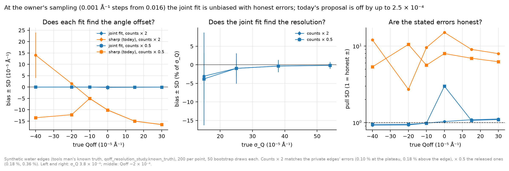
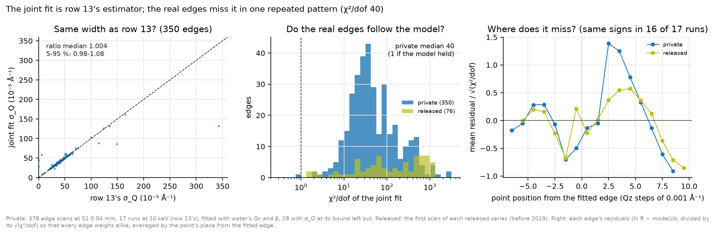
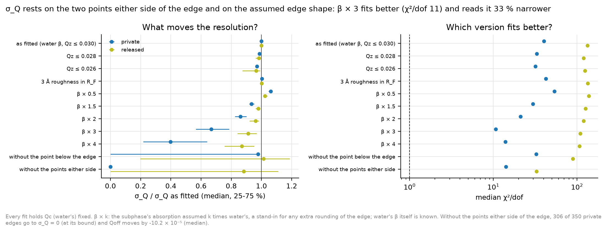

# Qoff and the Qz resolution on real edges (DATA_NEEDS row 18)

xr-data-needs (the owner's PC), 2026-11-27. The real-data half of hand-off 09
(`docs/handoff_out/09-qoff-resolution-fit.md`). It runs tools man's `fresnel.fit_edge_resolution` (#154,
`docs/studies/qoff_resolution/summary.md`) on the owner's private edges and on the released ones. The owner,
2026-11-26: "Qoffset also has to be fit, and this could be a useful ability to have in reader".

**Measured** throughout. Every number here comes from one run of the private generator
(`sample_data/private/xr/scripts/qres_*.py`); `numbers.json` and the CSVs beside this file hold them.

**Anonymous:**
- private runs are E01–E17, the same labels as row 13 (`docs/studies/qz_resolution/`);
- the released runs (before 2019) are R01 and R02;
- no names, dates, files or scan numbers are given, and no curves.

**No default changes.** The Propose button is unchanged.

## The question

Hand-off 09 asked five things of the real edges:
1. Is the new method the same estimator as row 13's?
2. How much of today's proposal was resolution?
3. How far does Qoff move from series to series within a run?
4. Does the joint fit pin the S1 0.02 mm scans that row 13 could not fit?
5. How much does a wrong β move σ_Q?

It adds a sixth, prompted by tools man's NX result: do the real edges follow the model at all?

## The data and the fit

- **Private:** 400 edge scans, the first scan of every reflectivity series that crosses the edge. They are
  row 13's, at 10 keV in 18 runs:
  - **378 at S1 0.04 mm** in 17 runs: the main set;
  - 11 at S1 0.02 mm;
  - 11 at S1 0.2 mm.

  All of them use steps of 0.001 Å⁻¹ from 0.016, which puts 6 points below the edge. Their errors are
  0.10 % at the plateau and 0.18 % just above the edge (medians). They come from the cached reductions row 13
  used: the reader's net reflected intensity per monitor, with counting errors.
- **Released:** the first scan of each of the 96 released series (`docs/studies/excess_scatter/`'s set), at
  10 keV. 95 edges are in one run (R01) and 1 in another (R02). They have the same sampling, with errors of
  0.18 % and 0.36 %.
- **The fit:** `fit_edge_resolution` as tools man wrote it.
  - Water's Qc (0.021728, `fresnel.subphase('water')`) and water's β at the scan's energy are held fixed.
  - The range is 0.6 Qc to 0.030 Å⁻¹, with a soft-L1 loss and 100 bootstrap draws.
  - Today's `propose_qoff` (the sharp proposal) runs beside it on every edge.
- **Variants** on every edge:
  - 3 Å roughness in R_F;
  - β × 0.5, 1.5, 2, 3 and 4;
  - an upper end at 0.026 or 0.028;
  - without the point below the edge, or without the points on either side.
- **Cross-check of the survey tool:** tools man's `qoff_resolution_survey.py` was run on 3 of the private
  files, reading them again from the raw data with `errors='budget'`. It found 72 edge scans. The 71 that
  are also in the cache agree with the cached fits:
  - Qoff within 1.9 × 10⁻⁶ (95th percentile of |difference|);
  - σ_Q ratio 1.000.

  χ²/dof is 1.06 × the counting-error value, so the budget errors do not explain the misfit below.

**Statistics used:**
- **χ²/dof** is the mean squared residual in units of each point's error. It comes out at 1 when the model
  describes the data and the errors are right.
- **Pull SD** is the SD of (estimate − truth)/stated error. It is 1 when the ± is honest.
- **Coverage** is the share of 95 % intervals that hold the truth.
- **Robust SD** is 1.4826 × the median absolute deviation. A few far points cannot inflate it.

## 1. Known truth at the real sampling (Q1)

These are tools man's synthetic water edges (`qoff_resolution_study.known_truth`), drawn at the private and
released sampling: 0.001 steps from 0.016.
- Counts × 2 matches the private errors, and × 0.5 the released ones.
- 200 edges per condition.

**Bias ± SD of Qoff in 10⁻⁵ Å⁻¹, true σ_Q 3.8 × 10⁻⁴** (`truth.csv`):

| true Qoff (10⁻⁴) | joint, counts × 2 | sharp, counts × 2 | joint, counts × 0.5 | sharp, counts × 0.5 |
|---|---|---|---|---|
| −4 | −0.00 ± 0.16 | +14.0 ± 10.0 | −0.00 ± 0.30 | −13.5 ± 0.4 |
| −2 | +0.00 ± 0.15 | +1.5 ± 0.1 | +0.01 ± 0.27 | −12.2 ± 0.5 |
| −1 | −0.01 ± 0.15 | −5.0 ± 0.1 | −0.01 ± 0.27 | −5.0 ± 0.1 |
| 0 | −0.06 ± 0.21 | −10.1 ± 0.1 | −0.14 ± 1.00 | −10.1 ± 0.2 |
| +1.5 | −0.06 ± 0.29 | −15.0 ± 0.1 | −0.06 ± 0.51 | −15.0 ± 0.2 |
| +3 | −0.03 ± 0.26 | −16.5 ± 0.2 | −0.03 ± 0.46 | −16.5 ± 0.3 |

**The joint fit at the real sampling:**
- **Qoff** is unbiased to 1.4 × 10⁻⁶ or better, with an SD of 1.4–5.1 × 10⁻⁶.
- **σ_Q** comes back within 4 % from 1.5 to 5.4 × 10⁻⁴, and within 0.4 % at 3.8 × 10⁻⁴.
- **The errors are honest:**
  - pull SD 0.88–1.11;
  - 91–98 % of the 95 % intervals hold the truth.
- **The one exception** is true Qoff 0 at counts × 0.5. There a few edges fail (SD 1.0 × 10⁻⁵), and the pull
  SD is 3.0 for Qoff and 1.8 for σ_Q. Coverage is still 94 %.

**Today's sharp proposal** is off by −2.5 to +1.4 × 10⁻⁴. Its error depends on where the edge falls between
the points (the rows) and on σ_Q (−12 at 3.8 × 10⁻⁴, −25 at 5.4 × 10⁻⁴, counts × 0.5). Its ± holds the truth
in 0–44 % of the edges.

**A wrong model:**

| fitted with | ΔQoff (10⁻⁵) | σ_Q bias |
|---|---|---|
| β × 2 | −0.7 | −13 % |
| β × 0.5 | +0.4 | +5 % |
| a DPPC monolayer, not bare water | +0.1 | +5 % |

These agree with tools man's results at his sampling.

So at the owner's sampling the method works on edges that follow its model. Synthetic water edges give
χ²/dof near 1; the real ones do not (section 3).

## 2. The same estimator as row 13 (Q2, left)

On the 350 main edges where σ_Q is not at its bound, the new fit agrees with row 13's (q_e = Qc − Qoff):
- σ_Q: the ratio is 1.004 (5–95 %: 0.98–1.08);
- Qoff: within 1.0 × 10⁻⁵ (95th percentile).

**So the new method is row 13's estimator,** and row 13's σ_Q numbers stand as the joint fit's. The median
σ_Q is 3.79 × 10⁻⁴ (FWHM 8.9 × 10⁻⁴), with a quartile range of 3.31–4.47 × 10⁻⁴.

## 3. The real edges do not follow the model at their errors (Q2, middle and right)

- **χ²/dof:**
  - private: median 40, quartiles 22–119, 95th percentile 860;
  - released: median 133.

  Only 1 % of the private edges come below 3. NX scan 6 (102) is typical, not an exception.
- **The misfit is one pattern, repeated.** Q2, right, averages each edge's residuals, scaled by its own
  √(χ²/dof), by the point's position from the fitted edge.
  - The points 1–2 steps below the edge lie low, at −0.5 to −0.7 of the scaled residual.
  - The points 2–5 steps above it lie high, at +0.8 to +1.4.
  - The points 7–9 above lie low again.
  - The pattern has the same signs in 16 of the 17 private runs (the exception, E06, has one edge), and in
    the released runs.
- **What it is not:**
  - the fit's upper end: down to 0.026, χ²/dof only falls to 32;
  - water's roughness in R_F: no change;
  - the error model: the survey's `errors='budget'` gives the same χ²/dof.
- **What it might be** (open; not measured here):
  - an edge rounded over a wider range than one Gaussian can give, such as a resolution with tails, the
    footprint or meniscus at the lowest angles, or an angle error per point;
  - a plateau that is not quite flat just below the edge.

  A larger β rounds the edge over a wider range, and it is the variant that fits best (section 6). Water's β
  itself is known, so β there stands in for the missing rounding.

## 4. How much of today's proposal was resolution

On the 350 edges, the median Qoff from each fit:
- joint fit: −1.62 × 10⁻⁴;
- sharp proposal: −2.20 × 10⁻⁴.

Per edge, joint − sharp is +0.94 × 10⁻⁴ (quartiles +0.33 to +1.66). So today's proposal reads the angle offset
about 1 × 10⁻⁴ too negative, about 0.1 FWHM of the median resolution. That is near C50's −0.15 ΔQ, but it
spreads widely from edge to edge, as tools man found on known truth.

On known truth at this sampling (section 1), the sharp proposal's error depends on where the edge falls
between the points. It ranges from −2.5 to +1.4 × 10⁻⁴. Q3 shows the same on real edges: within one run
(E05, E09, E11, E14) the sharp proposals split into two clusters about 2–4 × 10⁻⁴ apart, while the joint fits
stay together.

## 5. Qoff from series to series within a run (Q3)

Only the first scan of a series crosses the edge, so each point in Q3 is one series.
- **The spread:** in the 16 runs with 4 or more fitted edges, the robust SD of the joint Qoff between series
  is 7.8 × 10⁻⁵ Å⁻¹ (median), with a range of 2.6 × 10⁻⁵ to 8.0 × 10⁻⁴.
  - The plain SD is larger. A few edges per run lie 3–10 × 10⁻⁴ away.
  - Each is a series whose Qoff really differs, or whose edge the model misses: E12 has 6 near −1.1 × 10⁻³.
- **Against the stated ±:** the spread is about 6 × the fit's own ± (median over runs; 2–40 ×). The ± is
  already scaled by √(χ²/dof): median 1.3 × 10⁻⁵, against counting's 2.1 × 10⁻⁶.

  So quote the spread between series, not the fit's ±, as tools man advised. This cannot tell a real change of
  the angle offset (realignment between series) from fit scatter.
- **What it means for R/R_F:** far above the edge, a Qoff error δ shifts R/R_F by about 4δ/Qz. The typical
  spread of 7.8 × 10⁻⁵ is:
  - 0.62 % at Qz 0.05;
  - 0.16 % at 0.2;
  - 0.06 % at 0.5 Å⁻¹.

  One Qoff per run is therefore good to that level above Qz 0.1, but not near the edge.

## 6. What moves σ_Q and Qoff (Q4)

Private, median over 350 edges:

| change | σ_Q / as fitted | ΔQoff (10⁻⁵ Å⁻¹) | median χ²/dof |
|---|---|---|---|
| as fitted | 1 | 0 | 40 |
| Qz ≤ 0.028; ≤ 0.026 | 0.987; 0.970 | +0.2; +0.5 | 33; 32 |
| 3 Å roughness in R_F | 1.00 | 0.0 | 42 |
| β × 0.5 | 1.06 | +0.9 | 53 |
| β × 1.5 | 0.93 | −0.6 | 30 |
| β × 2 | 0.86 | −1.1 | 21 |
| β × 3 | **0.67** | −2.1 | **11** |
| β × 4 | 0.40 | −3.2 | 14 |
| without the point below the edge | 0.98, 100 edges at the bound | +0.2 | 33 |
| without the points either side | **0 (306 of 350 at the bound)** | **−10.2** | 14 |

- **β:** row 13 found ±15 % for β × 2, and this agrees (−14 %).
  - The data prefer a softer edge: β × 3 fits best, with χ²/dof 11.
  - The resolution then reads 33 % narrower, while Qoff moves only 2 × 10⁻⁵.
  - So σ_Q carries a model uncertainty of order 30 %, from the edge's shape. Qoff carries about 2 × 10⁻⁵.
- **The two points on either side of the edge carry σ_Q.** At steps of 0.001 the resolution (σ 3.8 × 10⁻⁴)
  touches only them.
  - Without them, 306 of 350 edges read σ_Q = 0, and Qoff moves by −1.0 × 10⁻⁴: the fit then becomes the
    sharp proposal.
  - These are the same points where the residual pattern sits. The width is read from two points that the
    model does not describe.
- **Released:** the same signs, smaller sizes. β × 3 gives 0.91 and χ²/dof 109.

## 7. The S1 0.02 mm scans, S1 0.2 mm, and the released runs

| set | edges | σ_Q at its bound | ill-conditioned | σ_Q median (quartiles), 10⁻⁴ | χ²/dof | Qoff median, 10⁻⁴ |
|---|---|---|---|---|---|---|
| S1 0.04 mm (main) | 378 | 28 | 25 | 3.79 (3.31–4.47) | 40 | −1.62 |
| S1 0.02 mm | 11 | 4 | 3 | 4.93 (4.65–7.92) | 52 | −3.30 |
| S1 0.2 mm | 11 | 0 | 0 | 3.39 (3.00–3.85) | 91 | −2.48 |
| released (before 2019) | 96 | 20 | 1 | 7.62 (4.59–15.3) | 133 | +6.84 |

- **S1 0.02 mm:** the joint fit does not pin them any better than row 13 did. 4 of 11 are at the bound, 3 are
  ill-conditioned, and the rest spread widely.
- **S1 0.2 mm** gives the same resolution as 0.04 mm. The edge's width is not the slit, as row 13 found.
- **The released runs:**
  - The edges are wider (σ_Q median 7.6 × 10⁻⁴), the χ²/dof is higher (133), and 20 of 96 are at the bound.
  - Qoff is positive (+6.8 × 10⁻⁴), and today's proposal differs from it by 2.7 × 10⁻⁴.
  - **Their subphase is not known here.** With water's Qc held, any difference of Qc reads as Qoff one for one
    (C50 §4), so these Qoff values are not angle offsets until the subphase is known.

## 8. The judgment

- **The method is right where its model holds** (section 1, at the owner's own sampling), **and it is row
  13's estimator** (section 2). Its σ_Q per scan is row 13's, within 2 %.
- **Real edges do not hold the model at their errors.** χ²/dof is 40 at the median, and the residual pattern
  is the same in almost every run. What the model lacks is open: something rounds the edge over more than one
  Gaussian's width.
- **The angle offset Qoff is the robust number.**
  - It moves by 3 × 10⁻⁵ or less over every variant except dropping the edge's own points.
  - It moves 7.8 × 10⁻⁵ from series to series within a run, so quote that spread, not the fit's ±.
  - Today's proposal is about 1 × 10⁻⁴ more negative, with a spread of the same size.
- **The resolution σ_Q is the fragile number.**
  - It rests on two points per edge.
  - It moves by about 30 % with the assumed edge shape.
  - It is at its bound (not measured) on 4 of 11 S1 0.02 mm edges and 20 of 96 released ones.
- **How sure:**
  - **High** that the method reproduces row 13 and works on known truth at this sampling.
  - **High** that real edges miss the model in one repeated way.
  - **Moderate** on Qoff to ±3 × 10⁻⁵, and on its between-series spread of 7.8 × 10⁻⁵.
  - **Low** on σ_Q beyond ±30 %.
- **For the reader (the owner's choice; nothing changes yet):**
  - Offering the joint fit's Qoff would remove the sampling-dependent error of today's proposal, about
    1 × 10⁻⁴ here.
  - Its ± should be quoted as the between-series spread, or as the counting ± scaled by √(χ²/dof) with a
    warning when χ²/dof is far above the run's others.
  - A scan with finer steps through the edge (0.00025–0.0005 Å⁻¹ from 0.019 to 0.025) would put 5–10 points
    where the two are now. That would test the edge's shape: a measurement design, not an analysis.

## Questions for the owner

1. **Released edges as figures.** The released runs are summarised here as numbers only. A figure drawing one
   released edge with its fit and residuals (rule 13's "a fit drawn over its data") would need the owner's
   approval. main man's reading of 2026-11-26 is that whole released series were not approved, so this study
   commits none.
2. **The released runs' subphase.** Their Qoff (+6.8 × 10⁻⁴) cannot be read as an angle offset without their
   Qc. If the owner can say which subphase they had, the numbers can be redone.

## Files

| file | what |
|---|---|
| `numbers.json` | every number quoted here |
| `edges.csv` | one row per edge: anonymous run, S1, the joint fit, its variants, the sharp proposal and row 13's fit. Sorted by run and Qoff, with no scan numbers |
| `runs.csv` | per run: edges, fitted, at the bound, Qoff median and spread, the stated ±, σ_Q, χ²/dof |
| `variants.csv` | Q4's table, private and released |
| `residual_pattern.csv` | Q2, right: the mean scaled residual by position from the edge |
| `truth.csv` | Q1: the known truth at the real sampling (synthetic) |

**How to regenerate** (on the owner's PC, from the private caches):

    python sample_data/private/xr/scripts/qres_truth.py 200       # known truth, ~2 h on 4 CPUs
    python sample_data/private/xr/scripts/qres_fit.py 4           # 496 edges, ~25 min
    python sample_data/private/xr/scripts/qres_diag.py            # variants, ~10 min
    python sample_data/private/xr/scripts/qres_publish.py docs/studies/qoff_resolution_real
