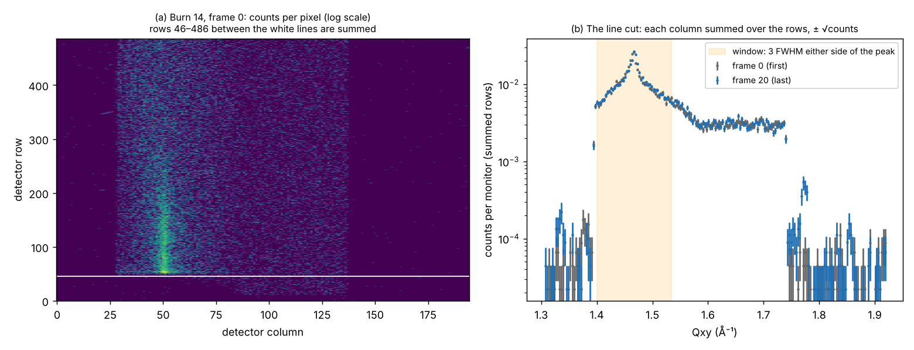
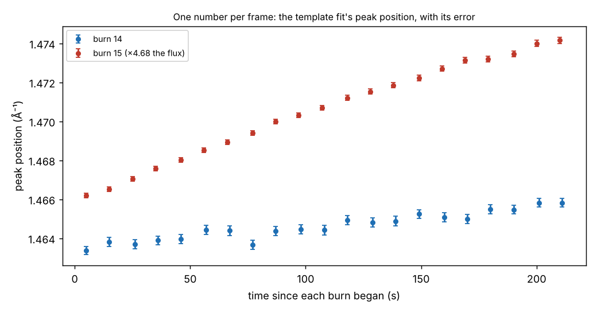
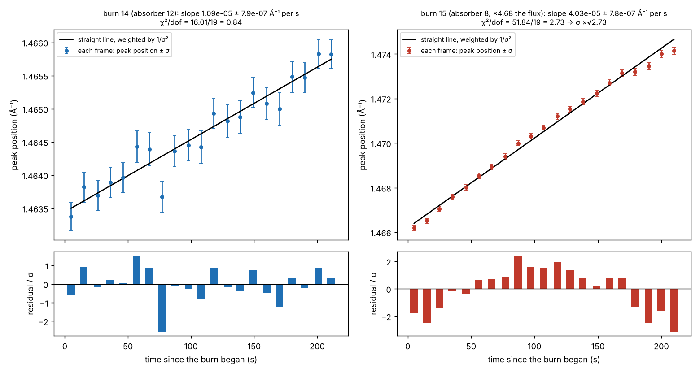
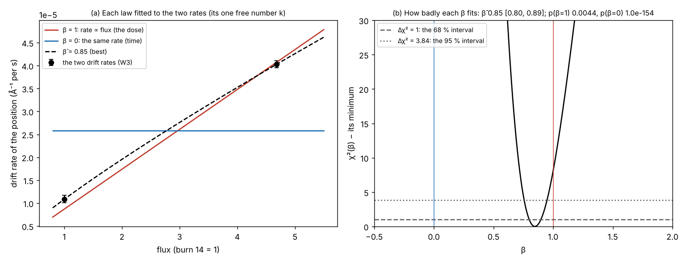
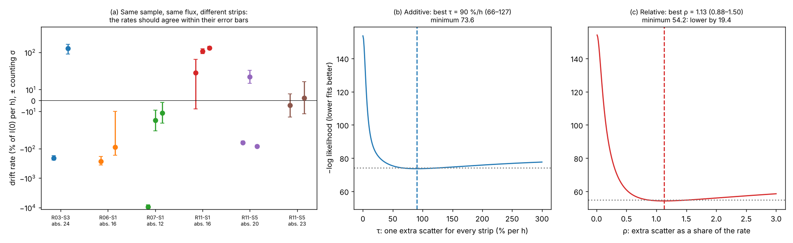
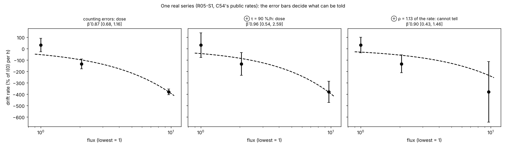
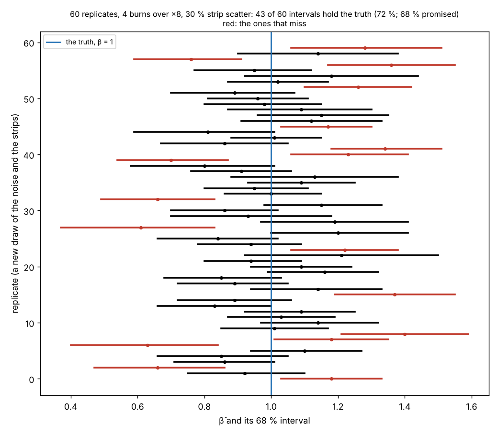

# Walkthrough: beam damage or a sample changing by itself? From frames to the verdict (F76)

Tools man, 2026-11-25, for the owner's standing order: "I always need to see the entire chain of data
processing, ending with the statistics and judgment. That means data fit examples, explanations of
statistics, all ELI5." This walkthrough follows the dose-or-time test (`docs/studies/reciprocity/summary.md`)
step by step. It starts from the detector frames of two public NX school burns and ends at a verdict and how
far to trust it. Steps 6 and 7 use the real burns of C54, from their public, anonymised table of rates.

Every figure and number comes from:

    python tests/tools/reciprocity_walkthrough.py --out docs/studies/reciprocity/walkthrough    # about 1 min

The numbers are in `walkthrough/numbers.json`. **Measured** throughout, on the data named.

## The question, in one paragraph

A sample can change while we measure it for two reasons:
- **the X-ray beam damages it.** Then the change follows the **dose**, the number of photons it has
  received. Twice the flux gives twice the damage per second.
- **it changes by itself** (it ages, evaporates, reorganises). Then the change follows the **clock**. The
  flux does not matter.

So burn one kind of sample at two or more fluxes and compare how fast each burn changes. If the speed goes
with the flux, it is the beam. If it is the same at every flux, it is the clock.

## Step 1. The raw data: a detector frame and its line cut (figure W1)

- **(a) One frame.** This is burn 14, frame 0: what the Pilatus detector counted in 10 s at one spot of the
  sample.
  - Each pixel is a number of photons. The colour scale is logarithmic, so faint and bright show together.
  - The bright streak near column 50 is the GID peak (diffraction from the film's lattice).
  - The rows between the white lines (46–486) are the ones that carry signal; the rest is shadow. They are
    chosen from the mean of all frames (`burn.signal_rows`).
- **(b) The line cut.** For every column, the counts of those rows are added up and divided by the monitor
  count, so a change in beam intensity cancels.
  - Each point's error bar is √counts. Photon counting is Poisson: if you expect N photons, you get N ± √N.
  - Grey is the first frame, blue the last (frame 20). The peak has moved slightly to the right; that is
    what this test measures.
  - The orange band is the **window**: 3 peak widths either side of the peak. Only these points are used,
    so the edges of the detector's shadow stay out.

## Step 2. One number per frame (figure W2)

Each frame's line cut becomes one number with one error bar: here the **peak position**. The reader's
default estimator is the "shoulder stretched with the peak" (`stretched`). The mean of all 21 frames (less a straight background) is the peak's
shape. Each frame is then fitted as that shape, shifted by δ and stretched by w, on its own straight
background:
- the position is the template's centre + δ;
- its error comes from the fit's covariance, the uncertainty of δ given the counting errors.

The same is done for the intensity and the width. The intensity changes in neither burn, and the width only
in 15 (summary, section 5).

## Step 3. How fast does one burn change? A straight line through its frames (figure W3)

**The fit.** Through each burn's 21 positions, a straight line y = a + r·t, weighted by 1/σ². A point with a
small error bar counts more. The slope r is the **drift rate**, the change per second.

| burn | flux | drift rate (Å⁻¹ per s) | χ²/dof |
|---|---|---|---|
| 14 (absorber 12) | 1 | 1.09 × 10⁻⁵ ± 0.08 × 10⁻⁵ | 16.0/19 = 0.84 |
| 15 (absorber 8) | ×4.68 | 4.03 × 10⁻⁵ ± 0.08 × 10⁻⁵ | 51.8/19 = 2.73 |

**What χ² and χ²/dof mean.** Each point's miss, the distance from the line, is divided by its own error
bar. These are the bars in the lower panels. Then they are squared and added up.
- If the line is right and the error bars are honest, each miss is about ±1 error bar, so χ² comes out about
  equal to the number of points less the two fitted numbers (dof = 21 − 2 = 19). χ²/dof is then about 1.
- **Burn 14: 0.84.** The line describes it; the misses are noise. One frame, at 75 s, sits 2.6 error bars
  low. A miss that large happens to 1 frame in 110 by chance, so with 21 frames about once in 5 burns.
- **Burn 15: 2.73.** The misses are too big for noise, and they have a **pattern**: low at both ends, high
  in the middle. The drift **slows down** during the burn, and a straight line cannot follow a curve.
  - The slope is still a fair average rate. Its error is multiplied by √2.73 = 1.65 so that it is not
    overconfident: the reader's rule when χ²/dof > 1.
  - The curvature is a hint about step 4. A drift that slows is what saturation looks like: the part of the
    film that can change is being used up.

## Step 4. Across burns: does the rate go with the flux? (figure W4)

**The model.** rate = k · flux^β, with two unknowns: k, the rate at a reference flux, and β, how the rate
scales with the flux.
- **β = 1: the dose.** Rate in proportion to flux: 4.68 × the flux gives 4.68 × the rate.
- **β = 0: the clock.** Flux to the power 0 is 1, so every burn has the same rate.
- Anything else is a mixture, or a damage that is not proportional to the dose.

**(a) Each law fitted.**
- Blue, β = 0: one flat line cannot pass through both rates; it misses each by about 19 error bars (χ² 702).
- Red, β = 1: the line through the origin misses burn 14 by 2.8 error bars (χ² 8.1).
- Dashed, the best β: 0.85. Burn 15's rate is 3.7 × burn 14's, where the dose would give 4.68 ×.

**(b) χ²(β).** For every β from −1 to 4, the best k is found and the χ² of the two rates computed. The curve
says how badly each β fits.

| statistic | value | in words |
|---|---|---|
| best β̂ | 0.85 | the bottom of the curve |
| 68 % interval (Δχ² = 1) | [0.80, 0.89] | where the curve is less than 1 above its bottom |
| 95 % interval (Δχ² = 3.84) | [0.76, 0.94] | less than 3.84 above |
| χ² at β = 1, p | 8.1, p = 0.004 | the dose alone fits worse than 1 time in 200 by chance |
| χ² at β = 0, p | 702, p = 10⁻¹⁵⁴ | the clock alone is impossible |
| Akaike weight of the dose against time | 1.00 | of the two pure laws, the dose is the far better one |

**Statistics, ELI5:**
- **The interval from Δχ² = 1.** Move β away from the best value until the fit is worse by 1 in χ². Moving
  that far is what noise alone does about 1 time in 3, so the interval holds the truth about 68 % of the
  time; at Δχ² = 3.84, 95 %. That "about" is checked in step 7.
- **A p-value.** Suppose a law were exactly true. How often would noise alone make a fit as bad as this
  one? p = 0.004 means 4 times in 1000. Below 0.05 (1 in 20) the law is "rejected". This is a convention,
  not a law of nature.
- **The Akaike weight.** Of two candidate laws, how much the data prefer each: w = e^(−χ²₁/2) /
  (e^(−χ²₁/2) + e^(−χ²₀/2)). 1.00 means the dose is overwhelmingly the better of the two pure laws, even
  though neither is perfect.

**The verdict on counting errors alone: "neither".** Time is rejected beyond doubt; the dose is rejected
narrowly (p 0.004); β is 15 % short of 1.

## Step 5. What a verdict means, and the strip scatter

The test's rules, in order:
1. **"no change"** if no burn changes by 3 error bars;
2. **"opposite signs"** if one burn rises and another falls (neither law can do that);
3. **"dose"** if β = 1 passes (p ≥ 0.05) and β = 0 fails;
4. **"time"** the reverse;
5. **"cannot tell"** if both pass;
6. **"neither"** if both fail.

**The catch: two strips are not two copies.** Each burn sits on a fresh spot (a "strip") of the sample. Two
strips of one sample at one flux should drift at the same rate, but on real samples they do not. So a rate
carries an extra uncertainty, the **strip scatter**, beyond its counting error. NX 14 and 15 are one spot, so
their strip scatter cannot be measured. Allowing a 10 % strip scatter as a test, the dose passes (p 0.58),
time still fails (p 4 × 10⁻⁷), and the verdict becomes **"dose"**: β 0.85 [0.63, 1.15].

## Step 6. How big is the strip scatter on real samples? (figures W5, W5b)

**(a) The evidence.** C54 has six groups where an absorber was repeated on another strip of the same sample.
Within a group the rates should agree within their error bars. They do not: some differ by 5–10 error bars,
and two groups even change sign.

**(b, c) Two ways to model it, and which fits.** The strip scatter is fitted by **REML**, explained below, in
two forms:

| form | each rate's extra error | best value | −log L | in words |
|---|---|---|---|---|
| none | 0 | — | 153.6 | the error bars alone: very unlikely |
| additive τ | the same for every strip | 90 %/h (66–127) | 73.6 | C54 found 88 (64–122): reproduced |
| relative ρ | a share of the rate | **1.13 (0.88–1.50)** | **54.2** | **lower by 19.4: much better** |

**Statistics, ELI5:**
- **A likelihood.** For a guessed strip scatter, how probable are the rates we actually saw? Each rate's
  chance is a bell curve around its group's mean, as wide as √(counting error² + strip scatter²). Multiply
  over all rates; take −log so that small is good.
  - Too small a scatter and the far-apart rates are "impossible".
  - Too large and every value is "possible but unlikely".
  - The best scatter sits between, at the bottom of the curves in (b) and (c).
- **REML.** "Restricted" maximum likelihood. Each group's mean is unknown and is estimated from the same
  few rates, which makes the rates look closer than they are. REML corrects for that. It is the textbook
  method for this one-way "random effects" problem, and C54 used it too.
- **Comparing the two forms.** Both have one free number, so the lower −log L is simply the better
  description. A difference of 19.4 in −log L is a likelihood ratio of e^19.4, about 270 million to one.
  **The strips differ in proportion to the rate, by about the rate itself (113 %).**

**One real series under the three error models** (C54's R05-S1: three burns, ×9.6 in flux).
- **Counting errors:** "dose", β 0.87 [0.68, 1.16].
- **With τ, 90 %/h added to every rate:** still "dose", β 0.96 [0.54, 2.59]. Every bar widens by the
  same ±90 %/h. Beside the fast burn's −380 %/h that is small, so the fast burn still pins the law; beside
  the slow ones it is large.
- **With ρ, 113 % of each rate added:** **"cannot tell"**, β 0.90 [0.43, 1.46]. The fast burn now carries
  most of the uncertainty, the fit leans on the two slower burns, and β = 0 is no longer excluded.

## Step 7. Can the intervals be trusted? Calibration (figure W6)

**Why this step.** "68 % interval" is a promise: over many repeats of the experiment, 68 % of such
intervals hold the truth. It can be checked only where the truth is known, on synthetic data.
- Sixty synthetic series are drawn from `synthetic.burn_pairs`: four burns over ×8, each strip off by a
  random 30 %, with true β = 1. Each is analysed as a real one would be.
- **Result: 43 of 60 intervals hold the truth (72 %), against 68 % promised.** The red ones miss, as about a
  third should.
- Over 300 replicates (the tool, `numbers.json`): at ρ = 0.3, 0.66 of the 68 % intervals and 0.95 of the
  95 % ones hold the truth. The promise is kept. The study's section 2 finds 0.61–0.69 at 20 % and 50 %.
- At ρ = 1, as on the real strips, coverage falls to 0.52 (68 %) and 0.87 (95 %) with four burns. So
  single verdicts on the real series are **overconfident**: a law is rejected more often than the p-value
  says.

**Pull, ELI5:** (β̂ − true β) / its error, over many replicates. If the errors are honest, the pulls scatter
with a standard deviation of 1. Above 1 means the errors are too small, below 1 too large. The study reports
0.93–1.09 with ρ (one exception: 3.6 for a steep β = 2 at 50 %, where intervals are cut at the grid's edge).

## Step 8. The judgment

- **NX school burns 14 and 15** (one spot, 15 measured after 14). The position drifts **with the dose,
  not the clock**:
  - time is excluded beyond doubt (p 10⁻¹⁵⁴);
  - β = 0.85 is a little short of 1;
  - burn 15's drift slows during the burn (step 3), which saturation would explain.
  - On counting errors alone the verdict is "neither"; with any realistic strip scatter it is "dose".
  - Confidence: **high that the beam drives it; moderate on the exact β**. One pair, one spot.
- **C54's real samples:**
  - strips differ by about their own rate (ρ ≈ 1.1, far better than one additive τ);
  - with that, 5 of 19 series rise on one strip and fall on another;
  - the single-series calls (5 dose, 1 time) are overconfident (step 7).
  - Confidence: **high that the strip scatter is large and proportional; low on any one sample's dose or
    time**.
- **What would settle it:**
  - reduce the strip scatter first: find why strips differ (C54 suspects the specular spot moving in the
    ROI);
  - or, at ρ ≈ 1.1, use 12–16 strips at each of two fluxes ×10 apart (summary, section 4).

## Where each step lives in the code

| step | code |
|---|---|
| 1 rows, line cut, window | `lss_core.burn.signal_rows`, `Experiment.burn` (profiles), `burn.choose_window` |
| 2 one number per frame | `lss_core.burn.measure_gid` (estimator 'stretched') |
| 3 drift rate | `lss_core.reciprocity.drift_rate` (ln y for intensity and width, y for a position; σ × √(χ²/dof) when > 1) |
| 4 β, intervals, p, weight | `reciprocity.dose_or_time` / `dose_or_time_rates`, `_profile` |
| 5 verdict rules, strip scatter | `dose_or_time(strip_scatter=τ, strip_relative=ρ)`; repeated strips pooled (`_pooled_z`) |
| 6 strip scatter from repeats | `reciprocity.strip_scatter_fit` (REML) |
| 7 calibration | `tests/tools/reciprocity_study.py` (300 replicates), `synthetic.burn_pairs` |
