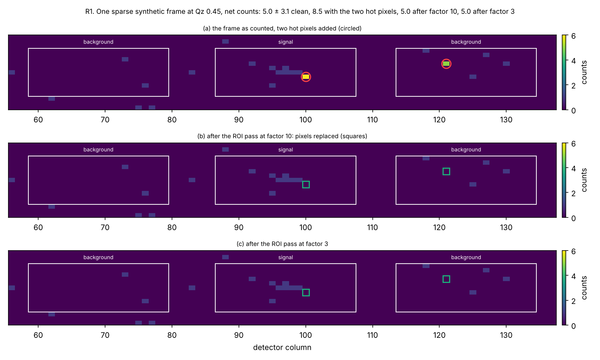
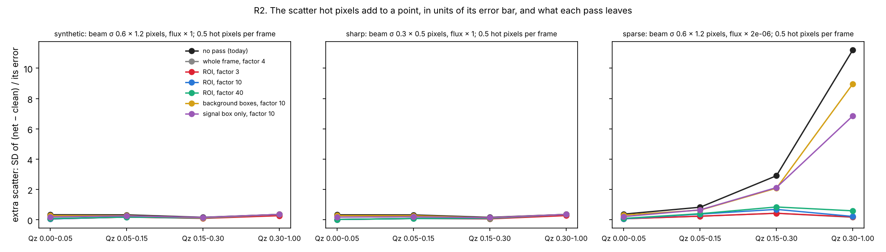
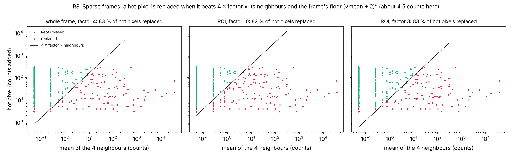
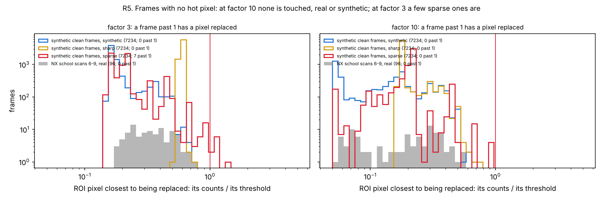
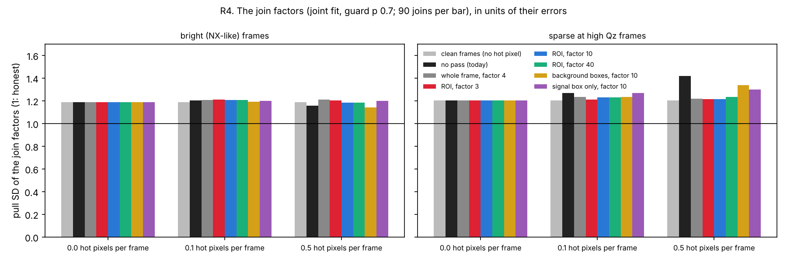

# A bad-pixel pass on the reflectivity ROI (F95 B3, C62): from one frame to the verdict

*main man, 2026-11-25. The owner's answer (Q-UI-B3) was "wire them": a bad-pixel threshold of its own for
the reflectivity ROI. The Reflectivity tab's "Bad Pixel Correction fac" field (default 10) is read today but
never used. The GUI manager pointed out the risk: on sparse frames a pass could replace real signal with 0, so
a study must come first (rule 12). This study answers it with known truth. Rule 13's chain follows, one step
at a time.*

Every figure and number comes from:

    python tests/tools/roi_bad_pixel_study.py --out docs/studies/roi_bad_pixels     # about 2 min on 4 CPUs

The numbers are in `numbers.json`, `stats.csv` (per condition, Qz class and pass), `join_pulls.csv`,
`hot_pixels.csv` (every hot pixel: its counts, its neighbours, which passes removed it) and `nx_school.csv`.
**Measured** throughout: synthetic data with known truth, and the public NX school frames.

## The question, in one paragraph

A reflectivity point is the counts in a box around the reflected beam, minus the counts in two boxes beside
it (the background), divided by the monitor. A **hot pixel** is one pixel that reads far more than it should:
a cosmic ray, a zinger, an unstable pixel. One in the signal box adds its counts to the point; one in a
background box takes half of them away. A **bad-pixel pass** looks for pixels much brighter than their
neighbours and replaces them with their neighbours' mean. The question has two halves:
- does a pass remove hot pixels?
- does it ever remove real signal?

On a sparse frame the reflected beam is a few isolated counts, and that is where the second half bites.

## Step 1. The raw data: one sparse frame (figure R1)

- **What the frame shows.** A synthetic Pilatus frame at Qz 0.45, at the end of the curve of a weak sample,
  with the flux 2 × 10⁻⁶ of the NX-like beamline's. The white rectangles are the reader's three boxes (21 × 11
  pixels, the window's defaults).
- **The signal.** The reflected beam is the short trail of 1-count pixels in the signal box; the background
  boxes hold about 0.02 counts per pixel. The point is **5.0 ± 3.1 net counts**.
- **(a) Two hot pixels added:** 6 counts beside the beam (in the signal box) and 5 counts in the right
  background box. The point becomes 5.0 + 6 − 5/2 = **8.5**, 1.1 error bars too high.
- **(b) The ROI pass at factor 10** replaces both (squares) and the point is 5.0 again. **(c) Factor 3** does
  the same here.

**How the test decides** (the reader's `TwoDDetector.removeBadPix`, applied here only inside the three
boxes). A pixel is replaced when it exceeds both:
- 4 × factor × the mean of its 4 neighbours (one iteration);
- the frame's floor, (√(the frame's mean) + 2)². On this frame that is 4.5 counts.

Both hot pixels have neighbours of 0 and exceed 4.5, so both go. The beam's own 1-count pixels are below the
floor, so they stay.

## Step 2. What is compared

**The conditions.** Each is reduced by the reader's own arithmetic (`reflectivity.frame_row`: the beam's
centroid, the three box sums, the legacy error).
- **The data:** synthetic reflectivity scans, a smooth film on the NX-like plan of four scans and 96 points
  (`synthetic.xrr_scans`, `xrr_images`). 30 replicates.
- **Three beams:**
  - **bright**, the NX-like flux. The beam is σ 0.6 × 1.2 pixels, and even at Qz 0.45 its brightest pixel
    holds 656 counts;
  - **sharp**, σ 0.3 × 0.5 pixels;
  - **sparse**, the NX-like flux × 2 × 10⁻⁶. The low-Qz scans stay bright, because fewer absorbers are
    needed, but at Qz 0.45 the box holds about 8 counts (figure R1).
- **Hot pixels:** a Poisson number per frame, mean 0, 0.1 or 0.5, placed at random in the three boxes, each
  3 to 300 counts (log-uniform).

**The passes:**

| pass | what it does |
|---|---|
| **none** | today's default (Frames > Reduce, iterations 0) |
| whole frame, factor 4 | what a user gets by switching on today's Frames > Reduce pass |
| ROI, factor 3 / 10 / 40 | the same test, only inside the three boxes (10: the Reflectivity tab's field) |
| background boxes, factor 10 | the test only where no signal is expected |
| signal box only, factor 10 | the test only where the beam is (as first proposed for the window) |

**The yardstick.** Every point is compared with **the same frame reduced clean**: no hot pixel, no pass. So
the numbers below measure only what hot pixels and passes add, not the counting noise both share.

## Step 3. How much hot pixels hurt, and what a pass leaves (figure R2)

**The statistic, ELI5.**
- **Extra scatter:** the standard deviation of (point − clean point) / its error bar.
- **What the values mean:**
  - 0: nothing was added;
  - 0.3: the hot pixels widen the point's real uncertainty by √(1 + 0.3²) = 4.4 %;
  - 3: they dominate it.
- **It is the per-point excess of C61, measured directly:** scatter the error bars do not know about.

**What the panels show:**
- **Bright and sharp beams** (left and middle). Hot pixels add 0.1–0.4 error bars, with or without a pass.
  A hot pixel of up to 300 counts is small beside thousands of real counts.
- **Sparse frames** (right). Without a pass, hot pixels add 2.9 error bars at Qz 0.15–0.30 and **11.2 at
  Qz ≥ 0.30**.
  - The point moves by +535 % on average when its hot pixels land in the signal box, and by −337 % when they
    land in a background box (`stats.csv`).
  - Any pass on the three boxes cuts this to 0.2–0.9.
  - **A pass on one kind of box is worse than none.** It removes the hot pixels of that box and leaves the
    ones that were partly cancelling them:
    - the background-only pass leaves the signal-box ones: +107 % bias (against +19 % with no pass);
    - the signal-box-only pass leaves the background ones: −87 % bias and 6.9 error bars. It removes only 35 %
      of the hot pixels, those that happen to land in the signal box.
    - **A pass must cover all three boxes.**

## Step 4. Which hot pixels a pass removes: the threshold (figure R3)

- **Each dot is one hot pixel on the sparse frames:** its counts against its neighbours' mean, green when
  replaced. The line is 4 × factor × neighbours, and the floor (about 4.5 counts on the sparse frames) cuts
  off the smallest ones.
- **On the sparse high-Qz frames** (neighbours near 0, the dots at the left edge), 87–91 % are replaced at
  any factor from 3 to 40.
- **On brighter frames** (neighbours of tens to thousands of counts, the low-Qz points) most are kept. There
  they do not matter: a hot pixel of 100 counts beside 10⁴ is a 1 % change in one pixel of 231.
- **Overall:** 80–83 % of all hot pixels on the sparse frames are replaced by the passes on the three boxes,
  and 57 % by the background-only pass.

## Step 5. Does a pass ever remove real signal? (figure R5)

**The statistic, ELI5.** For a frame with no hot pixel, take the ROI pixel that comes closest to being
replaced, and divide its counts by its threshold. This is its **margin**: below 1 it is kept, above 1 a real
pixel is replaced. The histogram shows how close clean frames come.

- **Factor 10 (right):** no clean frame passes 1, in all three conditions: 21,702 clean synthetic frames,
  closest 0.89, on a sparse frame. On the 96 real NX school frames the closest is 0.57.
- **Factor 3 (left):** 7 sparse clean frames pass 1. Measured as false corrections, 0.2–0.9 % of the sparse
  high-Qz frames were changed by factor 3 or by the whole-frame pass at factor 4. Each such point lost 35–59 %
  of its value (`stats.csv`, `false_rate` and `false_loss_pct`). That is the risk the GUI manager foresaw:
  real, but only at the low factors.
- **NX school (real, public):** at any factor, no ROI pixel of scans 6–9 is replaced. A pass at factor 10
  would change no NX number, so the legacy export fixtures, which are NX, stay as they are.

## Step 6. The join factors (figure R4)

**The statistic, ELI5.**
- **The pull:** the error of a join factor in units of its own error bar. Its SD is 1 when the error bars are
  honest (C61's walkthrough, step 4).
- **The baseline:** 1.19–1.21 even on clean frames, the guard's known under-coverage (C61).
- **The noise of each bar:** 90 joins, so about ±0.09.

**What the bars show:**
- **Bright frames:** hot pixels and passes move the pull SD by at most 0.05, within the noise.
- **Sparse frames at 0.5 hot pixels per frame:** no pass gives 1.42, and the passes on the three boxes bring
  it back to 1.22–1.24, the clean value. The background-only pass gives 1.34, the signal-only pass 1.30.

## Step 7. The judgment

**Measured, synthetic with known truth.** High confidence on the mechanism; its size depends on the
hot-pixel rate, which is assumed.
- **Hot pixels matter only on sparse frames, but there they are large:** up to 11 error bars of extra
  scatter per point at the end of a weak curve.
- **The ROI pass at factor 10 removes 90 % of them there** and never touched a frame without a hot pixel
  (21,702 synthetic frames, and the 96 real NX frames).
- **Factor 3, and the whole-frame pass at factor 4,** occasionally take half of a real sparse point (0.2–0.9 %
  of such frames).
- **Factor 40** leaves more hot pixels behind: 2.9 % bias at the end of the curve.
- **Never use a pass on one kind of box,** background only (+107 %) or signal only (−87 %).

**The verdict:**
- **Factor 10 on the three boxes is the best setting tested.** It is the field's existing default.
- **Rule 12: the case for making it the default is not complete.** Still needed:
  - **real sparse frames:** NX school is bright, so its "nothing changes" does not test the risky case. The
    local agent is asked to count, on the owner's high-Qz frames (derived numbers only):
    - how many ROI pixels factor 10 would replace;
    - their margins;
    - how far the points would move;
  - the core option in `lss_core` with tests that pin it;
  - the window's field, wired by the GUI manager, off by default for now.
- **A link to C61:** C56's χ² failures at the joins concentrate at Qz ≥ 0.25 (16–31 % of joins). That is
  where real frames are sparsest, so hot pixels there could be part of the per-point excess. The local
  agent's count answers that too.

## Where each step lives in the code

| step | code |
|---|---|
| the frame and its boxes | `tests/synthetic/xrr_images.frame`, `_box`, `box_columns` |
| the test and the replacement | `TwoDDetector.removeBadPix` (the reader's); `roi_bad_pixel_study.bad_pixel_pass` (the same, restricted to a region; checked equal on the whole frame each run) |
| the point | `lss_core.reflectivity.frame_row` (peakLocate, sumROI, netROI) |
| the join factors | `lss_core.patching.joint_factor(guard_p=0.7)` |
| the margins | `roi_bad_pixel_study.margin` |
