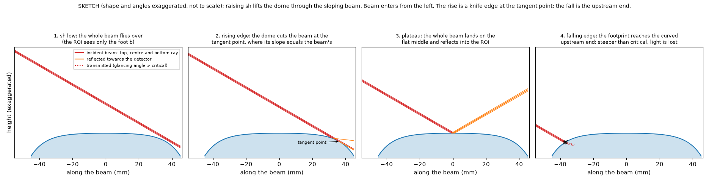
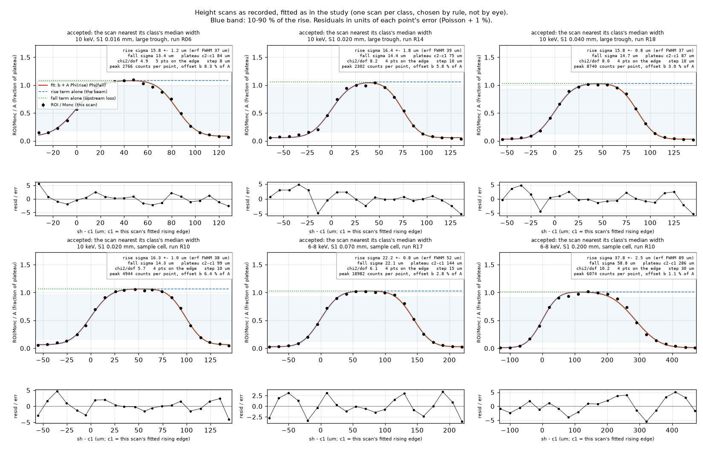
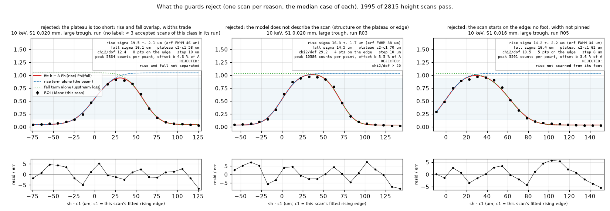
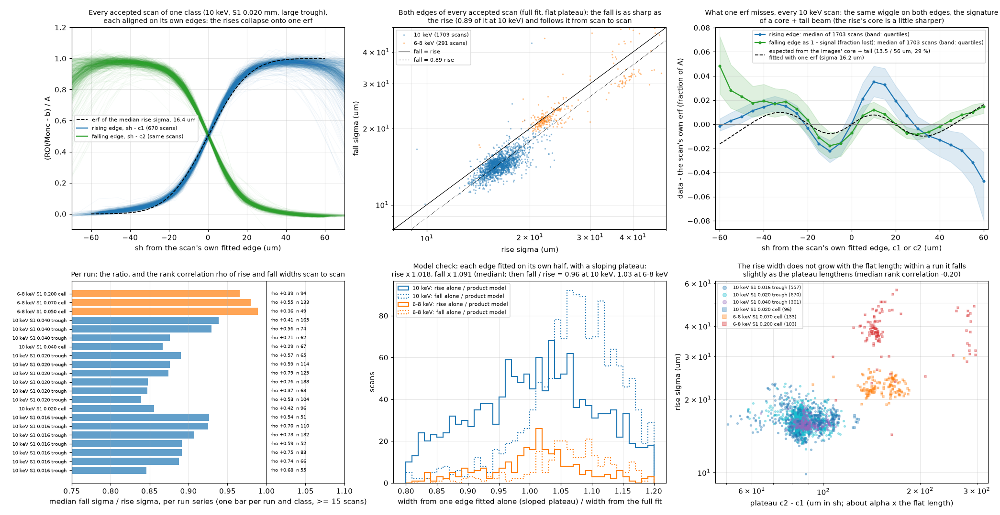

# What a height scan tells you, why, and how sure it is

Non-cloud data agent, 2026-11-24, for the owner's question: "some fits to the
height scan data that went into that busy scatter plot [`S1_rise_vs_gap.png`],
and some explanatory text … what we can get from a height scan, why we can,
and how sure of it we are (meniscus effects do what?)". It is a companion to
[`summary.md`](summary.md), which has the beam-size numbers and the dose rule.
**Measured** on the private spec files: 1995 accepted height scans, 21 runs.
**Derived** where marked. Nothing was checked at the beamline.

The owner ruled on 2026-11-24 that the ROI, monitor and `sh` columns of height
scans may be published (AGENTS.md). So the curves below are single real scans.
Each is named by its class and its anonymous run label (R01…, the same labels
as `roi_rise_by_run.csv`), never by file, scan number or date. `sh` is
measured from each scan's own fitted rising edge.

**Regenerate:** `scan_fits.py <out>` in `sample_data/private/sh_beam/`
(private, beside the other generators). It writes `S6`–`S9` and
`height_scan_fits.json` here.

## In short

| What a height scan gives | How | How sure |
|---|---|---|
| **The beam's vertical profile at the sample** (`σ_rise`, so the dose height √(2π)·σ_rise) | the rising edge is a knife edge | **About ±1 µm per scan, ±10 % as a size.** At 10 keV, σ_rise is 14–18 µm between runs and about 1 µm within a run. The ±10 % comes from the model: the beam is a core plus a tail, and one erf fits it imperfectly. |
| **The beam's shape** (core + tail) | what one erf leaves in the residuals | **Qualitative from the ROI alone.** The images measure the shape itself (`summary.md`). |
| The surface height (CEN), so the level drift | the scan's centre | The users' own purpose. Repeat scans scatter by 1.3–1.9 µm (the owner's level-drift analysis). |
| The length of the flat middle of the surface | the plateau: c2 − c1 ≈ α × the flat length | 79–102 µm in `sh` at 10 keV (10–90 %), about 50–60 mm along the beam. It is an estimate of a length, not a profile. |
| **Not given:** the horizontal width, convergence, or where the beam is in absolute terms | — | — |

## Why: what happens to the beam during a scan (`S9_geometry_sketch.png`)

The incident beam slopes down at α: 1.6–1.8 mrad at 10 keV at the
height-scan qz. In the large trough the liquid is a dome pinned on the rims:
a flat middle 50–60 mm long and curved ends. Raising `sh` lifts the whole
dome through the beam.

1. **Low:** the beam passes over the dome. The ROI sees only a small offset
   b, the direct beam's halo, 1–8 % of A.
2. **The rising edge.** The dome first touches the beam at the **tangent
   point**, downstream of the centre, where the surface slopes down as steeply
   as the beam does. Rays below the tangent ray hit the surface and reflect;
   rays above it fly over.
   - Where the tangent point lies depends only on the dome's shape. It moves up
     exactly as much as `sh` does.
   - So the surface acts as a **blade at a fixed height**, and raising it by d
     cuts the beam d higher.
   - ROI/Monc against `sh` is then the beam's **cumulative vertical profile**:
     an erf if the beam is Gaussian.
   - This is why the size can be read from a scan that was never meant to
     measure it.
3. **The plateau.** The footprint (the beam's height / α, 9–25 mm long)
   lies on the flat middle and every ray reflects into the ROI. Its length in
   `sh` is about α times the flat length.
4. **The falling edge.** The footprint reaches the curved **upstream** end.
   - There the surface tilts toward the beam, so the local glancing angle grows.
   - The reflection first tilts out of the ROI.
   - Past the critical angle, the beam is transmitted into the liquid. The
     images show these photons are lost, not reflected elsewhere (the beam-fate
     table in the owner's analysis of the Pilatus images).
   - The lowest rays reach that end first, as on the rise. So the fall also
     sweeps through the beam from below, but at a cut set by the reflectivity
     and the ROI, not by geometry alone.

## The fits (`S6_height_scan_fits.png`)

**The model.** Each scan, ROI/Monc against `sh`, is fitted with

    b + A · Φ((sh − c1)/σ_rise) · Φ((c2 − sh)/σ_fall)

where Φ is the normal CDF. The weights are Poisson plus 1 %.

**Which scans are shown.** One accepted scan per class: the one nearest its
class's median width and median χ²/dof, chosen by that rule and not by eye.

**What the curves are.** The dashed blue curve is the rise term alone: the
beam. The dotted green curve is the fall term alone. Below each fit are its
residuals, in units of each point's error.

What the fits show:

- The edges are smooth and sampled by 4–5 points between 10 and 90 %. Steps
  are 8–10 µm at 10 keV, against an erf FWHM of 37–39 µm.
- **χ²/dof is 3–13 (10–90 % of accepted scans), not 1.** The residuals have
  a pattern, and it is the same in most scans:
  - points sit above the fit in the foot, 20–50 µm below c1;
  - they sit below it just under the edge;
  - they wobble on the plateau.
  - That is a single erf failing to describe a **core plus a tail**. It is not
    noise (see below).
- The fit's own error on σ_rise is 0.6–1.7 µm (median per run 1.0 µm). The
  scan-to-scan scatter of σ_rise within a run is 0.1–1.8 µm (median 1.0 µm,
  robust estimate). **So the stated per-scan error is about right**, even
  though χ²/dof is above 1.
- The 6–8 keV, 0.2 mm scan has a long plateau (286 µm in `sh`) that is not
  flat. Its σ_fall (59 µm) is pulled by that, while its rise is clean.

**What the guards reject (`S7_rejected_scans.png`).** One scan per main
reason, the median case of each. 820 of 2815 scans fail:

| Reason | Scans | What it looks like |
|---|---|---|
| Rise and fall overlap | 501 | The plateau is shorter than 3 σ_rise, so the two widths trade against each other. |
| χ²/dof > 20 | 384 | Structure the model lacks, usually on the plateau. |
| Not scanned from the foot | 127 | The scan starts on the edge. |
| Others | — | Under-sampled, edge outside the scan, short, saturated, no fit. |

A scan can fail for several reasons. The rejected scans' widths are not used
anywhere.

## How sure: four checks that do not lean on the geometry argument (`S8_rise_vs_fall.png`)

1. **The rises collapse onto one curve** (top left). All 670 accepted scans of
   one class (10 keV, S1 0.020 mm, large trough) lie on one erf of
   σ = 16.4 µm once each is aligned on its own edge. The falling edges of the
   same scans collapse just as well.
2. **The fall tracks the rise from scan to scan** (top middle, bottom left).
   - **Ratio.** In the full fit, σ_fall / σ_rise is 0.89 at 10 keV (10–90 %:
     0.81–0.96; run medians 0.84–0.94) and 0.98 at 6–8 keV.
   - **Correlation.** Within every one of the 21 run series, the two widths are
     positively rank-correlated, from scan to scan: ρ +0.29 to +0.79, median
     +0.57.
   - The fall happens at the other end of the trough, by a different mechanism
     (reflectivity and the ROI, not a tangent point). So if the rising edge's
     width came from the surface rather than the beam, the fall would not
     follow it. **Both edges see the same beam**, and the beam's own small
     changes from scan to scan move both.
3. **The 10 keV asymmetry is mostly the model** (bottom middle).
   - Fitting each edge on its own half, with a plateau allowed to slope, changes
     σ_rise by ×1.02 and σ_fall by ×1.09 (medians).
   - Fitted that way, σ_fall / σ_rise is 0.96 at 10 keV and 1.03 at 6–8 keV.
   - So the full model's flat plateau squeezes the fall more than the rise. The
     rise is the robust edge: its median moves by 2 %, but single scans move by
     0.84–1.21 (10–90 %) when half the data is dropped.
4. **What one erf misses is what the images predict** (top right).
   - **The wiggle.** On both edges, the median residual of the 10 keV scans
     against each scan's own erf has the same shape: +1 to +2 % of A in the
     foot, −2 % just below the edge, then +1 to +3 % just above it.
   - **The prediction.** The direct-beam profile from the Pilatus images is a
     core of 13.5 µm and a tail of 56 µm holding 29 % of the photons (medians,
     `summary.md`). Fitting one erf to that profile leaves the same wiggle (the
     dashed line), and gives σ = **16.2 µm**.
   - **The comparison.** That 16.2 µm is the measured σ_rise (15–17 µm at
     10 keV), from a witness that never uses the ROI.
   - The rise's wiggle is a little larger at the edge than the profile
     predicts: its core is a little sharper than the images' median.

**Does the rise depend on the flat length** (bottom right)?

- **Between classes, no.** At 10 keV the rise is 15–17 µm for plateaus of
  60–130 µm, in the trough and the sample cell alike.
- **Within a run, slightly.** It falls a little as the plateau lengthens: the
  median rank correlation is −0.20, from −0.69 to +0.06.
- **This is not explained.** One candidate is the fit trading the two edges in
  shorter scans. Another is that the beam and the surface change together
  (for example after a refill). The effect is about 1 µm, inside the run's
  scatter.

### The uncertainty, in one place

| Source | Size on σ_rise | Evidence |
|---|---|---|
| Counting and fit, per scan | 0.6–1.7 µm (median 1.0) | fit covariance, and within-run scatter, which agrees |
| Choice of model (product fit or each edge fitted alone) | +2 % median; ±15–20 % single scans | check 3 |
| A single erf for a core + tail beam | the number is an erf σ, not the core's σ (13.5) nor the rms | check 4; `summary.md` turns it into the dose height |
| Run to run (beam, focus, alignment) | 14–18 µm at 10 keV | `roi_rise_by_run.csv` |
| Knife-edge sharpness: beam convergence × the tangent point's distance from the centre | ≤ 1.5 µm in quadrature | derived (`summary.md` table) |
| Level drift during the 9–12 s the edge takes | ≤ 0.09 µm | derived (`summary.md`) |

**Net:** a run's median σ_rise is known to about ±0.3 µm statistically.
As the beam's size it is good to about **±10 %**, limited by how a single erf
summarises a core-plus-tail profile.

## What the meniscus does

The curved ends of the surface ("meniscus" here) do four things to a height
scan. None of them broadens the rising edge.

1. **The downstream end makes the knife.** Its curvature sets where the
   tangent point is, not how sharp the cut is.
   - **Sharpness.** A beam with angular spread θ is cut over θ × (the tangent
     point's distance from the centre, 30–45 mm): ≤ 1.5 µm in quadrature
     (derived).
   - **A small offset.** Rays that land just upstream of the tangent point,
     where the surface already slopes, reflect at less than 2α. A few percent
     of the beam lands between the direct beam and the ROI: 0–3 % measured in
     the images. This moves the rising edge's centre by a few µm, not its
     width.
   - **The evidence.** The rise does not change with the footprint (9 to 25 mm:
     S1 0.016 to 0.04 mm in `S1_rise_vs_gap.png`). It does not grow with the
     flat length (check 4 above). It is the same in the large trough and in
     the sample cell at 10 keV (16.7 and 16.6 µm at S1 0.02 mm), although
     their menisci differ.
2. **The flat middle sets the plateau, and the plateau limits the fit.** The
   plateau is about α × the flat length: 79–102 µm in `sh` at 10 keV and
   136–178 µm at 6–8 keV in the sample cell.
   - **Too short a plateau** (strong curvature, steep α, or a big beam): the two
     edges overlap. The guard rejects such scans (501 of them).
   - **A plateau that is not flat** (a slightly curved middle, or the reflected
     spot's centroid moving across the ROI) pulls the full fit. It narrows
     σ_fall by about 9 % and σ_rise by about 2 %.
3. **The upstream end makes the fall.** Light there is first tilted out of the
   ROI, then transmitted past the critical angle.
   - The fall is nearly as sharp as the rise, and follows it, so it is a second,
     less clean knife edge.
   - It is less clean because its position depends on α_c − α, the
     reflectivity near the critical angle and the ROI's acceptance. All of
     these change with energy and sample.
   - The study uses the rise. The fall is a cross-check.
4. **What is not settled.** The beam's upper tail at the sample might partly be
   light transmitted through the downstream meniscus and refracted out again,
   not beam. The liquid-metal half-cut at 30 keV has no tail, but it differs
   in energy too (`summary.md`). The fall's tail (check 4) argues for a
   beam tail: the fall sweeps through the beam from below at the other end of
   the trough, where no downstream meniscus is involved, and it shows the same
   wiggle.

**The sample cell's meniscus geometry is not known** (neither the owner's
analysis nor this one has it). At 10 keV its rising edges match the trough's.
At 6–8 keV its plateaus are longer (larger α at a lower energy) and the
widths are larger, but energy, gap and cell are confounded there.

## Numbers

`height_scan_fits.json`:

- `S6_scans`: the widths of the scans shown.
- `edges`: the rise and fall statistics above, with their 10th, 50th and 90th
  percentiles.
- `run_series`: per run and class, the fall/rise ratio and the rank
  correlations, labelled by class only.
- `erf_of_core_tail_sigma_um`: the 16.2 µm of check 4.
