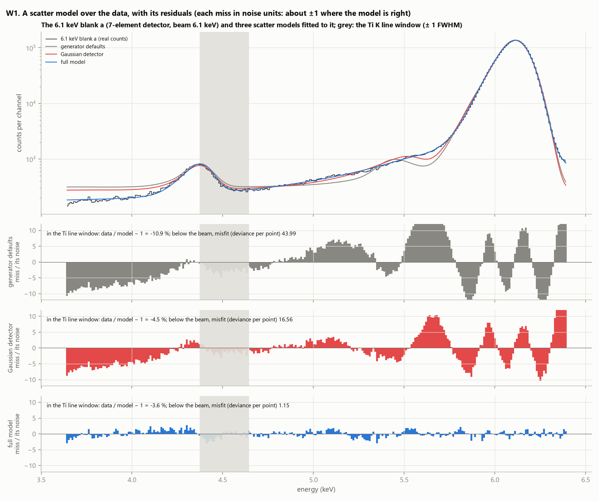
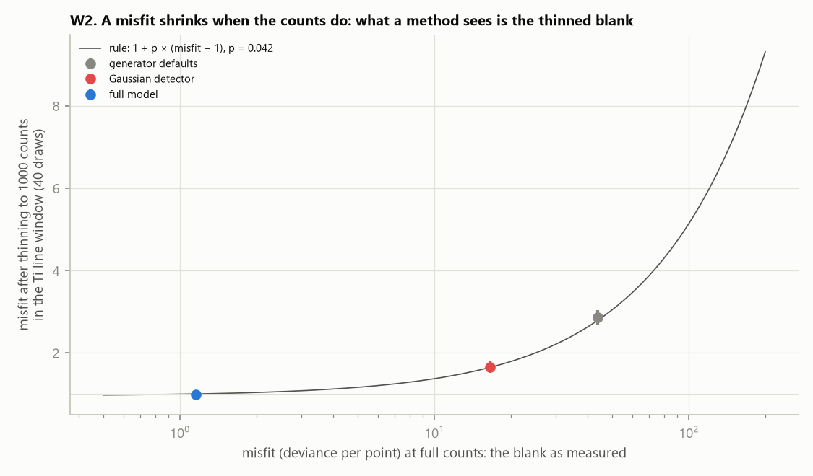
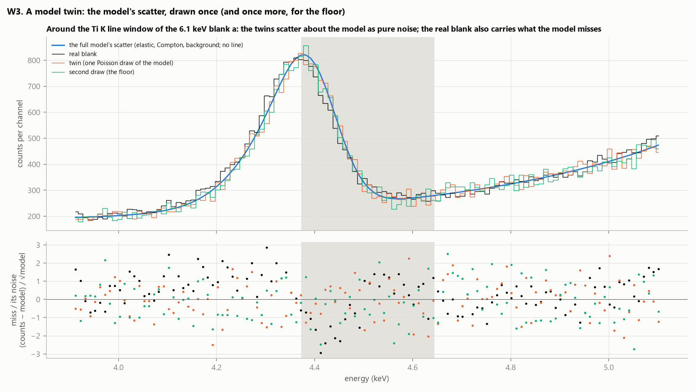
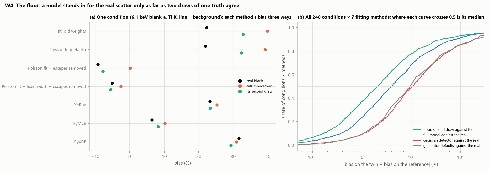
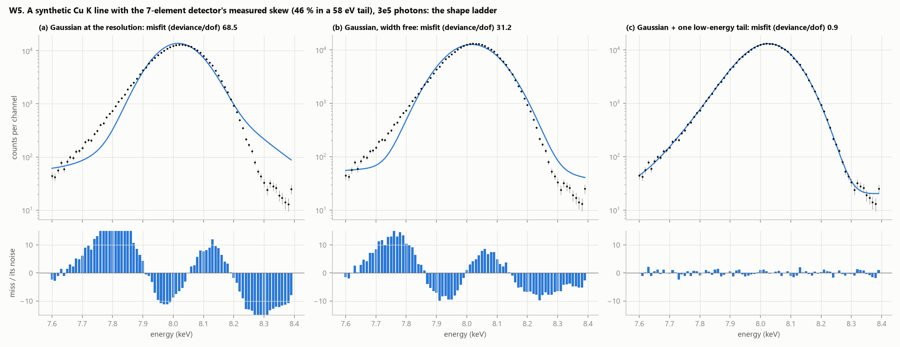

# Walkthrough: can a model replace the real scatter and the real lines? From a blank to the verdict (C68, C69)

2026-11-25, for the owner's standing order (AGENTS rule 13). This walkthrough follows the models
study (`README.md`) on one public blank, step by step, and explains each statistic as it comes up.
It assumes the shootout's walkthrough (`docs/studies/xrf_shootout/walkthrough.md`): how one test
spectrum is made, fitted and scored.

Every figure and number comes from:

    python tests/tools/xrf_walkthrough.py --part models        # about a minute

The numbers are in `walkthrough/numbers.json`. **Measured** on public data: the 6.1 keV blank a (the 7-element detector,
6.1 keV beam), the committed fits and twins (`scatter/`), and synthetic lines. The real lines'
spectra are private, so step 5 shows a synthetic line with their measured shape;
`lines/line_shapes.csv` holds the real fits' numbers.

## The question, in one paragraph

The shootout scores fitting methods on spectra with a known answer. Its first round (C65) used
**synthetic** scatter from a model; the second (C66) used the owner's **real** blanks. Real blanks
exist only at a few beam energies and for some detectors. So: **can a model of the scatter stand
in for a real blank?** The test: draw a fake blank from a model fitted to a real one (a **twin**),
run the whole shootout on the twin, and see whether every method gets the same answer as on the
real blank. And for the lines themselves: **is a Gaussian a good enough shape?**

## Step 1. Three scatter models over one blank, with their residuals (figure W1)

The 6.1 keV blank a: the 7-element detector, a 6.1 keV beam, the scatter peak at the right, and the Si escape of that
peak at 4.36 keV. Three models are fitted to all of it by Poisson likelihood:

- **generator defaults:** the synthetic shootout's detector, with only the amounts free;
- **Gaussian detector:** a detector with a purely Gaussian response (no tail or shelf), width free;
- **full model:** every part of the detector response free (low tails, shelf, high tail).

The lower panels show the **deviance residual** of each channel. It is the Poisson version of
(data − model) / √model: about ±1 where the model is right, with no pattern.
- **generator defaults:** misses by up to 10 σ in long runs. It is too high below 4.3 keV and wrong around
  the scatter peak.
- **Gaussian detector:** better, but still in runs of 5–10 σ below 4.3 keV. Far below the beam, the
  counts come from the detector's tail and shelf, which a Gaussian does not have.
- **full model:** within about ±3 σ everywhere, with small runs left.

**Two numbers per model** (the grey band is the Ti K line window, ±1 FWHM around 4.51 keV):

| Model | Data / model − 1 in the line window | Same, in σ: (N − M) / √M | Deviance per point below the beam |
|---|---|---|---|
| generator defaults | −10.9 % | −12.3 | 44.0 |
| Gaussian detector | −4.5 % | −4.9 | 16.6 |
| full model | **−3.6 %** | −3.9 | **1.15** |

- **The window miss** is what a line fit in that line window inherits: a model 4 % too high there puts
  "negative line" under any Ti line.
- **The deviance per point** is the χ²/dof of a Poisson fit. A perfect model gives about 1.
- On most blanks and line windows the full model is within 1 % (README, 1a); this Ti line window on 6.1 keV blank a is one
  of its poorer ones, which is why it is the example.

## Step 2. Does the misfit matter at the counts a method sees? (figure W2)

The blank holds 11 191 counts in the Ti line window, but a test spectrum holds 1000 there. The blank is
thinned by p = 0.042 (shootout walkthrough, step 2). Thinning keeps a misfit's size in percent but
makes the counting noise relatively larger, so the misfit, counted in error bars, shrinks. A model
can be clearly wrong on the full blank and hard to tell from right on a test spectrum. The rule:

> deviance per point at use ≈ 1 + p × (deviance per point at full counts − 1)

Checked by thinning the real blank 40 times and measuring:

| Model | At full counts | Predicted by the rule | Measured (40 thinnings) |
|---|---|---|---|
| generator defaults | 44.0 | 2.80 | 2.86 ± 0.19 |
| Gaussian detector | 16.6 | 1.65 | 1.66 ± 0.14 |
| full model | 1.15 | 1.006 | 1.00 ± 0.09 |
| a perfect model (drawn from the full model itself) | | 1 | 1.005 ± 0.09 |

**What it says:**
- **The rule works.** Each model's measured point sits on the curve.
- **At the shootout's counts the full model cannot be told from a perfect one** (1.00 against
  1.005, both ± 0.09).
- **The generator's and the Gaussian's misfits still show**: 2.9 and 1.7, against 1.0.

A misfit that is invisible in the χ² can still bias a line, though. Step 4 measures that directly.

## Step 3. A model twin, and a second draw of it (figure W3)

**The twin.** The full model's fitted **scatter** (elastic, Compton, background), with any fitted
trace lines left out, drawn once as Poisson counts on the blank's channels. That makes a fake blank
whose truth is the model exactly. **The second draw** is the same model drawn again with another
seed.

The lower panel shows (counts − model) / √model for all three. Below the beam:

| Spectrum | χ²/dof against the scatter model | Line window / model − 1 |
|---|---|---|
| real blank | 1.17 | −2.4 % |
| twin | 0.99 | −0.7 % |
| second draw | 1.08 | −1.8 % |

- **The twins scatter about the model as pure noise** (χ²/dof about 1 ± 0.09).
- **The real blank also carries what the model misses:** χ²/dof 1.17, a small excess. Inside the
  line window its misses run low (black points at 4.40–4.45 keV).
- **The twin and the second draw differ by 1.1 % in the line window.** That is pure noise, and it is the
  scale of the floor in step 4.

## Step 4. The floor: how far apart do two draws of one truth land? (figure W4)

Each twin goes through the whole shootout of C66: 240 conditions, 50 series of 10, 8 methods. That
is exactly what the real blanks went through. For each condition and method we then compare biases.

**(a) One condition:** Ti K on 6.1 keV blank a, the line as strong as the background:

| Method | Real blank | Twin | Second draw |
|---|---|---|---|
| Poisson fit | +21.9 % | +39.3 % | +32.4 % |
| Poisson fit + escapes removed | −9.2 % | +0.2 % | −7.8 % |
| Poisson fit + fixed width + escapes removed | −5.1 % | −2.5 % | −5.5 % |
| XeRay | +23.2 % | +25.3 % | +23.3 % |
| PyMca | +6.5 % | +10.2 % | +8.3 % |
| PyXRF | +31.6 % | +30.9 % | +29.3 % |

Even **two draws of the same model** differ by up to 8 points (*Poisson fit + escapes removed*: +0.2 against −7.8 %). The
reason: every test spectrum is a thinning of **one** blank (p ≈ 0.04), so all 500 share that
blank's own random bumps. A method that reacts to a bump under the line carries it into its bias.
So a model cannot be asked to match the real blank better than one of its own draws matches
another.

**(b) All conditions:** |bias on the twin − bias on the reference|, sorted, for every condition and
the 7 fitting methods (window sums left out). Each curve rises from 0 to 1; where it crosses 0.5
is its median.

| Twins | Against | Median | 90th percentile |
|---|---|---|---|
| **full model, second draw** | **its first draw: the floor** | **2.1 %** | 41 % |
| full model | the real blanks | 4.0 % | 79 % |
| generator defaults | the real blanks | 9.3 % | 194 % |
| Gaussian detector | the real blanks | 10.5 % | 185 % |

**Statistics, in plain words:**

| Statistic | In words |
|---|---|
| the floor | how far apart two runs land when the truth is identical: the test's own noise |
| ratio to the floor | 1 = as good as a perfect model can be; the full model is 1.9 overall, the others 4.4–5 |
| 90th percentile | 9 in 10 comparisons are closer than this; the big ones are mostly the weak lines (the floor's median is 17 % at ratio 0.1), where a few photons of bias are a large percentage |
| deviance residual | a channel's miss in Poisson σ: about ±1 when the model is right |
| Misfit (deviance per degree of freedom) | the sum of their squares per degree of freedom: about 1 when right |

By line (README 1b), the full model is within 1.3–3.7 × the floor for Cr, Cu, Ni and Zn. For Ti K
and La L under 6.1 keV, this example's region, it is 2.2–2.8 × the floor (8–9 % against 3–4 %).

## Step 5. Is a Gaussian enough for a line? (figure W5)

On the 7-element detector, the real lines carry a median 46 % of their photons in a short low-energy skew with a
58 eV decay (`lines/line_shapes.csv`; README 2b). Their spectra are private, so W5 shows a
**synthetic** Cu K line with exactly that shape (3·10⁵ photons), fitted the three ways the real
lines were:

| Fit | Misfit (deviance per degree of freedom) | What it found |
|---|---|---|
| (a) Gaussian at the detector's resolution | 68.5 | runs of ±10 σ: too narrow, misses the low side |
| (b) Gaussian, width free | 31.2 | widens to 1.15 × the resolution and still misses both sides |
| (c) Gaussian + one low-energy tail | **0.91** | tail 45.2 % over 58.9 eV (truth 45.8 % over 58 eV) |

This is the same ladder as on the 7-element detector's real lines: misfit 24–104 for a Gaussian, 2.9–8.7 with
the tail. Real lines also have other small features, so their best fit stays above 1 (reasoned). **The
residuals tell you the shape is wrong before any number does:** a Gaussian leaves the
"high–low–high–low" wave of panels (a) and (b).

**Does it matter for the methods?** Each method is calibrated on a clean, noise-free twin of the
line with the same shape. A method that just misses part of the line has that part calibrated out.
So the question is what is left over real scatter. To see it without noise, each method was run on
the noise-free spectrum itself (the thinned blank's mean plus the line's, line 3 × background):

| Line, blank | Poisson fit + escapes removed, elastic-shaped → real-shaped | Poisson fit + fixed width + escapes removed, elastic-shaped → real-shaped |
|---|---|---|
| Ni K, 9.2 keV blank a | +0.2 % → +0.4 % | +1.1 % → **−4.9 %** |
| Cu K, 9.2 keV blank a | −0.9 % → −1.3 % | +1.3 % → **−5.6 %** |
| Cr K, 6.1 keV blank a | +1.4 % → −2.4 % | +1.3 % → **−7.2 %** |
| Ti K, 6.1 keV blank a | −3.2 % → −3.3 % | −1.7 % → **−6.2 %** |

- **With the width free (*Poisson fit + escapes removed*), the shape changes the answer by at most 4 points.**
- **With the width fixed, it costs 5–7 %, with no noise at all.** A Gaussian of fixed width
  cannot follow the skew, so the quadratic background under it bends to take up the rest. On the
  clean calibration twin the background is flat and small; over real scatter it is not. So the
  calibration does not cancel this (the mechanism is reasoned; its size is measured).
- The shootout with real-shaped lines found the same: *Poisson fit + fixed width + escapes removed* −6 % on the 7-element detector (README 2c).

## The judgment, and how sure it is

- **High confidence** that the generator's defaults and a Gaussian detector are not substitutes for
  real scatter. They move a method's bias 4.4–5 × further than the floor, over 1300 comparisons.
- **Medium confidence** that the full model is a fair substitute for the K lines tested at 9.2 and
  10 keV (Cr, Cu, Ni, Zn: 1.3–3.7 × the floor). This rests on 10 blanks and one draw per twin; the
  floor itself is measured once.
- **High confidence** that it is not, for Ti K and La L under a 6.1 keV beam. The line window misfit is
  visible (−3.6 %, 3.9 σ), and the twins make *Poisson fit + fixed width + escapes removed* look 4–5 × better there than the real blanks.
- **High confidence** that the 7-element detector's lines need the skew in synthetic data. On the real lines a
  Gaussian leaves a misfit of 24–104, against 2.9–8.7 with the tail. With the skew, the fixed width
  loses 5–7 %.
- **What would settle more:** a second draw for the other two models, blanks at more energies, and
  real lines at the shootout's low counts (the real probes all had 5·10⁵ counts or more).
