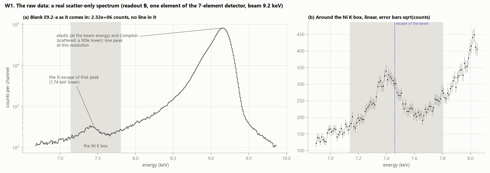
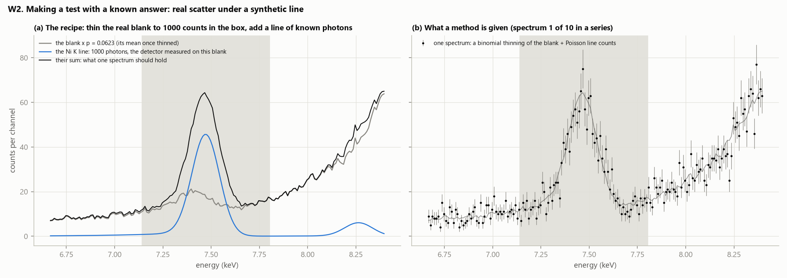
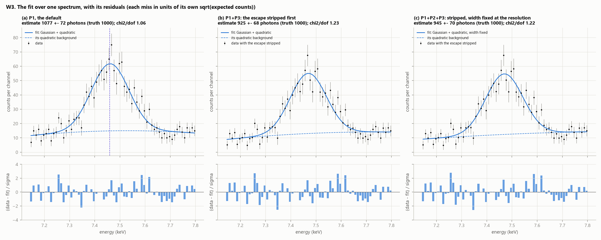
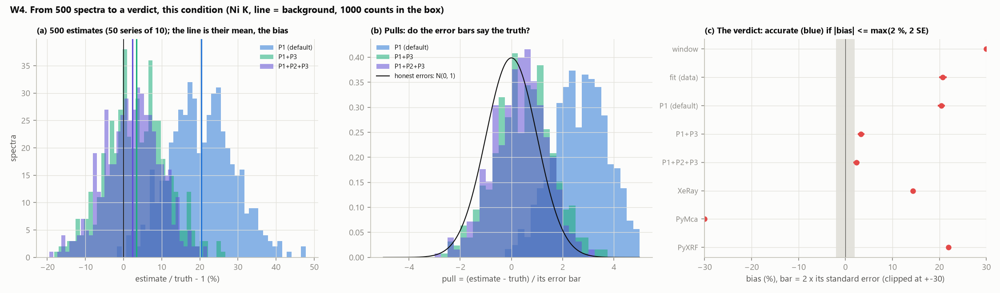
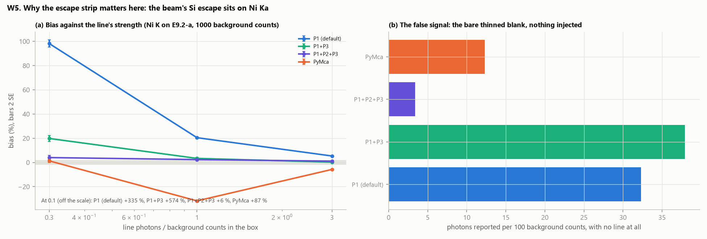

# Walkthrough: how a fluorescence method is scored, from a raw spectrum to the verdict (C65–C67)

2026-11-25, for the owner's standing order (AGENTS rule 13): "I always need to see the entire chain
of data processing, ending with the statistics and judgment." This walkthrough follows one test of
the XRF shootout from start to finish. It starts with a real detector spectrum and ends with the
verdict "accurate or not" and how far to trust it. The study's results are in `summary.md`; the
verdicts for every method are in `QUESTIONS.md`.

Every figure and number comes from:

    python tests/tools/xrf_walkthrough.py --part shootout        # about a minute

The numbers are in `walkthrough/numbers.json`. **Measured** throughout, on public data: blank E9.2-a
(`tests/reference/mca_scatter/`) and the committed blank shootout (`run_blanks/`, C66). The draws
are that run's own (the same seeds), so the bias found here equals the committed one; the tool
checks this.

## The question, in one paragraph

An X-ray fluorescence (XRF) spectrum counts photons by energy. An element in the sample gives
**lines** at its own energies; the beam, scattered by the water and the cell, gives a big
**scatter** peak at the beam energy with a long low-energy side. A method's job is to say how many
photons a line holds, separating them from the scatter under it. To score a method we need spectra
where the answer is known. So we take a **real** spectrum with no line in it (a "blank": all
scatter), add a **synthetic** line of a known number of photons, and ask each method how many it
sees. The difference is its error.

## Step 1. The raw data: a real scatter-only spectrum (figure W1)

- **(a) Blank E9.2-a, as the detector recorded it.** Readout B (one element of the 7-element
  detector), a 9.2 keV beam on water, 2.32 million counts, and no sample line in this range.
  - The x axis is the photon energy, from the channel number through the file's calibration. The
    y axis is the counts per channel (10 eV wide), on a log scale.
  - **The big peak** at the beam energy is the scattered beam. Elastic (Rayleigh) scattering
    keeps the energy; Compton scattering loses a little. At this detector's resolution the two
    overlap into one peak.
  - **The bump near 7.46 keV** is that peak's **Si escape**. A photon that hits the silicon
    detector sometimes knocks out a silicon Kα photon (1.74 keV) that escapes. It is recorded
    1.74 keV too low.
- **(b) The Ni K box, linear.** The **box** is where the methods look for the line: the Ni Kα
  energy (7.47 keV) ± 2 detector widths (FWHM 0.167 keV), 7.14–7.81 keV. It holds 16 059 counts.
  - Each error bar is √counts. Photon counting is Poisson: if you expect N, you get N ± √N.
  - **The escape bump sits right on Ni Kα.** That is why this example was chosen: this is where the
    real scatter caught out methods that the synthetic scatter had not.

## Step 2. Making one test spectrum with a known answer (figure W2)

**(a) The recipe.**
1. **Thin the blank.** Keep each of its counts with probability p = 0.062 (a binomial draw), so that
   the box holds 1000 counts on average. A thinned Poisson spectrum is again a Poisson spectrum,
   with p times the mean, so each thinning is a fresh, real-shaped spectrum at the counts we choose.
2. **Add the line.** A Ni K family of 1000 photons (Kα and Kβ, xraylib's ratios), drawn with the
   detector response measured on this blank's own elastic peak (width, tail, escape). Its Poisson
   counts are added.

The line is therefore as strong as the background under it ("ratio 1"). Of its 1000 photons, 847 are
expected inside the box; the rest are Kβ (8.26 keV) and the tails.

**(b) What a method is given:** the counts, the energy calibration, the beam energy, the detector's
resolution and the element. In this spectrum the box holds 1810 counts (1847 expected). The method
does not know which counts are line and which are scatter.

## Step 3. The fit over one spectrum, with its residuals (figure W3)

**The reader's fit.** In the box: one Gaussian (the line) on a quadratic (the scatter), fitted by
**Poisson likelihood** (P1, the default). The likelihood asks how probable these exact counts are if
the model is the truth; the fit moves the Gaussian's height, centre and width and the quadratic's
three numbers to make it as probable as possible. The line's photons are the Gaussian's area,
divided by **k**, the fraction of a line's photons this fit finds on a clean, noise-free copy of
the same line (k = 0.818 here, mostly because the box holds the Kα lines only).

Three variants, the same spectrum:

| Method | What it does | Estimate (truth 1000) | Pull | χ²/dof |
|---|---|---|---|---|
| (a) **P1** | as above | 1077 ± 72 | +1.08 | 65.8 / 62 = 1.06 |
| (b) **P1+P3** | first subtracts the Si escape of everything above (P3, "strip") | 925 ± 68 | −1.09 | 76.2 / 62 = 1.23 |
| (c) **P1+P2+P3** | also fixes the Gaussian's width at the detector's resolution (P2) | 945 ± 70 | −0.79 | 75.5 / 62 = 1.22 |

**Reading the residuals.** The lower panels show each channel's miss, (data − fit) / √fit: the
distance in error bars. If the model is right, the misses are about ±1, with no pattern.
- All three look like noise here: no run of same-sign misses, and none beyond 3.
- **χ²** is the sum of the squared misses. With 66 channels and 4 fitted numbers there are 62
  degrees of freedom (dof). A right model gives χ² ≈ dof, so χ²/dof ≈ 1, give or take
  √(2/62) = 0.18.
  - P1's 1.06 is perfectly normal. Noise alone would give a χ² this large 35 % of the time
    (p = 0.35).
  - The stripped fits' 1.22–1.23 is large but not alarming: p = 0.11–0.12.
- **The pull** is (estimate − truth) / error bar: how many error bars the answer is off. ±1 is
  normal.

**The lesson of this one spectrum: it cannot tell the methods apart.** All three answers are within
about one error bar of the truth, and every fit looks good. Step 4 shows that P1 is in fact 20 %
too high on average here. One spectrum's noise (±7 %) hides that, and **a good χ² does not mean a
right answer**: the escape bump is smooth, so the Gaussian swallows it and the fit still looks
perfect.

## Step 4. From 500 spectra to a bias, an error and a verdict (figure W4)

Each condition is run **50 times as a series of 10 spectra** (a series because the reader fits a
series together: the centre and width from their sum, then each spectrum's height). That is 500
estimates, each drawn as in step 2.

**(a) The estimates.** Each is (estimate / truth − 1). Their mean is the **bias**, the method's
systematic error; their spread is its noise.

| Method | Bias | Its standard error | Spread (SD) of one spectrum | Pull mean | Pull SD |
|---|---|---|---|---|---|
| P1 | **+20.4 %** | 0.38 % | 8.5 % | +2.72 | 1.08 |
| P1+P3 | +3.3 % | 0.35 % | 7.9 % | +0.45 | 1.11 |
| P1+P2+P3 | **+2.4 %** | 0.32 % | 7.2 % | +0.33 | 1.03 |

**(b) The pulls.** If the error bars are honest, the pulls follow the bell curve N(0, 1): mean 0 and
SD 1.
- **Pull SD** says whether the error bars are the right size: 1.03–1.11 here, so they are.
- **Pull mean** says whether the answers are centred on the truth. P1's +2.72 means its answers
  are 2.7 error bars too high on average. The error bars are honest about the noise but blind to
  the bias.

**(c) The verdict.** The shootout's rule:

> **accurate** if |bias| ≤ max(2 %, 2 × its standard error).

- **2 %** is the accuracy a user needs.
- **2 standard errors** allows for the test's own finite size. With 500 spectra the bias is known
  to ±0.3–0.4 %, so here the 2 % term decides.

Here **no method is accurate**, so every dot is red. P1+P2+P3 misses by 2.4 ± 0.3 %. Others in the
same condition: XeRay +14 %, PyXRF +22 %, PyMca −32 %, and the plain window sum +118 % (it counts
all the scatter in the box).

**Statistics, in plain words:**

| Statistic | Value here | In words |
|---|---|---|
| bias | P1 +20.4 % | how wrong the method is on average, with the noise averaged away |
| standard error of the bias | 0.38 % | SD / √500: how well 500 tries pin the bias down |
| SD | 8.5 % | how much one spectrum's answer jumps around the method's own average |
| pull | (estimate − truth) / σ | the miss counted in the method's own error bars |
| pull SD | 1.08 | 1 = the error bars are the right size; 2 = they are half what they should be |
| pull mean | +2.72 | 0 = centred on the truth; here the bias in units of error bars |
| χ²/dof | 1.06 | one fit's misfit; about 1 ± 0.18 for 62 dof when the model is right |
| p-value | 0.35 | how often noise alone would fit this badly or worse; below 0.05 is called a misfit |
| "accurate" | no | \|bias\| ≤ max(2 %, 2 SE): within the needed 2 %, beyond what the test can resolve |

## Step 5. The same test at every line strength, and with no line at all (figure W5)

**(a) The line's strength.** The line is 0.1, 0.3, 1 or 3 times the background in its box:

| Method | 0.1 | 0.3 | 1 | 3 |
|---|---|---|---|---|
| P1 | +335 % | +98 % | +20 % | +5.3 % |
| P1+P3 | +574 % | +20 % | +3.3 % | +0.2 % |
| P1+P2+P3 | +5.9 % | +4.0 % | +2.4 % | +1.1 % |
| PyMca | +87 % | +1.3 % | −32 % | −5.8 % |

**(b) The false signal:** the same methods on the thinned blank alone, with nothing injected. The
answer should be 0. In photons per 100 background counts:

| Method | Reports |
|---|---|
| P1 | 32 |
| P1+P3 | 38 |
| P1+P2+P3 | 3.4 |
| PyMca | 12 |

**What it says:**
- **P1 reads the escape bump as nickel**, about 32 photons per 100 background counts. That error
  is fixed in size, so it matters most for a weak line: +335 % at 0.1, +5 % at 3.
- **The strip alone (P1+P3) is not enough.** With nothing in the box a free-width Gaussian wanders:
  on the four 9.2 keV blanks P1+P3's false signal runs from −64 to +127 per 100. Fixing the width
  (P2) holds it in place: 3–4 per 100 on every blank. At ratio 0.1 Ni is then within 6 % on three of
  the four blanks, and −15.5 % on the fourth (E9.2-d).
- **This is what the real blanks showed and the synthetic spectra had not** (C66, `summary.md`
  §10): the escape peak of the scatter fools a fit that ignores it.

## Step 6. Over all 192 conditions: the scoreboard (C66), and the real lines (C67)

Each condition (10 blanks; Zn, Cu, Ni, Cr, Ti K and La L; 1000 or 3000 background counts; four
strengths) gets one verdict per method, as in step 4. Over the 192:

| Method | Accurate (C66, `summary.md` §10) |
|---|---|
| P1+P3 | 49 |
| P1+P2+P3 | 47 |
| PyMca, the best fixed setting | 20 |
| PyMca, its setting picked per condition using the truth | 56 |
| PyXRF | 15 |
| XeRay | 6 |

**On the real burn series (C67)** there is no injected truth, so the answer comes from the data
themselves. `tests/tools/xrf_real_series.py` makes resampled twins: Poisson draws from a series' own
sum, so the line and scatter are real and the answer is known. Only summary values are public, not
spectra or frame-by-frame curves (owner, 2026-11-25). At 27–58 line counts per spectrum, P1+P2+P3 is
the least biased (−2 to −7.5 %, against −6 to −25 % for P1), and its pull SD is 0.95–1.11 in every
series (`summary.md` §11).

## The judgment, and how sure it is

- **High confidence** that a box fit without the escape strip is wrong wherever the scatter's
  escape falls on the line (Ni under 9.2 keV; Ti and La under 6.1 keV). Measured on four
  independent blanks, at every strength, with 500 spectra each.
- **High confidence** that the reader's error bars are honest (pull SD 1.03–1.11). That alone does
  not make an answer right: a pull mean far from 0 is a bias the error bars cannot show.
- **Low confidence** in the order of P1+P3 and P1+P2+P3 (49 against 47 conditions). Another draw of
  the blanks could swap them. On two independent draws of the full model's twins of the same
  blanks, P1+P3 was accurate in 78 and in 64 conditions (`docs/studies/xrf_models/`, the floor).
- **What would settle more:** blanks at more beam energies and from more detector elements. The
  models study (`docs/studies/xrf_models/`) measured how much the test depends on which real blank
  is used.
